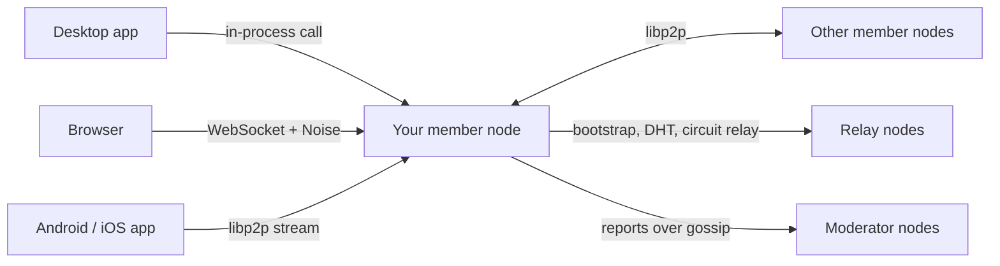
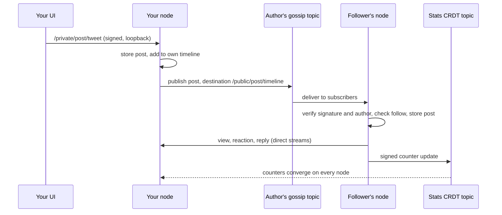

# Architecture

Warpnet is a peer-to-peer social network with no server tier. This page is the map: which kinds of nodes exist, how the apps reach your node, where your identity comes from, how networks are kept apart, and what happens to a post after you publish it. Each section links to a page with the details. It is written for curious users first and for developers second.

## No server tier

Every user runs a **member node**. The node keeps its owner's data in an embedded database on the owner's machine and talks to other nodes directly over [libp2p](https://libp2p.io). There is no instance, no central database and no administrator, so there is nothing in the middle to seize or switch off.

Most design decisions follow from that one choice:

| Without a server... | ...Warpnet does this instead |
|---|---|
| no central database | each node stores its own data locally ([Storage](storage.md)) |
| no trusted endpoint | every request is signed by the sender's key and verified by the receiver ([Security](security.md)) |
| no directory of users | nodes find each other through a DHT, gossip and the local network ([Discovery](discovery.md)) |
| no moderation team | independent moderator nodes judge reports and vote ([Moderation](moderation.md)) |
| no central counter | post statistics are CRDT counters that converge on every node ([Synchronization](synchronization.md)) |
| no UI host | the same UI reaches the node in-process, over a WebSocket, or from a phone over libp2p ([Clients](#clients)) |

The desktop program is a single executable. The web UI is compiled into it ([`embedded.go`](https://github.com/Warp-net/warpnet/blob/main/embedded.go) embeds `frontend/dist`), so there is nothing else to download or host.

## Node roles

Warpnet defines exactly three node roles. Each role reports its type in the node information it serves on `/public/get/info/0.0.0` ([`core/warpnet/warpnet.go`](https://github.com/Warp-net/warpnet/blob/main/core/warpnet/warpnet.go)).

| Role | Entry point | What it does | Stores |
|---|---|---|---|
| **member** | [`cmd/node/member`](https://github.com/Warp-net/warpnet/tree/main/cmd/node/member) | The user's node: holds the account, serves the UI and paired phones, publishes and receives posts. | Encrypted local database |
| **relay** | [`cmd/node/relay`](https://github.com/Warp-net/warpnet/tree/main/cmd/node/relay) | Entry point to the network: DHT bootstrap peer and circuit relay for nodes behind NAT. | Nothing on disk |
| **moderator** | [`cmd/node/moderator`](https://github.com/Warp-net/warpnet/tree/main/cmd/node/moderator) | Runs a local LLM (Llama Guard 3) and votes on reported content with other moderators. | Nothing on disk; it only reads its model file |

Some names you may meet elsewhere:

- **Bootstrap node** is the old name of the relay role. For compatibility a relay still sends `owner_id: "bootstrap"` in its node information, and nodes recognise a relay by that marker as well as by `type: "relay"`.
- **Remote** and **echo** are build flavours of the member role, not separate roles: a headless member that serves the UI to a browser, and a test bot. See [Member node architecture](member-node-architecture.md).
- There is no "business node" role in the code.
- The **bridge gateway** that connects Warpnet to Mastodon and the Fediverse, Threads and Nostr lives in its own repository and joins the network as an ordinary libp2p peer. See [Bridges](bridge.md).

All three roles are built on the same core ([`core/node`](https://github.com/Warp-net/warpnet/tree/main/core/node)): the same transport stack, connection limits, hole punching and relay service. They differ in which routes they register and what they keep.

## Clients

There is one canonical handler per route on the node, and every client reaches that same handler. The clients only differ in how a request travels to the member node.

| Client | Where it runs | How it reaches the member node | Protection on that hop |
|---|---|---|---|
| Desktop app | inside the member node process (Wails window) | in-process call, then a loopback stream | none needed: it is one program |
| Browser dashboard | any browser | HTTP for the page, WebSocket `/ws` for calls, to a **remote** member node (default port 4999) | Noise XX inside the WebSocket; the browser pins the node's key on first contact |
| Android app (warpdroid, a Tusky fork) | phone | libp2p stream from a small libp2p node inside the app, directly or through a relay | the same stack as node-to-node traffic: camouflage TLS, PSK, Noise |
| iOS app (warpfone, an Ice Cubes fork) | phone | as Android | as Android |

Both mobile apps are released companion apps: warpdroid is on [F-Droid](https://f-droid.org/packages/site.warpnet.warpdroid/) and warpfone is on the [App Store](https://apps.apple.com/app/warpnet/id6835178022). They do not hold your account. They pair with your member node and act on its behalf; see [Mobile apps](user-guide/mobile.md).

How the request reaches the handler:

- **Desktop and browser.** The member node signs the UI's request with the owner's key and hands it to its own handler through an in-process loopback stream (`SelfStream`). The request passes the same middleware a remote peer's request would (signature check, rate limit, de-duplication). Login, logout and (on the desktop) self-update requests are handled before that point and never become streams ([`cmd/node/member/app.go`](https://github.com/Warp-net/warpnet/blob/main/cmd/node/member/app.go)).
- **Phones.** The app runs a dial-only libp2p host (it opens no listening sockets). You pair it by scanning a QR code shown by the desktop or browser UI. The QR code carries the node ID, its addresses, the bootstrap list, the network name and key, and a pairing token. The phone sends the token on `/private/post/admin/pair/0.0.0`; the node checks it and records the phone's peer ID as an **alias**. From then on the node accepts private routes from that peer ([`core/middleware/auth.go`](https://github.com/Warp-net/warpnet/blob/main/core/middleware/auth.go)) and lists the alias in its node information.

The developer view of these transports is in [Clients](developer-guide/clients.md).

## Identity

Every node has an **Ed25519** key pair; no other key type is used. The public key is short enough to be embedded in the libp2p **peer ID** (node ID), so a receiver recovers the sender's public key from the peer ID alone and verifies signatures with it.

Example: `12D3KooWMKZFrp1BDKg9amtkv5zWnLhuUXN32nhqMvbtMdV2hz7j`

Where the key comes from depends on the role:

| Role | Key source | Consequence |
|---|---|---|
| member | derived from **username + password + network** with Argon2id ([`security/kdf.go`](https://github.com/Warp-net/warpnet/blob/main/security/kdf.go)) | no key file; the key exists only in memory after login |
| relay | derived from `--node.seed`; without it, from a string built from the network, database directory, IPv4 bind address and port ([`config/config.go`](https://github.com/Warp-net/warpnet/blob/main/config/config.go)) | stable peer ID across restarts |
| moderator | random at every start ([`cmd/node/moderator/main.go`](https://github.com/Warp-net/warpnet/blob/main/cmd/node/moderator/main.go)) | new peer ID after each restart |

What this means for a member node:

- The same username, password and network always give the same node ID, on any machine.
- The password is the seed of the identity. Changing it produces a different key and therefore a different node.
- The same credentials on testnet and on mainnet give two different node IDs, because the network name is part of the derivation.
- The database is encrypted with a second key derived from the same username and password ([`database/local-store/db.go`](https://github.com/Warp-net/warpnet/blob/main/database/local-store/db.go)). A wrong password simply fails to open it.

Your **user ID** is not the node ID. It is a ULID created at your first login and stored in your database ([`cmd/node/member/auth/auth.go`](https://github.com/Warp-net/warpnet/blob/main/cmd/node/member/auth/auth.go)); other nodes map your user ID to your node ID. Your credentials alone recreate the node ID, but not the user ID, your posts or your follows: those live in the data directory. To move an account to another machine, move the data directory. See [Backup and restore](user-guide/backup-and-restore.md).

Every request between nodes travels in a signed envelope. The signature covers the body, the timestamp and the destination route; the receiver checks it against the key in the sender's peer ID and rejects remote messages whose timestamp is more than five minutes off ([`core/middleware`](https://github.com/Warp-net/warpnet/tree/main/core/middleware)). Details: [Security](security.md).

## Networks

Warpnet runs separate networks that cannot see each other:

| Network | Name | Built-in relays |
|---|---|---|
| Mainnet | `warpnet` (`mainnet` is accepted as an alias) | three relays, ports 4001-4003 |
| Testnet | `testnet` | three relays, ports 4011, 4022, 4033 |
| Your own | any other name | none: pass `--node.bootstrap` |

A network is kept apart at several layers:

- **Network key (PSK).** Every connection is gated by a libp2p private-network key, `SHA-256(network name + major version)` ([`security/psk.go`](https://github.com/Warp-net/warpnet/blob/main/security/psk.go)). The key is public and is not a secret; it makes nodes of another network or another major version fail on the first bytes. A major release therefore also starts a new network.
- **DHT.** The Kademlia DHT runs under the protocol prefix `/<network>` and nodes announce themselves under the rendezvous namespace `warpnet/rendezvous/<network>` ([`core/dht/dht.go`](https://github.com/Warp-net/warpnet/blob/main/core/dht/dht.go)).
- **Data.** Each network has its own data directory, `~/.warpdata/<network>/` (on Windows `%LOCALAPPDATA%\warpdata\<network>\`).
- **Identity.** The member key includes the network name, as described above.

The desktop app starts on mainnet by default. If you did not choose a network and a testnet database already exists, it starts on testnet instead ([`cmd/node/member/main.go`](https://github.com/Warp-net/warpnet/blob/main/cmd/node/member/main.go)). See [Getting started](user-guide/index.md) for choosing a network.

## Core subsystems

A short map of the machinery. Each paragraph links to the page that covers it in depth.

**Wire protocol.** Every operation is a route such as `/private/post/tweet/0.0.0` or `/public/get/user/0.0.0`, carried over a libp2p stream as a signed JSON envelope. `private` routes act on the owner's own data and are served only to the node itself and its paired devices; `public` routes are what other peers may ask for. GossipSub topics carry broadcasts. See [Protocol](protocol.md) and the [route reference](developer-guide/api.md).

**Discovery.** A node learns about peers from four sources: the DHT, gossip announcements, the peers that contact it over streams, and mDNS on the local network (member nodes only). For each new peer it fetches the node information and, for member nodes, the user profile. Relays and publicly reachable peers are preferred when the connection manager has to drop connections. See [Discovery](discovery.md).

**Network and transport.** All roles and both mobile apps use one stack: TCP, a TLS layer that makes the connection look like ordinary HTTPS to deep packet inspection, the PSK, Noise XX encryption and yamux multiplexing. NAT traversal uses UPnP/NAT-PMP, AutoNAT v2, hole punching and, as a fallback, circuit relay v2 through relay nodes. See [Network](network.md).

**Synchronization.** There is no global state to agree on. The two things that converge across nodes are post statistics (views, reactions, replies, reposts, poll votes) and node ratings. Both are signed, Merkle-CRDT stores replicated over gossip. See [Synchronization](synchronization.md).

**Storage.** A member node keeps everything in an encrypted BadgerDB database behind a repository layer. Writes to peers that are offline are queued in an outbox and re-sent when the peer comes back. See [Storage](storage.md).

**Security.** Identity derivation, signed envelopes, freshness and replay checks, per-peer rate limits, the encrypted database and the encrypted browser channel. See [Security](security.md).

**Moderation.** Users report public posts and profiles. Reports go to moderator nodes over gossip; a few of them judge each report with a local model and vote, and the signed verdict hides the content on the nodes that receive it. Each user also has local blocks, mutes and keyword filters. Direct messages are never moderated. See [Moderation](moderation.md).

**Rating.** Nodes rate the peers they deal with from what they observe (bad signatures, flooding, failed dials and similar). Ratings are replicated and feed back into connection priority, the DHT, gossip scoring and rate limits. See [Rating](rating.md).

**Trust circle.** Each member node computes the set of users its owner trusts from the follow graph. It changes only how content is shown (for example, media from strangers is blurred), never whether it is carried. See [Trust circle](trust-circle.md).

**Bridges.** A separate gateway peer makes Warpnet users visible on the Fediverse and Nostr and brings Mastodon, Threads and Nostr accounts into Warpnet. The node seeds an entry account whose home node is the gateway, so bridged users resolve like any other remote user. See [Bridges](bridge.md).

## Lifecycle of a post

This is what the code does when you publish a post, verified against the handlers in [`core/handler`](https://github.com/Warp-net/warpnet/tree/main/core/handler).

1. **Create.** The UI sends the post to `/private/post/tweet/0.0.0`. The node validates it (text up to 2048 bytes, polls with 2-4 options) and rejects priced posts, which use the sponsored route ([`core/handler/tweet.go`](https://github.com/Warp-net/warpnet/blob/main/core/handler/tweet.go)). A reply is a post with a parent: it is stored in its thread and sent to the parent author's node instead of being broadcast to followers.
2. **Store.** The post is written to the local database and added to the owner's own home timeline.
3. **Propagate.** The node publishes the post on the GossipSub topic `user-update-<user ID>` with the destination `/public/post/timeline/0.0.0` ([`cmd/node/member/pubsub/member-pubsub.go`](https://github.com/Warp-net/warpnet/blob/main/cmd/node/member/pubsub/member-pubsub.go)). Images and video are not included, only their keys. Following someone subscribes your node to their topic, so only followers' nodes receive the post this way.
4. **Arrive in followers' timelines.** A follower's node feeds the gossip message through its own stream handler with the author's node as the sender ([`core/pubsub/gossip.go`](https://github.com/Warp-net/warpnet/blob/main/core/pubsub/gossip.go)). The usual middleware checks the author's signature and freshness, then the timeline handler checks that the sender is the author's node and that the owner follows the author, and stores the post in the home timeline ([`core/handler/timeline.go`](https://github.com/Warp-net/warpnet/blob/main/core/handler/timeline.go)). If the sender's rating does not allow media, the media keys are dropped. Media are fetched later, on demand, from the author's node and cached locally.
5. **Engage and count.** Views, reactions, replies, reposts and poll votes are sent from the actor's node to the author's node over direct streams. Each counter is a signed CRDT counter replicated on the gossip topic `/warpnet/stats/1.0.0`; only the actor's own node adds its action to the replicated counter, so an action is counted once however many nodes see it ([`core/crdt/stats/store.go`](https://github.com/Warp-net/warpnet/blob/main/core/crdt/stats/store.go)). Counters travel for 30 days after a post is created; older posts are counted from local data only.

What this means in practice:

- The home timeline is local. A follower whose node was offline when the post went out does not get it pushed later; the gossip message is not stored for them.
- Opening an author's profile asks the author's node for their posts and caches them locally, so missed posts still show up there while the author's node is online.
- Deleting a post publishes a delete on the same topic, and followers' nodes remove it from their timelines.

## See also

- [Member node architecture](member-node-architecture.md)
- [Relay node architecture](relay-node-architecture.md)
- [Protocol](protocol.md)
- [Network](network.md)
- [Security](security.md)
