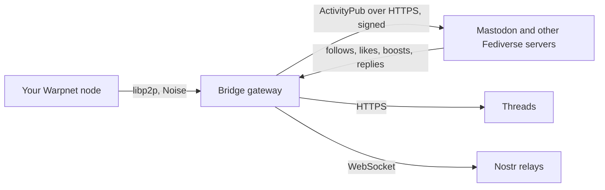

# Bridges

Warpnet can talk to the outside social web through a separate program, the **bridge gateway**. With it you can follow and interact with Mastodon (and other ActivityPub), Threads and Nostr accounts from Warpnet, and people on those networks can find, follow and interact with you. This page explains how the bridge works today, what crosses it in each direction, its limits, and the privacy cost. It is for users deciding whether to use bridged features and for developers who want to know where the code lives.

> **Note:** Earlier versions of these docs described a read-only bridge that imported Mastodon posts through a pseudo-node. That design is gone. The bridge is now two-way, and bridged accounts are fetched live through the gateway.
{: .note }

## How it works

The gateway lives in its own repository, [Warp-net/bridge-gateway](https://github.com/Warp-net/bridge-gateway). It is two things at once:

- **A Warpnet node.** It joins the Warpnet network (and optionally `testnet`) like any other peer, with its own peer ID, and answers Warpnet's public routes for accounts on other networks.
- **An ActivityPub server.** It serves every Warpnet user as an ActivityPub actor on its own public HTTPS host, so Mastodon and other Fediverse servers can look them up and follow them. The host comes from an embedded Tailscale Funnel node (a `*.ts.net` name).

The gateway stores no Warpnet content. Its only state on disk is its RSA signing key and its Tailscale node state. Fediverse followers of a Warpnet user are recorded on that user's own node, through the normal follow routes, and everything else is fetched on demand.

### Which gateway you use

Your node uses one gateway, identified by its peer ID. By default that is the project's gateway, `12D3KooWKSVXZAF8dE2Cv449x2jkb1mCFqs7b9CV59Dpzqnur2N3` ([`core/bridge/bridge.go`](https://github.com/Warp-net/warpnet/blob/main/core/bridge/bridge.go)). To use another one, enter its peer ID in **Settings → Bridge gateway** and restart the node. See [Running your own gateway](#running-your-own-gateway).

## Following accounts on other networks

### What a bridged account looks like

A bridged account is stored on your node like any other user, with three differences:

| Field | Warpnet user | Bridged account |
|---|---|---|
| User ID | A ULID, e.g. `01J...` | A handle, e.g. `name@mastodon.social` |
| Node ID | The user's own node | The gateway's peer ID |
| Network tag | `warpnet` (or `testnet`) | `mastodon`, `threads` or `nostr` |

The apps key their icons, badges and tabs off the network tag; Who to follow has a tab per network. Opening a bridged profile shows a warning that anything you do there leaves the peer-to-peer network and passes through the gateway.

Your node seeds one Mastodon entry account, `warpnet@mastodon.social`, and one Threads entry account, so that each network has a starting point for discovery. Who to follow asks the gateway for suggestions; by default the gateway draws Mastodon suggestions from `mastodon.social`.

### Reading

When you open a bridged profile or post, your node asks the gateway, and the gateway fetches it live from the account's own server: through the Mastodon REST API where the server offers one, otherwise through ActivityPub. If the account's server will not serve its posts, the gateway can read them from a mirror instance that federates with it (`mastodon.social` by default). Images of bridged accounts are also fetched through the gateway.

The desktop app merges the posts of the bridged accounts you follow into your Home timeline, refreshing them every 75 seconds and leaving out accounts you blocked or muted.

### Writing

What you do to bridged content is sent by your node to the gateway, which delivers it to the other network signed as your Fediverse actor:

| You do on Warpnet | The Fediverse receives |
|---|---|
| Follow / unfollow a Mastodon account | `Follow` / `Undo(Follow)` |
| Reply to a bridged post | `Create(Note)` in reply to it, mentioning the author |
| Delete that reply | `Delete` |
| React with the default heart | `Like` (a Mastodon favourite) |
| React with any other emoji | Nothing; Mastodon has only one kind of favourite |
| Repost | `Announce` (boost) |

The desktop app does not let you reply to Threads posts: Threads shows Fediverse replies only under posts whose authors opted in, nothing tells which posts those are, and a reply to any other post would be dropped silently. Direct messages with bridged accounts are not supported: the node refuses to open a chat with one.

## Being followed from the Fediverse

### Your Fediverse address

Every Warpnet user is reachable through the gateway as `@<user-id>@<gateway-host>`, where `<user-id>` is the user's Warpnet ID (a ULID). The gateway resolves any Warpnet user it can find through the public routes; there is no sign-up and no per-user switch.

A Mastodon user who looks you up sees an ActivityPub profile built live from your Warpnet profile: display name with a Warpnet badge, your bio prefixed with a note that the account lives on Warpnet, avatar, header image, a "Network" profile field, and your public posts.

### What goes out

- **Follows.** When someone on the Fediverse follows you, the gateway verifies the request's HTTP signature, accepts the follow on your behalf and records the follower on your node.
- **Posts.** As soon as you have at least one Fediverse follower, the gateway starts federating your posts: your new original top-level posts are delivered to your Fediverse followers as public notes, with images served through the gateway's media proxy from your node. Your node pushes new posts to the gateway as they are published, and the gateway also checks every 60 seconds. Older posts are not replayed, and reposts are not federated.
- **Your follows.** Your follows of Fediverse accounts are delivered as `Follow` activities; the gateway checks for changes every 30 seconds.
- **Profile.** When federation starts, including after a gateway restart, followers' servers are sent an `Update` so they refresh your name, bio and avatar. Later profile changes reach them when their servers fetch your profile again.
- **Sponsored posts** federate only as a placeholder image.

The gateway re-checks the follower graph every 5 minutes and stops federating your posts once no Fediverse follower is left.

### What comes in

| Someone on the Fediverse | You see on Warpnet |
|---|---|
| Likes your post | A heart reaction from their handle |
| Boosts your post | A repost |
| Replies to your post | A reply in the thread |
| Quotes your post | A quote repost |
| Undoes a follow, like or boost | The follow, reaction or repost is removed |
| Deletes a reply | Nothing; the gateway cannot delete on your node, so the reply stays |

Every inbound activity must carry a valid HTTP signature, and the signing actor must be the actor named in the activity.

## Threads and Nostr

The same gateway bridges two more networks:

- **Threads.** Threads accounts are read over ActivityPub, often through the mirror instance because Threads serves little of its own. Their follower and following lists are not available.
- **Nostr.** Nostr accounts appear under `npub1…` handles, read from public relays. In the other direction, the gateway publishes Warpnet users' activity to Nostr: their own posts, edits and deletions, their profile, their replies, quotes, reactions and reposts on Nostr notes, and their follow list. It also serves NIP-05 names of the form `<user-id>@<gateway-host>`. The default relays are damus, primal, nos.lol, purplepag.es and user.kindpag.es; a gateway operator can replace them.

Nostr publishing is on for every Warpnet user whose profile does not carry the `locked` flag ("approve followers manually"). The sign-up screen used to offer an opt-out; it was removed, and the desktop app currently has no switch for this.

## Bridge key

Nostr events must be signed by the author's own key, which the gateway does not have. Instead, your node derives a 32-byte **bridge key** from your identity with HKDF-SHA256 and sends it to the gateway with every message it sends there, and to no other peer ([`security/bridge-key.go`](https://github.com/Warp-net/warpnet/blob/main/security/bridge-key.go), [`core/stream/stream.go`](https://github.com/Warp-net/warpnet/blob/main/core/stream/stream.go)). The gateway turns it into a secp256k1 key, so each Warpnet user has their own Nostr public key (npub).

- The bridge key is one-way: it does not reveal your identity key or your password.
- It is stable. Each user gets the same npub on every gateway, and a gateway that has seen the key can sign Nostr events as you.
- The project's gateway keeps bridge keys in memory only, for up to an hour after your node last sent one. It can publish to Nostr for you only while it holds a fresh key.

Details of the derivation are in [Security](security.md#bridge-key).

## Privacy and trust

The bridge is useful, but it is the one place where Warpnet's "no middle" design does not hold:

- **Plain text at the gateway.** Your node talks to the gateway over Noise, but the gateway must read everything it translates. What you send to bridged accounts, and what the gateway serves about you, is in plain text on the gateway.
- **Stored by other servers.** Once your posts, replies, likes or follows reach Mastodon, Threads or Nostr relays, they are stored by servers you do not control, under their rules and their human moderators. Deleting something on Warpnet does not delete it there.
- **Your public posts are readable through the gateway.** Anyone on the Fediverse can look up any Warpnet user's profile and public posts through the gateway, whether or not that user has Fediverse followers.
- **The gateway speaks for you on the Fediverse.** It signs ActivityPub activities for every Warpnet user with one RSA key of its own. Fediverse servers trust the gateway's host, not your Warpnet key, so the gateway operator could act as you there. On Warpnet itself the gateway cannot sign as you.
- **Blocks are local.** Blocking a bridged account hides it in your apps. Nothing is sent to the other network, and the gateway can still accept a follow from that account.
- **Not covered by Warpnet moderation.** Bridged accounts are moderated by their own servers' administrators.

If this trade-off does not suit you, avoid bridged accounts. On the Fediverse side, as of this writing, there is no per-user switch to stay off the gateway; running your own gateway changes who holds this trust, not whether someone does.

## Running your own gateway

Anyone can run a gateway; its peer ID and public host come from state it creates on first start, so it never collides with the project's one. The full instructions are in the [bridge-gateway README](https://github.com/Warp-net/bridge-gateway#readme); in short:

1. In a Tailscale account, enable MagicDNS, HTTPS certificates and Funnel, and create a reusable auth key.
2. Start the gateway with `TS_AUTHKEY` and, optionally, `GATEWAY_FUNNEL_HOSTNAME` (Docker image built from `Dockerfile.bridge-gateway`, with a volume for `/data`).
3. Read its `*.ts.net` host and its peer ID from the logs.
4. Users who want it enter the peer ID in **Settings → Bridge gateway** and restart their node.

Back up the `/data` volume: it holds the RSA key and the Tailscale node. Losing it gives the gateway a new host and peer ID, which orphans its Fediverse followers. The gateway listens for Warpnet on TCP 4040 (`warpnet`) and 4041 (`testnet`).

The gateway protects itself with HTTP-signature checks on its inbox, an HTTPS-only guard against requests to private addresses, per-IP and global request budgets, and a token that gates its log and profiling endpoints. Your node in turn gives the gateway a larger rate-limit budget than ordinary peers ([Security](security.md#per-peer-stream-limits)).

## Limits

- Deleting a reply on the Fediverse does not remove it from Warpnet.
- Only the default heart reaction federates as a Mastodon favourite.
- Reposts and older posts are not federated; only new original top-level posts.
- No direct messages with bridged accounts.
- No replies to Threads posts from the desktop app, and no follower lists for Threads accounts.
- Bridged posts in your Home timeline are polled, so in the desktop app they can arrive up to about 75 seconds late.
- Everything bridged depends on the gateway being online.

## See also

- [Security](security.md): the bridge key and the gateway's rate-limit budget
- [Moderation](moderation.md): Warpnet moderation and what it does not cover
- [Network](network.md): transport encryption between your node and the gateway
- [Getting started](user-guide/index.md): using the apps
