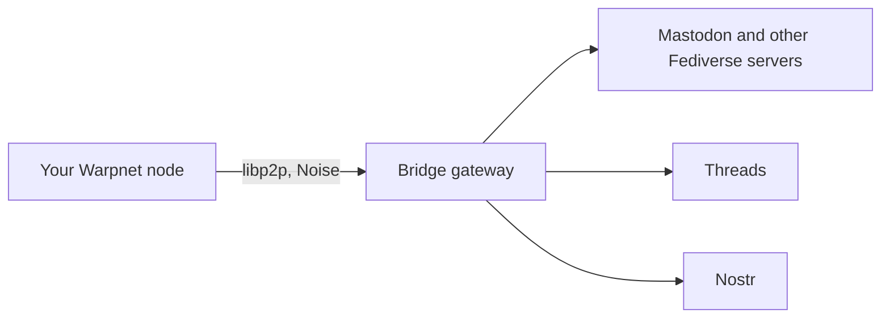

# Bridges

Warpnet can show and interact with accounts on Mastodon (and other Fediverse servers), Threads and Nostr through a **bridge gateway**: a separate program that joins Warpnet as a peer and translates between Warpnet and those networks. This page describes what your node does with the gateway, what it sends there, and what that means for your privacy. What the gateway does on the other networks is defined in its own repository, [Warp-net/bridge-gateway](https://github.com/Warp-net/bridge-gateway).

## How it works

Your node treats the gateway as the home node of every bridged account. A request about a bridged account, its profile, posts or images, goes to the gateway over the usual Warpnet transport (Noise-encrypted libp2p streams), and the gateway answers for the other network.

### Which gateway you use

Your node uses one gateway, identified by its peer ID. By default that is the project's gateway, `12D3KooWKSVXZAF8dE2Cv449x2jkb1mCFqs7b9CV59Dpzqnur2N3` ([`core/bridge/bridge.go`](https://github.com/Warp-net/warpnet/blob/main/core/bridge/bridge.go)). To use another one, enter its peer ID in **Settings → Bridge gateway**; an empty field means the default. The change takes effect when the node next starts.

## Bridged accounts on your node

A bridged account is stored on your node like any other user, with three differences:

| Field | Warpnet user | Bridged account |
|---|---|---|
| User ID | A ULID, e.g. `01J...` | A handle: `name@instance` for Mastodon and Threads, `npub1…@nostr.com` for Nostr |
| Node ID | The user's own node | The gateway's peer ID |
| Network tag | `warpnet` (or `testnet`) | `mastodon`, `threads` or `nostr` |

Bridged accounts reach your node in three ways:

- **Entry accounts.** At every start your node stores one Mastodon account, `warpnet@mastodon.social`, and one Threads account.
- **Who to follow.** Whenever the app loads the first page of suggestions, your node also asks the gateway for suggested accounts and stores them. Who to follow has a tab per network: Warpnet, Mastodon, Threads and Nostr.
- **Search.** A handle such as `@name@mastodon.social`, a profile link such as `https://mastodon.social/@name`, or a Nostr `npub1…` (also `nostr:npub1…`) is looked up through the gateway.

The desktop app and the browser dashboard pick icons, badges and tabs from the network tag. Opening a bridged profile shows a warning that it comes through the gateway.

### Reading

Profiles, posts and images of bridged accounts are fetched from the gateway when you open them. Your node does not subscribe to gossip for bridged accounts.

The Home timeline in the desktop app and the dashboard merges in the posts of the bridged accounts you follow, refreshing them every 75 seconds and leaving out accounts you blocked or muted.

### Interacting

Follows and unfollows, replies (with their edits and deletions), reactions and reposts on bridged accounts and posts go to the gateway, exactly as they would go to the node of a Warpnet author. What reaches the other network is up to the gateway.

The gateway can also deliver follows, replies, reactions and reposts from accounts on other networks to your node. Your node handles them like those from any Warpnet node: it fetches an unknown account from the gateway and checks that the action came from the account's home node, which for a bridged account is the gateway.

Not supported:

- **Direct messages.** The node refuses to open a chat with a bridged account, and the desktop app and the dashboard leave bridged accounts out of the new-message list.
- **Replies to Threads posts.** The desktop app and the dashboard do not offer them.

## Bridge key

Every message your node sends to the gateway it uses carries a **bridge key**: 32 bytes derived from your node's identity key with HKDF-SHA256 (info string `warpnet/bridge/v1`), hex-encoded. No other peer receives it ([`security/bridge-key.go`](https://github.com/Warp-net/warpnet/blob/main/security/bridge-key.go), [`core/stream/stream.go`](https://github.com/Warp-net/warpnet/blob/main/core/stream/stream.go)). It is the key the gateway uses to act as you on the bridged networks.

- **One-way.** It does not reveal your identity key or your password.
- **Stable.** Every gateway you configure receives the same key. It changes only if your identity changes, that is, your login, password or network.
- **Sent in normal use.** The desktop app and the dashboard show Who to follow on most screens, and each first-page load makes your node ask the gateway for suggestions. The gateway therefore receives the key even if you never follow a bridged account.

Details of the derivation are in [Security](security.md#bridge-key).

## Privacy and trust

The gateway is one peer that sees a lot:

- **Plain text at the gateway.** Noise protects the connection, but the gateway is its endpoint and reads every request it handles.
- **What it learns in normal use.** Your user ID and node ID from Who to follow requests, your bridge key, every action you take on bridged accounts, and, like any node, your public profile and public posts.
- **Stored by other servers.** Whatever the gateway delivers to Mastodon, Threads or Nostr is stored by servers outside Warpnet, under their rules.
- **Blocks are local.** Blocking a bridged account is recorded on your node only. Nothing is sent to the gateway or to the other network, and the gateway peer is never put on your node's peer blocklist.
- **A larger budget.** Your node lets the gateway make more requests than ordinary peers: a burst of 600 and 6000 per minute on every route ([Security](security.md#per-peer-stream-limits)).

Running your own gateway changes who receives this, not whether a gateway does.

## Running your own gateway

Anyone can run a gateway; build and run instructions are in the [bridge-gateway repository](https://github.com/Warp-net/bridge-gateway#readme). To use it, enter its peer ID in **Settings → Bridge gateway** and restart the node. Your node then sends bridged requests and its bridge key to that gateway instead of the project's.

## Limits

- No direct messages with bridged accounts.
- No replies to Threads posts from the desktop app or the dashboard.
- Bridged posts in the Home timeline are polled, so they can arrive up to about 75 seconds late.
- Everything bridged depends on the gateway being reachable.

## See also

- [Security](security.md): the bridge key and the gateway's rate-limit budget
- [Network](network.md): transport encryption between your node and the gateway
- [Discovery](discovery.md): why discovery never syncs a user from the gateway
- [Getting started](user-guide/index.md): using the apps
