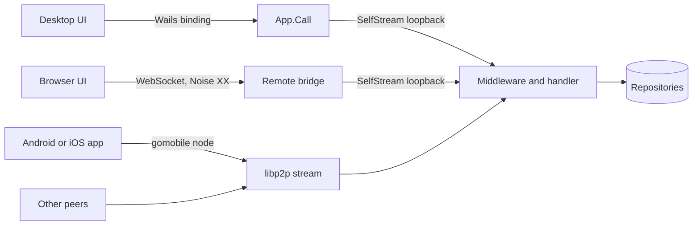
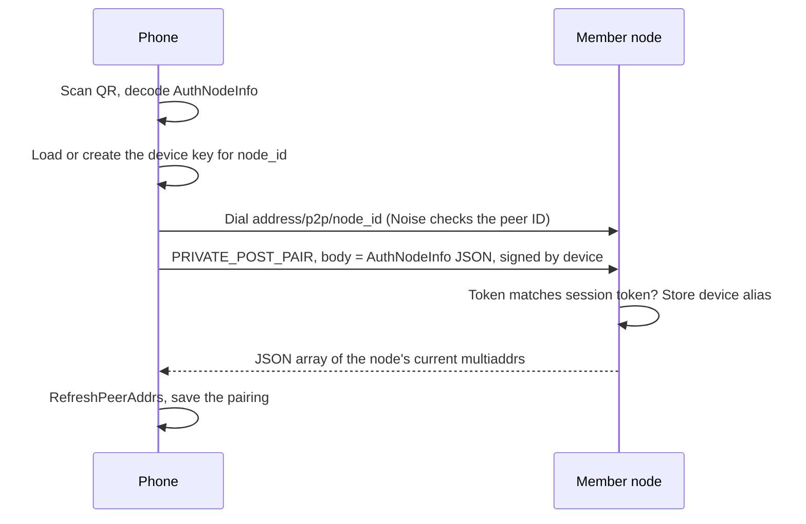

# Clients

Warpnet has one server-side implementation of every route and four ways to reach it: the desktop app, the browser dashboard of a remote node, the Android app and the iOS app. This page explains each transport, the request envelope they share, the mobile pairing protocol, and the rules for keeping route strings and DTOs identical across Go, JavaScript, Kotlin and Swift. It is for developers working on a client or adding a route that a client calls.

## One protocol, several transports

There is exactly one handler per route, in `core/handler/`. Clients differ only in how a request gets to it.



| Client | Transport to the node | Who signs the request | Who may call `/private/...` |
|---|---|---|---|
| Desktop (member node) | in-process call through Wails; no network hop | the node, with the owner key | yes, it is the node itself |
| Browser (remote node) | WebSocket `/ws`, Noise XX encrypted | the node, with the owner key, after the browser's key is enrolled | yes, once signed in |
| Android, iOS | libp2p stream from an embedded Go node: PSK, camouflage transport, Noise, yamux | the device, with its own key | yes, while the device is paired |
| Another member node | libp2p stream | the sending node | no |

Whatever the transport, the request runs through the same middleware chain (logging, rate limiting, signature check, idempotency) and the same handler. The desktop app and the remote bridge use `SelfStream`, an in-process loopback stream to the node's own registered handler, so there is no separate local API. A loopback call is exempt from rate limits and from the timestamp freshness check.

## The envelope

All transports carry the same JSON envelope, `event.Message` in [`event/event.go`](https://github.com/Warp-net/warpnet/blob/main/event/event.go):

| Field | Meaning |
|---|---|
| `body` | the route's request DTO, as raw JSON |
| `message_id` | a unique ID (nodes use ULIDs, the dashboard and the mobile apps UUIDs); required, and the idempotency key on `/post/` routes |
| `node_id` | the sender's peer ID |
| `path` | the route string, e.g. `/public/post/react/0.0.0` |
| `timestamp` | RFC 3339 time |
| `version` | `0.0.0` |
| `signature` | base64 Ed25519 signature |
| `bridge_key` | only on messages a node sends to the bridge gateway |

The signature covers `body`, then the timestamp as decimal Unix nanoseconds, then `path` (`Message.SigningBytes`). The auth middleware verifies it against the public key inside the stream's remote peer ID and, for remote peers, rejects timestamps more than 5 minutes away from its own clock.

A handler's return value is the response body. Errors come back as `{"code": <int>, "message": "<text>"}` (`event.ResponseError`); plain acknowledgements are `{"code":0,"message":"Accepted"}`. Stream framing is described in [Stream API](stream-API.md); the routes are listed in the [API reference](api.md).

## Desktop: Wails bindings

The member node runs the Vue app inside a Wails webview. `cmd/node/member/main.go` binds the `App` struct from [`app.go`](https://github.com/Warp-net/warpnet/blob/main/cmd/node/member/app.go), and Wails generates JavaScript wrappers for its exported methods into `frontend/wailsjs/go/main/App.js`, which is committed.

| Bound method | Purpose |
|---|---|
| `Call(request)` | send one envelope, return the response envelope |
| `IsFirstRun()` | whether the local database has been created yet (sign-up or login form) |
| `Network()`, `SelectNetwork(name)` | the current network; the first-launch choice, which relaunches the app with `NODE_NETWORK` set |
| `ConsumePendingDeepLink()` | the pending `warpnet://` link, if any. The Go side stores links with `SetPendingDeepLink` and `NotifyDeepLink` and tells the frontend through the Wails event `deeplink:open` |

`App.Call` handles four routes itself: login, logout, and the two self-update routes. Logout stops the node and closes the database; the next login starts a new node. Every other request is rebuilt as an `event.Message`, signed with the owner's private key, and passed to `node.SelfStream`, which runs the registered handler with its full middleware chain.

### The frontend bridge

The UI never talks to Wails or WebSockets directly. Components call helpers in [`frontend/src/service/service.js`](https://github.com/Warp-net/warpnet/blob/main/frontend/src/service/service.js), which hold the route constants and send `{ path, body }` through `Call` from [`frontend/src/lib/transport.js`](https://github.com/Warp-net/warpnet/blob/main/frontend/src/lib/transport.js). `transport.js` picks the backend at run time:

- if `window.go.main.App.Call` exists, it is the desktop app and the call goes to the Wails binding;
- otherwise it is the browser dashboard and the call goes over the WebSocket described below.

Both paths take the same request and return the same response shape, so a feature is written once. The desktop-only helpers (`IsDesktop`, deep links, `SelectNetwork`, Wails events) do nothing in the browser, and `IsFirstRun` goes to the bridge path `is-first-run`.

## Remote node: HTTP and /ws

The remote node ([`remote-member.go`](https://github.com/Warp-net/warpnet/blob/main/cmd/node/member/remote-member.go)) has no window. It runs a plain HTTP server with two routes:

| Route | Handler |
|---|---|
| `/` | the embedded `frontend/dist`; an unknown path serves `index.html` |
| `/ws` | the bridge in [`cmd/node/member/remote/bridge.go`](https://github.com/Warp-net/warpnet/blob/main/cmd/node/member/remote/bridge.go) |

It listens on `--node.server.host`:`--node.server.port` (default `0.0.0.0:4999`) and serves plain HTTP. Bind it to `127.0.0.1` and use an SSH tunnel, or put it behind an HTTPS reverse proxy; when the page is loaded over HTTPS the frontend connects with `wss://`. The full protocol is in [WebSocket API](ws-API.md).

### Channel encryption

Every WebSocket starts with a Noise handshake, `Noise_XX_25519_ChaChaPoly_SHA256` (`security/noise.go` on the node, `frontend/src/lib/noise.js` in the browser):

- The node's static X25519 key is stored in `ws-noise.key` in the network's data directory (`~/.warpdata/<network>/`). The node prints its SHA-256 fingerprint at start-up.
- The browser creates its own static key on first use and keeps it in `localStorage` (`warpnet.client.key`).
- The browser pins the node's key on first contact (`warpnet.node.key`) and refuses to continue if it later changes.
- After the handshake, every WebSocket frame is one encrypted Noise transport message containing one JSON envelope. A frame that fails to decrypt closes the connection.

There is no pre-shared secret and no session cookie. The upgrade is also refused if the `Origin` header names a different host than the one the request was sent to.

### Authorization

| Request | Allowed when |
|---|---|
| `is-first-run` | always |
| `PRIVATE_POST_LOGIN` | always; a successful login enrols this connection's client key in memory |
| `PRIVATE_POST_LOGOUT` | enrolled; removes this client key from the list, the node keeps running |
| anything else | the client key is enrolled and the node is signed in; otherwise `401` in a `ResponseError` |

Because enrolment is by the Noise client key, the same browser reconnects without retyping the password for as long as the node process runs. The list is never written to disk.

The bridge signs each request with the owner key and passes it to `SelfStream`, as the desktop app does. Each connection processes up to 32 requests concurrently; login and logout wait for the connection's in-flight requests to finish first. The browser matches responses by `message_id` and times out after 30 seconds by default, longer for archive import, sponsored-tweet orders and quotes, copy-buyer checks and video.

## Mobile: the embedded Go node

Neither mobile app re-implements the transport. Each one links a small Go libp2p node, compiled with gomobile from the same repository, and its platform code calls into it. Both apps build the envelope and its signing input themselves and let the Go node sign it with the device key.

### Android (warpdroid)

warpdroid is a fork of the Tusky Mastodon client. It is published on [F-Droid](https://f-droid.org/packages/site.warpnet.warpdroid/) as `site.warpnet.warpdroid`, needs Android 7.0 (API 24) or newer, and is built for arm64-v8a only.

| Layer | Location | Contents |
|---|---|---|
| Go node | `warpdroid/node/` (build tag `mobile`) | the libp2p client, compiled to `warpnet.aar` by `build-native.sh` |
| Transport library | `warpdroid/warpnet-transport/` | `WarpnetClient`, `ProtocolIds.kt`, Moshi DTOs in `dto/`, `EnvelopeSigner`, `Ed25519IdentityStore`, `ConnectionMonitor` |
| App | `warpdroid/app/` | Tusky-based UI, `WarpnetApi` and `WarpnetRepository` in place of the Mastodon API, pairing screens, `PairRefreshWorker` |

Build the native library, then the app:

```bash
cd warpdroid/node && ./build-native.sh   # needs Go and the Android NDK; writes warpnet-transport/libs/warpnet.aar
cd .. && make build                       # ./gradlew clean, then build without tests and lint
```

The AAR is never committed; the F-Droid CI check fails if a binary is. `build-native.sh` sets `GOTOOLCHAIN=local`, so the installed Go must satisfy `go.mod`.

### iOS (warpfone)

warpfone is a modified copy of Ice Cubes 1.10.31, an Apache-2.0 SwiftUI Mastodon client. It is published on the [App Store](https://apps.apple.com/app/warpnet/id6835178022) as `site.warpnet.warpfone` and needs iOS 17 or newer.

| Layer | Location | Contents |
|---|---|---|
| Go node | `warpfone/node/` | a copy of `warpdroid/node`; CI checks that the two match except for comments and the user agent |
| Framework | `Warpnet.xcframework` (not committed) | built by `warpfone/scripts/build-xcframework.sh` (`gomobile bind -tags mobile -iosversion=17.0`) |
| Transport package | `warpfone/Packages/WarpnetTransport` | the `WarpnetBinding` protocol, `WarpnetClient`, `WarpnetSession`, envelope, DTOs, generated `ProtocolIds.swift`, QR codec |
| Binding | `warpfone/WarpnetApp/App/Warpnet/GoBinding.swift` | implements `WarpnetBinding` by calling the generated `NodeInitialize`, `NodeStream`, ... from `import Warpnet` |
| Network package | `warpfone/Packages/Network` | keeps the Ice Cubes `Client` API; `Sources/Network/Warpnet/WarpnetRouter.swift` answers its Mastodon endpoints from the node |

To build locally: run `warpfone/scripts/build-xcframework.sh`, copy `warpfone/WarpnetApp.xcconfig.template` to `WarpnetApp.xcconfig` and set your team and bundle ID prefix, then open `warpfone/WarpnetApp.xcodeproj` (scheme `WarpnetApp`). CI builds with Xcode 27.2.

### The Go bridge API

gomobile can bind only simple types, so [`warpdroid/node/mobile.go`](https://github.com/Warp-net/warpnet/blob/main/warpdroid/node/mobile.go) exposes string-based functions and reports errors as strings:

| Function | Purpose |
|---|---|
| `Initialize(privKeyHex, warpNetwork, pskHex, bootstrapNodes)` | start the phone's libp2p host with the device key, network name, PSK and comma-separated bootstrap peers |
| `Connect(addrInfo)` | dial the paired member node; takes newline-separated multiaddrs of that one peer |
| `Stream(protocolID, data)` | open a stream on a route, send the envelope, return the response bytes |
| `Sign(body)` | Ed25519-sign the given signing input with the device key, base64 |
| `PeerID()`, `IsConnected()`, `Connectedness()` | status; the platform connection monitor polls `Connectedness` |
| `Pause()`, `Resume()` | close connections when backgrounded, re-dial the paired node when foregrounded |
| `RefreshPeerAddrs(addrs)` | add the member node's current addresses to the peerstore |
| `Disconnect()`, `Shutdown()` | tear down |
| `SetLogSink`, `SetLogSinkMinLevel` | forward Go logs to the platform logger |

The host is client-only (it does not listen). It joins the private network with the PSK, dials through the same camouflage transport the nodes use, secures connections with Noise and multiplexes them with yamux. On start it dials the bootstrap peers and seeds a client-mode DHT with them. When dialling the member node it tries LAN addresses first, and it can reach the node through a circuit relay when there is no direct path. It identifies itself with the user agent `warpdroid` or `warpfone`.

## Pairing

A phone does not hold the account. It is a **device** (alias) of a member node: a separate libp2p identity that the node authorizes to act through it. Pairing passes what the phone needs over a QR code.

### What the QR code carries

After the owner logs in, the node returns an `AuthNodeInfo` ([`domain/warpnet.go`](https://github.com/Warp-net/warpnet/blob/main/domain/warpnet.go)). The UI shows it under "Sign in by QR-code" in the side menu, gzip-compressed (level 9) and Base45-encoded so it fits a QR alphanumeric segment (`frontend/src/lib/qr-payload.js`). The same dialog's "Copy connection data" button gives the uncompressed JSON.

| Field | Purpose |
|---|---|
| `user_id` | the account the device will act for |
| `token` | pairing authorization: 32 random bytes, base64, minted on the first sign-in of the node process and kept only in memory |
| `psk` | the private-network key in hex, so the phone can join the network |
| `node_id` | the member node's peer ID, pinned when dialling |
| `addresses`, `bootstrap_peers` | where to reach the node and the network |
| `network` | network name |

The member node's private key is never in the QR code.

### Handshake



1. **Device identity.** The phone keeps a random 32-byte seed for the paired node (`PairedNodeStore` and `Ed25519IdentityStore` on Android; `PairingStore` in the Keychain and `DeviceIdentity` on iOS) and expands it into a libp2p Ed25519 key. Re-pairing with the same node reuses it; pairing with another node draws a new one; clearing the pairing deletes it.
2. **Dial.** Candidate addresses end in `/p2p/<node_id>`, so the Noise handshake fails if the remote cannot prove that identity.
3. **Pair request.** The phone sends `PRIVATE_POST_PAIR` (`/private/post/admin/pair/0.0.0`) with the original `AuthNodeInfo` JSON as the body. This is the one private route the middleware accepts from an unknown peer.
4. **Node side** ([`core/handler/device.go`](https://github.com/Warp-net/warpnet/blob/main/core/handler/device.go)). The handler rejects an empty or mismatched token, records the phone's peer ID as a device alias, and answers with a JSON array of its current multiaddrs. Errors such as `token mismatch`, `pairing revoked` or `too many aliases` come back as a `ResponseError`.
5. **Phone side.** On an address array it calls `RefreshPeerAddrs` and saves the pairing.

After pairing, the phone signs every request with its own key. The middleware accepts `/private/...` routes from it because its peer ID is in the alias list, and handlers accept it as the owner on public routes.

### Device rules on the node

| Rule | Where |
|---|---|
| At most 10 paired devices | `MaxAliases` in `database/aliases-repo.go` |
| A pairing expires 72 hours after its last successful pair request. Both apps re-send the stored pairing request to renew it and pick up new addresses: Android periodically with `PairRefreshWorker`, iOS when the app becomes active or runs a background refresh and the last pair is older than the re-pair interval. If the node rejects it for good (for example `token mismatch` or `pairing revoked`), the app clears the pairing and asks for a new QR code | `aliasTTL`, `PairRefreshWorker.kt`, `WarpnetSession.swift` |
| Every start of the member node unpairs all devices. The desktop app starts the node at every sign-in; a remote node starts it at the first sign-in of its process | `NewMemberNode` |
| An unpaired device, whether removed by the owner or by a node start, cannot pair again with the same token (`pairing revoked`). The token changes only when the node's process restarts, so the device needs a QR code shown after that restart | `DeleteAlias` tombstone, `database/auth-repo.go` |
| A device may unpair itself, but no other device | `StreamDeleteDeviceHandler` |
| While at least one device is paired, the node asks the OS not to sleep | `core/handler/device.go`, `keepalive/` |

Because the PSK comes from the QR code, the phone never derives it.

## Keeping the contract in lockstep

Go is the source of truth. There is no version negotiation inside a stream: if a route string or a DTO field changes, every client has to change with it.

| What | Go | Desktop (JS) | Android (Kotlin) | iOS (Swift) |
|---|---|---|---|---|
| Route strings | `event/paths.go` | constants in `frontend/src/service/service.js` | `ProtocolIds.kt`, hand-maintained, covers the routes the app uses | `ProtocolIds.swift`, generated by `warpfone/scripts/generate-protocol-ids.sh` |
| Request DTOs | `event/event.go` | object literals in `service.js` | `dto/WarpnetDtos.kt` (Moshi) | `WarpnetEvents.swift` |
| Response and domain types | `event/event.go`, `domain/*.go` | read from `resp.body` | `dto/WarpnetDtos.kt` | `WarpnetDtos.swift` |
| Mobile node | `warpdroid/node` | n/a | built into the AAR | `warpfone/node` copy |

What CI catches:

- `test-warpfone.yaml` regenerates `ProtocolIds.swift` and fails if it differs, and fails if the two mobile node copies diverge.
- `fdroid-check.yml` and `build-warpdroid.yml` rebuild the AAR from source.
- No CI job compares `service.js`, `ProtocolIds.kt`, or the Kotlin and Swift DTO field names with the Go definitions. A wrong JSON name usually decodes to an empty or zero value without an error, which shows up as blank fields in one client while another works.

When you change a route or DTO:

1. Change Go first and look at what the handler actually returns; that is what clients parse.
2. Update `service.js`.
3. Update `ProtocolIds.kt` and the Moshi DTO, then rebuild the AAR with `warpdroid/node/build-native.sh`.
4. Run `warpfone/scripts/generate-protocol-ids.sh`, update the Swift DTOs, and rebuild the framework with `warpfone/scripts/build-xcframework.sh`.
5. If you touched `warpdroid/node`, apply the same change to `warpfone/node`.

## See also

- [Developer guide](index.md): building, project layout, adding a route
- [API reference](api.md): the routes nodes serve
- [Stream API](stream-API.md): request framing over libp2p streams
- [WebSocket API](ws-API.md): the remote node's browser bridge
- [Mobile apps](../user-guide/mobile.md): pairing from the user's side
- [Security](../security.md): identity, signatures and encryption
