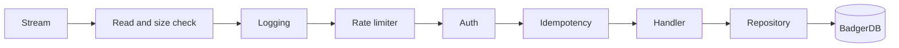

# Developer Guide

This guide takes you from a fresh clone to a merged pull request. It covers the toolchain, how to build and run each node role and the mobile apps, how to set up a local multi-node network, how the code is laid out, a worked example of adding a route, tests and CI, and how releases are cut. It is written for contributors; if you only want to run Warpnet, start with the [user guide](../user-guide/index.md).

## Prerequisites

| Tool | Version | Needed for |
|---|---|---|
| Go | 1.26.3 or newer (`go 1.26.3` in `go.mod`) | everything |
| Wails CLI | v2.10.2 | the desktop member node |
| C/C++ compiler | not pinned | the desktop member node and the moderator (both use cgo) |
| Node.js and npm | not pinned | rebuilding the desktop UI in `frontend/` |
| golangci-lint | v2 (the config uses `version: "2"`) | linting |
| JDK 17, Android SDK and NDK | the release workflow uses NDK r27c (`27.2.12479018`) | the Android app |
| macOS with Xcode | CI selects Xcode 27.2 | the iOS app |

Install the Wails CLI at the version the Makefile and the release workflow use:

```bash
go install github.com/wailsapp/wails/v2/cmd/wails@v2.10.2
```

> **Note:** `go.mod` requires the Wails library v2.17.1, newer than the CLI. The Makefile targets and the release workflow pass `-m -nosyncgomod`, so the CLI neither runs `go mod tidy` nor rewrites `go.mod`. Use the same flags.
{: .note }

### System packages

**Linux (Debian/Ubuntu).** The desktop node links GTK and WebKitGTK 4.1. These are the packages the release workflow and `Dockerfile.member` install:

```bash
sudo apt update
sudo apt install -y build-essential libgtk-3-dev libwebkit2gtk-4.1-dev
```

**macOS and Windows.** The release workflow builds both on stock GitHub runners with only Go and the Wails CLI installed. If a build fails, `wails doctor` reports what the Wails toolchain is missing.

Headless roles (relay, echo, remote) need only Go.

## Get the source

```bash
git clone https://github.com/Warp-net/warpnet.git
cd warpnet
git checkout develop
```

- **Branches.** Work lands in `develop`; `main` receives merges from `develop`. Branch off `develop` and target it with pull requests: the Android and iOS CI runs on pull requests to `develop`.
- **Vendored modules.** `vendor/` is committed and Go builds use it (`-mod=vendor` in the relay, echo and remote Dockerfiles and the relay release build, `"go:build:mod": "vendor"` in `wails.json`). Do not edit it by hand; after changing dependencies run `go mod tidy && go mod vendor`.
- **Submodule.** `core/moderation` is a git submodule pointing at [Warp-net/moderation](https://github.com/Warp-net/moderation). Only the moderator needs it: `git submodule update --init core/moderation`.

## Node roles and entry points

One codebase builds several binaries. Build tags pick the entry point.

| Role | Entry point | Build tag | CGO | Dockerfile |
|---|---|---|---|---|
| member (desktop) | `cmd/node/member/main.go` + `app.go` | none (`!echo && !remote`) | `1` | `Dockerfile.member` (a Linux build check; the image is not meant to run) |
| remote (headless, browser UI) | `cmd/node/member/remote-member.go` | `remote` | not set | `Dockerfile.remote` |
| echo (test bot) | `cmd/node/member/echo-member.go` | `echo` | `0` | `Dockerfile.echo` |
| relay | `cmd/node/relay/main.go` | none (the file is `!windows`) | `0` | `Dockerfile.relay` |
| moderator | `cmd/node/moderator/main.go` | `llama` | `1` | `Dockerfile.moderator` |
| mobile node | `warpdroid/node`, `warpfone/node` | `mobile` | gomobile | none |

See [Architecture](../architecture.md) for what each role does.

## Build and run each role

### Member (desktop)

```bash
cd cmd/node/member
wails build -m -nosyncgomod -devtools -tags webkit2_41
./build/bin/warpnet --node.network testnet
```

`make run-main` does the same (it installs the Wails CLI first) and runs the node on testnet with `--node.port 4000`. On macOS the output is `build/bin/warpnet.app`; on Windows it is `build/bin/warpnet.exe`. `make build-windows` cross-builds the Windows binary (`wails build -clean -platform windows -tags webkit2_41 -m -nosyncgomod`).

The binary embeds the UI from `frontend/dist` through `//go:embed` in `embedded.go`, and `wails.json` sets `skipfrontend: true`, so `wails build` never compiles the Vue app. After changing anything under `frontend/src`, rebuild the bundle and then the binary:

```bash
make frontend        # cd frontend && make rebuild: clean npm install + npm run build
```

`frontend/dist` is committed, so a Go-only contributor can build a working binary without Node.js. If you change the UI, commit the rebuilt `dist` with your source changes.

### Remote node (headless, UI in a browser)

```bash
go run -tags remote ./cmd/node/member/remote-member.go \
  --node.network testnet --node.server.host 127.0.0.1
```

Open `http://127.0.0.1:4999`. The node serves the same embedded UI over HTTP and bridges it to the node over a Noise-encrypted WebSocket at `/ws` (see [Clients](clients.md#remote-node-http-and-ws)). At startup it prints the fingerprint of its WebSocket key, which the browser pins on first connect. This is also the easiest way to work on the UI without GTK or Wails.

With Docker, `docker compose up --build` uses the repository's `docker-compose.yaml`, which builds `Dockerfile.remote` and runs a remote node on testnet with host networking (libp2p port 4001, dashboard port 4999).

### Echo bot

```bash
make echo-main
# = go run -tags echo cmd/node/member/echo-member.go --node.network testnet \
#     --node.seed echo --database.dir echo --node.port 4002
```

The echo node is a member node with an in-memory database and a fixed built-in account named `Echo`. It follows back whoever follows it, answers chat messages and posts once a day. It writes nothing to disk, so `--database.dir` has no effect on it, and because its login and password are fixed, its peer ID depends only on the network (see the note under [Local networks](#local-networks)).

### Relay

```bash
make relay-main
# = go run cmd/node/relay/main.go --node.network testnet --node.print-psk
```

The release build is static:

```bash
cd cmd/node/relay
CGO_ENABLED=0 go build -ldflags "-s -w" -gcflags=all=-l -mod=vendor -o relay
```

The relay keeps its state in memory only. Its key is derived from `--node.seed`; without the flag, the config fills in a seed built from the network, `--database.dir`, `--node.host.v4` and `--node.port`, so a relay started with the same flags keeps its peer ID. It prints `RELAY NODE STARTED WITH ID <id> AND ADDRESSES [...]` once it is up. The relay does not build on Windows.

### Moderator

The moderator needs the `core/moderation` submodule, a C/C++ toolchain, and the model file `Llama-Guard-3-1B-Q4_K_M.gguf` in its **working directory**. The path is hard-coded in `cmd/node/moderator/moderator/moderator.go`; there is no flag for it. The model is not part of the repository or the release archives.

```bash
git submodule update --init core/moderation
make run-moderator
# = CGO_CXXFLAGS="-w -Wno-format -Wno-delete-incomplete" go run -tags=llama \
#     cmd/node/moderator/main.go --node.network testnet --node.port 4002 --node.seed moderatorlocalhost
```

The moderator generates a fresh random identity on every start. `Dockerfile.moderator` builds with `-mod=mod` and fetches the submodule if it is missing; the release workflow builds the released moderator in that image. `deploy/docker-compose-moderator.yml` shows how the model file is mounted into the container. How moderation works is described in [Moderation](../moderation.md).

### Android app

The Android app (`warpdroid/`) embeds the gomobile node from `warpdroid/node`, built for arm64 only. It needs JDK 17, the Android SDK, an NDK (`$ANDROID_NDK_HOME`, or one under `$ANDROID_HOME/ndk/`), and Go:

```bash
go mod download
cd warpdroid/node && bash build-native.sh   # writes warpdroid/warpnet-transport/libs/warpnet.aar
cd .. && ./gradlew :app:assembleDebug
```

`warpnet.aar` is not committed. On a clean checkout Gradle builds it itself (task `buildWarpnetAar` runs `build-native.sh`); once the file exists, Gradle reuses it, so run `build-native.sh` again (or `make aar` in `warpdroid/`) after changing Go code.

### iOS app

The iOS app (`warpfone/`) embeds the gomobile node from `warpfone/node`. It needs macOS with Xcode and Go:

```bash
warpfone/scripts/build-xcframework.sh   # writes warpfone/Warpnet.xcframework
cp warpfone/WarpnetApp.xcconfig.template warpfone/WarpnetApp.xcconfig
xcodebuild build -project warpfone/WarpnetApp.xcodeproj -scheme WarpnetApp \
  -destination 'generic/platform=iOS Simulator' CODE_SIGNING_ALLOWED=NO
```

`WARPFONE_XCFRAMEWORK_TARGETS=iossimulator` limits the framework to the simulator, as CI does. `Warpnet.xcframework` is not committed.

## Build tags and CGO

| Tag | Used by | Effect |
|---|---|---|
| `webkit2_41` | member | Selects the WebKitGTK 4.1 bindings Wails uses on Linux. |
| `remote` | remote | Swaps the Wails entry point for the HTTP/WebSocket one. |
| `echo` | echo | Builds the in-memory bot entry point. |
| `llama` | moderator | Compiles the moderation engine and its llama.cpp cgo bindings. |
| `mobile` | `warpdroid/node`, `warpfone/node` | Gates the gomobile bridge; the module-wide `go test ./...` skips these files. |

CGO is on for the member (Wails) and the moderator (llama.cpp), and off for the relay and echo so they link statically into `distroless` images. `Dockerfile.remote` leaves it unset.

## Local networks

### Ports used by the Makefile targets

| Target | Role | Network | Port | Notes |
|---|---|---|---|---|
| `run-main` | member | testnet | 4000 | default `storage` directory |
| `run-second` | member | testnet | 4002 | `--node.seed backendtest --database.dir backend1` |
| `relay-main` | relay | testnet | 4001 | prints the PSK |
| `echo-main` | echo | testnet | 4002 | in memory |
| `run-moderator` | moderator | testnet | 4002 | needs the model file |

> **Warning:** `run-second`, `echo-main` and `run-moderator` all use port 4002. Override `--node.port` when you run more than one of them. The desktop app also holds a single-instance lock (`net.warpnet.app`), so a second desktop member on the same machine just hands over to the first one. For a second full member on one machine, run a remote node with its own `--database.dir`, `--node.port` and `--node.server.port`.
{: .warning }

A practical local swarm is one desktop member, a relay, an echo node and one or more remote nodes with their own accounts. The `--node.seed` values the Makefile passes to member, echo and moderator targets have no effect: a member's peer ID comes from its login and password, and the moderator draws a random one.

> **Note:** Every echo node logs in with the same built-in account, so all echo nodes on one network share one peer ID. Run at most one per network. The testnet deployment (`deploy/docker-compose-testnet.yml`) already runs one, so a local echo bot is most useful on your own isolated network.
{: .note }

### An isolated network

Any network name other than `warpnet` (mainnet) and `testnet` gives you a separate network with no built-in bootstrap nodes. Nodes connect only if they use the same network name and the same **major** version: the network key (PSK) is `SHA-256(network + major version)` (`security/psk.go`).

1. Start a relay and note its peer ID from the startup line:

   ```bash
   go run cmd/node/relay/main.go --node.network devnet --node.seed devrelay \
     --node.self-update=false
   ```

2. Point the other nodes at it:

   ```bash
   ./build/bin/warpnet --node.network devnet --node.port 4000 \
     --node.bootstrap /ip4/127.0.0.1/tcp/4001/p2p/<relay-peer-id>

   go run -tags echo cmd/node/member/echo-member.go --node.network devnet \
     --node.port 4003 --node.bootstrap /ip4/127.0.0.1/tcp/4001/p2p/<relay-peer-id>
   ```

Member nodes on the same LAN also find each other over mDNS. A member node prefers bootstrap addresses saved in its own network settings over `--node.bootstrap`; the flag applies while those settings are empty. Self-update (`--node.self-update`, on by default) replaces the binary with the latest release, and a relay does so without asking, so switch it off for local builds.

### Data directory

Each member or remote node keeps its data in `~/.warpdata/<network>/<database.dir>` (Windows: `%LOCALAPPDATA%\warpdata\...`). `--node.network mainnet` is normalised to `warpnet`. The remote node's WebSocket key is `~/.warpdata/<network>/ws-noise.key`. Relay, moderator and echo nodes keep no data there.

`make prune-testnet` deletes `~/.warpdata/testnet/*`. Without `--node.network` or `NODE_NETWORK`, the desktop node starts on mainnet, unless a testnet database (with its `run.lock`) already exists, in which case it reopens testnet.

### Flags

Every flag can also be set as an environment variable: upper-case, with dots and dashes replaced by underscores (`node.server.port` becomes `NODE_SERVER_PORT`). A flag on the command line wins over the environment.

| Flag | Default | Purpose |
|---|---|---|
| `--node.network` | `warpnet` | Network name; `testnet` for testing. |
| `--node.port` | `4001` | libp2p TCP port (IPv4 and IPv6). |
| `--node.host.v4` / `--node.host.v6` | `0.0.0.0` / `::` | Bind addresses. |
| `--node.seed` | derived from network, database dir, host and port | Seed for a deterministic peer ID; read by the relay only. |
| `--node.bootstrap` | empty | Comma-separated multiaddrs. If set, it **replaces** the built-in list. |
| `--node.print-psk` | `false` | Log the network PSK on start; read by the relay only. |
| `--node.self-update` | `true` | Replace the binary with new releases; a member node asks its owner first. |
| `--node.server.host` / `--node.server.port` | `0.0.0.0` / `4999` | Remote node dashboard. |
| `--database.dir` | `storage` | Sub-directory under `~/.warpdata/<network>/`. |
| `--logging.level` / `--logging.format` | `info` / `text` | Log level; `text` or `json`. |
| `--wallet.binary-path` | empty | Payment engine binary, used while the node's wallet settings have none. |
| `--wallet.endpoint` | `https://api.trongrid.io` on `warpnet`, `https://nile.trongrid.io` on `testnet` | Blockchain API endpoint, used while the node's wallet settings have none. |

The full operator reference is in [Running a node](../user-guide/running-a-node.md).

## Project layout

```text
warpnet/
├── cmd/node/
│   ├── member/        # main.go (desktop), remote-member.go, echo-member.go, app.go (Wails App)
│   │   ├── auth/      #   login, password rules, owner account
│   │   ├── deeplink/  #   warpnet:// URL scheme registration per OS
│   │   ├── node/      #   member-node.go: wires the node, registers handlers
│   │   ├── pubsub/    #   member gossip topics
│   │   └── remote/    #   /ws bridge and static file server for the remote node
│   ├── relay/         # relay node
│   └── moderator/     # moderator node: rounds, votes, audit, isolation
├── core/              # networking, streams, handlers, middleware, subsystems
├── database/          # repositories over the embedded store (*-repo.go)
│   └── local-store/   #   BadgerDB wrapper and prefix-key builder
├── domain/            # shared domain types (User, Tweet, AuthNodeInfo, ...)
├── event/             # wire protocol: paths.go (routes), event.go (DTOs, envelope)
├── security/          # key derivation, signatures, PSK, Noise for the remote /ws channel
├── config/            # flags, env vars, defaults, built-in bootstrap nodes
├── json/              # json-iterator wrapper used everywhere
├── retrier/           # retry helper
├── frontend/          # Vue 3 UI; dist/ is committed and embedded in the binary
├── warpdroid/         # Android app (based on Tusky) + gomobile node in node/
├── warpfone/          # iOS app (based on Ice Cubes) + gomobile node in node/
├── keepalive/         # keeps the host awake while devices are paired
├── deploy/            # testnet and moderator compose files, deploy script
├── snap/              # Snap packaging
├── fastlane/          # F-Droid store listing
├── .githooks/         # version-bump hook (see Release process)
├── embedded.go        # go:embed of version, icon, frontend/dist
└── version            # the release version
```

Selected `core/` packages:

| Package | Responsibility |
|---|---|
| `core/node` | libp2p host, handler registration behind middleware, `SelfStream` loopback |
| `core/stream` | route type, request framing, loopback streams, stream pool, outbox |
| `core/handler` | one file per feature; the unit you usually add |
| `core/middleware` | logging, rate limiting, signature auth, idempotency |
| `core/discovery`, `core/dht`, `core/mdns` | peer discovery |
| `core/pubsub` | GossipSub topics |
| `core/relay`, `core/holepunch` | circuit relay v2 service and reservation refusals, hole-punching tracer |
| `core/crdt` | replicated counters and rating store (see [Synchronization](../synchronization.md)) |
| `core/rating`, `core/ratelimit` | node reputation, per-peer limits |
| `core/trust` | trust circle |
| `core/authorship` | checks that an event came from the actor's own node |
| `core/bridge` | bridged accounts and the gateway node ID (see [Bridges](../bridge.md)) |
| `core/selfupdate` | release polling and binary replacement |
| `core/warpnet` | libp2p type aliases, host options, shared types such as `NodeInfo` |

The protocol itself is documented in [Protocol](../protocol.md); the route list is in [API reference](api.md).

## How the node is shaped

The member node is laid out like a familiar MVC web app, so you can map what you know onto it:

| MVC role | Warpnet | What lives there |
|---|---|---|
| Router | `event/paths.go` + `setupHandlers` in `member-node.go` | route strings and the handler each one dispatches to |
| Controller | `core/handler/<feature>.go` | request handling, forwarding to other nodes |
| Model | `database/<feature>-repo.go` + `domain/` | persistence over BadgerDB, domain types |
| View | `frontend/`, `warpdroid/`, `warpfone/` | UIs that reach the controller over one of the [client transports](clients.md) |

Underneath there is no HTTP server: the router dispatches libp2p streams. Every request, whether it comes from your own UI over the in-process loopback or from another peer, goes through the same chain:



- **Auth** (`core/middleware/auth.go`) verifies the Ed25519 signature over body, timestamp and route, rejects messages from remote peers whose timestamp is more than 5 minutes off, and lets `/private/...` routes through only from the node itself, a paired device, or the pairing route.
- **Idempotency** caches successful responses on `/post/` routes by route, peer and `message_id` for 10 minutes, so a retried request is not executed twice.
- **Handlers** are factory functions that take narrow interfaces and return a `warpnet.WarpHandlerFunc`:

```go
type WarpHandlerFunc func(msg []byte, s WarpStream) (any, error)
```

The narrow interfaces are what make handlers unit-testable without a running node.

## Worked example: adding a route

The reference feature is **emoji reactions**: small, cross-node, and present in every client.

| Layer | File | What is there |
|---|---|---|
| Route | [`event/paths.go`](https://github.com/Warp-net/warpnet/blob/main/event/paths.go) | `PUBLIC_POST_REACT = "/public/post/react/0.0.0"` |
| DTOs | [`event/event.go`](https://github.com/Warp-net/warpnet/blob/main/event/event.go) | `ReactionEvent{TweetId, UserId, OwnerId, Emoji}`, `ReactionsCountResponse{Count, Reactions}` |
| Handler | [`core/handler/reaction.go`](https://github.com/Warp-net/warpnet/blob/main/core/handler/reaction.go) | `StreamReactionHandler(repo, userRepo, notifyRepo, streamer)` |
| Storage | [`database/reaction-repo.go`](https://github.com/Warp-net/warpnet/blob/main/database/reaction-repo.go) | `ReactionRepo.React(tweetId, userId, emoji, isTransitive)` |
| Wiring | [`cmd/node/member/node/member-node.go`](https://github.com/Warp-net/warpnet/blob/main/cmd/node/member/node/member-node.go) | repo built in `setupHandlers`, handler listed in `engagementHandlers`; the `ReactionsProvider` interface is in `types.go` |
| Test | [`core/handler/reaction_test.go`](https://github.com/Warp-net/warpnet/blob/main/core/handler/reaction_test.go) | `TestStreamReactionHandler` with stub repositories |
| Desktop UI | [`frontend/src/service/service.js`](https://github.com/Warp-net/warpnet/blob/main/frontend/src/service/service.js) | `PUBLIC_POST_REACT` constant, `reactToTweet()` |
| Android | `warpdroid/warpnet-transport/src/main/kotlin/site/warpnet/transport/ProtocolIds.kt`, `.../transport/dto/WarpnetDtos.kt`, `warpdroid/app/src/main/java/site/warpnet/warpdroid/warpnet/WarpnetRepository.kt` | route constant, Moshi DTO, repository call |
| iOS | `warpfone/Packages/WarpnetTransport/Sources/WarpnetTransport/ProtocolIds.swift`, `WarpnetEvents.swift`, `warpfone/Packages/Network/Sources/Network/Warpnet/WarpnetRouter.swift` | generated route constant, DTO, router call |

The handler shows the usual peer-to-peer pattern: verify the actor, store locally, then forward to the author's node, and treat an offline peer as success.

```go
reactor, err := authorship.VerifyActor(userRepo, streamer, s, ev.OwnerId)
// ...
num, err := repo.React(tweetId, ev.OwnerId, emoji, ev.OwnerId == ownNodeInfo.OwnerId) // store locally
// ...
reactionDataResp, err := streamer.GenericStream( // forward to the author's node
    reactedUser.NodeId, event.PUBLIC_POST_REACT, event.ReactionEvent{ /* same fields */ },
)
if errors.Is(err, warpnet.ErrNodeIsOffline) {
    return resp, nil // the author is offline: keep the local result
}
```

### Checklist

1. **Route.** Add a constant to `event/paths.go`: `/<private|public>/<verb>/<entity>[/<sub>]/<version>`. `private` routes act on the owner's own data and are accepted only from the node itself or a paired device; `public` routes are what other peers may call.
2. **DTOs.** Add request and response structs to `event/event.go` (shared types go in `domain/`).
3. **Handler.** Create `core/handler/<feature>.go` with narrow interfaces for its dependencies and a `Stream<Feature>Handler(...) warpnet.WarpHandlerFunc` factory.
4. **Storage.** Add repository methods under `database/`, using the prefix builder in `database/local-store`.
5. **Wiring.** Build the repository and register `{route, handler}` in `cmd/node/member/node/member-node.go` (one of the `*Handlers` groups called from `setupHandlers`); add the interface to `types.go` if needed.
6. **Test.** Add `core/handler/<feature>_test.go`; copy the stub style from `reaction_test.go`.
7. **Clients.** If a UI calls the route, mirror it in each client (details in [Clients](clients.md#keeping-the-contract-in-lockstep)):
   - desktop: constant and method in `frontend/src/service/service.js`, then the Vue component;
   - Android: `ProtocolIds.kt`, a Moshi DTO, a `WarpnetRepository` method;
   - iOS: run `warpfone/scripts/generate-protocol-ids.sh`, add the DTO and the router case.
8. **House rules.** License header on new files, tests and linters clean (below).

## Tests and linters

```bash
make tests            # CGO_ENABLED=0 go test -short -p 8 -v ./...
go test -race -short ./...   # what the Linux amd64 CI job runs (-race needs cgo)
golangci-lint run     # config: .golangci.yaml
```

- `.golangci.yaml` enables all linters (`default: all`) minus an explicit disable list, runs in vendor mode, relaxes a few linters for `_test.go` files, and relaxes style linters for `warpdroid/node/` because gomobile returns errors as strings.
- The mobile node is behind the `mobile` tag, so `./...` skips it. Test it with `go test -race -count=1 -tags mobile ./warpfone/node/... ./warpdroid/node/...`.
- Frontend: `cd frontend && npm test` runs Vitest (`tests/**/*.spec.js`). `npm run serve` starts the Vue dev server; in development mode `src/lib/backend-mock.js` replaces the Go bindings with an in-memory mock, so it needs no node. For real data use a remote node.
- iOS: `swift test --package-path warpfone/Packages/WarpnetTransport` and `swift test --package-path warpfone/Packages/Network`.
- `make check-heap` prints a stack-to-heap escape report, the same one CI posts on pull requests.

## CI workflows

All workflows live in [`.github/workflows`](https://github.com/Warp-net/warpnet/tree/main/.github/workflows).

| Workflow | Runs on | What it does |
|---|---|---|
| `tests-static-check.yaml` | every PR, push to `main`, manual | `go mod verify`, golangci-lint, govulncheck (non-blocking), `go test -race` on Linux amd64 (`-short`, coverage to Codecov) and arm64, macOS (`-short`) and Windows |
| `heap-escape-analysis.yaml` | every PR, push to `main`, manual | informational escape-analysis report as a PR comment |
| `build-warpdroid.yml` | PRs to `develop` | builds the AAR with gomobile and the debug APK; posts the build log on failure |
| `fdroid-check.yml` | PRs to `main` or `develop` touching `warpdroid/`, `go.mod`, `go.sum` or `vendor/golang.org/x/mobile`; `v*` tags; manual | inside F-Droid's buildserver image: no committed binaries, AAR built from source, licence check, no proprietary Google dependencies, release build |
| `build-warpfone.yml` | PRs to `develop` | builds `Warpnet.xcframework` for the simulator and the app with `xcodebuild` |
| `test-warpfone.yaml` | PRs to `develop` touching `warpfone/`, `warpdroid/node/`, `event/paths.go`, `go.mod` or `go.sum` | checks `ProtocolIds.swift` is regenerated, checks the two mobile node copies match, runs Swift and mobile Go tests |
| `build.yaml` (Build Mainnet) | push to `main`, manual | builds and pushes the relay image `ghcr.io/warp-net/warpnet-relay` |
| `build-deploy-testnet.yaml` | manual | builds relay, moderator, echo and remote images and deploys the testnet host |
| `release.yaml` | manual, with a tag | release artifacts (below) |
| `release-warpfone.yaml` | manual, with a tag | iOS build to TestFlight |
| `snap.yml` | push to the `snap` branch, manual | builds the Snap and uploads it to the Snap Store (`snapcraft upload --release beta`) |

## Release process

The `version` file is the single source of truth. It is embedded into the binary, the Android build reads it for `versionName` and `versionCode`, and its major number feeds the network key.

1. **Version bump.** The `pre-commit` hook in `.githooks/` increments the patch number on every commit to `main` or `develop` and keeps `snap/snapcraft.yaml`, `frontend/package.json` and `package-lock.json`, `warpdroid/fdroid/versionCode`, `warpfone/Version.xcconfig` and the F-Droid changelog file in step. Maintainers enable it with `make setup-hooks`; on any other branch the hook does nothing. Do not edit the version by hand.
2. **Tag.** The maintainer creates and pushes the tag `v<version>`.
3. **Release workflow.** Run **Release** with that tag. It does not bump versions, commit or tag. It builds:
   - the member binary for Linux amd64 and arm64, macOS (universal) and Windows amd64;
   - the relay and the moderator for Linux amd64;
   - the signed Android APK;
   - a SHA-256 checksum file per artifact, then signs every checksum file with the release Ed25519 key (`*.sig`).
4. **iOS.** Run **Release / Warpfone** with the same tag when the release touches the iOS app; it uploads to TestFlight.
5. **Snap.** Pushing to the `snap` branch runs the Snap workflow.

Nodes with self-update enabled check the latest GitHub release every hour and verify the checksum file and its signature before replacing their binary (`core/selfupdate`). The release workflow does not sign or notarize the macOS build.

## Contribution workflow

1. Branch off `develop`.
2. Make the change:
   - every new `.go` file carries the AGPL header: copy the comment block from the top of an existing file such as `core/handler/reaction.go`, including the `// SPDX-License-Identifier: AGPL-3.0-or-later` line. Kotlin files in `warpdroid/` carry a short SPDX header of their own;
   - commit a rebuilt `frontend/dist` if you changed the UI;
   - do not touch `vendor/` by hand or bump `version`.
3. Run `make tests` and `golangci-lint run`.
4. Open a pull request against `develop`.

By submitting a contribution you accept the [Contributor License Agreement](../legal/CLA.md).

## Troubleshooting

| Symptom | Cause and fix |
|---|---|
| UI changes do not show up in the desktop build | `skipfrontend: true` and the embedded `dist`: run `make frontend`, then rebuild the binary. |
| Two local nodes never see each other | Different `--node.network`, a different major version, or a custom network without `--node.bootstrap` and not on the same LAN. |
| `bind: address already in use` | Two Makefile targets on the same port (4002); pass `--node.port`. |
| Second desktop window does not open | Single-instance lock; use a remote node instead. |
| Moderator exits right after start | Built without `-tags=llama` (no engine is compiled in, `failed to start moderator`), or the model file is missing from the working directory. |
| `wails build` fails on Linux | Missing GTK/WebKit dev packages, or `-tags webkit2_41` left out. |
| Android changes to Go code have no effect | Gradle reused the existing `warpnet.aar`; run `warpdroid/node/build-native.sh` again. |
| Android shows blank fields while desktop is fine | Kotlin DTO or `ProtocolIds.kt` out of step with Go; see [Clients](clients.md#keeping-the-contract-in-lockstep). |
| Need more detail | `LOGGING_LEVEL=debug`, and `--logging.format json` for structured logs. |

## See also

- [Clients](clients.md): how the desktop, browser and mobile apps reach a node
- [API reference](api.md): every route in `event/paths.go`
- [Stream API](stream-API.md): request framing over libp2p streams
- [Architecture](../architecture.md): roles, components and data flow
- [How to help](../HOW-TO-HELP.md): where contributions are most needed
