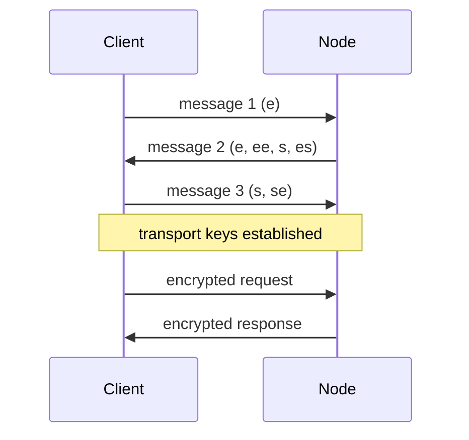

# WebSocket API

The remote flavour of the member node runs headless and serves the web dashboard in a browser. The dashboard talks to the node over one WebSocket at `/ws`, secured end to end with Noise. This page describes that bridge for developers who want to write their own dashboard, a script or a bot against a remote node. The same routes are listed in the [API reference](api.md).

## Endpoint

| Item | Value |
|---|---|
| URL | `ws://<host>:<port>/ws` (or `wss://` behind a TLS proxy) |
| Default bind | `0.0.0.0:4999`; change with `--node.server.host` and `--node.server.port` (`NODE_SERVER_HOST`, `NODE_SERVER_PORT`) |
| Other paths | Everything else serves the dashboard's static files (single-page app fallback) |
| Origin | A browser request whose `Origin` host differs from the `Host` it connects to is refused. Requests without an `Origin` header (non-browser clients) are allowed |
| Frames | Binary WebSocket messages only |

Code: [`cmd/node/member/remote-member.go`](https://github.com/Warp-net/warpnet/blob/main/cmd/node/member/remote-member.go), [`cmd/node/member/remote/bridge.go`](https://github.com/Warp-net/warpnet/blob/main/cmd/node/member/remote/bridge.go), [`security/noise.go`](https://github.com/Warp-net/warpnet/blob/main/security/noise.go). The browser side is [`frontend/src/lib/transport.js`](https://github.com/Warp-net/warpnet/blob/main/frontend/src/lib/transport.js) and [`frontend/src/lib/noise.js`](https://github.com/Warp-net/warpnet/blob/main/frontend/src/lib/noise.js).

## Handshake

Each connection starts with a Noise handshake, `Noise_XX_25519_ChaChaPoly_SHA256`, with an empty prologue. The client is the initiator, the node the responder. Each handshake message is one binary WebSocket message:



- The handshake must finish within 10 seconds of the upgrade.
- **Node key.** The node's static X25519 key is stored in `ws-noise.key` next to its database directory and created on first start. The node prints its fingerprint at start-up: the hex SHA-256 of the static public key.
- **Client key.** The client brings its own long-lived static X25519 key. The browser dashboard generates one on first use and keeps it in local storage.
- **Pinning.** The dashboard pins the node's fingerprint on first contact and refuses to continue if it ever changes. A custom client should do the same, or compare the fingerprint with the one the node printed.

There is no pre-shared secret and no plaintext fallback.

## Transport frames

After the handshake, every binary WebSocket message in either direction is one Noise transport message: ChaCha20-Poly1305 with a counter nonce, so messages must be decrypted in the order they arrive. The plaintext is one UTF-8 JSON document.

- A message that fails to decrypt closes the connection.
- A message that decrypts but is not a valid envelope is logged and dropped **without a reply**; the client will only see its own timeout.
- The node handles up to 32 requests per connection at the same time, so responses can arrive in any order. Match them to requests by `message_id`.

## Request envelope

The plaintext of a request is an `event.Message` ([`event/event.go`](https://github.com/Warp-net/warpnet/blob/main/event/event.go)):

```json
{
  "path": "/private/get/timeline/0.0.0",
  "body": {"user_id": "a1b2c3...", "limit": 20},
  "message_id": "6f1c2a7e-3b4d-4e5f-8a9b-0c1d2e3f4a5b",
  "timestamp": "2026-11-24T10:15:30Z"
}
```

| Field | Required | Notes |
|---|---|---|
| `path` | yes | A route from the [API reference](api.md), or one of the bridge paths below |
| `body` | yes | The route's request type as JSON; `{}` when it takes none |
| `message_id` | yes | Unique per request (the dashboard uses UUIDs). Echoed in the response. Without it, routes fail with `middleware: internal node error` |
| `timestamp` | no | RFC 3339. If missing, the node uses the current time. A value that is not RFC 3339 makes the envelope invalid |
| `node_id`, `version`, `signature` | no | Ignored. The node signs the request itself with the owner's key |

You do not sign anything: the Noise channel authenticates the client, and the node signs the envelope with the owner's key before it pushes it through its own handlers as a loopback call. Because the call comes from the node itself, private routes are allowed and the 5-minute freshness check does not apply.

## Response envelope

```json
{
  "body": {"cursor": "end", "tweets": [], "user_id": "a1b2c3..."},
  "message_id": "6f1c2a7e-3b4d-4e5f-8a9b-0c1d2e3f4a5b",
  "node_id": "",
  "path": "/private/get/timeline/0.0.0",
  "timestamp": "2026-11-24T10:15:30.481Z",
  "version": "0.0.0",
  "signature": ""
}
```

`message_id` and `path` are copied from the request. `body` is exactly what the route returned over the stream: the response type from the [API reference](api.md), `Accepted`, or an error object. `node_id` and `signature` are empty.

## Bridge paths

| Path | Needs login | Body | Response body |
|---|---|---|---|
| `is-first-run` (no leading slash) | no | `{}` | `true` if the node has no account yet, otherwise `false` |
| `/private/post/login/0.0.0` | no | `LoginEvent`: `{"username": "...", "password": "..."}` | `domain.AuthNodeInfo`: `user_id`, `token`, `psk`, `node_id`, `addresses`, `bootstrap_peers`, `network` |
| `/private/post/logout/0.0.0` | yes | `{}` | `["logged_out"]` |
| any other route | yes | the route's request type | the route's response |

The login response is also what the dashboard encodes into the pairing QR code for phones.

## Login and enrolment

The bridge authorizes a connection by the client static key the Noise handshake proved, not by cookies or tokens:

1. On a connection from a client key that is not enrolled, only `is-first-run` and login work. Everything else answers `401`.
2. A successful login unlocks the node's database (on the first login the node starts) and **enrols** the client's static key. The connection is authorized at once.
3. Later connections with the same client key are authorized without logging in again, for as long as the node process runs. Enrolments are kept in memory only.
4. Logout removes the client's key from the enrolment list and de-authorizes the connection. The node itself keeps running.

Login and logout are serialized: the node waits for the connection's in-flight requests to finish, then runs them alone.

The node's identity key is derived from the account credentials; see the [user guide](../user-guide/index.md) and [Security](../security.md).

## Errors

Errors arrive as a response envelope whose `body` is an error object:

| Body | Meaning |
|---|---|
| `{"code":401,"message":"this connection is not signed in: log in on this node first"}` | The connection is not enrolled, or the node is logged out |
| `{"code":500,"message":"not attached server node"}` | Logged in, but the node has not finished starting |
| `{"code":500,"message":"..."}` | Login failed, or the request could not be dispatched (for example `node: selfstream: no handler for path ...`) |
| `{"code":5000,"message":"..."}`, `{"code":5001,...}` and others | Passed through from the route itself; see [Protocol](../protocol.md#errors-and-responses) |

`/private/get/update/0.0.0` and `/private/post/update/0.0.0` exist only in the desktop app; on a remote node they fail with a "no handler" error, because the remote node does not self-update.

## Timeouts

The node gives each request 1 minute inside the loopback call (10 minutes for `/private/post/import/twitter/tweet/0.0.0`). The browser dashboard waits 30 seconds by default, longer for video (3 minutes), archive import (10 minutes) and sponsored-tweet orders (up to 7 minutes).

## Security notes

- The WebSocket payload is encrypted end to end between client and node, but the dashboard's HTML and JavaScript are served over plain HTTP by the node. On a network you do not trust, bind the dashboard to `127.0.0.1` and use an SSH tunnel, or put a TLS reverse proxy in front.
- Anyone who can reach the port can attempt a login. Keep the account password strong; it is also your identity key.

## See also

- [API reference](api.md): the routes you can call
- [Stream API](stream-API.md): calling a node over libp2p instead
- [Clients](clients.md): how each client reaches its node
- [Running a node](../user-guide/running-a-node.md): starting a remote node
- [Network](../network.md#the-remote-nodes-dashboard): what the dashboard exposes on the network
