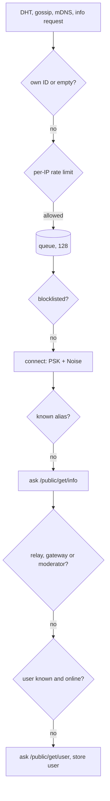

# Peer Discovery

Warpnet has no directory server, so every node has to find its peers itself. This page explains where a node learns about other nodes, what it does with each one it finds, and how it decides which connections to keep. It is mostly for developers and node operators; the transport underneath is in [Network](network.md).

## Sources at a glance

| Source | What it delivers | Runs on | Code |
|---|---|---|---|
| Bootstrap list | A few well-known relay nodes to start from | every role | [`config/config.go`](https://github.com/Warp-net/warpnet/blob/main/config/config.go) |
| DHT | Peers added to the Kademlia routing table, and providers of the network's rendezvous key | every role | [`core/dht/dht.go`](https://github.com/Warp-net/warpnet/blob/main/core/dht/dht.go) |
| PubSub gossip | Peer announcements on `/warpnet/discovery/1.0.0` | all roles publish; members and relays use what they receive | [`core/pubsub/gossip.go`](https://github.com/Warp-net/warpnet/blob/main/core/pubsub/gossip.go) |
| mDNS | Nodes on the same local network | members | [`core/mdns/mdns.go`](https://github.com/Warp-net/warpnet/blob/main/core/mdns/mdns.go) |
| Inbound info requests | Any peer that asks this node for `/public/get/info/0.0.0` | members and relays | [`core/handler/info.go`](https://github.com/Warp-net/warpnet/blob/main/core/handler/info.go) |

All sources except the bootstrap list feed one queue in the discovery service ([`core/discovery/discovery.go`](https://github.com/Warp-net/warpnet/blob/main/core/discovery/discovery.go)), which a single worker drains. Moderator nodes do not run the discovery service; they only keep a DHT routing table and forward gossip.

Only nodes on the same network and major version can connect at all, because the private-network key is derived from both (see [Protocol](protocol.md#versioning-and-compatibility)). A peer that is discovered but does not share the key fails at the connect step.

## Bootstrap nodes

The built-in bootstrap list is three relay nodes run by the project on one host, `207.154.221.44`, each reachable over IPv4 and IPv6:

| Network | Ports |
|---|---|
| `warpnet` (mainnet) | TCP 4001, 4002, 4003 |
| `testnet` | TCP 4011, 4022, 4033 |

A member node picks its bootstrap list in this order:

1. the list saved in the node's own network settings (`/private/post/settings/network/0.0.0`, the Settings screen);
2. `--node.bootstrap <multiaddr>,<multiaddr>` or `NODE_BOOTSTRAP`;
3. the built-in list for the selected network.

Relay and moderator nodes use only 2 and 3. The relay role is the same open-source code (`cmd/node/relay`), so anyone can run one and point their nodes at it; see [Network](network.md#keeping-the-projects-hosts-out-of-the-path).

What a node does with its bootstrap list:

- Adds the addresses to its peerstore permanently and seeds the DHT with them, then bootstraps and refreshes the routing table.
- Checks each bootstrap peer with a DHT ping. If an address answers with a different peer ID than configured, the node replaces the stale ID with the actual one.
- Uses the bootstrap nodes as static relays for AutoRelay, so a node behind NAT reserves a relay slot on them.
- Gives them the highest connection priority (see [Peer prioritisation](#peer-prioritisation)).
- Hands the same list to a phone during pairing, so the phone uses the same bootstrap nodes.

Bootstrap nodes are relays: they answer `/public/get/info/0.0.0` with type `relay` and carry no user profile, so discovery never syncs a user from them.

## DHT and rendezvous

Every role runs the Kademlia DHT (go-libp2p-kad-dht) in automatic client/server mode under a network-specific protocol prefix, `/warpnet` or `/testnet`. Nodes of the other network cannot share a routing table with it.

| Setting | Value |
|---|---|
| Bucket size | 50 |
| Routing table refresh | every hour |
| Record max age | 1 hour |
| Provider record cache | 256 entries, 8 hours |

Two things feed discovery from the DHT:

- **Routing table additions.** When a peer enters the routing table, its ID is handed to discovery. The connect step then uses whatever addresses the peerstore has for it.
- **Rendezvous.** Once bootstrapped, a node advertises itself as a provider of the namespace `warpnet/rendezvous/<network>` (for example `warpnet/rendezvous/warpnet`) and looks up other providers of the same namespace: right away and then every 10 minutes, up to 50 peers per lookup. It skips itself, peers it is already connected to and peers its rating excludes, stores the found addresses for 8 hours and hands each peer to discovery. Advertising needs at least one peer in the routing table; otherwise it is retried after 30 seconds, and afterwards it is renewed whenever the provider record expires.

Member nodes keep the DHT's records and their peerstore in their local database, so known peers survive a restart. Relay and moderator nodes keep them in memory.

## PubSub gossip

The gossip topic `/warpnet/discovery/1.0.0` is the main discovery source. Every role publishes on it:

- The message lists the publisher's own peer ID and addresses, plus up to 10 peers it is currently connected to, with their addresses.
- The first announcement goes out when gossip starts. The interval then starts at 1 minute and grows by 5 seconds with each round up to 30 minutes, plus a random 0 to 59 seconds per round.

Members and relays hand every peer in a received announcement to discovery. Moderators subscribe only to forward the topic.

## mDNS

Member nodes announce themselves on the local network with libp2p's mDNS service under the name `warpnet` and hand every local peer they hear to discovery. Mainnet and testnet use the same service name; the private-network key keeps them from connecting.

## Inbound info requests

When any peer calls `/public/get/info/0.0.0`, the serving node (member or relay) also treats the caller as discovered, with the address the call came from. Peers whose addresses are already in the peerstore are skipped, so two nodes asking each other for info do not loop.

## The discovery pipeline

### Before the queue

Every source goes through the same entry checks:

1. Empty peer IDs and the node's own ID are dropped.
2. The sighting is reported to the [rating](rating.md) engine, which can notice a peer that turns up too often.
3. A per-IP leaky bucket limits how often one address may be heard: by default a burst of 64 and 32 per 10 seconds. Peers announced without any address share one bucket. The owner can change both numbers in the rate-limit settings (`discovery_burst`, `discovery_per_ten_sec`).
4. The peer enters a 128-slot queue. If the queue is full, between 1 and 12 of the oldest entries are dropped.

### Member nodes

For each queued peer the member node:

1. Skips it if its peer ID is on the blocklist.
2. Connects to it. This is where the private-network key, Noise and the connection gater apply. A failed dial is reported to the rating engine.
3. If the peer is a known alias of another node (a phone paired with a member), raises its connection priority to the maximum and stops.
4. Asks it for `/public/get/info/0.0.0`. A node that answers with an error, or whose info has no owner, is dropped.
5. Remembers the peer's aliases (its paired devices) for 24 hours, and sets its connection priority from the reachability it reported.
6. Stops if the peer is a relay, the Fediverse gateway or a moderator. None of them carry a user profile to sync.
7. Stops if a user with this node ID is already stored and not marked offline.
8. Asks for the owner's profile over `/public/get/user/0.0.0`, measures the round-trip time, and creates the user locally or updates the existing record. The user is marked online.

A user is marked offline when a stream to their node fails with `node is offline`; the next time discovery meets that node, step 7 lets the profile be fetched again.

### Relay nodes

Relays do less: connect, check the alias cache (4096 entries, 72 hours), ask for info, set the connection priority and remember aliases. They store no users.

If the queue stays empty for 30 minutes on a member (5 minutes on a relay), the node logs `discovery: stalled`.

## Peer prioritisation

Connections are managed by libp2p's connection manager. By default it starts trimming at 50 connections down to 20 (the owner can change `network_low_water` and `network_high_water` in the rate-limit settings), with a one-hour grace period for new connections. When it trims, peers with the lowest tag values go first. Two tags add up:

| Tag | Values | Set when |
|---|---|---|
| Reachability | bootstrap nodes and paired aliases 100; public 90; unknown 60; private 30 | at start for bootstrap nodes, after the info request for others; ignored if changed within the last 30 seconds |
| Rating | trusted 60, watched 30, degraded 10, floor 1 | on connect and every 30 seconds |

The [rating](rating.md) also filters peers outside the connection manager:

| Effect | Floor tier | Other low tiers |
|---|---|---|
| DHT | kept out of the routing table, out of query results and out of rendezvous results; checked again every 30 seconds | stay |
| Gossip | score below the graylist threshold, messages are no longer read | negative score, no place in the gossip mesh |
| Stream rate limits | 10% of each route's allowance | 50% (watched), 25% (degraded) |
| Media in tweets and replies they deliver | dropped | kept |

A peer the node has no evidence about counts as trusted. Ratings are a weight, not a ban: a low-rated peer is slowed down and deprioritised, never refused outright.

## Blocklist

The peer blocklist lives in the node's database ([`database/node-repo.go`](https://github.com/Warp-net/warpnet/blob/main/database/node-repo.go)). A blocked peer is:

- skipped by discovery;
- refused by the connection gater on outgoing dials and on incoming connections once Noise has revealed its peer ID;
- disconnected and removed from the peerstore by a sweep every 10 seconds;
- blacklisted in GossipSub.

When a blocked peer reaches the node through a relay, the node also asks that relay to stop connecting the peer to it (see [Network](network.md#relay-reservation-refusals)).

Blocking a user in the app (`/private/post/settings/block/0.0.0`) puts that user's node on the blocklist permanently; unblocking removes it. Users on bridged networks are the exception: the Fediverse gateway node they come through is never blocked.

> **Note:** The database layer also implements escalating temporary blocks (1 hour, 24 hours, 7 days, then permanent), but no code path calls it today. The only way a peer gets on the blocklist is a user block.
{: .note }

## Reconnects and caching

- **Peer addresses.** Members persist their peerstore, so known peers are dialable after a restart. Addresses learned through rendezvous expire after 8 hours; bootstrap addresses never expire.
- **Reconnect.** When a peer connects again, the node clears its offline mark at once (otherwise a peer that failed a stream is skipped for 30 seconds), flushes any writes queued for it in the outbox and re-applies its rating tag. See [Protocol](protocol.md#outbox-for-offline-peers).
- **Relays.** AutoRelay retries a failed relay after 5 minutes and drops relay candidates older than 5 minutes.
- **Periodic refresh.** Gossip announcements and rendezvous lookups keep running for the node's lifetime, so a node that lost all its peers finds them again without a restart.

## See also

- [Network](network.md): transport, NAT traversal, relays
- [Protocol](protocol.md): routes, envelopes, gossip topics
- [Rating](rating.md): how peers are rated
- [Relay node architecture](relay-node-architecture.md): the bootstrap/relay role
- [Running a node](user-guide/running-a-node.md): flags and configuration
