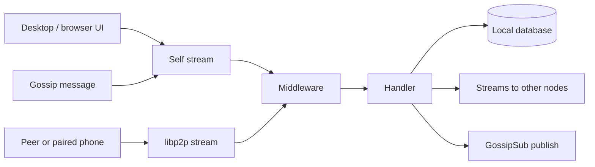

# Member Node Architecture

The member node is the node a user runs: it holds the account, serves the UI and paired phones, and takes part in the network. This page describes how it starts, how a request travels through it, and what each component does. It is aimed at developers and curious operators; for the big picture read [Architecture](architecture.md) first.

## Build flavours

One package, [`cmd/node/member`](https://github.com/Warp-net/warpnet/tree/main/cmd/node/member), has three entry points chosen by Go build tags. All three build the same node with `NewMemberNode` and `Start` from [`cmd/node/member/node/member-node.go`](https://github.com/Warp-net/warpnet/blob/main/cmd/node/member/node/member-node.go); they differ only in how the user reaches it.

| Flavour | Entry point | Build | User interface | Database | Self-update |
|---|---|---|---|---|---|
| **Desktop** | [`main.go`](https://github.com/Warp-net/warpnet/blob/main/cmd/node/member/main.go) + [`app.go`](https://github.com/Warp-net/warpnet/blob/main/cmd/node/member/app.go) | default (no `echo`, no `remote` tag), built with Wails; on Linux `-tags webkit2_41` | Wails window; the UI calls the node in-process | encrypted BadgerDB on disk | yes, asks the owner first; off in the Snap package |
| **Remote** | [`remote-member.go`](https://github.com/Warp-net/warpnet/blob/main/cmd/node/member/remote-member.go) | `-tags remote`, plain `go build` | the same UI in a browser: HTTP at `/`, WebSocket at `/ws` | encrypted BadgerDB on disk | no |
| **Echo** | [`echo-member.go`](https://github.com/Warp-net/warpnet/blob/main/cmd/node/member/echo-member.go) | `-tags echo`, `CGO_ENABLED=0` | none: a bot | in memory, fixed test account | no |

All three report `type: "member"` to other nodes.

**Desktop.** The Vue UI is embedded in the binary and rendered by [Wails](https://wails.io) in a native window. Wails holds a single-instance lock (`net.warpnet.app`), so only one desktop app runs at a time; launching it again passes any `warpnet://` link to the running app. The app registers the `warpnet://` URL scheme at start-up.

**Remote.** A headless member node with an HTTP server for the browser dashboard. It listens on `--node.server.host` and `--node.server.port` (defaults `0.0.0.0` and `4999`). Every `/ws` connection starts with a Noise XX handshake ([`security/noise.go`](https://github.com/Warp-net/warpnet/blob/main/security/noise.go)); the node's static key is kept in `ws-noise.key` in the network's data directory, and its fingerprint is printed at start-up so the user can compare it with what the browser pinned. A successful login enrolls the browser's key for as long as the process runs; logging out from the browser removes that key but leaves the node running ([`cmd/node/member/remote/bridge.go`](https://github.com/Warp-net/warpnet/blob/main/cmd/node/member/remote/bridge.go)). Running it on a server is covered in [Running a node](user-guide/running-a-node.md).

**Echo.** A test bot for local swarms and the testnet. It runs with an in-memory database and a fixed account, logs itself in, and then replaces three handlers with bot behaviour: it follows back whoever follows it, answers direct messages, and accepts but ignores posts pushed to it. Once a day it writes a new post whose text it fetches from a public jokes API; others see it on the bot's profile.

## Boot sequence

The desktop flavour starts like this. Remote and echo skip the Wails parts but go through the same login and node start.

1. **Configuration.** Flags and environment variables are read when the [`config`](https://github.com/Warp-net/warpnet/blob/main/config/config.go) package initialises: network (with `mainnet` mapped to `warpnet`), bootstrap list, ports, data path. A flag overrides the environment variable with the same name (`--node.port` / `NODE_PORT`), which overrides the default. The full list is in [Running a node](user-guide/running-a-node.md).
2. **Process start** (`main.go`). Set up logging. If no network was chosen and a testnet database already exists, switch to testnet. On Linux, install the desktop icon and a fontconfig file. Register the `warpnet://` scheme, then start Wails with the embedded UI and bind the `App` object so the UI can call it.
3. **App start-up** (`App.startup`). Open the BadgerDB store at `~/.warpdata/<network>/<database.dir>` (it stays locked until login), create the auth and user repositories and the auth service, derive the network key (PSK) from the network name and version, start the login loop, and start the self-updater if `--node.self-update` is on and the app is not running from a Snap.
4. **Login.** The UI sends `/private/post/login/0.0.0`; the app handles it itself. The password must be 8-32 characters with an upper-case letter, a lower-case letter, a digit and a special character. The username and password open the encrypted database and derive the Ed25519 identity key ([`database/auth-repo.go`](https://github.com/Warp-net/warpnet/blob/main/database/auth-repo.go)). On the very first login the owner record and the user profile are created with a new ULID user ID.
5. **Node start.** The login loop computes the node ID from the key, reads network settings saved in the database (listen hosts, port, bootstrap list; empty values fall back to the configuration), calls `NewMemberNode` and `Start`, and answers the login with the node ID, addresses, bootstrap list, network, PSK and pairing token. The UI turns this answer into the pairing QR code.
6. **Logout.** On the desktop, logout stops the node and closes the database; the next login starts a new node.

### NewMemberNode

`NewMemberNode` builds everything that does not need a running libp2p host:

- clears the list of paired devices, so a phone has to pair again after the node restarts;
- applies the owner's Mastodon gateway setting and seeds the bridged entry accounts ([`core/bridge`](https://github.com/Warp-net/warpnet/tree/main/core/bridge));
- loads rate-limit, network and wallet settings from the database;
- creates the notifier (in-app store and email), the user repository, the discovery service and mDNS;
- collects the users the owner follows (except bridged ones) so gossip subscribes to their topics from the start;
- creates the GossipSub service, the DHT and the wallet client;
- assembles the libp2p options: identity, a peerstore persisted in the database, the PSK, TCP listeners on IPv4 and IPv6, DHT routing, auto-relay through the bootstrap relays, a connection gater for blocklisted peers, and the options shared by every role ([`core/warpnet/options.go`](https://github.com/Warp-net/warpnet/blob/main/core/warpnet/options.go)).

### Start

`Start` brings the node up in this order:

1. Create the libp2p host ([`core/node/node.go`](https://github.com/Warp-net/warpnet/blob/main/core/node/node.go)) with a resource manager, a connection manager, yamux, hole punching and a circuit relay v2 service.
2. Attach the outbox for undelivered writes.
3. Start discovery, then GossipSub (discovery must run first because the gossip listener feeds it), then mDNS.
4. Start the CRDT stores for post statistics and node ratings, then the rating engine.
5. Install the stream middleware and connect the rating engine to the events of the host, the middleware, discovery and the node itself.
6. Start the trust circle.
7. Register the stream handlers (120 routes on the current `develop` branch).
8. Give the bootstrap relays the highest connection priority and print `NODE STARTED WITH ID ... AND ADDRESSES ...`.

`Stop` closes the libp2p host first, waits for requests in flight to finish, and then closes the other components.

## Request path

Every request ends up in a handler registered for a route. It can arrive two ways.

| Entry | Who uses it | How |
|---|---|---|
| **Self stream** | the desktop UI, the browser dashboard, gossip deliveries | `SelfStream` creates an in-memory loopback stream and runs the route's handler directly, with a one-minute deadline (ten minutes for the Twitter archive import) |
| **Peer stream** | other nodes and paired phones | a real libp2p stream opened on the route's protocol ID |

Both are wrapped by the same code in `WarpNode`, which reads the request (each route has a size limit), runs the middleware and the handler, and writes the response or an error object back.



### Middleware

The member node installs four middlewares; the first listed is the outermost ([`core/middleware`](https://github.com/Warp-net/warpnet/tree/main/core/middleware)).

| Order | Middleware | What it does |
|---|---|---|
| 1 | Logging | logs the request and response |
| 2 | Rate limiter | a leaky bucket per route and peer, with separate budgets for reads, writes, media, uploads and other route classes; scaled down for badly rated peers; the node's own requests are exempt |
| 3 | Auth | parses the envelope; requires a message ID and a signature; verifies the Ed25519 signature against the key in the sender's peer ID; rejects remote messages more than five minutes off; allows `private` routes only from the node itself and its paired devices (the pairing route is open, since that is how a device pairs) |
| 4 | Idempotency | caches each response by route, peer and message ID for ten minutes, so a retried request is not executed twice; errors are not cached |

The handler receives only the message body, plus the message ID and whether the caller is a paired device.

### Outgoing streams and the outbox

Handlers talk to other nodes with `GenericStream`. A write (any route that is not a `get`) is put into the outbox before it is sent and removed once the peer confirms it. If the peer is offline, the write stays queued and is retried when the peer connects again, and at least every five minutes ([`core/stream/outbox.go`](https://github.com/Warp-net/warpnet/blob/main/core/stream/outbox.go)); the peer's user is marked offline meanwhile. A node never opens a peer stream to itself.

### Gossip input

Topics without their own handler, which are the topics of followed users, are fed into the node as a self stream with the original publisher as the sender ([`core/pubsub/gossip.go`](https://github.com/Warp-net/warpnet/blob/main/core/pubsub/gossip.go)). The message therefore passes the same signature and freshness checks as a direct request. Messages whose destination is a `get` route are ignored.

## Components

| Component | Package | Role |
|---|---|---|
| Host and dispatch | [`core/node`](https://github.com/Warp-net/warpnet/tree/main/core/node), [`core/warpnet`](https://github.com/Warp-net/warpnet/tree/main/core/warpnet) | libp2p host, handler registration, self streams, peer priorities, blocklist gater |
| Streams | [`core/stream`](https://github.com/Warp-net/warpnet/tree/main/core/stream) | peer stream pool, loopback streams, outbox |
| Middleware | [`core/middleware`](https://github.com/Warp-net/warpnet/tree/main/core/middleware) | logging, rate limits, signature and access checks, idempotency |
| Handlers | [`core/handler`](https://github.com/Warp-net/warpnet/tree/main/core/handler) | one handler per route |
| Repositories | [`database`](https://github.com/Warp-net/warpnet/tree/main/database) | storage over BadgerDB, one repository per feature |
| Gossip | [`core/pubsub`](https://github.com/Warp-net/warpnet/tree/main/core/pubsub), [`cmd/node/member/pubsub`](https://github.com/Warp-net/warpnet/tree/main/cmd/node/member/pubsub) | GossipSub topics, follower updates, reports |
| Discovery | [`core/discovery`](https://github.com/Warp-net/warpnet/tree/main/core/discovery), [`core/dht`](https://github.com/Warp-net/warpnet/tree/main/core/dht), [`core/mdns`](https://github.com/Warp-net/warpnet/tree/main/core/mdns) | finding peers and learning who runs them |
| CRDT stores | [`core/crdt`](https://github.com/Warp-net/warpnet/tree/main/core/crdt) | replicated post statistics and node ratings |
| Rating | [`core/rating`](https://github.com/Warp-net/warpnet/tree/main/core/rating) | rates peers from observed behaviour |
| Trust circle | [`core/trust`](https://github.com/Warp-net/warpnet/blob/develop/core/trust/circle.go) | users the owner trusts, from the follow graph |
| Notifications | [`core/notifications`](https://github.com/Warp-net/warpnet/tree/main/core/notifications) | in-app notifications and optional email |
| Media | [`core/media-meta`](https://github.com/Warp-net/warpnet/tree/main/core/media-meta), [`core/video`](https://github.com/Warp-net/warpnet/tree/main/core/video) | image and video checks, sponsored-media processing |
| Self-update | [`core/selfupdate`](https://github.com/Warp-net/warpnet/tree/main/core/selfupdate) | signed release updates |
| Wallet | [`core/wallet`](https://github.com/Warp-net/warpnet/tree/main/core/wallet) | TRON wallet for priced posts |
| Bridge | [`core/bridge`](https://github.com/Warp-net/warpnet/tree/main/core/bridge) | bridged-user tagging and the gateway's peer ID |

### Handlers

Handlers are factory functions that receive their dependencies as small interfaces and return a function of `(body, stream)`. This keeps each one testable without a live node; a short handler such as [`core/handler/bookmark.go`](https://github.com/Warp-net/warpnet/blob/main/core/handler/bookmark.go) shows the pattern. `setupHandlers` registers them in groups:

| Group | Examples |
|---|---|
| Node and devices | pairing, device list, node info, node stats, rating, reports, moderation results |
| Posts and timeline | new post, reply, edit, delete, pin, repost, timeline delivery, Twitter archive import |
| Engagement | reactions, views, reactors, reposters, poll votes |
| Follows | follow, unfollow, followers, followings, follow requests, trust circle |
| Users | profile, user search, who to follow, subscriptions |
| Chats | chats, messages |
| Media | image and video upload and download, for posts and for chats |
| Notifications | list, read, mark read |
| Settings | notifications, gateway, rate limits, network, wallet, sponsored posts, keyword filters |
| Blocks, mutes, bookmarks | block, unblock, mute, unmute, bookmarks |
| Wallet and sponsored posts | balance, send, stake, priced posts, orders |

The full list of routes is in the [route reference](developer-guide/api.md).

### Gossip topics

| Topic | Carries |
|---|---|
| `user-update-<user ID>` | new and deleted posts of that user; a node subscribes to the topics of the users its owner follows |
| `/warpnet/discovery/1.0.0` | address announcements: the node's own addresses and those of up to ten connected peers, first at start-up and then at intervals that grow from one minute to 30 minutes |
| `/warpnet/stats/1.0.0` | CRDT updates of post statistics |
| `/warpnet/rating/1.0.0` | CRDT updates of node ratings |
| `/warpnet/reports/1.0.0` | reports sent to moderator nodes |

GossipSub scores peers by their rating: a peer rated low enough is no longer read at all. See [Rating](rating.md).

### Discovery

Discovery takes candidate peers from the DHT, gossip announcements, mDNS and the peers that call `/public/get/info/0.0.0`. For each one it connects, asks for the node information, and sets a connection priority from the peer's reachability. For a member peer it also fetches the user profile and stores it, which is how users appear in search and in "who to follow". Relays, moderators and the bridge gateway are connected but not added as users. Blocklisted peers are skipped. See [Discovery](discovery.md).

### Database

All state lives in one BadgerDB store, encrypted with a key derived from the username and password and opened at login. The repositories in [`database`](https://github.com/Warp-net/warpnet/tree/main/database) store posts, timeline, follows, chats, media, notifications, settings, the peerstore and the DHT records. Posts and media fetched from other nodes are cached with an expiry. See [Storage](storage.md).

### CRDT stores and rating

Post statistics (views, reactions, replies, reposts, poll votes) are kept twice: as local counters in the database and as signed Merkle-CRDT counters replicated over gossip ([`core/crdt/stats`](https://github.com/Warp-net/warpnet/tree/main/core/crdt/stats)). Only the node of the user who acted adds to the replicated counter. Node ratings use a second CRDT store of signed records. The rating engine turns the events it hears about (bad signatures, malformed frames, rate-limit hits, failed dials and others) into ratings, which in turn set connection priority, DHT admission, gossip scoring, rate limits and whether media from a peer is accepted. See [Synchronization](synchronization.md) and [Rating](rating.md).

### Paired devices

A phone pairs on `/private/post/admin/pair/0.0.0` with the token from the QR code; the node stores the phone's peer ID as an alias and answers with its own addresses ([`core/handler/device.go`](https://github.com/Warp-net/warpnet/blob/main/core/handler/device.go)). While at least one device is paired, the node asks the operating system not to sleep ("serving paired devices"); removing the last device releases that. A paired device may unpair only itself. The alias list is cleared every time the node starts. See [Mobile apps](user-guide/mobile.md).

### Notifications

Handlers record notifications (follows, replies, mentions, reactions, reposts, messages, moderation outcomes and others) through one notifier that delivers them to every channel: the in-app store and, if the owner configured SMTP and opted in for that type, email. Email is sent in the background and never blocks the in-app notification ([`core/notifications`](https://github.com/Warp-net/warpnet/tree/main/core/notifications)).

### Media

Images and videos are stored on the author's node under a content key. Other nodes fetch them on demand from the author's node, check that the bytes match the key and that the metadata embedded in the file names the author's node and user, and cache them locally with an expiry ([`core/handler/image.go`](https://github.com/Warp-net/warpnet/blob/main/core/handler/image.go)). Media of bridged Fediverse users come from the gateway. Video for sponsored posts is processed with an ffmpeg build embedded in the binary, one process at a time.

### Self-update

The desktop node checks for a newer release one minute after start and then every hour, on both Codeberg and GitHub, and takes the newest. It verifies the release's checksum list against an Ed25519 release key built into the binary, then asks the owner in the UI before installing; the owner can decline. It replaces its own binary and restarts; if the restart fails it puts the old binary back and skips that version from then on ([`core/selfupdate`](https://github.com/Warp-net/warpnet/tree/main/core/selfupdate)). Release assets exist for Linux (amd64, arm64) and Windows (amd64). In the Snap package self-update is off; an install the process cannot write to only shows that an update is available. A new major version changes the network key, so the updated node joins the peers on that major version.

### Wallet

The wallet holds USDT and TRX on the TRON network and is used for priced (sponsored) posts. Its key is derived from the identity key, the network and the login name, so it is recovered with the account ([`core/wallet/seed.go`](https://github.com/Warp-net/warpnet/blob/main/core/wallet/seed.go)). The blockchain work is done by a payment engine binary embedded in the node ([payment-engine-lib](https://github.com/Warp-net/payment-engine-lib)), unpacked into the user's cache directory and started only when needed. It talks to TronGrid by default; `--wallet.endpoint` and `--wallet.binary-path`, or the wallet settings in the UI, change that.

## Data on disk

```text
~/.warpdata/                    (Windows: %LOCALAPPDATA%\warpdata)
  fontconfig.conf               Linux desktop only, outside the Snap
  <network>/                    warpnet, testnet, or your own network name
    <database.dir>/             encrypted BadgerDB, default "storage"
    ws-noise.key                remote flavour only: the dashboard's Noise key
```

Several member nodes can run on one machine for development if each has its own `--node.port` and `--database.dir`; the desktop flavour still allows only one app at a time. See [Running a node](user-guide/running-a-node.md).

## See also

- [Architecture](architecture.md)
- [Relay node architecture](relay-node-architecture.md)
- [Protocol](protocol.md)
- [Clients](developer-guide/clients.md)
- [Storage](storage.md)
