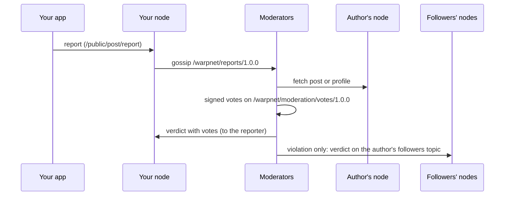

# Moderation

Warpnet has no company, no instance administrators and no moderation team. Reported content is judged by volunteer **moderator nodes** that each run a small language model locally and vote; a strict majority is needed to act, and every vote is signed. This page explains what you can report, how a report is handled, what you will see, what your own node lets you control, and how to run a moderator. It is written for users first; the later sections give the exact rules for developers.

## In short

- You report a post or a profile. The report goes to all moderators at once.
- A few of them, chosen by an order nobody controls, fetch the content and judge it with Llama Guard 3.
- They vote. Content is actioned only on a strict majority against it; a tie or no majority favours the content.
- The result comes back to you with every vote signed. Your node recounts the votes before it accepts it.
- A condemned post or profile is hidden from the author's followers (shadow ban). Nothing is deleted, the author is not told, and there is no appeal.

## What can be reported

| Object | What the moderators judge |
|---|---|
| A post | The text of the post as served by the author's node |
| A profile | Profile name, bio, website and any extra public profile fields, in that order (extra fields sorted by name) |

Not covered:

- **Direct messages.** Chats are never read, judged or reported. There is no mechanism for it.
- **Images and video.** Only text is judged. A post without text gets an "unavailable" result.
- **Other report types.** The node rejects report types other than post and profile ([`core/handler/report.go`](https://github.com/Warp-net/warpnet/blob/main/core/handler/report.go)).
- **Bridged accounts.** Accounts from other networks are moderated by those networks' administrators; the desktop app says so on their profiles. See [Bridges](bridge.md).

### The report itself

In the desktop app you pick one or more categories (spam or scam, harassment or bullying, hate speech, violence or threats, sexual content, child safety, self-harm or suicide, privacy violation, dangerous or weapons) and can add a short comment. The app sends the matching Llama Guard category names plus your comment as the report reason. Your node accepts a report only from its own owner, trims the reason and rejects one longer than 256 characters.

The reason travels with the report and appears in moderators' logs, but the model judges the content, not the reason.

A report is **not anonymous**: your node stamps it with your user ID and node ID so the result can find its way back, and it travels on a public gossip topic. Warpnet does not notify the person you reported.

## How a report is handled



1. Your node validates the report, stamps your identity on it and publishes it on the global reports topic. Relay nodes forward the topic, so the report reaches every moderator at once.
2. Each moderator opens a **round** for the report and works out its own place in the order for that round.
3. The first moderators in the order fetch the post or profile directly from the author's node (3 attempts, 3 seconds apart) and run it through the model. If the content cannot be fetched, they vote "unavailable" instead, which counts as no violation.
4. Each vote is signed and broadcast on the votes topic.
5. When the voting window closes, every moderator that voted computes the same outcome from the same votes.
6. One of them, the chair, signs the verdict, attaches the counted votes, sends it to your node, and on a violation also publishes it to the author's followers.

### Who judges a report

Nobody assigns moderators, and nobody can volunteer for a particular report ([`cmd/node/moderator/round`](https://github.com/Warp-net/warpnet/tree/main/cmd/node/moderator/round)):

- **Round ID.** A SHA-256 hash of the report's own fields (type, target user, target node, object, reason, reporter, reporter's node), each length-prefixed. Identical reports collapse into one round, and a finished round ID is remembered for an hour so it is not judged twice.
- **Order.** For each moderator, the first 8 bytes of `SHA-256(round ID + "|" + moderator ID)` give its rank. The report decides the order, so an attacker cannot arrange to judge a friend's post.
- **Who starts.** Each moderator estimates its rank among the moderators it has seen voting in the last 24 hours. The top three start at once. The others wait 35 seconds per place below the top three and stay silent if three votes are already in when their turn comes, so no inference is wasted.
- **Moderator identity.** A vote's moderator ID is taken from the signed gossip envelope, never from the vote's own payload.

### Voting and majority

The rules are the same on every moderator and on every member node ([`cmd/node/moderator/round/countdown.go`](https://github.com/Warp-net/warpnet/blob/main/cmd/node/moderator/round/countdown.go), [`event/event.go`](https://github.com/Warp-net/warpnet/blob/main/event/event.go)):

| Rule | Value |
|---|---|
| Voting window | 150 seconds from the moment a moderator opens the round |
| Votes per moderator | One; duplicates are ignored |
| Vote order | Ascending by the pair hash above; position 0 comes first |
| Even number of votes | The last vote in that order is set aside, so the count is always odd |
| Violation (FAIL) | Only if more than half of the counted votes say so |
| Tie, split, no majority | Always resolves in favour of the content (OK) |
| Reason in the result | Taken from the first vote in the order on the winning side |

The **chair** is the first voter in the order. Every other voter is a backup: the voter at position *k* waits *k* × 10 seconds and publishes the verdict itself if no "final" announcement has arrived, so a report is not lost when the chair goes offline. A final announcement is honoured only from a moderator whose vote is in the round.

### Signed verdicts

A single forged verdict could hide anyone's posts, so verdicts are checked by every node that receives them ([`core/handler/moderation.go`](https://github.com/Warp-net/warpnet/blob/main/core/handler/moderation.go)):

1. Each vote is signed by its moderator with the moderator's Ed25519 node key, over the subject of the verdict (type, user, object), the moderator ID and the result.
2. The verdict is signed by the moderator that publishes it, over its own fields and timestamp. Both signatures use explicit length-prefixed fields rather than re-encoded JSON.
3. Your node verifies the publisher's signature against the key embedded in its moderator ID.
4. Your node recounts the attached votes: it drops votes whose signature does not match their moderator ID, counts each moderator once, and requires **at least three** valid voters whose strict majority matches the verdict.
5. If any check fails, the verdict is dropped silently. Nothing is hidden and nobody is notified.

## What you will see

As the reporter, you get one notification, whatever the outcome:

| Outcome | Notification |
|---|---|
| Violation found | "The tweet you reported was moderated: *reason*" |
| No violation | "The tweet you reported was reviewed: no violation found" |
| Content could not be fetched | "The tweet you reported could not be reviewed: the content is unavailable" |

For a profile the text says "profile" instead of "tweet". The reason is the list of Llama Guard category names that were violated, for example "Violent Crimes, Hate". "Could not be reviewed" usually means the author's node was offline; nothing was decided.

A typical report takes a few minutes, because the voting window is 150 seconds and a backup may need to step in.

If you follow the author of a moderated post, your node removes the post from your Home timeline; where the post still appears, the app replaces its text with "Moderated: *reason*". In user lists, a moderated profile shows "Moderated" instead of its name and "Moderated: *reason*" instead of its bio.

The author sees nothing: their own copy looks exactly as before, and they get no notification.

## What happens to moderated content

Moderation is a **shadow ban**, not a deletion ([`cmd/node/moderator/isolation/isolation-protocol.go`](https://github.com/Warp-net/warpnet/blob/main/cmd/node/moderator/isolation/isolation-protocol.go)):

- Only violation verdicts are broadcast, and only on the author's followers topic. A "no violation" result goes to the reporter alone.
- Each receiving node that stores the post marks its copy with a moderation record and removes the post from its owner's Home timeline. A profile verdict is applied only by nodes that already store that profile.
- Nothing is deleted from anyone's disk, including the author's.
- The author's node never receives the verdict.
- The moderator that carries the decision also records it against the author's node in the [rating](rating.md) system, once per verdict.
- There is no appeal and no human review. The protection against a bad call is that several independent machines had to agree.

The reasoning behind the shadow ban: an author who knows the exact moment they were caught tends to repost with different wording; an author who does not know keeps posting into a room that has quietly emptied.

## Moderators check each other

A vote round stops a single forged verdict, but it cannot tell a real moderator from one that votes without running a model. Moderators therefore spot-check each other ([`cmd/node/moderator/audit`](https://github.com/Warp-net/warpnet/tree/main/cmd/node/moderator/audit)):

- **Reference texts.** When a round this moderator voted in is decided, it files the text it judged under the round's verdict. It keeps up to 128 clean and 128 moderated texts and starts checking others only once it has at least one of each.
- **Who is asked.** Every 5 minutes it picks a random peer among the moderators it has seen voting in the last 24 hours, skipping any peer it asked in the last 10 minutes, and sends it one reference text, clean or moderated at random, over `/public/get/moderate/challenge/0.0.0`. The references come from live traffic, so they cannot be tabulated in advance.
- **The answer.** The peer runs its own model on the text and returns a verdict signed with its node key and bound to the challenge ID and the SHA-256 of the text. An answer with a wrong binding or signature counts as invalid; no answer or an error counts as unanswered.

Each moderator keeps a standing for every peer it asked:

| Standing | When |
|---|---|
| Probation | Fewer than 20 answered challenges (every peer starts here) |
| Trusted | 80% or more of answers agree with the decided result |
| Suspect | Agreement below 80%, or more than half of 20 or more challenges unanswered |
| Banned | Agreement below 65%, or more than one invalid answer |

A standing never throws a vote out: a flagged moderator still votes. One machine's opinion of another is not proof, and moderators may legitimately run different models that sometimes disagree. Every unanswered challenge and every move into Suspect or Banned is reported to the [rating](rating.md) system, which weighs observations from many nodes.

## Your own controls

Besides reporting, every user can shape what they see. These controls are stored on your own node and apply only to you; nobody else is told.

| Control | Where | Effect |
|---|---|---|
| **Block** | Profile menu; Settings → Blocked users | Stored on your node. For a Warpnet user, your node also refuses connections to and from that user's node. For a bridged account only the stored block applies |
| **Mute** | Profile menu; Settings → Muted users | Stored on your node. It does not affect connections |
| **Filters** | Settings → Filters | Named keyword lists, matched in the app |
| **Report** | Post or profile menu | Sends the report to moderators, as described above |

**Filters** follow the Mastodon model ([`domain/warpnet.go`](https://github.com/Warp-net/warpnet/blob/main/domain/warpnet.go)): each filter has a title, one or more keywords (each optionally "whole word"), the contexts it applies to (home, notifications, thread), an action (warn or hide) and an optional expiry. The node stores them; matching happens in the app. The desktop app applies active "hide" filters to the Home timeline, matching case-insensitively, and never hides your own posts.

Blocking at the network level is described in [Security](security.md#blocklist).

## Running a moderator node

Anyone can run one. There is no application and no approval, and a moderator gets no special power: its vote counts the same as any other, and it cannot choose which reports it judges. Running one commits your machine to fetching reported content, judging it, answering spot-checks from other moderators, and signing its votes.

### Requirements

- **Platform.** Releases ship a moderator binary for Linux amd64 (`moderator_linux_amd64.tar.gz`). On other platforms build it from source.
- **Model file.** `Llama-Guard-3-1B-Q4_K_M.gguf`, which you obtain yourself; it is not in the repository or the releases. The moderator loads it from its **working directory**; the file name is fixed and there is no flag for another path ([`cmd/node/moderator/moderator/moderator.go`](https://github.com/Warp-net/warpnet/blob/main/cmd/node/moderator/moderator/moderator.go)).
- **CPU.** Inference runs on the CPU using all cores; the model file is memory-mapped. The project's own deployment caps each moderator container at 256 MB of RAM ([`deploy/docker-compose-moderator.yml`](https://github.com/Warp-net/warpnet/blob/main/deploy/docker-compose-moderator.yml)).
- **Network.** A reasonably stable connection; other moderators must be able to reach it for spot-checks.

A moderator creates a new random identity every time it starts, so the standing other moderators keep for it starts over after a restart.

### Build and run

From source, a C/C++ toolchain is required (cgo), and the `core/moderation` submodule must be checked out:

```bash
git submodule update --init --recursive
CGO_ENABLED=1 go build -tags=llama -mod=mod -o moderator cmd/node/moderator/main.go
# the model file must be in the current directory
./moderator --node.network warpnet --node.port 4001
```

The repository's Dockerfile builds with the same `llama` tag; the `Makefile` target `run-moderator` runs a moderator on `testnet`.

With Docker, using the repository's [`Dockerfile.moderator`](https://github.com/Warp-net/warpnet/blob/main/Dockerfile.moderator) (the container's working directory is `/warpnet`):

```bash
docker build -f Dockerfile.moderator -t warpnet-moderator .
docker run -d --network host \
  -e NODE_NETWORK=warpnet -e NODE_PORT=4001 \
  -v /path/to/Llama-Guard-3-1B-Q4_K_M.gguf:/warpnet/Llama-Guard-3-1B-Q4_K_M.gguf:ro \
  warpnet-moderator
```

### Options

The moderator reads the common node options ([`config/config.go`](https://github.com/Warp-net/warpnet/blob/main/config/config.go)). Each flag can also be set as an environment variable, upper-case with `_` for `.` and `-`:

| Flag | Environment | Default | Meaning |
|---|---|---|---|
| `--node.network` | `NODE_NETWORK` | `warpnet` | `warpnet` or `testnet` |
| `--node.port` | `NODE_PORT` | `4001` | TCP port to listen on |
| `--node.host.v4` / `--node.host.v6` | `NODE_HOST_V4` / `NODE_HOST_V6` | `0.0.0.0` / `::` | Listen addresses |
| `--node.bootstrap` | `NODE_BOOTSTRAP` | built-in list | Bootstrap nodes, comma-separated multiaddrs |
| `--node.self-update` | `NODE_SELF_UPDATE` | `true` | Install new signed releases automatically |
| `--logging.level` | `LOGGING_LEVEL` | `info` | Log level |
| `--logging.format` | `LOGGING_FORMAT` | `text` | `text` or `json` |

A moderator installs updates without asking. See [Running a node](user-guide/running-a-node.md) for the options shared by all node types.

### Engine and policy

The engine is the [Warp-net/moderation](https://github.com/Warp-net/moderation) package, included as the `core/moderation` submodule. It runs Llama Guard 3 (1B, Q4_K_M quantization) through llama.cpp with no network calls. Decoding is deterministic: temperature 0, top-p 0.9, fixed seed 42, at most 64 output tokens, a 4096-token context, no GPU layers.

The prompt lists the hazard categories S1 to S13, and the model answers `safe`, or `unsafe` followed by a line of category codes. Some codes are ignored:

| Count as a violation | Ignored (treated as safe) |
|---|---|
| S1 Violent Crimes, S2 Non-Violent Crimes, S3 Sex Crimes, S4 Child Exploitation, S7 Privacy, S9 Indiscriminate Weapons, S10 Hate, S11 Self-Harm | S5 Defamation, S6 Specialized Advice, S8 Intellectual Property, S12 Sexual Content, S13 Elections |

If the model flags content only with ignored codes, the content is treated as safe. Output that is neither `safe` nor `unsafe` is an engine error; the moderator then casts no vote at all.

## Limits

These are real and worth knowing:

- **The model makes mistakes** in both directions. The majority rule means several machines must make the same mistake; it does not make mistakes impossible.
- **Text only, reports only.** Images and video are not analysed, and nothing scans the network on its own. Content nobody reports is never reviewed.
- **No moderators, no moderation.** If no moderator is online, a report is accepted and then goes nowhere, without a notification. With fewer than three moderators the round still decides, but nodes discard a verdict with fewer than three signed votes, so again nothing happens and nobody is notified.
- **Keys cost nothing.** There is no list of approved moderators: nobody owns the network. Anyone who generates three throwaway keys can sign three votes and build a verdict that nodes will accept, without running a model. Someone patient can also run several real moderators to swing votes.
- **The author's node supplies the content.** Moderators judge what the author's node returns. If the returned post already carries a moderation record, moderators reuse its result instead of running the model.
- **Followers only.** The verdict reaches the nodes that receive the author's updates. Anyone who reads the author's posts directly from the author's node sees them unchanged.
- **Applied by each app, not enforced by the network.** A node running modified software can ignore verdicts on its own screen.
- **Nothing is deleted** and there is no appeal.

## Protocol reference

| Purpose | Route or topic |
|---|---|
| Submit a report (your app to your node) | `/public/post/report/0.0.0` |
| Reports gossip topic | `/warpnet/reports/1.0.0` |
| Moderator votes gossip topic | `/warpnet/moderation/votes/1.0.0` |
| Verdict delivery (to the reporter and to followers) | `/public/post/moderate/result/0.0.0` |
| Moderator spot-check (moderator to moderator) | `/public/get/moderate/challenge/0.0.0` |
| Fetch the reported post / profile | `/public/get/tweet/0.0.0` / `/public/get/user/0.0.0` |

The spot-check route is defined in [`cmd/node/moderator/audit/wire.go`](https://github.com/Warp-net/warpnet/blob/main/cmd/node/moderator/audit/wire.go), the others in [`event/paths.go`](https://github.com/Warp-net/warpnet/blob/main/event/paths.go); the full list is in the [API reference](developer-guide/api.md).

## See also

- [Security](security.md): signatures, blocklist and rate limits
- [Rating](rating.md): how moderation outcomes and spot-checks affect a node's rating
- [Bridges](bridge.md): moderation of bridged accounts
- [Getting started](user-guide/index.md): reporting from the app
