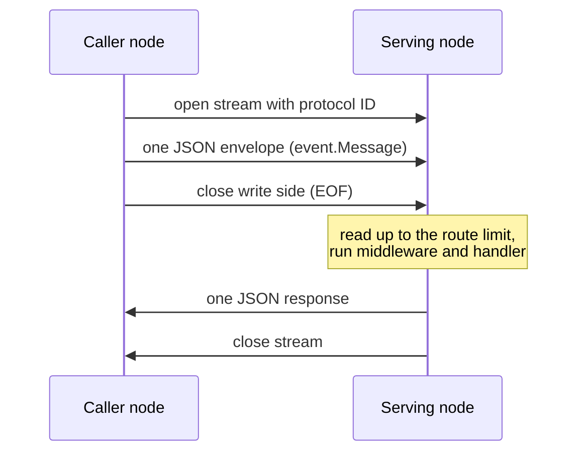

# Wire Protocol

This page describes the application protocol that Warpnet nodes speak on top of libp2p: how routes are named, what a request looks like on the wire, how it is signed and checked, which messages are gossiped, and how incompatible nodes are kept apart. It is written for developers and reviewers; the transport underneath (TLS camouflage, PSK, Noise, NAT traversal) is covered in [Network](network.md), and the route list is in the [API reference](developer-guide/api.md).

## At a glance

| Layer | What it is | Code |
|---|---|---|
| Route | A libp2p protocol ID such as `/public/post/react/0.0.0` | [`event/paths.go`](https://github.com/Warp-net/warpnet/blob/main/event/paths.go) |
| Exchange | One stream per request: write one JSON envelope, half-close, read one JSON response | [`core/stream/stream.go`](https://github.com/Warp-net/warpnet/blob/main/core/stream/stream.go) |
| Envelope | `event.Message`: body, ids, route, timestamp, Ed25519 signature | [`event/event.go`](https://github.com/Warp-net/warpnet/blob/main/event/event.go) |
| Checks | Rate limit, signature, freshness, private-route access, idempotency | [`core/middleware`](https://github.com/Warp-net/warpnet/tree/main/core/middleware) |
| Broadcast | GossipSub topics for timelines, peer discovery, CRDT deltas, reports, moderator votes | [`core/pubsub/gossip.go`](https://github.com/Warp-net/warpnet/blob/main/core/pubsub/gossip.go) |
| Compatibility | Network name and major version baked into the private-network key | [`security/psk.go`](https://github.com/Warp-net/warpnet/blob/main/security/psk.go) |

## Protocol IDs

Every application route is a libp2p protocol ID with this shape:

```text
/{visibility}/{verb}/{entity}[/{sub}...]/{version}
```

| Segment | Values | Example |
|---|---|---|
| `visibility` | `private` or `public` | `/private/...` |
| `verb` | `get`, `post` or `delete` | `/private/get/...` |
| `entity` | the thing acted on, optionally followed by sub-segments | `tweet`, `settings/filter/keyword` |
| `version` | `0.0.0` on every route | `/0.0.0` |

Examples: `/private/post/tweet/0.0.0`, `/public/get/tweet/reactors/0.0.0`, `/private/delete/settings/filter/keyword/0.0.0`.

The code classifies routes by substring ([`core/stream/routes.go`](https://github.com/Warp-net/warpnet/blob/main/core/stream/routes.go)):

- A route is a **read** when its ID contains `get` (`WarpRoute.IsGet`). Reads get the larger response limit and the read rate limit, are never queued in the outbox, and a gossip message whose path is a read is dropped.
- A route is **private** when its ID contains `private` (`WarpRoute.IsPrivate`).
- The idempotency cache covers routes whose ID contains `/post/`.

### Who serves which routes

| Node role | Stream handlers registered |
|---|---|
| Member (desktop, remote and echo flavours) | 120 routes from `event/paths.go`, registered in `setupHandlers` ([`cmd/node/member/node/member-node.go`](https://github.com/Warp-net/warpnet/blob/main/cmd/node/member/node/member-node.go)). The echo node replaces the handlers of `/private/post/tweet/0.0.0`, `/public/post/follow/0.0.0` and `/public/post/message/0.0.0` with its bot logic |
| Relay | `/public/get/info/0.0.0`, `/public/post/relay/refuse/reservation/0.0.0` |
| Moderator | `/public/get/info/0.0.0`, `/public/get/moderate/challenge/0.0.0` (defined in `cmd/node/moderator/audit/wire.go`; other moderators call it to audit this one) |

Four routes in `event/paths.go` are answered by the application around the node, not by a stream handler:

| Route | Answered by |
|---|---|
| `/private/post/login/0.0.0`, `/private/post/logout/0.0.0` | The desktop app (`App.Call` in `cmd/node/member/app.go`) and the remote node's `/ws` bridge (`cmd/node/member/remote/bridge.go`). Login opens the database and starts the node; logout stops it |
| `/private/get/update/0.0.0`, `/private/post/update/0.0.0` | The desktop app only: the pending self-update and the owner's answer to it |

A member sends `/public/post/relay/refuse/reservation/0.0.0` to a relay when a peer on its blocklist reaches it through that relay (see [Network](network.md#relay-reservation-refusals)).

Besides these routes, nodes speak the standard libp2p protocols (identify, ping, GossipSub, circuit relay v2, DCUtR, AutoNAT v2) and the Kademlia DHT under a network-specific prefix: `/warpnet/kad/1.0.0` on mainnet, `/testnet/kad/1.0.0` on testnet.

## Private and public routes

The visibility segment is enforced by the auth middleware ([`core/middleware/auth.go`](https://github.com/Warp-net/warpnet/blob/main/core/middleware/auth.go)).

A **private** route is served only when the caller is:

1. the node itself (a loopback self-stream from its own UI), or
2. a device paired with this node: a peer ID stored by `/private/post/admin/pair/0.0.0`. The record expires 72 hours after the device last paired, a node keeps at most 10 devices, the owner removes one with `/private/delete/admin/device/0.0.0` (`database/aliases-repo.go`), and every member node start revokes all of them (`NewMemberNode`), or
3. anyone calling `/private/post/admin/pair/0.0.0` itself; the pairing handler then checks the session token.

Any other peer gets `middleware: auth: unknown client peer`.

A **public** route can be called by any peer that got through the private-network key, Noise and the signature check. Handlers that act on behalf of a user also check *authorship*: the actor named in the event must belong to the node at the other end of the stream, or, when a paired device calls, to this node (`warpnet.VerifyAuthorship` in [`core/warpnet/warpnet.go`](https://github.com/Warp-net/warpnet/blob/main/core/warpnet/warpnet.go), [`core/authorship`](https://github.com/Warp-net/warpnet/tree/main/core/authorship)). A peer that claims someone else's action gets `event did not come from its author's node` and is charged a foreign-authorship offence in the [rating](rating.md).

## Request and response

Each request uses its own libp2p stream. There is no session, no multiplexing of several requests on one stream and no length prefix; end-of-stream is the frame delimiter.



What the sender does ([`core/stream/stream.go`](https://github.com/Warp-net/warpnet/blob/main/core/stream/stream.go)):

1. Opens the stream with a 10-second budget for dialing and protocol negotiation. The stream may ride a relayed (limited) connection.
2. Builds the envelope with a ULID `message_id`, its own peer ID in `node_id`, the route in `path`, the current UTC time and `version` `0.0.0`, then signs it.
3. Writes the JSON and closes its write side.
4. Reads the response until EOF, with a 2-minute read deadline and the route's response size limit.

What the receiver does (`unwrap` in [`core/node/node.go`](https://github.com/Warp-net/warpnet/blob/main/core/node/node.go)):

1. Reads the request until EOF, within 15 seconds (5 minutes on the 50 MiB request routes) and within the request size limit. An oversize request resets the stream without a reply.
2. Answers `node is offline` if the node is shutting down.
3. Runs the middleware chain and the route handler.
4. Encodes the handler's result as JSON (a string or byte result is written as is), writes it and closes the stream.

### Retries and offline peers

- If the dial fails because the peer has no known address, the DHT lookup failed, every dial failed or the 10 seconds ran out, the call fails with `node is offline`. The peer is then short-circuited as offline for 30 seconds, or until it connects again.
- If the request was written but the response was lost, the sender retries once at once with the **same** `message_id`, so on a `post` route the receiver's idempotency cache answers without running the handler twice.
- Other failures are retried at once and then after pauses of 2, 3, 4… seconds (plus up to 0.5 s jitter), at most 5 times within a 10-second budget. Every retry keeps the same `message_id`.
- Identical concurrent sends (same route, peer and body) share one exchange.

### Outbox for offline peers

On member nodes, writes to other nodes (any non-`get` route) go through a persistent outbox ([`core/stream/outbox.go`](https://github.com/Warp-net/warpnet/blob/main/core/stream/outbox.go)). The write is stored before it is sent and removed once the peer answers with anything other than a rate-limit error. Queued writes are sent again when the node starts, when the peer connects again and every 5 minutes; a queued write expires after 30 days. A write identical to the last one queued for the same peer is stored once. A redelivered write goes out with a new `message_id`, so the receiver's idempotency cache does not recognise it as a repeat. Reads are never queued.

### Local calls use the same path

The desktop UI, the remote node's browser dashboard and paired phones have no separate API. The node runs their requests through the same handlers and middleware:

- **Self-stream.** The desktop app and the remote node's `/ws` bridge sign the envelope with the node's identity key and push it through an in-memory loopback stream (`SelfStream`, [`core/stream/loopback-stream.go`](https://github.com/Warp-net/warpnet/blob/main/core/stream/loopback-stream.go)). The UI supplies the `message_id`. The I/O deadline is 1 minute (10 minutes for `/private/post/import/twitter/tweet/0.0.0`). Loopback calls skip the rate limiter and the freshness check.
- **Paired device.** The Android and iOS apps open real libp2p streams to their node, signed with the phone's own key; private routes are allowed because the phone's peer ID was stored at pairing.
- **Peer stream.** When a handler needs another node, it calls the same route on that node over a real stream (`GenericStream`). Calling your own node this way is refused with `self request is not allowed`.

A typical public route is handled twice. For example, reacting to someone's tweet:

1. Your UI calls `/public/post/react/0.0.0` on your own node through a self-stream.
2. Your node records the reaction and forwards the same event over a peer stream to the node of the tweet's author.
3. The author's node runs the same handler, sees that the reactor is not its owner, records the reaction and adds a notification.

If the author's node is offline, step 2 lands in the outbox and your node still answers your UI with its local result.

## The message envelope

Requests and most gossip messages share one envelope, `event.Message`:

```json
{
  "body": {"tweet_id": "01J...", "user_id": "a1b2...", "owner_id": "c3d4..."},
  "message_id": "01JD7Q3K8V6N2M4P5R7S9T0W1X",
  "node_id": "12D3KooW...",
  "path": "/public/post/react/0.0.0",
  "timestamp": "2026-11-24T10:15:30.123456789Z",
  "version": "0.0.0",
  "signature": "base64..."
}
```

| Field | Type | Meaning |
|---|---|---|
| `body` | JSON value | The route's request DTO, kept as raw bytes and signed byte for byte |
| `message_id` | string | Unique per request: a ULID on node-to-node streams, a UUID from the UIs, the mobile apps and gossip publishers. A stream request without it is rejected |
| `node_id` | string | Sender's libp2p peer ID. On streams the receiver uses the connection's peer ID instead; on gossip it names the publisher |
| `path` | string | The route (Go field `Destination`) |
| `timestamp` | RFC 3339 time | Sender's clock, UTC |
| `version` | string | Always `0.0.0` |
| `signature` | string | Base64 Ed25519 signature, see [Signing](#signing) |
| `bridge_key` | string, optional | Set only on messages to the [bridge](bridge.md) gateway: a key derived from the sender's identity key, with which the gateway acts for the sender on bridged networks |

The response is **not** wrapped in an envelope: the receiver writes the bare response DTO (see [Errors and responses](#errors-and-responses)).

Request and response bodies are plain JSON, encoded with json-iterator in standard-library-compatible mode. Field names are snake_case. Binary media travels as base64 strings inside JSON.

## Signing

The signature covers exactly these bytes (`Message.SigningBytes`):

```text
raw body bytes  ||  timestamp as decimal Unix nanoseconds  ||  path
```

It is an Ed25519 signature with the node's identity key, base64-encoded with the standard alphabet ([`security/signature.go`](https://github.com/Warp-net/warpnet/blob/main/security/signature.go)).

On a stream, the receiver checks it against the public key embedded in the **peer ID of the connection**, not against `node_id`. A libp2p peer ID of an Ed25519 key contains the key, so no key exchange or lookup is needed, and a captured request cannot be passed off by another peer. Then:

- **Freshness.** The timestamp must be within 5 minutes of the receiver's clock in either direction; otherwise `middleware: auth: stale or replayed message`. Loopback calls from the node's own UI are exempt. Nodes therefore need roughly correct clocks.
- **Gossip.** A replayed timeline message is checked against the key in its `node_id` (it arrives through other peers), so for gossip the 5-minute window is what bounds a replay.

Because the path is part of the signed bytes, a signed body cannot be replayed against another route.

## Middleware chain

Member, relay and moderator nodes wrap every route in the same chain, outermost first:

| Step | What it does |
|---|---|
| unwrap | Reads the request within limits, writes the response, turns handler errors into `{code, message}` |
| Logging | Logs stream open, close and duration at debug level |
| Rate limiter | Per peer and route leaky bucket; over the limit answers code `5001` without running the handler. Loopback calls are not limited |
| Auth | Parses the envelope, requires `message_id` and `signature`, verifies the signature and freshness, enforces private-route access, passes the inner `body` on |
| Idempotency | On `/post/` routes, caches successful responses by route, peer and `message_id` for 10 minutes; duplicates in flight wait for the first |

Rate limits ([`core/ratelimit/stream.go`](https://github.com/Warp-net/warpnet/blob/main/core/ratelimit/stream.go), [`core/ratelimit/settings.go`](https://github.com/Warp-net/warpnet/blob/main/core/ratelimit/settings.go)). Burst is the bucket size; the bucket drains at the per-minute rate.

| Routes | Burst | Per minute |
|---|---|---|
| Reads (route contains `get`), plus `/public/post/isfollowing`, `/public/post/isfollower`, `/public/post/view`, `/private/post/notification/read` | 60 | 300 |
| Other writes | 30 | 120 |
| Media downloads: `/public/get/image`, `/public/get/video`, `/public/get/chat/image`, `/public/get/chat/video`, `/public/get/sponsored/image`, `/public/get/sponsored/video` | 150 | 600 |
| Uploads: `/private/post/image`, `/private/post/video`, `/private/post/chat/image`, `/private/post/chat/video` | 10 | 30 |
| Timeline delivery and moderation verdicts: `/public/post/timeline`, `/public/post/moderate/result` | 200 | 1200 |
| Chats and messages: `/public/post/chat`, `/public/post/message` | 60 | 300 |
| Reports: `/public/post/report` | 10 | 30 |
| Pairing: `/private/post/admin/pair` | 5 | 15 |
| Any route called by the bridge gateway | 600 | 6000 |

A peer in a lower [rating](rating.md) tier gets 0.5, 0.25 or 0.1 of the burst and of the rate, never less than one call. On a member node the owner can change the read and write budgets with `/private/post/settings/ratelimit/0.0.0`; the node reads them when it starts. Relays and moderators use the defaults.

The idempotency cache holds up to 1024 entries. Error responses are never cached, and neither is a raw string or byte response larger than 64 KiB.

## Size limits and timeouts

| Limit | Value | Applies to |
|---|---|---|
| Request size | 50 MiB | `/private/post/image`, `/private/post/video`, `/private/post/import/twitter/tweet`, `/private/get/sponsored/buyer` |
| Request size | 1 MiB | every other route |
| Response size | 50 MiB | `/public/get/image`, `/public/get/video`, `/public/get/sponsored/image`, `/public/get/sponsored/video` |
| Response size | 8 MiB | other `get` routes |
| Response size | 1 MiB | every other route |
| Open stream (dial + negotiate) | 10 s | sender |
| Request read | 15 s, or 5 min on the 50 MiB request routes | receiver |
| Response read | 2 min | sender |
| Loopback call | 1 min, 10 min for the import route | self-stream |
| Concurrent inbound streams | 2 per peer | `/public/get/video`, `/public/get/chat/video`, `/public/get/sponsored/video` |

Limits are defined in [`core/stream/stream.go`](https://github.com/Warp-net/warpnet/blob/main/core/stream/stream.go) and [`core/ratelimit/stream.go`](https://github.com/Warp-net/warpnet/blob/main/core/ratelimit/stream.go).

## Errors and responses

A handler that succeeds returns its response DTO as JSON. A handler with nothing else to return answers with the literal string:

```json
{"code":0,"message":"Accepted"}
```

Failures use the same shape, `event.ResponseError`:

```json
{"code":5000,"message":"middleware: auth: stale or replayed message"}
```

| Situation | Response |
|---|---|
| Handler returned an error | code `5000`, message is the error text |
| Envelope unreadable, no `message_id`, missing or invalid signature | code `5000`, `middleware: internal node error` |
| Timestamp outside the 5-minute window | code `5000`, `middleware: auth: stale or replayed message` |
| Private route called by an unknown peer | code `5000`, `middleware: auth: unknown client peer` |
| Rate limit exceeded | code `5001`, `middleware: too many requests for this route` |
| Request could not be read | code `0`, `middleware: stream: reading failed` |
| Node is shutting down | code `0`, `node is offline` |
| Handler returned nothing | code `0`, `empty response` |
| Request larger than the route limit | stream reset, no response |

A handler error of `node is offline` is not turned into code `5000`: the handler's own result is written instead. Callers tell failure from success by decoding the reply as `{code, message}`: a non-empty `message` other than `Accepted` is an error. Errors raised by the desktop app or the `/ws` bridge before a request reaches the node (for example a failed login) use code `500`.

## Gossip topics

Broadcasts use GossipSub ([`core/pubsub/gossip.go`](https://github.com/Warp-net/warpnet/blob/main/core/pubsub/gossip.go)). The discovery, timeline, report and vote topics carry the `event.Message` envelope, signed over `SigningBytes` with the publisher's node key. Timeline messages are verified by the auth middleware (below) and reports and votes by the moderators. The two CRDT topics carry the CRDT store's own delta messages.

| Topic | Published by | Carries |
|---|---|---|
| `/warpnet/discovery/1.0.0` | every role | The publisher's peer ID and addresses plus up to 10 connected peers; see [Discovery](discovery.md#pubsub-gossip) |
| `user-update-<userId>` | the author's member node; moderators | Timeline fan-out: envelopes with `path` `/public/post/timeline/0.0.0` (new tweet) or `/public/delete/timeline/0.0.0` (deleted tweet); moderation verdicts with `/public/post/moderate/result/0.0.0` |
| `/warpnet/stats/1.0.0` | members | CRDT deltas of tweet counters; see [Synchronization](synchronization.md) |
| `/warpnet/rating/1.0.0` | every role | CRDT deltas of signed rating records; see [Rating](rating.md) |
| `/warpnet/reports/1.0.0` | members; relays forward it | User reports for moderators; see [Moderation](moderation.md) |
| `/warpnet/moderation/votes/1.0.0` | moderators; relays forward it | Moderator ballots |

How a follower receives a timeline update:

1. Following a user subscribes the node to `user-update-<userId>`; unfollowing unsubscribes. On start, a member subscribes to the topics of everyone it follows, bridged accounts excepted.
2. A received message is decoded, and if its `path` is not a `get` route it is replayed into the node's own handler for that path through a self-stream, with the peer ID from `node_id` as the caller.
3. The auth middleware therefore verifies the publisher's signature and the 5-minute freshness window, and the rate limiter counts the call against the publisher, exactly as for a direct stream.

Gossip peer scoring follows the [rating](rating.md): peers in the lowest tier score -200, below the graylist threshold of -100, and are no longer read; the other low tiers score below zero and lose their place in the mesh. On member nodes the peer blocklist also feeds GossipSub's blacklist.

## Versioning and compatibility

There is no per-route version negotiation. The `0.0.0` suffix on routes and the `version` field in the envelope never change, and no node checks them.

Compatibility is enforced one layer lower, by the private-network key (PSK):

```text
PSK = SHA-256(network name || major version)
```

The network is `warpnet` (mainnet; `mainnet` is accepted as an alias) or `testnet`, and the major version comes from the release version (`0.8.125` gives `0`). Every 0.x mainnet node therefore uses `SHA-256("warpnet0")`. libp2p's private-network layer encrypts the whole connection with this key, so a node from another network or another major version fails during connection setup, before any stream or Warpnet message exists. When a self-update crosses a major version, the node logs that its private network key rotates; after the restart it meets only peers on the new major.

The PSK is public; it separates networks and incompatible versions and is not a secret. See [Network](network.md#the-pre-shared-key-is-public).

Within one major version, JSON decoding ignores unknown fields, so new optional fields can be added without breaking nodes that do not know them. `/public/get/info/0.0.0` returns `NodeInfo`, which includes the node's version and the protocol IDs it serves.

## See also

- [Network](network.md): transport, PSK, Noise, NAT traversal
- [Discovery](discovery.md): how peers are found
- [API reference](developer-guide/api.md): every route with its DTOs
- [Stream API](developer-guide/stream-API.md): writing a client that talks to a node
- [Security](security.md): identity, keys and signatures
