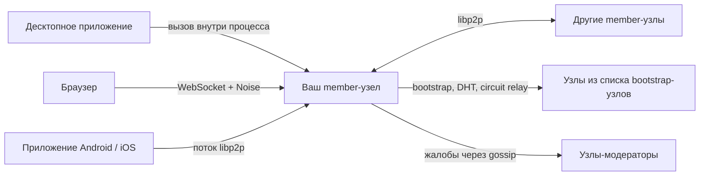
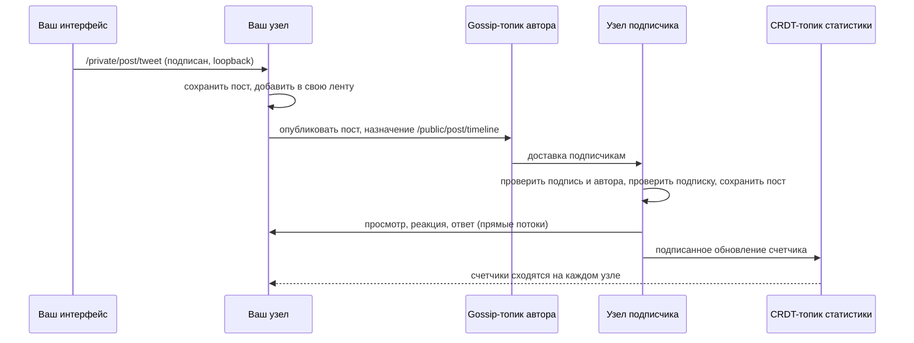

# Архитектура {#architecture}

Warpnet — одноранговая социальная сеть без серверного слоя. Эта страница — карта: какие бывают узлы, как узел находит первых пиров, как приложения достигают вашего узла, откуда берется ваша идентичность, как разделены сети и что происходит с постом после публикации. Каждый раздел ссылается на страницу с подробностями. Страница написана в первую очередь для любознательных пользователей, во вторую — для разработчиков.

## Без серверного слоя {#no-server-tier}

Каждый пользователь запускает **member-узел**. Узел хранит данные владельца во встроенной базе данных на компьютере владельца и общается с другими узлами напрямую через [libp2p](https://libp2p.io). Здесь нет инстанса, центральной базы данных и администратора, поэтому в середине нет ничего, что можно изъять или отключить.

Большинство проектных решений следует из этого одного выбора:

| Без сервера... | ...Warpnet вместо этого |
|---|---|
| нет центральной базы данных | каждый узел хранит свои данные локально ([Хранилище](storage.md)) |
| нет доверенной конечной точки | каждый запрос подписывается ключом отправителя и проверяется получателем ([Безопасность](security.md)) |
| нет каталога пользователей | узлы находят друг друга через DHT, gossip и локальную сеть ([Обнаружение](discovery.md)) |
| нет команды модераторов | независимые узлы-модераторы рассматривают жалобы и голосуют ([Модерация](moderation.md)) |
| нет центрального счетчика | статистика постов — это CRDT-счетчики, которые сходятся на каждом узле ([Синхронизация](synchronization.md)) |
| нет хостинга для интерфейса | один и тот же интерфейс обращается к узлу внутри процесса, через WebSocket или с телефона через libp2p ([Клиенты](#clients)) |

Десктопная программа — это один исполняемый файл. Веб-интерфейс вкомпилирован в него ([`embedded.go`](https://github.com/Warp-net/warpnet/blob/main/embedded.go) встраивает `frontend/dist`), поэтому больше ничего скачивать или размещать не нужно.

## Роли узлов {#node-roles}

В Warpnet три типа узлов. Каждый сообщает свой тип в информации об узле, которую отдает по `/public/get/info/0.0.0` ([`core/warpnet/warpnet.go`](https://github.com/Warp-net/warpnet/blob/main/core/warpnet/warpnet.go)).

| Тип | Точка входа | Что делает | Что хранит |
|---|---|---|---|
| **member** | [`cmd/node/member`](https://github.com/Warp-net/warpnet/tree/main/cmd/node/member) | Узел пользователя: хранит аккаунт, обслуживает интерфейс и подключенные телефоны, публикует и получает посты. | Зашифрованная локальная база данных |
| **relay** | [`cmd/node/relay`](https://github.com/Warp-net/warpnet/tree/main/cmd/node/relay) | Служебный узел без интерфейса на публичном адресе: DHT-сервер, circuit relay для узлов за NAT, пересылка gossip, рейтинг пиров. | Ничего на диске |
| **moderator** | [`cmd/node/moderator`](https://github.com/Warp-net/warpnet/tree/main/cmd/node/moderator) | Запускает локальную LLM (Llama Guard 3) и вместе с другими модераторами голосует по контенту, на который пожаловались. | Ничего на диске; только читает файл модели |

**Remote** и **echo** — варианты сборки типа member, а не отдельные типы: member-узел без интерфейса (headless), который отдает интерфейс в браузер, и тестовый бот. См. [Архитектура member-узла](member-node-architecture.md).

**Шлюз моста**, который соединяет Warpnet с Mastodon и Fediverse, Threads и Nostr, живет в отдельном репозитории и подключается к сети как обычный пир libp2p. См. [Мосты](bridge.md).

Все три типа построены на одном ядре ([`core/node`](https://github.com/Warp-net/warpnet/tree/main/core/node)): тот же транспортный стек, лимиты соединений, hole punching и сервис circuit relay v2. Различаются они тем, какие маршруты регистрируют и что хранят.

### Bootstrap-узлы {#bootstrap-nodes}

«Bootstrap-узел» — это позиция, а не тип узла: так называется любой адрес из **списка bootstrap-узлов** какого-либо узла. Узел использует свой список как:

- первых пиров, к которым он подключается и от которых заполняется его таблица маршрутизации DHT;
- единственные relay-узлы, на которых он резервирует слоты circuit relay, когда находится за NAT (libp2p AutoRelay со статическими relay-узлами, [`core/warpnet/options.go`](https://github.com/Warp-net/warpnet/blob/main/core/warpnet/options.go));
- на member-узле — еще и пиров с наивысшим приоритетом соединения и список, который он передает подключенным телефонам в QR-коде сопряжения.

Откуда берется список:

| Узел | Источник |
|---|---|
| member | список bootstrap-узлов из сетевых настроек в его базе данных; если он пуст — конфигурация |
| relay, moderator | конфигурация |

В конфигурации `--node.bootstrap` (или `NODE_BOOTSTRAP`) — список мультиадресов через запятую — заменяет встроенный список. Без него сети `warpnet` и `testnet` используют встроенные списки ([`config/config.go`](https://github.com/Warp-net/warpnet/blob/main/config/config.go)); у любой другой сети встроенного списка нет.

Встроенные списки указывают на три relay-узла, которые запускает проект. Поэтому bootstrap-узлы по умолчанию — это relay-узлы, но это два разных понятия: любой доступный узел может оказаться в чьем-то списке bootstrap-узлов, а relay-узел работает как circuit relay только для тех узлов, у которых он есть в списке. См. [Архитектура relay-узла](relay-node-architecture.md).

## Клиенты {#clients}

На узле для каждого маршрута есть один канонический обработчик, и все клиенты попадают в этот же обработчик. Клиенты различаются только тем, как запрос доходит до member-узла.

| Клиент | Где работает | Как достигает member-узла | Защита на этом участке |
|---|---|---|---|
| Десктопное приложение | внутри процесса member-узла (окно Wails) | вызов внутри процесса, затем loopback-поток | не нужна: это одна программа |
| Дашборд в браузере | любой браузер | HTTP для страницы, WebSocket `/ws` для вызовов, к **удаленному** member-узлу (remote, порт по умолчанию 4999) | Noise XX внутри WebSocket; браузер закрепляет ключ узла при первом контакте |
| Приложение для Android (warpdroid, форк Tusky) | телефон | поток libp2p от небольшого узла libp2p внутри приложения, напрямую или через relay | тот же стек, что и для трафика между узлами: маскирующий TLS, PSK, Noise |
| Приложение для iOS (warpfone, форк Ice Cubes) | телефон | как на Android | как на Android |

Оба мобильных приложения выпущены как приложения-компаньоны: warpdroid есть в [F-Droid](https://f-droid.org/packages/site.warpnet.warpdroid/), а warpfone — в [App Store](https://apps.apple.com/app/warpnet/id6835178022). Они не хранят ваш аккаунт. Они подключаются к вашему member-узлу (сопряжение) и действуют от его имени; см. [Мобильные приложения](user-guide/mobile.md).

Как запрос доходит до обработчика:

- **Десктоп и браузер.** Member-узел подписывает запрос интерфейса ключом владельца и передает его собственному обработчику через loopback-поток внутри процесса (`SelfStream`). Запрос проходит те же middleware, что и запрос удаленного пира (проверка подписи, ограничение частоты запросов, дедупликация). Запросы входа, выхода и (на десктопе) самообновления обрабатываются раньше этой точки и никогда не становятся потоками ([`cmd/node/member/app.go`](https://github.com/Warp-net/warpnet/blob/main/cmd/node/member/app.go)).
- **Телефоны.** Приложение запускает libp2p-хост, который только устанавливает исходящие соединения (слушающих сокетов он не открывает). Вы подключаете телефон (сопряжение), сканируя QR-код, который показывает десктопный или браузерный интерфейс. QR-код содержит ID узла, его адреса, список bootstrap-узлов, имя и ключ сети и токен сопряжения. Телефон отправляет токен на `/private/post/admin/pair/0.0.0`; узел проверяет его и записывает peer ID телефона как **алиас** (alias). С этого момента узел принимает от этого пира приватные маршруты ([`core/middleware/auth.go`](https://github.com/Warp-net/warpnet/blob/main/core/middleware/auth.go)) и указывает алиас в своей информации об узле.

Эти транспорты с точки зрения разработчика описаны на странице [Клиенты](developer-guide/clients.md).

## Идентичность {#identity}

Идентичность каждого узла — это пара ключей **Ed25519**. **Peer ID** узла в libp2p (ID узла) содержит открытый ключ целиком: ключ достаточно короткий, чтобы в него поместиться. Поэтому получатель восстанавливает открытый ключ отправителя по одному peer ID и проверяет им подписи.

Пример: `12D3KooWMKZFrp1BDKg9amtkv5zWnLhuUXN32nhqMvbtMdV2hz7j`

Откуда берется ключ, зависит от типа узла:

| Тип | Источник ключа | Следствие |
|---|---|---|
| member | выводится из **логина + пароля + сети** с помощью Argon2id ([`security/kdf.go`](https://github.com/Warp-net/warpnet/blob/main/security/kdf.go)) | файла ключа нет; ключ существует только в памяти после входа |
| relay | выводится из `--node.seed`; без него — из строки `seed` + имя сети + `--database.dir` + IPv4-адрес для прослушивания + порт ([`config/config.go`](https://github.com/Warp-net/warpnet/blob/main/config/config.go)) | peer ID не меняется между перезапусками |
| moderator | случайный при каждом запуске ([`cmd/node/moderator/main.go`](https://github.com/Warp-net/warpnet/blob/main/cmd/node/moderator/main.go)) | новый peer ID после каждого перезапуска |

Что это значит для member-узла:

- Ваши логин и пароль — это ваша идентичность. Логин — это то, что вы вводите в поле «Login»; это не имя профиля, которое изначально равно «Anonymous» и меняется отдельно. Логин хранится только в вашей зашифрованной базе данных и никогда не публикуется.
- Одни и те же логин, пароль и сеть всегда дают один и тот же ID узла, на любой машине.
- Если сменить логин или пароль, получится другой ключ и, следовательно, другой узел, а существующая база данных перестанет открываться.
- Одни и те же логин и пароль в testnet и в mainnet дают два разных ID узла, потому что имя сети участвует в выводе ключа.
- База данных зашифрована вторым ключом, выведенным из тех же логина и пароля ([`database/local-store/db.go`](https://github.com/Warp-net/warpnet/blob/main/database/local-store/db.go)). С неверной парой ее просто не удастся открыть.

Ваш **ID пользователя** — это не ID узла. Это ULID, который создается при первом входе и хранится в вашей базе данных ([`cmd/node/member/auth/auth.go`](https://github.com/Warp-net/warpnet/blob/main/cmd/node/member/auth/auth.go)); другие узлы сопоставляют ваш ID пользователя с ID вашего узла. Логин и пароль сами по себе воссоздают ID узла, но не ID пользователя, не ваши посты и не подписки: все это хранится в каталоге данных. Чтобы перенести аккаунт на другую машину, перенесите каталог данных. См. [Резервное копирование и восстановление](user-guide/backup-and-restore.md).

Каждый запрос между узлами передается в подписанном конверте. Подпись покрывает тело, метку времени и маршрут назначения. Получатель проверяет ее по ключу из peer ID отправителя и отклоняет удаленные сообщения, метка времени которых расходится с его часами больше чем на пять минут ([`core/middleware`](https://github.com/Warp-net/warpnet/tree/main/core/middleware)). Подробнее: [Безопасность](security.md).

## Сети {#networks}

Warpnet работает в отдельных сетях, которые не видят друг друга:

| Сеть | Имя | Встроенный список bootstrap-узлов |
|---|---|---|
| Mainnet | `warpnet` (`mainnet` принимается как псевдоним) | три relay-узла, порты 4001-4003 |
| Testnet | `testnet` | три relay-узла, порты 4011, 4022, 4033 |
| Ваша собственная | любое другое имя | нет: передайте `--node.bootstrap` |

Сеть отделена от других на нескольких уровнях:

- **Сетевой ключ (PSK).** Каждое соединение допускается только с приватным сетевым ключом libp2p, `SHA-256(network name + major version)` ([`security/psk.go`](https://github.com/Warp-net/warpnet/blob/main/security/psk.go)). Ключ публичный и не является секретом. Из-за него узлы другой сети или другой мажорной версии отваливаются на первых же байтах. Поэтому мажорный релиз заодно запускает новую сеть.
- **DHT.** Kademlia DHT работает под префиксом протокола `/<network>`, а узлы анонсируют себя в пространстве имен rendezvous `warpnet/rendezvous/<network>` ([`core/dht/dht.go`](https://github.com/Warp-net/warpnet/blob/main/core/dht/dht.go)).
- **Данные.** У каждой сети свой каталог данных, `~/.warpdata/<network>/` (в Windows `%LOCALAPPDATA%\warpdata\<network>\`).
- **Идентичность.** Ключ member-узла включает имя сети, как описано выше.

Десктопное приложение работает в mainnet, если `--node.network` или `NODE_NETWORK` не задают другую сеть. При первом запуске экран регистрации предлагает выбрать Warpnet или Testnet; после выбора приложение перезапускается в этой сети ([`cmd/node/member/app.go`](https://github.com/Warp-net/warpnet/blob/main/cmd/node/member/app.go)). См. [Начало работы](user-guide/index.md).

## Основные подсистемы {#core-subsystems}

Краткая карта механизмов. Каждый абзац ссылается на страницу, где тема разобрана подробно.

**Сетевой протокол.** Каждая операция — это маршрут, например `/private/post/tweet/0.0.0` или `/public/get/user/0.0.0`, который передается через поток libp2p как подписанный JSON-конверт. Маршруты `private` работают с собственными данными владельца и доступны только самому узлу и его подключенным устройствам. Маршруты `public` — это то, что могут запрашивать другие пиры. Широковещательные сообщения передаются через топики GossipSub. См. [Протокол](protocol.md) и [справочник маршрутов](developer-guide/api.md).

**Обнаружение.** Member-узел узнает о пирах из четырех источников: DHT, gossip-анонсов, пиров, которые запрашивают у него информацию об узле, и mDNS в локальной сети. Для каждого нового пира он запрашивает информацию об узле, а если пир — member-узел, то и профиль его пользователя. Когда менеджеру соединений приходится сокращать число соединений, дольше всего он сохраняет bootstrap-узлы, а также публично доступных пиров с хорошим рейтингом. См. [Обнаружение](discovery.md).

**Сеть и транспорт.** Все типы узлов и оба мобильных приложения используют один стек: TCP, слой TLS, с которым соединение для глубокой инспекции пакетов (DPI) выглядит как обычный HTTPS, PSK, шифрование Noise XX и мультиплексирование yamux. Для обхода NAT используются UPnP/NAT-PMP, AutoNAT v2, hole punching и, в крайнем случае, circuit relay v2 через узлы из списка bootstrap-узлов. См. [Сеть](network.md).

**Синхронизация.** Глобального состояния, о котором нужно договариваться, нет. Между узлами сходятся две вещи: статистика постов (просмотры, реакции, ответы, репосты, голоса в опросах) и рейтинги узлов. И то и другое — подписанные Merkle-CRDT-хранилища, которые реплицируются через gossip. См. [Синхронизация](synchronization.md).

**Хранилище.** Member-узел хранит все в зашифрованной базе BadgerDB за слоем репозиториев. Записи для пиров, которые не в сети, ставятся в очередь исходящих (outbox) и отправляются повторно, когда пир возвращается. См. [Хранилище](storage.md).

**Безопасность.** Вывод идентичности, подписанные конверты, проверки свежести и повторов, ограничения частоты запросов для каждого пира, зашифрованная база данных и зашифрованный канал с браузером. См. [Безопасность](security.md).

**Модерация.** Пользователи жалуются на публичные посты, ответы и профили. Жалобы попадают к узлам-модераторам через gossip. Модераторы оценивают каждую жалобу с помощью локальной модели и голосуют, а подписанный вердикт скрывает контент на узлах, которые его получили. Кроме того, у каждого пользователя есть локальные блокировки, скрытие (mute) и фильтры по ключевым словам. На личные сообщения пожаловаться нельзя. См. [Модерация](moderation.md).

**Рейтинг.** Узлы оценивают пиров, с которыми имеют дело, по тому, что наблюдают (неверные подписи, некорректные или слишком большие сообщения, превышение лимитов запросов, неудачные попытки соединения и т. п.). Рейтинги реплицируются и влияют на приоритет соединений, DHT, оценку пиров в gossip, ограничения частоты запросов и на то, принимаются ли медиа от пира. См. [Рейтинг](rating.md).

**Круг доверия.** Каждый member-узел вычисляет по графу подписок множество пользователей, которым доверяет его владелец. Это меняет только то, как показывается контент (например, медиа от незнакомцев размываются), и никогда не влияет на то, передается ли он. См. [Круг доверия](trust-circle.md).

**Мосты.** Отдельный пир-шлюз делает пользователей Warpnet видимыми в Fediverse и Nostr и приводит в Warpnet аккаунты Mastodon, Threads и Nostr. Узел создает входной аккаунт, домашним узлом которого является шлюз, поэтому пользователи с другой стороны моста находятся так же, как любой другой удаленный пользователь. См. [Мосты](bridge.md).

## Жизненный цикл поста {#lifecycle-of-a-post}

Вот что делает код, когда вы публикуете пост. Описание сверено с обработчиками в [`core/handler`](https://github.com/Warp-net/warpnet/tree/main/core/handler).

1. **Создание.** Интерфейс отправляет пост на `/private/post/tweet/0.0.0`. Узел проверяет его (текст до 2048 байт, опросы с 2-4 вариантами) и отклоняет посты с ценой: для них есть спонсорский маршрут ([`core/handler/tweet.go`](https://github.com/Warp-net/warpnet/blob/main/core/handler/tweet.go)). Ответ — это пост с родителем. Он сохраняется в своей ветке и отправляется на узел автора родительского поста, а не рассылается подписчикам.
2. **Сохранение.** Пост записывается в локальную базу данных и добавляется в собственную домашнюю ленту владельца.
3. **Распространение.** Узел публикует пост в топике GossipSub `user-update-<user ID>` с назначением `/public/post/timeline/0.0.0` ([`cmd/node/member/pubsub/member-pubsub.go`](https://github.com/Warp-net/warpnet/blob/main/cmd/node/member/pubsub/member-pubsub.go)). Изображения и видео не включаются, только их ключи. Подписка на пользователя подписывает ваш узел на его топик, поэтому так пост получают только узлы подписчиков.
4. **Попадание в ленты подписчиков.** Узел подписчика пропускает gossip-сообщение через свой собственный обработчик потоков, указывая узел автора как отправителя ([`core/pubsub/gossip.go`](https://github.com/Warp-net/warpnet/blob/main/core/pubsub/gossip.go)). Обычные middleware проверяют подпись автора и свежесть. Затем обработчик ленты проверяет, что отправитель — узел автора и что владелец подписан на автора, и сохраняет пост в домашней ленте ([`core/handler/timeline.go`](https://github.com/Warp-net/warpnet/blob/main/core/handler/timeline.go)). Если рейтинг отправителя не допускает медиа, ключи медиа отбрасываются. Сами медиа загружаются позже, по запросу, с узла автора и кэшируются локально.
5. **Взаимодействие и подсчет.** Просмотры, реакции, ответы, репосты и голоса в опросах отправляются с узла того, кто совершил действие, на узел автора через прямые потоки. Каждый счетчик — это подписанный CRDT-счетчик, который реплицируется в gossip-топике `/warpnet/stats/1.0.0`. Только собственный узел того, кто совершил действие, добавляет его в реплицируемый счетчик, поэтому действие учитывается один раз, сколько бы узлов его ни видели ([`core/crdt/stats/store.go`](https://github.com/Warp-net/warpnet/blob/main/core/crdt/stats/store.go)). Счетчики распространяются в течение 30 дней после создания поста; более старые посты подсчитываются только по локальным данным.

Что это значит на практике:

- Домашняя лента локальна. Если узел подписчика был не в сети, когда пост был отправлен, позже этот пост ему не придет: gossip-сообщение для него не сохраняется.
- Когда вы открываете профиль автора, ваш узел запрашивает его посты у узла автора и кэширует их локально на 30 дней. Поэтому пропущенные посты все же появятся там, пока узел автора в сети.
- Удаление поста публикует сообщение об удалении в том же топике, и узлы подписчиков убирают пост из своих лент.

## См. также {#see-also}

- [Архитектура member-узла](member-node-architecture.md)
- [Архитектура relay-узла](relay-node-architecture.md)
- [Протокол](protocol.md)
- [Сеть](network.md)
- [Безопасность](security.md)
