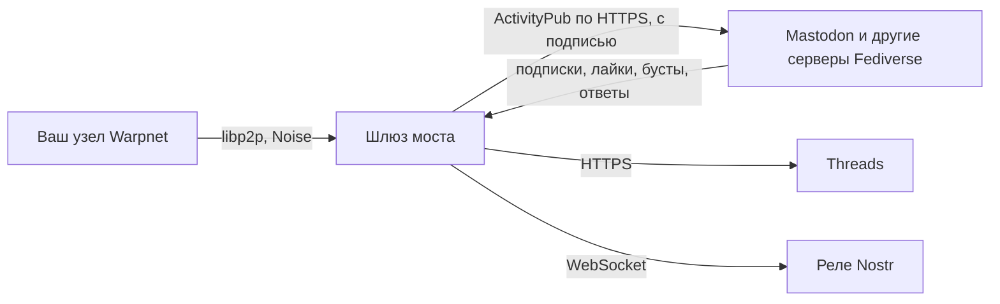

# Мосты {#bridges}

Warpnet может общаться с социальными сетями за его пределами через отдельную программу — **шлюз моста**. С ним вы можете подписываться на аккаунты Mastodon (и других серверов ActivityPub), Threads и Nostr и взаимодействовать с ними из Warpnet, а люди в этих сетях могут находить вас, подписываться на вас и взаимодействовать с вами. На этой странице объясняется, как мост работает сегодня, что через него проходит в каждую сторону, каковы его ограничения и чем он оборачивается для приватности. Она написана для пользователей, которые решают, пользоваться ли функциями моста, и для разработчиков, которые хотят знать, где находится код.

> **Примечание:** В ранних версиях этой документации описывался мост только для чтения, который импортировал посты Mastodon через псевдоузел. От этой схемы отказались. Теперь мост двусторонний, а аккаунты через мост загружаются в реальном времени через шлюз.
{: .note }

## Как это работает {#how-it-works}

Шлюз живет в отдельном репозитории, [Warp-net/bridge-gateway](https://github.com/Warp-net/bridge-gateway). Он одновременно выполняет две роли:

- **Узел Warpnet.** Он подключается к сети Warpnet (и, при желании, к `testnet`) как любой другой пир, со своим peer ID, и отвечает на публичные маршруты Warpnet для аккаунтов из других сетей.
- **Сервер ActivityPub.** Он представляет каждого пользователя Warpnet как актора ActivityPub на собственном публичном HTTPS-хосте, чтобы Mastodon и другие серверы Fediverse могли находить таких пользователей и подписываться на них. Хост предоставляет встроенный узел Tailscale Funnel (имя вида `*.ts.net`).

Шлюз не хранит контент Warpnet. Его единственное состояние на диске — RSA-ключ подписи и состояние узла Tailscale. Подписчики пользователя Warpnet из Fediverse записываются на собственный узел этого пользователя через обычные маршруты подписки, а все остальное загружается по запросу.

### Какой шлюз вы используете {#which-gateway-you-use}

Ваш узел использует один шлюз, который определяется по его peer ID. По умолчанию это шлюз проекта, `12D3KooWKSVXZAF8dE2Cv449x2jkb1mCFqs7b9CV59Dpzqnur2N3` ([`core/bridge/bridge.go`](https://github.com/Warp-net/warpnet/blob/main/core/bridge/bridge.go)). Чтобы использовать другой, введите его peer ID в **Settings → Bridge gateway** и перезапустите узел. См. [Как запустить свой шлюз](#running-your-own-gateway).

## Подписка на аккаунты в других сетях {#following-accounts-on-other-networks}

### Как выглядит аккаунт через мост {#what-a-bridged-account-looks-like}

Аккаунт через мост хранится на вашем узле как любой другой пользователь, но с тремя отличиями:

| Поле | Пользователь Warpnet | Аккаунт через мост |
|---|---|---|
| ID пользователя | ULID, например `01J...` | Handle, например `name@mastodon.social` |
| ID узла | Собственный узел пользователя | peer ID шлюза |
| Тег сети | `warpnet` (или `testnet`) | `mastodon`, `threads` или `nostr` |

Приложения выбирают иконки, значки и вкладки по тегу сети; в разделе Who to follow (кого читать) есть вкладка для каждой сети. Когда вы открываете профиль через мост, приложение предупреждает: все, что вы там делаете, покидает одноранговую сеть и проходит через шлюз.

Ваш узел заранее создает один входной аккаунт Mastodon, `warpnet@mastodon.social`, и один входной аккаунт Threads, чтобы в каждой сети была отправная точка для поиска. Who to follow запрашивает рекомендации у шлюза; по умолчанию шлюз берет рекомендации Mastodon с `mastodon.social`.

### Чтение {#reading}

Когда вы открываете профиль или пост через мост, ваш узел обращается к шлюзу, а шлюз загружает их в реальном времени с собственного сервера аккаунта: через Mastodon REST API, если сервер его предоставляет, иначе через ActivityPub. Если сервер аккаунта не отдает его посты, шлюз может прочитать их с зеркального инстанса, который с ним федерируется (по умолчанию `mastodon.social`). Изображения аккаунтов через мост тоже загружаются через шлюз.

Десктопное приложение добавляет посты аккаунтов через мост, на которые вы подписаны, в вашу ленту Home, обновляет их каждые 75 секунд и пропускает аккаунты, которые вы заблокировали или заглушили.

### Запись {#writing}

Ваши действия с контентом через мост узел отправляет шлюзу, а тот доставляет их в другую сеть с подписью вашего актора в Fediverse:

| Что вы делаете в Warpnet | Что получает Fediverse |
|---|---|
| Подписка на аккаунт Mastodon / отписка от него | `Follow` / `Undo(Follow)` |
| Ответ на пост через мост | `Create(Note)` в ответ на него, с упоминанием автора |
| Удаление этого ответа | `Delete` |
| Реакция стандартным сердечком | `Like` (избранное в Mastodon) |
| Реакция любым другим эмодзи | Ничего; в Mastodon есть только один вид избранного |
| Репост | `Announce` (буст) |

Десктопное приложение не позволяет отвечать на посты Threads: Threads показывает ответы из Fediverse только под постами, авторы которых это разрешили, узнать, какие это посты, нельзя, а ответ на любой другой пост был бы молча отброшен. Личные сообщения с аккаунтами через мост не поддерживаются: узел отказывается открывать с ними чат.

## Подписчики из Fediverse {#being-followed-from-the-fediverse}

### Ваш адрес в Fediverse {#your-fediverse-address}

Каждый пользователь Warpnet доступен через шлюз как `@<user-id>@<gateway-host>`, где `<user-id>` — ID пользователя в Warpnet (ULID). Шлюз находит любого пользователя Warpnet, которого может найти через публичные маршруты; регистрации и отдельного переключателя для каждого пользователя нет.

Пользователь Mastodon, который ищет вас, видит профиль ActivityPub, построенный в реальном времени из вашего профиля Warpnet: отображаемое имя со значком Warpnet, ваше био с пометкой о том, что аккаунт находится в Warpnet, аватар, обложку, поле профиля «Network» и ваши публичные посты.

### Что уходит наружу {#what-goes-out}

- **Подписки.** Когда кто-то из Fediverse подписывается на вас, шлюз проверяет HTTP-подпись запроса, принимает подписку от вашего имени и записывает подписчика на ваш узел.
- **Посты.** Как только у вас появляется хотя бы один подписчик из Fediverse, шлюз начинает федерировать ваши посты: ваши новые оригинальные посты верхнего уровня доставляются подписчикам из Fediverse как публичные заметки, а изображения отдаются с вашего узла через медиапрокси шлюза. Ваш узел отправляет новые посты шлюзу сразу при публикации, а шлюз дополнительно проверяет их каждые 60 секунд. Старые посты повторно не отправляются, а репосты не федерируются.
- **Ваши подписки.** Ваши подписки на аккаунты Fediverse доставляются как активности `Follow`; шлюз проверяет изменения каждые 30 секунд.
- **Профиль.** Когда начинается федерация, в том числе после перезапуска шлюза, серверам подписчиков отправляется `Update`, чтобы они обновили ваше имя, био и аватар. Последующие изменения профиля доходят до них, когда их серверы снова запрашивают ваш профиль.
- **Спонсорские посты** федерируются только как картинка-заглушка.

Шлюз перепроверяет граф подписчиков каждые 5 минут и прекращает федерировать ваши посты, когда у вас не остается подписчиков из Fediverse.

### Что приходит извне {#what-comes-in}

| Кто-то в Fediverse | Что вы видите в Warpnet |
|---|---|
| Лайкает ваш пост | Реакцию-сердечко от его handle |
| Бустит ваш пост | Репост |
| Отвечает на ваш пост | Ответ в треде |
| Цитирует ваш пост | Репост с цитатой |
| Отменяет подписку, лайк или буст | Подписка, реакция или репост удаляются |
| Удаляет ответ | Ничего; шлюз не может удалять на вашем узле, поэтому ответ остается |

Каждая входящая активность должна нести действительную HTTP-подпись, а подписавший актор должен совпадать с актором, указанным в активности.

## Threads и Nostr {#threads-and-nostr}

Тот же шлюз соединяет с Warpnet еще две сети:

- **Threads.** Аккаунты Threads читаются через ActivityPub, часто через зеркальный инстанс, потому что сам Threads отдает немного. Их списки подписчиков и подписок недоступны.
- **Nostr.** Аккаунты Nostr отображаются под handle вида `npub1…` и читаются с публичных реле. В обратную сторону шлюз публикует в Nostr активность пользователей Warpnet: их собственные посты, правки и удаления, их профиль, их ответы, цитаты, реакции и репосты к заметкам Nostr, а также их список подписок. Кроме того, он обслуживает имена NIP-05 вида `<user-id>@<gateway-host>`. Реле по умолчанию: damus, primal, nos.lol, purplepag.es и user.kindpag.es; оператор шлюза может их заменить.

Публикация в Nostr включена для каждого пользователя Warpnet, в профиле которого нет флага `locked` («approve followers manually» — одобрять подписчиков вручную). Раньше экран регистрации предлагал от нее отказаться; эту опцию убрали, и сейчас в десктопном приложении для этого нет переключателя.

## Ключ моста {#bridge-key}

События Nostr должны быть подписаны собственным ключом автора, которого у шлюза нет. Поэтому ваш узел выводит из вашей идентичности 32-байтный **ключ моста** через HKDF-SHA256 и отправляет его шлюзу с каждым сообщением, которое туда отправляет, и больше ни одному пиру ([`security/bridge-key.go`](https://github.com/Warp-net/warpnet/blob/main/security/bridge-key.go), [`core/stream/stream.go`](https://github.com/Warp-net/warpnet/blob/main/core/stream/stream.go)). Шлюз превращает его в ключ secp256k1, поэтому у каждого пользователя Warpnet есть собственный открытый ключ Nostr (npub).

- Ключ моста односторонний: он не раскрывает ни ключ идентичности, ни пароль.
- Он постоянен. Каждый пользователь получает один и тот же npub на любом шлюзе, и шлюз, который видел ключ, может подписывать события Nostr от вашего имени.
- Шлюз проекта хранит ключи моста только в памяти, не дольше часа после того, как ваш узел последний раз прислал ключ. Публиковать в Nostr от вашего имени он может, только пока у него есть свежий ключ.

Подробности вывода ключа — в разделе [Безопасность](security.md#bridge-key).

## Приватность и доверие {#privacy-and-trust}

Мост полезен, но это единственное место, где принцип Warpnet «никого посередине» не соблюдается:

- **Открытый текст на шлюзе.** Ваш узел общается со шлюзом через Noise, но шлюз должен читать все, что переводит. То, что вы отправляете аккаунтам через мост, и то, что шлюз отдает о вас, находится на шлюзе в открытом виде.
- **Хранится на чужих серверах.** Как только ваши посты, ответы, лайки или подписки попадают в Mastodon, Threads или на реле Nostr, они хранятся на серверах, которые вы не контролируете, по их правилам и под надзором их модераторов-людей. Если вы удалите что-то в Warpnet, там это не удалится.
- **Ваши публичные посты можно прочитать через шлюз.** Любой пользователь Fediverse может найти через шлюз профиль и публичные посты любого пользователя Warpnet, независимо от того, есть ли у этого пользователя подписчики в Fediverse.
- **Шлюз говорит от вашего имени в Fediverse.** Он подписывает активности ActivityPub для всех пользователей Warpnet одним собственным RSA-ключом. Серверы Fediverse доверяют хосту шлюза, а не вашему ключу Warpnet, поэтому оператор шлюза мог бы действовать там от вашего имени. В самом Warpnet шлюз не может подписываться вашим именем.
- **Блокировки локальны.** Блокировка аккаунта через мост скрывает его в ваших приложениях. В другую сеть ничего не отправляется, и шлюз по-прежнему может принять подписку от этого аккаунта.
- **Не подпадают под модерацию Warpnet.** Аккаунты через мост модерируют администраторы их собственных серверов.

Если такой компромисс вам не подходит, не взаимодействуйте с аккаунтами через мост. Со стороны Fediverse на момент написания нет переключателя, который позволил бы отдельному пользователю не попадать на шлюз; запуск собственного шлюза меняет то, кому вы доверяете, но не избавляет от необходимости кому-то доверять.

## Как запустить свой шлюз {#running-your-own-gateway}

Шлюз может запустить любой; его peer ID и публичный хост берутся из состояния, которое он создает при первом запуске, поэтому он никогда не совпадет со шлюзом проекта. Полная инструкция — в [README bridge-gateway](https://github.com/Warp-net/bridge-gateway#readme); вкратце:

1. В аккаунте Tailscale включите MagicDNS, HTTPS-сертификаты и Funnel и создайте многоразовый ключ авторизации (auth key).
2. Запустите шлюз с `TS_AUTHKEY` и, при желании, `GATEWAY_FUNNEL_HOSTNAME` (Docker-образ собирается из `Dockerfile.bridge-gateway`, с томом для `/data`).
3. Найдите в логах его хост `*.ts.net` и peer ID.
4. Пользователи, которые хотят им пользоваться, вводят peer ID в **Settings → Bridge gateway** и перезапускают свой узел.

Делайте резервную копию тома `/data`: в нем хранятся RSA-ключ и узел Tailscale. Если том потеряется, шлюз получит новый хост и peer ID, и его подписчики из Fediverse останутся привязаны к старому адресу. Шлюз принимает соединения Warpnet на TCP-портах 4040 (`warpnet`) и 4041 (`testnet`).

Шлюз защищается проверкой HTTP-подписей во входящем ящике (inbox), защитой от запросов к приватным адресам с допуском только HTTPS, лимитами запросов на IP и общими лимитами, а также токеном, который закрывает доступ к его эндпоинтам логов и профилирования. Ваш узел, в свою очередь, выделяет шлюзу больший лимит запросов, чем обычным пирам ([Безопасность](security.md#per-peer-stream-limits)).

## Ограничения {#limits}

- Удаление ответа в Fediverse не удаляет его из Warpnet.
- Как избранное Mastodon федерируется только стандартная реакция-сердечко.
- Репосты и старые посты не федерируются — только новые оригинальные посты верхнего уровня.
- Нет личных сообщений с аккаунтами через мост.
- Нельзя отвечать на посты Threads из десктопного приложения, и для аккаунтов Threads нет списков подписчиков.
- Посты через мост в ленте Home получаются опросом, поэтому в десктопном приложении они могут приходить с задержкой примерно до 75 секунд.
- Все, что связано с мостом, зависит от того, работает ли шлюз.

## См. также {#see-also}

- [Безопасность](security.md): ключ моста и лимит запросов для шлюза
- [Модерация](moderation.md): модерация Warpnet и то, что она не охватывает
- [Сеть и транспорт](network.md): шифрование между вашим узлом и шлюзом
- [Начало работы](user-guide/index.md): как пользоваться приложениями
