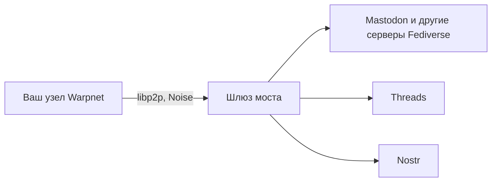

# Мосты {#bridges}

Warpnet может показывать аккаунты Mastodon (и других серверов Fediverse), Threads и Nostr и взаимодействовать с ними через **шлюз моста** — отдельную программу, которая подключается к Warpnet как пир и переводит между Warpnet и этими сетями. На этой странице описано, что ваш узел делает со шлюзом, что он туда отправляет и что это значит для вашей приватности. Что шлюз делает в других сетях, определяется в его собственном репозитории, [Warp-net/bridge-gateway](https://github.com/Warp-net/bridge-gateway).

## Как это работает {#how-it-works}

Ваш узел считает шлюз домашним узлом каждого аккаунта через мост. Запрос об аккаунте через мост, его профиле, постах или изображениях уходит шлюзу по обычному транспорту Warpnet (потоки libp2p, зашифрованные Noise), а шлюз отвечает за другую сеть.

### Какой шлюз вы используете {#which-gateway-you-use}

Ваш узел использует один шлюз, который определяется по его peer ID. По умолчанию это шлюз проекта, `12D3KooWKSVXZAF8dE2Cv449x2jkb1mCFqs7b9CV59Dpzqnur2N3` ([`core/bridge/bridge.go`](https://github.com/Warp-net/warpnet/blob/main/core/bridge/bridge.go)). Чтобы использовать другой, введите его peer ID в **Settings → Bridge gateway**; пустое поле означает шлюз по умолчанию. Изменение применяется при следующем запуске узла.

## Аккаунты через мост на вашем узле {#bridged-accounts-on-your-node}

Аккаунт через мост хранится на вашем узле как любой другой пользователь, но с тремя отличиями:

| Поле | Пользователь Warpnet | Аккаунт через мост |
|---|---|---|
| ID пользователя | ULID, например `01J...` | Handle: `name@instance` для Mastodon и Threads, `npub1…@nostr.com` для Nostr |
| ID узла | Собственный узел пользователя | peer ID шлюза |
| Тег сети | `warpnet` (или `testnet`) | `mastodon`, `threads` или `nostr` |

Аккаунты через мост попадают на ваш узел тремя путями:

- **Входные аккаунты.** При каждом запуске ваш узел сохраняет один аккаунт Mastodon, `warpnet@mastodon.social`, и один аккаунт Threads.
- **Who to follow (кого читать).** Каждый раз, когда приложение загружает первую страницу рекомендаций, ваш узел также запрашивает у шлюза рекомендуемые аккаунты и сохраняет их. В Who to follow есть вкладка для каждой сети: Warpnet, Mastodon, Threads и Nostr.
- **Поиск.** Handle вида `@name@mastodon.social`, ссылка на профиль вида `https://mastodon.social/@name` или `npub1…` из Nostr (также `nostr:npub1…`) ищутся через шлюз.

Десктопное приложение и браузерная панель выбирают иконки, значки и вкладки по тегу сети. Когда вы открываете профиль через мост, приложение предупреждает, что он приходит через шлюз.

### Чтение {#reading}

Профили, посты и изображения аккаунтов через мост загружаются со шлюза, когда вы их открываете. На gossip для аккаунтов через мост ваш узел не подписывается.

Лента Home в десктопном приложении и в панели добавляет посты аккаунтов через мост, на которые вы подписаны, обновляет их каждые 75 секунд и пропускает аккаунты, которые вы заблокировали или заглушили.

### Взаимодействие {#interacting}

Подписки и отписки, ответы (с их правками и удалением), реакции и репосты для аккаунтов и постов через мост уходят шлюзу — точно так же, как ушли бы на узел автора из Warpnet. Что попадет в другую сеть, решает шлюз.

Шлюз может и доставлять вашему узлу подписки, ответы, реакции и репосты от аккаунтов из других сетей. Ваш узел обрабатывает их как действия от любого узла Warpnet: загружает неизвестный аккаунт со шлюза и проверяет, что действие пришло с домашнего узла аккаунта, — для аккаунта через мост это шлюз.

Не поддерживаются:

- **Личные сообщения.** Узел отказывается открывать чат с аккаунтом через мост, а десктопное приложение и панель не показывают такие аккаунты в списке для нового сообщения.
- **Ответы на посты Threads.** Десктопное приложение и панель их не предлагают.

## Ключ моста {#bridge-key}

Каждое сообщение, которое ваш узел отправляет используемому шлюзу, несет **ключ моста**: 32 байта, выведенные из ключа идентичности вашего узла через HKDF-SHA256 (строка info `warpnet/bridge/v1`), в hex-кодировке. Ни один другой пир его не получает ([`security/bridge-key.go`](https://github.com/Warp-net/warpnet/blob/main/security/bridge-key.go), [`core/stream/stream.go`](https://github.com/Warp-net/warpnet/blob/main/core/stream/stream.go)). Этим ключом шлюз пользуется, чтобы действовать от вашего имени в сетях за мостом.

- **Односторонний.** Он не раскрывает ни ключ идентичности, ни пароль.
- **Постоянный.** Каждый шлюз, который вы настроите, получает один и тот же ключ. Он меняется, только если меняется ваша идентичность, то есть логин, пароль или сеть.
- **Отправляется при обычной работе.** Десктопное приложение и панель показывают Who to follow на большинстве экранов, и каждая загрузка первой страницы заставляет ваш узел запросить у шлюза рекомендации. Поэтому шлюз получает ключ, даже если вы ни разу не подписывались на аккаунт через мост.

Подробности вывода ключа — в разделе [Безопасность](security.md#bridge-key).

## Приватность и доверие {#privacy-and-trust}

Шлюз — это один пир, который видит многое:

- **Открытый текст на шлюзе.** Noise защищает соединение, но шлюз — его конечная точка и читает каждый запрос, который обрабатывает.
- **Что он узнает при обычной работе.** Ваш ID пользователя и ID узла из запросов Who to follow, ваш ключ моста, каждое ваше действие с аккаунтами через мост и, как любой узел, ваш публичный профиль и публичные посты.
- **Хранится на чужих серверах.** Все, что шлюз доставляет в Mastodon, Threads или Nostr, хранится на серверах за пределами Warpnet по их правилам.
- **Блокировки локальны.** Блокировка аккаунта через мост записывается только на вашем узле. Ни шлюзу, ни другой сети ничего не отправляется, а пир шлюза никогда не попадает в блоклист пиров вашего узла.
- **Больший лимит.** Ваш узел разрешает шлюзу больше запросов, чем обычным пирам: burst 600 и 6000 в минуту на каждом маршруте ([Безопасность](security.md#per-peer-stream-limits)).

Запуск собственного шлюза меняет то, кто все это получает, но не то, что это получает какой-то шлюз.

## Как запустить свой шлюз {#running-your-own-gateway}

Шлюз может запустить любой; инструкции по сборке и запуску — в [репозитории bridge-gateway](https://github.com/Warp-net/bridge-gateway#readme). Чтобы им пользоваться, введите его peer ID в **Settings → Bridge gateway** и перезапустите узел. После этого ваш узел отправляет запросы через мост и свой ключ моста этому шлюзу, а не шлюзу проекта.

## Ограничения {#limits}

- Нет личных сообщений с аккаунтами через мост.
- Нельзя отвечать на посты Threads из десктопного приложения и панели.
- Посты через мост в ленте Home получаются опросом, поэтому могут приходить с задержкой примерно до 75 секунд.
- Все, что связано с мостом, зависит от того, доступен ли шлюз.

## См. также {#see-also}

- [Безопасность](security.md): ключ моста и лимит запросов для шлюза
- [Сеть и транспорт](network.md): шифрование между вашим узлом и шлюзом
- [Обнаружение пиров](discovery.md): почему обнаружение никогда не синхронизирует пользователя со шлюза
- [Начало работы](user-guide/index.md): как пользоваться приложениями
