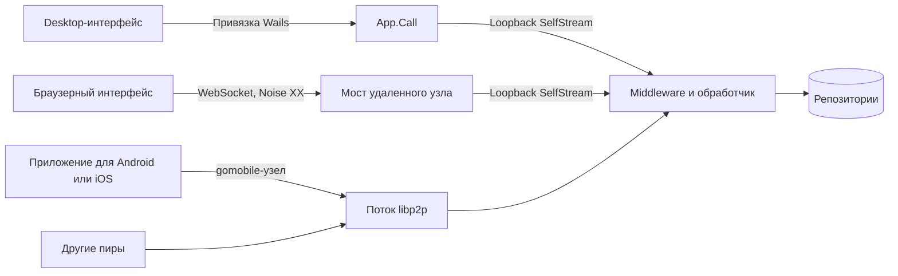
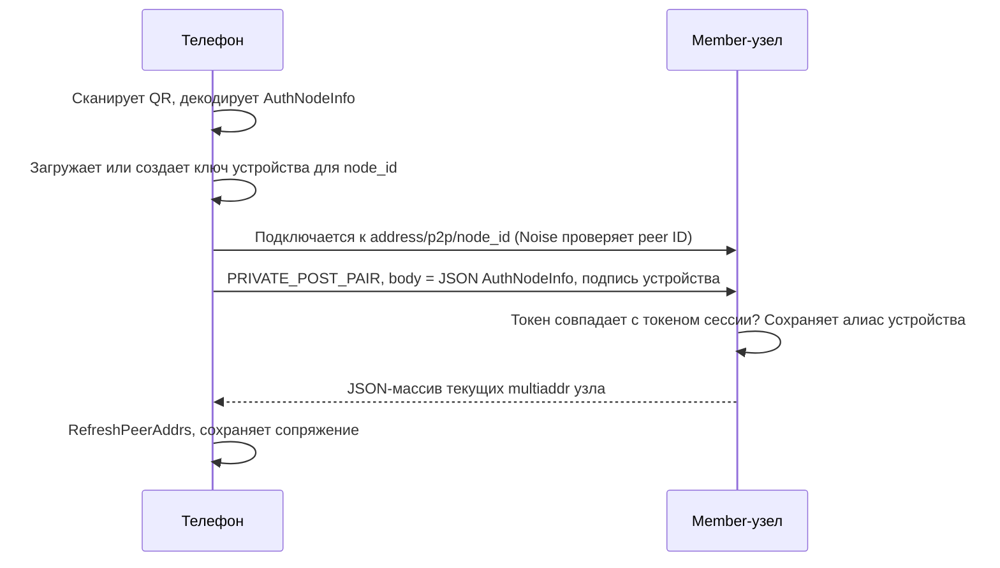

# Клиенты {#clients}

У Warpnet одна серверная реализация каждого маршрута и четыре способа до нее добраться: desktop-приложение, браузерная панель управления удаленного узла, приложение для Android и приложение для iOS. На этой странице описаны каждый транспорт, общий для них конверт запроса, протокол сопряжения мобильных устройств и правила, по которым строки маршрутов и DTO остаются одинаковыми в Go, JavaScript, Kotlin и Swift. Страница предназначена для разработчиков, которые работают над клиентом или добавляют маршрут, вызываемый клиентом.

## Один протокол, несколько транспортов {#one-protocol-several-transports}

На каждый маршрут приходится ровно один обработчик в `core/handler/`. Клиенты отличаются только тем, как запрос до него доходит.



| Клиент | Транспорт до узла | Кто подписывает запрос | Кто может вызывать `/private/...` |
|---|---|---|---|
| Desktop (member-узел) | внутрипроцессный вызов через Wails, без сетевого перехода | узел, ключом владельца | да, это и есть сам узел |
| Браузер (удаленный узел) | WebSocket `/ws`, шифрование Noise XX | узел, ключом владельца, после допуска браузера | да, после входа |
| Android, iOS | поток libp2p от встроенного Go-узла: PSK, Noise, камуфлирующий TCP-транспорт | устройство, своим ключом | да, пока устройство подключено |
| Другой member-узел | поток libp2p | узел-отправитель | нет |

Независимо от транспорта запрос проходит одну и ту же цепочку middleware (логирование, ограничение частоты запросов, проверка подписи, идемпотентность) и один и тот же обработчик. Desktop-приложение и мост удаленного узла используют `SelfStream` — внутрипроцессный loopback-поток к зарегистрированному обработчику самого узла, поэтому отдельный «локальный API» поддерживать не нужно.

## Конверт {#the-envelope}

Все транспорты передают один и тот же JSON-конверт — `event.Message` из [`event/event.go`](https://github.com/Warp-net/warpnet/blob/main/event/event.go):

| Поле | Значение |
|---|---|
| `body` | DTO запроса маршрута в виде сырого JSON |
| `message_id` | UUID; обязателен и служит ключом идемпотентности |
| `node_id` | peer ID отправителя |
| `path` | строка маршрута, например `/public/post/react/0.0.0` |
| `timestamp` | время в формате RFC 3339 |
| `version` | строка версии протокола |
| `signature` | подпись Ed25519 в base64 |
| `bridge_key` | только в сообщениях к шлюзу Fediverse |

Подпись покрывает `body`, затем временную метку в виде десятичного числа наносекунд Unix, затем `path` (`Message.SigningBytes`). Middleware аутентификации проверяет ее по открытому ключу, заключенному в peer ID удаленного пира потока, а для удаленных пиров отклоняет временные метки, которые расходятся с его собственными часами больше чем на 5 минут.

Возвращаемое обработчиком значение и есть тело ответа. Ошибки приходят в виде `{"code": <int>, "message": "<text>"}` (`event.ResponseError`), простые подтверждения — `{"code":0,"message":"Accepted"}`. Фрейминг потоков описан в разделе [Stream API](stream-API.md), маршруты перечислены в [справочнике API](api.md).

## Desktop: привязки Wails {#desktop-wails-bindings}

Member-узел запускает Vue-приложение внутри webview Wails. `cmd/node/member/main.go` привязывает структуру `App` из [`app.go`](https://github.com/Warp-net/warpnet/blob/main/cmd/node/member/app.go), и Wails генерирует JavaScript-обертки для ее экспортируемых методов в `frontend/wailsjs/go/main/App.js` (файл закоммичен и перегенерируется при `wails build`).

| Привязанный метод | Назначение |
|---|---|
| `Call(request)` | отправить один конверт и вернуть конверт ответа |
| `IsFirstRun()` | пуста ли еще локальная база данных (регистрация или вход) |
| `Network()`, `SelectNetwork(name)` | текущая сеть; выбор при первом запуске, после которого приложение перезапускается с заданным `NODE_NETWORK` |
| `ConsumePendingDeepLink()`, `SetPendingDeepLink()`, `NotifyDeepLink()` | передача ссылок `warpnet://`; фронтенд узнает о них через событие Wails `deeplink:open` |

`App.Call` сам обрабатывает четыре маршрута: вход, выход и два маршрута самообновления. Любой другой запрос пересобирается в `event.Message`, подписывается закрытым ключом владельца и передается в `node.SelfStream`, который запускает зарегистрированный обработчик с полной цепочкой middleware.

### Мост фронтенда {#the-frontend-bridge}

Интерфейс никогда не обращается к Wails или WebSocket напрямую. Компоненты вызывают хелперы из [`frontend/src/service/service.js`](https://github.com/Warp-net/warpnet/blob/main/frontend/src/service/service.js): там хранятся константы маршрутов, а `{ path, body }` отправляется через `Call` из [`frontend/src/lib/transport.js`](https://github.com/Warp-net/warpnet/blob/main/frontend/src/lib/transport.js). `transport.js` выбирает бэкенд во время выполнения:

- если `window.go.main.App.Call` существует, это desktop-приложение, и вызов уходит в привязку Wails;
- иначе это браузерная панель управления, и вызов идет через WebSocket, описанный ниже.

Оба пути принимают один и тот же запрос и возвращают ответ одной и той же формы, поэтому функцию достаточно написать один раз. Хелперы, нужные только desktop-приложению (`IsDesktop`, deep links, `SelectNetwork`, события Wails), в браузере превращаются в пустые операции.

## Удаленный узел: HTTP и /ws {#remote-node-http-and-ws}

У удаленного узла ([`remote-member.go`](https://github.com/Warp-net/warpnet/blob/main/cmd/node/member/remote-member.go)) нет окна. Он запускает обычный HTTP-сервер с двумя маршрутами:

| Маршрут | Обработчик |
|---|---|
| `/` | встроенный `frontend/dist` с SPA-фолбэком на `index.html` |
| `/ws` | мост в [`cmd/node/member/remote/bridge.go`](https://github.com/Warp-net/warpnet/blob/main/cmd/node/member/remote/bridge.go) |

Сервер слушает `--node.server.host`:`--node.server.port` (по умолчанию `0.0.0.0:4999`) и отдает обычный HTTP. Привяжите его к `127.0.0.1` и используйте SSH-туннель или поставьте за обратный HTTPS-прокси. Если страница загружена по HTTPS, фронтенд подключается через `wss://`.

### Шифрование канала {#channel-encryption}

Каждое WebSocket-соединение начинается с рукопожатия Noise `Noise_XX_25519_ChaChaPoly_SHA256` (`security/noise.go` на узле, `frontend/src/lib/noise.js` в браузере):

- Статический ключ X25519 узла хранится в `ws-noise.key` в каталоге данных сети (`~/.warpdata/<network>/`). При запуске узел выводит его отпечаток SHA-256.
- Браузер создает собственный статический ключ при первом использовании и хранит его в `localStorage` (`warpnet.client.key`).
- Браузер закрепляет ключ узла при первом контакте (`warpnet.node.key`) и отказывается продолжать, если тот позже изменится.
- После рукопожатия каждый WebSocket-фрейм — это одно зашифрованное транспортное сообщение Noise с одним JSON-конвертом. Фрейм, который не удалось расшифровать, закрывает соединение.

Нет ни заранее разделенного секрета, ни сессионной cookie. Апгрейд соединения также отклоняется, если заголовок `Origin` указывает не тот хост, на который отправлен запрос.

### Авторизация {#authorization}

| Запрос | Когда разрешен |
|---|---|
| `is-first-run` | всегда |
| `PRIVATE_POST_LOGIN` | всегда; успешный вход вносит клиентский ключ этого соединения в список допущенных (в памяти) |
| `PRIVATE_POST_LOGOUT` | ключ допущен; удаляет этот клиентский ключ из списка |
| все остальное | клиентский ключ допущен и на узле выполнен вход; иначе `401` в `ResponseError` |

Поскольку допуск привязан к клиентскому ключу Noise, тот же браузер переподключается без повторного ввода пароля, пока работает процесс узла. Список никогда не записывается на диск.

Мост подписывает каждый запрос ключом владельца и передает его в `SelfStream`, как и desktop-приложение. Каждое соединение обрабатывает до 32 запросов одновременно; вход и выход сначала ждут завершения запросов, которые уже выполняются. Браузер сопоставляет ответы по `message_id` и по умолчанию ждет 30 секунд (дольше — для импорта архива, видео и заказов спонсорских постов).

## Мобильные устройства: встроенный Go-узел {#mobile-the-embedded-go-node}

Ни одно из мобильных приложений не реализует протокол заново. Каждое линкует небольшой libp2p-узел на Go, скомпилированный через gomobile из того же репозитория, и платформенный код обращается к нему.

### Android (warpdroid) {#android-warpdroid}

warpdroid — форк Mastodon-клиента Tusky. Он опубликован в [F-Droid](https://f-droid.org/packages/site.warpnet.warpdroid/) как `site.warpnet.warpdroid`, требует Android 7.0 (API 24) или новее и поставляется одним APK для arm64-v8a.

| Слой | Расположение | Содержимое |
|---|---|---|
| Go-узел | `warpdroid/node/` (тег `mobile`) | libp2p-клиент, компилируется в `warpnet.aar` скриптом `build-native.sh` |
| Транспортная библиотека | `warpdroid/warpnet-transport/` | `WarpnetClient`, `ProtocolIds.kt`, Moshi DTO в `dto/`, `EnvelopeSigner`, `Ed25519IdentityStore`, `ConnectionMonitor` |
| Приложение | `warpdroid/app/` | интерфейс на основе Tusky, `WarpnetRepository`, экраны сопряжения, `PairRefreshWorker` |

Соберите нативную библиотеку, затем приложение:

```bash
cd warpdroid/node && ./build-native.sh   # нужны Go и ANDROID_NDK_HOME; пишет warpnet-transport/libs/warpnet.aar
cd .. && make build                       # ./gradlew clean, затем сборка без тестов и lint
```

AAR никогда не коммитится (это правило F-Droid, его проверяет CI). `build-native.sh` задает `GOTOOLCHAIN=local`, поэтому установленный Go должен удовлетворять `go.mod`.

### iOS (warpfone) {#ios-warpfone}

warpfone основан на Ice Cubes 1.10.31 — Mastodon-клиенте на SwiftUI под лицензией Apache-2.0. Он опубликован в [App Store](https://apps.apple.com/app/warpnet/id6835178022) как `site.warpnet.warpfone` и требует iOS 17 или новее. Приложение подключается к узлу по QR-коду и поддерживает ленты, треды, профили, посты, реакции, ретвиты и цитаты, чаты и уведомления; экраны Ice Cubes для функций, которых у узла нет, удалены.

| Слой | Расположение | Содержимое |
|---|---|---|
| Go-узел | `warpfone/node/` | копия `warpdroid/node`; CI проверяет, что копии совпадают, не считая комментариев и user agent |
| Фреймворк | `Warpnet.xcframework` (не коммитится) | собирается скриптом `warpfone/scripts/build-xcframework.sh` (`gomobile bind -tags mobile -iosversion=17.0`) |
| Транспортный пакет | `warpfone/Packages/WarpnetTransport` | протокол `WarpnetBinding`, `WarpnetClient`, конверт, DTO, сгенерированный `ProtocolIds.swift`, кодек QR |
| Привязка | `warpfone/WarpnetApp/App/Warpnet/GoBinding.swift` | реализует `WarpnetBinding`, вызывая сгенерированные `NodeInitialize`, `NodeStream`, ... из `import Warpnet` |
| Сетевой пакет | `warpfone/Packages/Network` | сохраняет API `Client` из Ice Cubes; `Sources/Network/Warpnet/WarpnetRouter.swift` отвечает на его Mastodon-эндпоинты данными узла |

Локальная сборка: запустите `warpfone/scripts/build-xcframework.sh`, скопируйте `warpfone/WarpnetApp.xcconfig.template` в `WarpnetApp.xcconfig` и укажите свою команду разработчика (team) и префикс bundle ID, затем откройте `warpfone/WarpnetApp.xcodeproj` (схема `WarpnetApp`). CI собирает с Xcode 27.2.

### API моста Go {#the-go-bridge-api}

gomobile умеет привязывать только простые типы, поэтому [`warpdroid/node/mobile.go`](https://github.com/Warp-net/warpnet/blob/main/warpdroid/node/mobile.go) предоставляет функции, работающие со строками, и возвращает ошибки строками:

| Функция | Назначение |
|---|---|
| `Initialize(privKeyHex, warpNetwork, pskHex, bootstrapNodes)` | запустить libp2p-хост телефона с ключом устройства, именем сети, PSK и bootstrap-пирами |
| `Connect(addrInfo)` | подключиться к пиру, обычно к сопряженному member-узлу |
| `Stream(protocolID, data)` | открыть поток на маршрут, отправить конверт, вернуть байты ответа |
| `Sign(body)` | подписать входные данные для подписи ключом устройства (Ed25519) |
| `PeerID()`, `IsConnected()`, `Connectedness()` | статус; платформенный монитор соединения опрашивает `Connectedness` |
| `Pause()`, `Resume()` | закрыть соединения при уходе в фон, снова подключиться к сопряженному узлу при возврате на передний план |
| `RefreshPeerAddrs(addrs)` | добавить текущие адреса member-узла в peerstore |
| `Disconnect()`, `Shutdown()` | завершение работы |
| `SetLogSink`, `SetLogSinkMinLevel` | перенаправить логи Go в платформенный логгер |

Хост работает только как клиент (не принимает входящих соединений), входит в частную сеть с PSK, защищает соединения через Noise, подключается через тот же камуфлирующий транспорт, что и узлы, и может достучаться до member-узла через relay-канал (circuit relay), если прямого пути нет. Он представляется user agent `warpdroid` или `warpfone`.

## Сопряжение {#pairing}

Телефон не хранит аккаунт. Это **устройство** (алиас) member-узла: отдельная libp2p-идентичность, которой узел разрешает действовать через себя. При сопряжении телефон получает все необходимое через QR-код.

### Что содержит QR-код {#what-the-qr-code-carries}

После входа владельца узел возвращает `AuthNodeInfo` ([`domain/warpnet.go`](https://github.com/Warp-net/warpnet/blob/main/domain/warpnet.go)). Интерфейс показывает его в пункте **Sign in by QR-code** (вход по QR-коду) бокового меню: данные сжаты gzip (уровень 9) и закодированы в Base45, чтобы поместиться в буквенно-цифровой сегмент QR (`frontend/src/lib/qr-payload.js`). Кнопка **Copy connection data** (скопировать данные подключения) в том же диалоге выдает несжатый JSON.

| Поле | Назначение |
|---|---|
| `user_id` | аккаунт, от имени которого будет действовать устройство |
| `token` | авторизация сопряжения: 32 случайных байта в base64; создается, когда процесс узла выполняет вход, и хранится только в памяти |
| `psk` | ключ частной сети в hex, чтобы телефон мог войти в сеть |
| `node_id` | peer ID member-узла, закрепляется при подключении |
| `addresses`, `bootstrap_peers` | где искать узел и сеть |
| `network` | имя сети |

Закрытого ключа member-узла в QR-коде нет никогда.

### Рукопожатие {#handshake}



1. **Идентичность устройства.** Телефон хранит случайный 32-байтный seed для сопряженного узла (`Ed25519IdentityStore` на Android; `PairingStore` в Keychain и `DeviceIdentity` на iOS) и разворачивает его в libp2p-ключ Ed25519. Повторное сопряжение с тем же узлом использует этот seed снова, сопряжение с другим узлом создает новый, а удаление сопряжения стирает его.
2. **Подключение.** Адреса-кандидаты заканчиваются на `/p2p/<node_id>`, поэтому рукопожатие Noise не пройдет, если удаленная сторона не докажет эту идентичность.
3. **Запрос сопряжения.** Телефон отправляет `PRIVATE_POST_PAIR` (`/private/post/admin/pair/0.0.0`) с исходным JSON `AuthNodeInfo` в теле. Это единственный приватный маршрут, который middleware принимает от неизвестного пира.
4. **Сторона узла** ([`core/handler/device.go`](https://github.com/Warp-net/warpnet/blob/main/core/handler/device.go)). Обработчик отклоняет пустой или несовпадающий токен, записывает peer ID телефона как алиас устройства и отвечает JSON-массивом своих текущих multiaddr. Ошибки вроде `token mismatch`, `pairing revoked` или `too many aliases` возвращаются в виде `ResponseError`.
5. **Сторона телефона.** Получив массив адресов, телефон вызывает `RefreshPeerAddrs` и сохраняет сопряжение.

После сопряжения телефон подписывает каждый запрос собственным ключом. Middleware принимает от него маршруты `/private/...`, потому что его peer ID есть в списке алиасов.

### Правила для устройств на узле {#device-rules-on-the-node}

| Правило | Где |
|---|---|
| Не больше 10 подключенных устройств | `MaxAliases` в `database/aliases-repo.go` |
| Алиас истекает через 72 часа после последнего успешного сопряжения. `PairRefreshWorker` на Android периодически повторно отправляет сохраненный запрос сопряжения, чтобы продлить алиас и получить новые адреса; если узел окончательно его отклоняет (например, `token mismatch`), приложение удаляет сопряжение и открывает экран сопряжения | `aliasTTL`, `PairRefreshWorker.kt` |
| Устройство, удаленное владельцем, не может снова подключиться с тем же токеном (`pairing revoked`); ему нужен QR-код от более позднего входа | tombstone-запись `DeleteAlias` |
| Устройство может отключить себя, но не другое устройство | `StreamDeleteDeviceHandler` |
| Узел очищает список устройств при запуске member-узла, а перезапуск к тому же создает новый токен, поэтому после перезапуска узла устройствам нужно отсканировать новый QR-код | `NewMemberNode`, `auth-repo.go` |
| Пока подключено хотя бы одно устройство, узел просит ОС не засыпать (`keepalive`) | `core/handler/device.go`, `keepalive/` |

Поскольку PSK приходит из QR-кода, телефон никогда не вычисляет его сам. Чтобы подключиться, мобильному релизу не нужно совпадать с версией узла; совпадать должны только маршруты и DTO, которые он использует.

## Как держать контракт синхронным {#keeping-the-contract-in-lockstep}

Источник истины — Go. Внутри потока нет согласования версий: если меняется строка маршрута или поле DTO, вместе с ними должен измениться каждый клиент.

| Что | Go | Desktop (JS) | Android (Kotlin) | iOS (Swift) |
|---|---|---|---|---|
| Строки маршрутов | `event/paths.go` | константы в `frontend/src/service/service.js` | `ProtocolIds.kt`, ведется вручную, покрывает маршруты, которые использует приложение | `ProtocolIds.swift`, генерируется скриптом `warpfone/scripts/generate-protocol-ids.sh` |
| DTO запросов | `event/event.go` | объектные литералы в `service.js` | `dto/WarpnetDtos.kt` (Moshi) | `WarpnetEvents.swift` |
| Типы ответов и доменные типы | `event/event.go`, `domain/*.go` | читаются из `resp.body` | `dto/WarpnetDtos.kt` | `WarpnetDtos.swift` |
| Мобильный узел | `warpdroid/node` | неприменимо | встроен в AAR | копия `warpfone/node` |

Что ловит CI:

- `test-warpfone.yaml` перегенерирует `ProtocolIds.swift` и падает, если результат отличается, а также падает, если две копии мобильного узла разошлись.
- `fdroid-check.yml` и `build-warpdroid.yml` пересобирают AAR из исходников.
- Ни один CI-джоб не сравнивает `service.js`, `ProtocolIds.kt` или имена полей DTO в Kotlin и Swift с определениями в Go; лишь несколько тестов фронтенда фиксируют отдельные строки маршрутов. Неверное имя JSON-поля обычно декодируется в пустое или нулевое значение без ошибки. Это проявляется пустыми полями в одном клиенте, тогда как другой работает.

Когда вы меняете маршрут или DTO:

1. Сначала измените Go и посмотрите, что обработчик возвращает на самом деле: именно это разбирают клиенты.
2. Обновите `service.js`.
3. Обновите `ProtocolIds.kt` и Moshi DTO, затем пересоберите AAR скриптом `warpdroid/node/build-native.sh`.
4. Запустите `warpfone/scripts/generate-protocol-ids.sh`, обновите DTO на Swift и пересоберите фреймворк скриптом `warpfone/scripts/build-xcframework.sh`.
5. Если вы меняли `warpdroid/node`, внесите то же изменение в `warpfone/node`.

## См. также {#see-also}

- [Руководство разработчика](index.md): сборка, структура проекта, добавление маршрута
- [Справочник API](api.md): все маршруты из `event/paths.go`
- [Stream API](stream-API.md): фрейминг запросов поверх потоков libp2p
- [Мобильные приложения](../user-guide/mobile.md): сопряжение со стороны пользователя
- [Безопасность](../security.md): идентичность, подписи и шифрование
