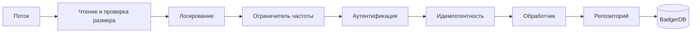

# Руководство разработчика {#developer-guide}

Это руководство проведет вас от свежего клона репозитория до принятого pull request. В нем описаны инструменты, сборка и запуск каждой роли узла, настройка локальной сети из нескольких узлов, устройство кода, разбор добавления маршрута на примере, тесты и CI, а также выпуск релизов. Руководство написано для контрибьюторов. Если вы хотите только запустить Warpnet, начните с [руководства пользователя](../user-guide/index.md).

[Contributor Onboarding Guide](https://github.com/Warp-net/warpnet/blob/main/docs/ONBOARDING.md) в самом репозитории подробнее объясняет, почему архитектура устроена именно так. Там, где он расходится с этой страницей, эта страница следует текущему коду.

## Требования {#prerequisites}

| Инструмент | Версия | Нужен для |
|---|---|---|
| Go | 1.26.3 или новее (`go 1.26.3` в `go.mod`) | всего |
| Wails CLI | v2.10.2 | desktop member-узла |
| Компилятор C/C++ | не зафиксирована | desktop member-узла и модератора (оба используют cgo) |
| Node.js и npm | не зафиксирована | пересборки desktop-интерфейса в `frontend/` |
| golangci-lint | v2 (в конфиге `version: "2"`) | линтинга |
| JDK 17, Android SDK, NDK r27c (`27.2.12479018`) | как в CI | приложения для Android |
| macOS с Xcode | в CI используется Xcode 27.2 | приложения для iOS |

Установите Wails CLI той версии, которую используют CI и Makefile:

```bash
go install github.com/wailsapp/wails/v2/cmd/wails@v2.10.2
```

> **Примечание:** `go.mod` фиксирует библиотеку Wails на более новой версии (v2.17.1), чем CLI. Все команды сборки в репозитории передают `-m -nosyncgomod`, поэтому CLI не выполняет tidy и не переписывает `go.mod`. Используйте те же флаги.
{: .note }

### Системные пакеты {#system-packages}

**Linux (Debian/Ubuntu).** Desktop-узел линкуется с GTK и WebKitGTK:

```bash
sudo apt update
sudo apt install -y pkg-config build-essential
sudo apt install -y \
  libgtk-3-dev libwebkit2gtk-4.1-dev libglib2.0-dev libcairo2-dev \
  libpango1.0-dev libgdk-pixbuf-2.0-dev libatk1.0-dev libsoup-3.0-dev
```

**macOS и Windows.** Release-воркфлоу собирает обе платформы на стандартных раннерах GitHub, где установлены только Go и Wails CLI. Если сборка падает, `wails doctor` покажет, чего не хватает в тулчейне Wails.

Headless-ролям (relay, echo, remote) нужен только Go.

## Получение исходников {#get-the-source}

```bash
git clone https://github.com/Warp-net/warpnet.git
cd warpnet
git checkout develop
```

- **Ветки.** Работа вливается в `develop`; `main` получает слияния из `develop`. Создавайте ветку от `develop` и направляйте в нее pull request.
- **Вендоренные модули.** Каталог `vendor/` закоммичен, и сборки Go используют `-mod=vendor`. Не редактируйте его вручную; после изменения зависимостей выполните `go mod tidy && go mod vendor`.
- **Сабмодуль.** `core/moderation` — git-сабмодуль, указывающий на [Warp-net/moderation](https://github.com/Warp-net/moderation). Он нужен только модератору: `git submodule update --init core/moderation` (или `--recursive`).
- **Зеркало.** Репозиторий зеркалируется на [codeberg.org/Warpnet/warpnet](https://codeberg.org/Warpnet/warpnet).

## Роли узлов и точки входа {#node-roles-and-entry-points}

Из одной кодовой базы собирается несколько бинарников. Точку входа выбирают теги сборки.

| Роль | Точка входа | Тег сборки | CGO | Dockerfile |
|---|---|---|---|---|
| member (desktop) | `cmd/node/member/main.go` + `app.go` | нет (`!echo && !remote`) | `1` | `Dockerfile.member` (только проверка компиляции, не запускается) |
| remote (headless, интерфейс в браузере) | `cmd/node/member/remote-member.go` | `remote` | не задан | `Dockerfile.remote` |
| echo (тестовый бот) | `cmd/node/member/echo-member.go` | `echo` | `0` | `Dockerfile.echo` |
| relay | `cmd/node/relay/main.go` | нет (файл помечен `!windows`) | `0` | `Dockerfile.relay` |
| moderator | `cmd/node/moderator/main.go` | `llama` | `1` | `Dockerfile.moderator` |
| мобильный узел | `warpdroid/node`, `warpfone/node` | `mobile` | gomobile | нет |

Каталога `cmd/node/bootstrap` больше нет: точкой входа в сеть служит роль relay. Что делает каждая роль, описано в разделе [Архитектура](../architecture.md).

## Сборка и запуск каждой роли {#build-and-run-each-role}

### Member-узел (desktop) {#member-desktop}

```bash
cd cmd/node/member
wails build -m -nosyncgomod -devtools -tags webkit2_41
./build/bin/warpnet --node.network testnet
```

`make run-main` делает то же самое (предварительно устанавливая Wails CLI) и запускает узел в testnet с `--node.port 4000`. На macOS результат сборки — `build/bin/warpnet.app`, на Windows — `build/bin/warpnet.exe`. Кросс-сборка под Windows:

```bash
cd cmd/node/member
wails build -clean -platform windows -tags webkit2_41 -m -nosyncgomod
```

Бинарник встраивает интерфейс из `frontend/dist` через `//go:embed` в `embedded.go`, а `wails.json` задает `skipfrontend: true`, поэтому `wails build` никогда не компилирует Vue-приложение. После любых изменений в `frontend/src` пересоберите бандл, а затем бинарник:

```bash
make frontend        # cd frontend && make rebuild: чистый npm install + npm run build
```

`frontend/dist` закоммичен намеренно: так контрибьютор, который работает только с Go, может собрать рабочий бинарник без Node.js. Если вы меняете интерфейс, закоммитьте пересобранный `dist` вместе с изменениями исходников.

### Удаленный узел (headless, интерфейс в браузере) {#remote-node-headless-ui-in-a-browser}

```bash
go run -tags remote ./cmd/node/member/remote-member.go \
  --node.network testnet --node.server.host 127.0.0.1
```

Откройте `http://127.0.0.1:4999`. Узел отдает тот же встроенный интерфейс по HTTP и связывает его с узлом через зашифрованный WebSocket (см. [Клиенты](clients.md#remote-node-http-and-ws)). При запуске он выводит отпечаток своего WebSocket-ключа. Это также самый простой способ работать над интерфейсом без GTK и Wails.

С Docker команда `docker compose up --build` использует `docker-compose.yaml` из репозитория: он собирает `Dockerfile.remote` и запускает удаленный узел в testnet в сети хоста (host networking).

### Echo-бот {#echo-bot}

```bash
make echo-main
# = go run -tags echo cmd/node/member/echo-member.go --node.network testnet \
#     --node.seed echo --database.dir echo --node.port 4002
```

Echo-узел — это member-узел с хранилищем в памяти и фиксированным аккаунтом `Echo`. Он отвечает в чатах, отвечает на посты с префиксом `echo: ` и публикует пост раз в день. На диск он ничего не пишет, поэтому `--database.dir` на него не влияет. А поскольку аккаунт фиксирован, его peer ID зависит только от сети (см. примечание в разделе [Локальные сети](#local-networks)).

### Relay-узел {#relay}

```bash
make relay-main
# = go run cmd/node/relay/main.go --node.network testnet --node.print-psk
```

Релизная сборка статическая:

```bash
cd cmd/node/relay
CGO_ENABLED=0 go build -ldflags "-s -w" -gcflags=all=-l -mod=vendor -o relay
```

Relay-узел хранит состояние только в памяти. Его peer ID берется из `--node.seed` (по умолчанию значение выводится из сети, каталога базы данных, хоста и порта), а после запуска он выводит `RELAY NODE STARTED WITH ID <id> AND ADDRESSES [...]`. Relay-узел не собирается под Windows.

### Узел-модератор {#moderator}

Модератору нужны сабмодуль `core/moderation`, тулчейн C/C++ и файл модели `Llama-Guard-3-1B-Q4_K_M.gguf` в его **рабочем каталоге**. Путь зашит в `cmd/node/moderator/moderator/moderator.go`, флага для него нет. Модель не поставляется вместе с Warpnet.

```bash
git submodule update --init core/moderation
make run-moderator
# = CGO_CXXFLAGS="-w -Wno-format -Wno-delete-incomplete" go run -tags=llama \
#     cmd/node/moderator/main.go --node.network testnet --node.port 4002 --node.seed moderatorlocalhost
```

Модератор генерирует новую случайную идентичность при каждом запуске. `Dockerfile.moderator` собирает с `-mod=mod`; в `deploy/docker-compose-moderator.yml` показано, как файл модели монтируется в контейнер. Как устроена модерация, описано в разделе [Модерация](../moderation.md).

## Теги сборки и CGO {#build-tags-and-cgo}

| Тег | Где используется | Что делает |
|---|---|---|
| `webkit2_41` | member | Выбирает привязки WebKitGTK 4.1, которые Wails использует в Linux. |
| `remote` | remote | Заменяет точку входа Wails на точку входа HTTP/WebSocket. |
| `echo` | echo | Собирает точку входа бота с хранилищем в памяти. |
| `llama` | moderator | Компилирует движок модерации и его cgo-привязки к llama.cpp. |
| `mobile` | `warpdroid/node`, `warpfone/node` | Включает мост gomobile; `go test ./...` по всему модулю эти файлы пропускает. |

CGO включен для member-узла (GTK/WebKit) и модератора (llama.cpp) и выключен для relay и echo, чтобы они статически линковались в образы `distroless`. `Dockerfile.remote` его не задает.

## Локальные сети {#local-networks}

### Порты целей Makefile {#ports-used-by-the-makefile-targets}

| Цель | Роль | Сеть | Порт | Примечания |
|---|---|---|---|---|
| `run-main` | member | testnet | 4000 | каталог `storage` по умолчанию |
| `run-second` | member | testnet | 4002 | `--node.seed backendtest --database.dir backend1` |
| `relay-main` | relay | testnet | 4001 | выводит PSK |
| `echo-main` | echo | testnet | 4002 | в памяти |
| `run-moderator` | moderator | testnet | 4002 | нужен файл модели |

> **Внимание:** `run-second`, `echo-main` и `run-moderator` используют один и тот же порт 4002. Если запускаете больше одного из них, переопределите `--node.port`. Desktop-приложение также держит блокировку единственного экземпляра (`net.warpnet.app`), поэтому второй desktop member-узел на той же машине просто передает управление первому. Чтобы запустить второй полноценный member-узел на одной машине, используйте удаленный узел со своими `--database.dir`, `--node.port` и `--node.server.port`.
{: .warning }

Практичный локальный рой — один desktop member-узел, relay-узел, echo-узел и один или несколько удаленных узлов со своими аккаунтами. Значения `--node.seed`, которые Makefile передает целям member, echo и moderator, ни на что не влияют: peer ID member-узла берется из учетных данных аккаунта, а модератор выбирает случайный.

> **Примечание:** Все echo-узлы входят под одним и тем же встроенным аккаунтом, поэтому у всех echo-узлов одной сети один peer ID. Запускайте не больше одного на сеть. В testnet уже есть публичный echo-узел, так что локальный echo-бот полезнее всего в вашей собственной изолированной сети.
{: .note }

### Изолированная сеть {#an-isolated-network}

Любое имя сети, кроме `warpnet` (mainnet) и `testnet`, дает вам частную сеть без встроенных bootstrap-узлов. Узлы соединяются, только если у них одинаковое имя сети и одинаковая **мажорная** версия: сетевой ключ (PSK) равен `SHA-256(network + major version)` (`security/psk.go`).

1. Запустите relay-узел и запишите его peer ID из стартовой строки:

   ```bash
   go run cmd/node/relay/main.go --node.network devnet --node.seed devrelay \
     --node.self-update=false
   ```

2. Укажите его остальным узлам:

   ```bash
   ./build/bin/warpnet --node.network devnet --node.port 4000 \
     --node.bootstrap /ip4/127.0.0.1/tcp/4001/p2p/<relay-peer-id>

   go run -tags echo cmd/node/member/echo-member.go --node.network devnet \
     --node.port 4003 --node.bootstrap /ip4/127.0.0.1/tcp/4001/p2p/<relay-peer-id>
   ```

Member-узлы в одной локальной сети также находят друг друга через mDNS. Member-узел предпочитает флагу `--node.bootstrap` bootstrap-адреса, сохраненные в его собственных сетевых настройках; флаг действует, пока эти настройки пусты. Самообновление (`--node.self-update`, по умолчанию включено) заменяет бинарник новейшим релизом, причем relay-узел делает это не спрашивая, поэтому для локальных сборок его стоит выключить.

### Каталог данных {#data-directory}

Каждый member-узел и удаленный узел хранит данные в `~/.warpdata/<network>/<database.dir>` (Windows: `%LOCALAPPDATA%\warpdata\...`). `--node.network mainnet` нормализуется в `warpnet`. WebSocket-ключ удаленного узла лежит в `~/.warpdata/<network>/ws-noise.key`. Relay-узел, модератор и echo-узел туда ничего не пишут.

`make prune-testnet` удаляет `~/.warpdata/testnet/*`. Без `--node.network` или `NODE_NETWORK` desktop-узел запускается в mainnet. Исключение — когда база данных testnet уже существует: тогда он снова открывает testnet.

### Флаги {#flags}

Любой флаг можно задать и переменной окружения: в верхнем регистре, с заменой точек и дефисов на подчеркивания (`node.server.port` становится `NODE_SERVER_PORT`). Флаг в командной строке имеет приоритет над окружением.

| Флаг | По умолчанию | Назначение |
|---|---|---|
| `--node.network` | `warpnet` | Имя сети; для тестирования — `testnet`. |
| `--node.port` | `4001` | TCP-порт libp2p (IPv4 и IPv6). |
| `--node.host.v4` / `--node.host.v6` | `0.0.0.0` / `::` | Адреса для привязки. |
| `--node.seed` | вычисляется | Seed для детерминированного peer ID; читается только relay-узлом. |
| `--node.bootstrap` | пусто | Multiaddr-адреса через запятую. Если флаг задан, он **заменяет** встроенный список. |
| `--node.print-psk` | `false` | Выводить PSK сети в лог при запуске; читается только relay-узлом. |
| `--node.self-update` | `true` | Заменять бинарник новыми релизами; member-узел сначала спрашивает владельца. |
| `--node.server.host` / `--node.server.port` | `0.0.0.0` / `4999` | Панель управления удаленного узла. |
| `--database.dir` | `storage` | Подкаталог в `~/.warpdata/<network>/`. |
| `--logging.level` / `--logging.format` | `info` / `text` | Уровень логирования; `text` или `json`. |
| `--wallet.binary-path` | пусто | Бинарник платежного движка. |
| `--wallet.endpoint` | TronGrid в `warpnet` и `testnet` | Эндпоинт API блокчейна. |

Полный справочник для операторов — в разделе [Запуск узла](../user-guide/running-a-node.md).

## Структура проекта {#project-layout}

```text
warpnet/
├── cmd/node/
│   ├── member/        # main.go (desktop), remote-member.go, echo-member.go, app.go (Wails App)
│   │   ├── auth/      #   login, owner record, key derivation via the auth repo
│   │   ├── deeplink/  #   warpnet:// URL scheme registration per OS
│   │   ├── node/      #   member-node.go: wires the node, registers handlers
│   │   ├── pubsub/    #   member gossip topics
│   │   └── remote/    #   /ws bridge and static file server for the remote node
│   ├── relay/         # relay node
│   └── moderator/     # moderator node: rounds, votes, audit, isolation
├── core/              # networking, streams, handlers, middleware, subsystems
├── database/          # repositories over the embedded store (*-repo.go)
│   └── local-store/   #   BadgerDB wrapper and prefix-key builder
├── domain/            # shared domain types (User, Tweet, AuthNodeInfo, ...)
├── event/             # wire protocol: paths.go (routes), event.go (DTOs, envelope)
├── security/          # keys, signatures, PSK, Noise for the remote /ws channel
├── config/            # flags, env vars, defaults, built-in bootstrap nodes
├── frontend/          # Vue 3 UI; dist/ is committed and embedded in the binary
├── warpdroid/         # Android app (Tusky fork) + gomobile node in node/
├── warpfone/          # iOS app (Ice Cubes fork) + gomobile node in node/
├── keepalive/         # keeps the host awake while devices are paired
├── deploy/            # testnet and moderator compose files, deploy script
├── snap/              # Snap packaging
├── fastlane/          # F-Droid store listing
├── embedded.go        # go:embed of version, icon, frontend/dist
└── version            # the release version (see Release process)
```

Избранные пакеты `core/`:

| Пакет | Зона ответственности |
|---|---|
| `core/node` | хост libp2p, регистрация обработчиков за middleware, loopback `SelfStream` |
| `core/stream` | тип маршрута, фрейминг запросов, loopback-потоки, пул потоков к пирам |
| `core/handler` | по одному файлу на функцию; обычно добавлять приходится именно такой файл |
| `core/middleware` | логирование, ограничение частоты запросов, проверка подписи, идемпотентность |
| `core/discovery`, `core/dht`, `core/mdns` | обнаружение пиров |
| `core/pubsub` | топики GossipSub |
| `core/relay`, `core/holepunch` | circuit relay v2, диагностика hole punching |
| `core/crdt` | реплицируемые счетчики и хранилище рейтингов (см. [Синхронизация](../synchronization.md)) |
| `core/rating`, `core/ratelimit` | репутация узлов, лимиты на пира |
| `core/trust` | круг доверия |
| `core/authorship` | проверка того, что событие пришло с собственного узла автора действия |
| `core/selfupdate` | опрос релизов и замена бинарника |
| `core/warpnet` | псевдонимы типов libp2p, опции, константы протокола |

Сам протокол описан в разделе [Протокол](../protocol.md), список маршрутов — в [справочнике API](api.md).

## Как устроен узел {#how-the-node-is-shaped}

Member-узел устроен как привычное веб-приложение MVC, так что знакомые понятия легко на него переносятся:

| Роль в MVC | Warpnet | Что там находится |
|---|---|---|
| Маршрутизатор (Router) | `event/paths.go` + `setupHandlers` в `member-node.go` | строки маршрутов и обработчик, которому передается каждый из них |
| Контроллер (Controller) | `core/handler/<feature>.go` | обработка запросов, пересылка другим узлам |
| Модель (Model) | `database/<feature>-repo.go` + `domain/` | хранение поверх BadgerDB, доменные типы |
| Представление (View) | `frontend/`, `warpdroid/`, `warpfone/` | интерфейсы, которые обращаются к контроллеру через один из [клиентских транспортов](clients.md) |

Под капотом нет HTTP-сервера: маршрутизатор распределяет потоки libp2p. Каждый запрос — пришел ли он из вашего собственного интерфейса через внутрипроцессный loopback или от другого пира — проходит одну и ту же цепочку:



- **Аутентификация** (`core/middleware/auth.go`) проверяет подпись Ed25519 над телом, временной меткой и маршрутом, отклоняет сообщения от удаленных пиров, чья временная метка расходится с часами узла больше чем на 5 минут, и пропускает маршруты `/private/...` только от самого узла, подключенного устройства или маршрута сопряжения.
- **Идемпотентность** кэширует ответы по маршруту, пиру и `message_id` на 10 минут, поэтому повторно отправленный запрос не выполняется дважды.
- **Обработчики** — это функции-фабрики, которые принимают узкие интерфейсы и возвращают `warpnet.WarpHandlerFunc`:

```go
type WarpHandlerFunc func(msg []byte, s WarpStream) (any, error)
```

Именно узкие интерфейсы позволяют покрывать обработчики модульными тестами без запущенного узла.

## Разбор примера: добавление маршрута {#worked-example-adding-a-route}

Эталонная функция — **эмодзи-реакции**: небольшая, работает между узлами и есть в каждом клиенте.

> **Примечание:** Старая документация (включая README репозитория) ссылается на `core/handler/like.go`, `like_test.go` и `database/like-repo.go`. Этих файлов больше нет: лайки заменены эмодзи-реакциями. Используйте файлы реакций из таблицы ниже.
{: .note }

| Слой | Файл | Что там |
|---|---|---|
| Маршрут | [`event/paths.go`](https://github.com/Warp-net/warpnet/blob/main/event/paths.go) | `PUBLIC_POST_REACT = "/public/post/react/0.0.0"` |
| DTO | [`event/event.go`](https://github.com/Warp-net/warpnet/blob/main/event/event.go) | `ReactionEvent{TweetId, UserId, OwnerId, Emoji}`, `ReactionsCountResponse{Count, Reactions}` |
| Обработчик | [`core/handler/reaction.go`](https://github.com/Warp-net/warpnet/blob/main/core/handler/reaction.go) | `StreamReactionHandler(repo, userRepo, notifyRepo, streamer)` |
| Хранилище | [`database/reaction-repo.go`](https://github.com/Warp-net/warpnet/blob/main/database/reaction-repo.go) | `ReactionRepo.React(tweetId, userId, emoji, isTransitive)` |
| Подключение | [`cmd/node/member/node/member-node.go`](https://github.com/Warp-net/warpnet/blob/main/cmd/node/member/node/member-node.go) | репозиторий создается в `setupHandlers`, обработчик указан в `engagementHandlers`; интерфейс `ReactionsProvider` находится в `types.go` |
| Тест | [`core/handler/reaction_test.go`](https://github.com/Warp-net/warpnet/blob/main/core/handler/reaction_test.go) | `TestStreamReactionHandler` с заглушками репозиториев |
| Desktop-интерфейс | [`frontend/src/service/service.js`](https://github.com/Warp-net/warpnet/blob/main/frontend/src/service/service.js) | константа `PUBLIC_POST_REACT`, `reactToTweet()` |
| Android | `warpdroid/warpnet-transport/.../ProtocolIds.kt`, `dto/WarpnetDtos.kt`, `app/.../WarpnetRepository.kt` | константа маршрута, Moshi DTO, вызов репозитория |
| iOS | `warpfone/Packages/WarpnetTransport/.../ProtocolIds.swift`, `WarpnetEvents.swift`, `Packages/Network/.../WarpnetRouter.swift` | сгенерированная константа маршрута, DTO, вызов роутера |

Обработчик показывает обычный для peer-to-peer паттерн: проверить автора действия, сохранить локально, затем переслать на узел автора поста, а недоступность пира считать успехом.

```go
reactor, err := authorship.VerifyActor(userRepo, streamer, s, ev.OwnerId)
// ...
num, err := repo.React(tweetId, ev.OwnerId, emoji, ev.OwnerId == ownNodeInfo.OwnerId) // store locally
// ...
reactionDataResp, err := streamer.GenericStream( // forward to the author's node
    reactedUser.NodeId, event.PUBLIC_POST_REACT, event.ReactionEvent{ /* same fields */ },
)
if errors.Is(err, warpnet.ErrNodeIsOffline) {
    return resp, nil // the author is offline: keep the local result
}
```

### Чек-лист {#checklist}

1. **Маршрут.** Добавьте константу в `event/paths.go`: `/<private|public>/<verb>/<entity>[/<sub>]/<version>`. Маршруты `private` работают с данными владельца и принимаются только от самого узла или подключенного устройства; маршруты `public` могут вызывать другие пиры.
2. **DTO.** Добавьте структуры запроса и ответа в `event/event.go` (общие типы — в `domain/`).
3. **Обработчик.** Создайте `core/handler/<feature>.go` с узкими интерфейсами для зависимостей и фабрикой `Stream<Feature>Handler(...) warpnet.WarpHandlerFunc`.
4. **Хранилище.** Добавьте методы репозитория в `database/`, используя построитель префиксов из `database/local-store`.
5. **Подключение.** Создайте репозиторий и зарегистрируйте `{route, handler}` в `cmd/node/member/node/member-node.go` (в одной из групп `*Handlers`, которые вызываются из `setupHandlers`); при необходимости добавьте интерфейс в `types.go`.
6. **Тест.** Добавьте `core/handler/<feature>_test.go`; возьмите стиль заглушек из `reaction_test.go`.
7. **Клиенты.** Если маршрут вызывает интерфейс, повторите его в каждом клиенте (подробности — в разделе [Клиенты](clients.md#keeping-the-contract-in-lockstep)):
   - desktop: константа и метод в `frontend/src/service/service.js`, затем компонент Vue;
   - Android: `ProtocolIds.kt`, Moshi DTO, метод `WarpnetRepository`, затем пересборка AAR;
   - iOS: запустите `warpfone/scripts/generate-protocol-ids.sh`, добавьте DTO и case в роутере.
8. **Правила проекта.** Лицензионный заголовок в новых файлах, тесты и линтеры без замечаний (см. ниже).

## Тесты и линтеры {#tests-and-linters}

```bash
make tests            # CGO_ENABLED=0 go test -short -p 8 -v ./...
go test -race -short ./...   # близко к прогону CI на Linux (-race требует cgo)
go vet ./...
golangci-lint run     # конфиг: .golangci.yaml
```

- `.golangci.yaml` включает все линтеры (`default: all`) за вычетом явного списка отключенных, работает в режиме vendor, ослабляет несколько линтеров для файлов `_test.go` и ослабляет стилевые линтеры для `warpdroid/node/`, потому что gomobile возвращает ошибки строками.
- Мобильный узел закрыт тегом `mobile`, поэтому `./...` его пропускает. Тестируйте его так: `go test -race -count=1 -tags mobile ./warpfone/node/... ./warpdroid/node/...`.
- Фронтенд: `cd frontend && npm test` запускает Vitest (`tests/**/*.spec.js`). `npm run serve` запускает dev-сервер Vue; в режиме разработки `src/lib/backend-mock.js` подменяет Go-привязки моком в памяти, так что узел не нужен. Для реальных данных используйте удаленный узел.
- iOS: `swift test --package-path warpfone/Packages/WarpnetTransport` и `swift test --package-path warpfone/Packages/Network`.
- `make check-heap` выводит отчет escape-анализа (какие значения уходят со стека в кучу) — тот же, что CI публикует в pull request.

## CI-воркфлоу {#ci-workflows}

Все воркфлоу лежат в [`.github/workflows`](https://github.com/Warp-net/warpnet/tree/main/.github/workflows).

| Воркфлоу | Когда запускается | Что делает |
|---|---|---|
| `tests-static-check.yaml` | каждый PR, push в `main` | `go mod verify`, golangci-lint, govulncheck (не блокирует), `go test -race` на Linux amd64/arm64, macOS (`-short`) и Windows, покрытие в Codecov |
| `heap-escape-analysis.yaml` | каждый PR, push в `main` | информационный отчет escape-анализа в комментарии к PR |
| `build-warpdroid.yml` | PR в `develop` | собирает AAR через gomobile и debug APK; при ошибке публикует лог сборки |
| `fdroid-check.yml` | PR, затрагивающие `warpdroid/`, `go.mod`, `go.sum`; теги `v*` | нет закоммиченных бинарников, AAR собран из исходников, проверка лицензий, нет зависимостей от Google Play, релизная сборка в образе buildserver F-Droid |
| `build-warpfone.yml` | PR в `develop` | собирает `Warpnet.xcframework` для симулятора и приложение через `xcodebuild` |
| `test-warpfone.yaml` | PR в `develop`, затрагивающие `warpfone/`, `warpdroid/node/`, `event/paths.go` | проверяет, что `ProtocolIds.swift` перегенерирован и что две копии мобильного узла совпадают, запускает тесты Swift и мобильные тесты Go |
| `build.yaml` (Build Mainnet) | push в `main`, вручную | собирает и публикует образ relay `ghcr.io/warp-net/warpnet-relay` |
| `build-deploy-testnet.yaml` | вручную | собирает образы relay, moderator, echo и remote и разворачивает хост testnet |
| `release.yaml` | вручную, с тегом | артефакты релиза (см. ниже) |
| `release-warpfone.yaml` | вручную, с тегом | сборка iOS в TestFlight |
| `snap.yml` | push в ветку `snap`, вручную | собирает Snap и загружает его в канал `beta` |

## Процесс релиза {#release-process}

Файл `version` — единственный источник истины. Он встраивается в бинарник, а его мажорный номер входит в сетевой ключ.

1. **Повышение версии.** Хук `pre-commit` в `.githooks/` увеличивает патч-номер при каждом коммите в `main` или `develop` и синхронизирует с ним `snap/snapcraft.yaml`, `frontend/package.json`, `warpdroid/fdroid/versionCode`, `warpfone/Version.xcconfig` и файл changelog для F-Droid. Мейнтейнеры включают хук командой `make setup-hooks`; в любой другой ветке он ничего не делает. Не меняйте версию вручную.
2. **Тег.** Мейнтейнер ставит тег `v<version>` на `main` и пушит его.
3. **Release-воркфлоу.** Запустите **Release** с этим тегом. Воркфлоу не повышает версии, не коммитит и не ставит теги. Он собирает:
   - member-бинарник для Linux amd64 и arm64, macOS (universal) и Windows amd64;
   - relay и модератор для Linux amd64;
   - подписанный APK для Android;
   - файл контрольной суммы SHA-256 для каждого артефакта, затем подписывает каждый файл контрольной суммы релизным ключом Ed25519 (`*.sig`) и зеркалирует релиз на Codeberg.
4. **iOS.** Если релиз затрагивает приложение для iOS, запустите **Release / Warpfone** с тем же тегом; он загружает сборку в TestFlight.
5. **Snap.** Push в ветку `snap` публикует сборку в канал `beta` Snap Store.

Узлы с включенным самообновлением раз в час опрашивают релизы на GitHub и Codeberg и проверяют файл контрольной суммы и его подпись, прежде чем заменить бинарник. Release-воркфлоу не подписывает и не нотаризует сборку для macOS.

## Порядок внесения изменений {#contribution-workflow}

1. Найдите или создайте issue. Обычно начинают с меток [`good first issue`](https://github.com/Warp-net/warpnet/labels/good%20first%20issue) и [`help wanted`](https://github.com/Warp-net/warpnet/labels/help%20wanted); если сомневаетесь, спросите в [Telegram](https://t.me/warpnetdev).
2. Сделайте форк и создайте ветку от `develop`: `git checkout -b <IssueNumber>/<ShortName>`.
3. Внесите изменение:
   - каждый новый файл `.go` содержит заголовок AGPL: скопируйте блок комментариев из начала существующего файла, например `core/handler/reaction.go`, включая строку `// SPDX-License-Identifier: AGPL-3.0-or-later`. У файлов Kotlin в `warpdroid/` свой короткий SPDX-заголовок;
   - если вы меняли интерфейс, закоммитьте пересобранный `frontend/dist`;
   - не трогайте `vendor/` вручную и не повышайте `version`.
4. Запустите `make tests`, `go vet ./...` и `golangci-lint run`.
5. Пишите сообщения коммитов в повелительном наклонении настоящего времени («Add bookmark filter handler»).
6. Откройте pull request в `develop` и укажите маршрут или маршруты, которые вы затронули: ревьюеры соотносят изменения со слоями по строке маршрута.

Вклад принимается на условиях [Contributor License Agreement](../legal/CLA.md). Отправка pull request и есть ваше согласие; подписывать ничего не нужно.

## Устранение неполадок {#troubleshooting}

| Симптом | Причина и решение |
|---|---|
| Изменения интерфейса не появляются в desktop-сборке | `skipfrontend: true` и встроенный `dist`: выполните `make frontend`, затем пересоберите бинарник. |
| Два локальных узла не видят друг друга | Разные `--node.network`, разная мажорная версия или своя сеть без `--node.bootstrap`. |
| `bind: address already in use` | Две цели Makefile на одном порту (4002); передайте `--node.port`. |
| Второе окно desktop-приложения не открывается | Блокировка единственного экземпляра; используйте удаленный узел. |
| Модератор завершается вскоре после старта или никогда не выносит решений | Нет файла модели в рабочем каталоге (процесс завершается) или сборка без `-tags=llama` (движок не скомпилирован). |
| `wails build` падает в Linux | Не хватает dev-пакетов GTK/WebKit или пропущен `-tags webkit2_41`. |
| В Android пустые поля, а в desktop все в порядке | Kotlin DTO или `ProtocolIds.kt` разошлись с Go; см. [Клиенты](clients.md#keeping-the-contract-in-lockstep). |
| Нужно больше подробностей | `LOGGING_LEVEL=debug`, а для структурированных логов — `--logging.format json`. |

## См. также {#see-also}

- [Клиенты](clients.md): как desktop-приложение, браузер и мобильные приложения обращаются к узлу
- [Справочник API](api.md): все маршруты из `event/paths.go`
- [Stream API](stream-API.md): фрейминг запросов поверх потоков libp2p
- [Архитектура](../architecture.md): роли, компоненты и потоки данных
- [Как помочь](../HOW-TO-HELP.md): где вклад нужнее всего
