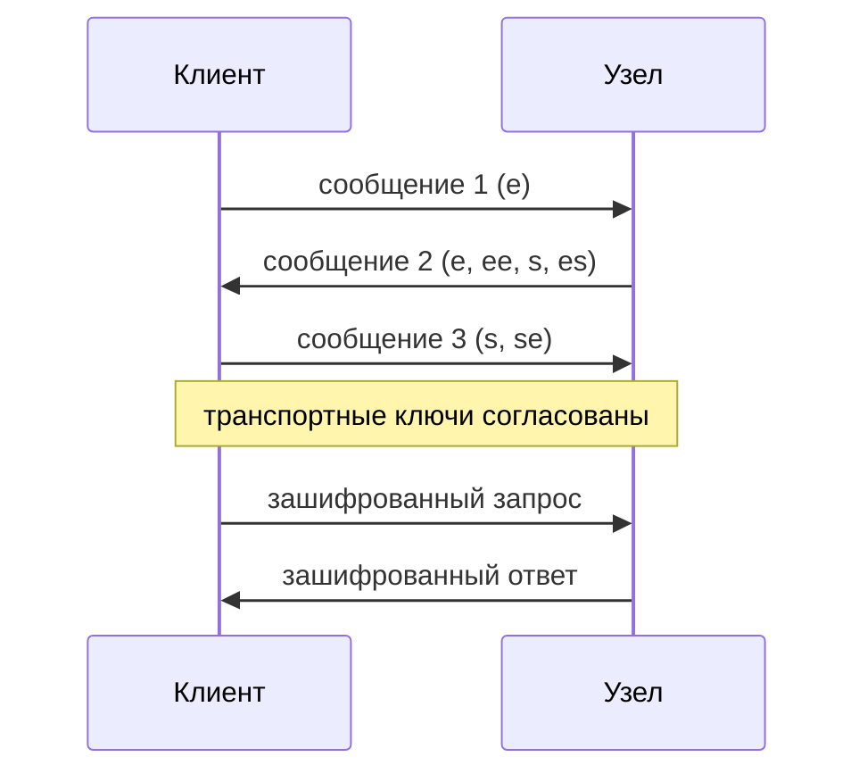

# WebSocket API {#websocket-api}

Удаленный вариант member-узла (`cmd/node/member/remote-member.go`, собирается с тегом `remote`) работает без окна и отдает веб-панель управления в браузер. Панель общается с узлом через один WebSocket на `/ws` со сквозным шифрованием Noise. На этой странице описан этот мост для разработчиков, которые хотят написать собственную панель управления, скрипт или бота для удаленного узла. Маршруты перечислены в [справочнике API](api.md).

## Эндпоинт {#endpoint}

| Параметр | Значение |
|---|---|
| URL | `ws://<host>:<port>/ws` (или `wss://` за TLS-прокси) |
| Привязка по умолчанию | `0.0.0.0:4999`; меняется через `--node.server.host` и `--node.server.port` (`NODE_SERVER_HOST`, `NODE_SERVER_PORT`) |
| Другие пути | Статические файлы панели управления; на неизвестный путь отдается `index.html` |
| Origin | Запрос, у которого хост в `Origin` отличается от `Host`, к которому он подключается, отклоняется. Запросы без заголовка `Origin` (небраузерные клиенты) разрешены |
| Фреймы | Бинарные сообщения WebSocket |

Код: [`cmd/node/member/remote-member.go`](https://github.com/Warp-net/warpnet/blob/main/cmd/node/member/remote-member.go), [`cmd/node/member/remote/bridge.go`](https://github.com/Warp-net/warpnet/blob/main/cmd/node/member/remote/bridge.go), [`security/noise.go`](https://github.com/Warp-net/warpnet/blob/main/security/noise.go). Браузерная сторона — [`frontend/src/lib/transport.js`](https://github.com/Warp-net/warpnet/blob/main/frontend/src/lib/transport.js) и [`frontend/src/lib/noise.js`](https://github.com/Warp-net/warpnet/blob/main/frontend/src/lib/noise.js).

## Рукопожатие {#handshake}

Каждое соединение начинается с рукопожатия Noise `Noise_XX_25519_ChaChaPoly_SHA256` с пустым прологом. Клиент — инициатор, узел — ответчик. Каждое сообщение рукопожатия — одно бинарное сообщение WebSocket:



- Рукопожатие должно завершиться в течение 10 секунд после апгрейда соединения.
- **Ключ узла.** Статический ключ X25519 узла хранится в `ws-noise.key` в каталоге данных сети, рядом с каталогом базы данных (`~/.warpdata/<network>/ws-noise.key` в Linux и macOS), и создается при первом запуске. При запуске узел выводит отпечаток — SHA-256 статического открытого ключа в hex.
- **Ключ клиента.** Клиент приходит со своим долгоживущим статическим ключом X25519. Браузерная панель управления генерирует его при первом использовании и хранит в `localStorage` (`warpnet.client.key`).
- **Закрепление.** Панель управления закрепляет отпечаток узла при первом контакте (`warpnet.node.key`) и отказывается продолжать, если он когда-либо изменится. Собственный клиент должен поступать так же или сверять отпечаток с тем, который вывел узел.

Нет ни заранее разделенного секрета, ни отката на открытый текст.

## Транспортные фреймы {#transport-frames}

После рукопожатия каждое бинарное сообщение WebSocket в любом направлении — это одно транспортное сообщение Noise: ChaCha20-Poly1305 с nonce-счетчиком, поэтому сообщения нужно расшифровывать в порядке поступления. Открытый текст — один JSON-документ в UTF-8.

- Сообщение, которое не удалось расшифровать, закрывает соединение.
- Сообщение, которое расшифровалось, но не является корректным конвертом, записывается в лог и отбрасывается **без ответа**; клиент увидит только собственный таймаут.
- Узел обрабатывает до 32 запросов на соединение одновременно, поэтому ответы могут приходить в любом порядке. Сопоставляйте их с запросами по `message_id`.

## Конверт запроса {#request-envelope}

Открытый текст запроса — это `event.Message` ([`event/event.go`](https://github.com/Warp-net/warpnet/blob/main/event/event.go)):

```json
{
  "path": "/private/get/timeline/0.0.0",
  "body": {"user_id": "01JD7Q...", "limit": 20},
  "message_id": "6f1c2a7e-3b4d-4e5f-8a9b-0c1d2e3f4a5b",
  "timestamp": "2026-11-24T10:15:30Z"
}
```

| Поле | Обязательное | Примечания |
|---|---|---|
| `path` | да | Маршрут из [справочника API](api.md) или один из путей моста ниже |
| `body` | да | Тип запроса маршрута в виде JSON; `{}`, если маршрут не принимает данных |
| `message_id` | да | Уникален для каждого запроса (панель управления использует UUID) и копируется в ответ. Вызов маршрута без него завершается ошибкой `middleware: internal node error` |
| `timestamp` | нет | RFC 3339. Если поля нет, узел берет текущее время. Значение не в формате RFC 3339 делает конверт некорректным |
| `node_id`, `version`, `signature` | нет | Не нужны. Узел сам подписывает запрос |

Подписывать ничего не нужно: канал Noise аутентифицирует клиента, а мост подписывает конверт ключом владельца, прежде чем передать его собственному обработчику узла как loopback-вызов. Поскольку вызов исходит от самого узла, приватные маршруты разрешены, а проверка свежести в 5 минут не применяется.

## Конверт ответа {#response-envelope}

```json
{
  "body": {"cursor": "end", "tweets": [], "user_id": "01JD7Q..."},
  "message_id": "6f1c2a7e-3b4d-4e5f-8a9b-0c1d2e3f4a5b",
  "node_id": "",
  "path": "/private/get/timeline/0.0.0",
  "timestamp": "2026-11-24T10:15:30.481Z",
  "version": "0.0.0",
  "signature": ""
}
```

`message_id` и `path` копируются из запроса. `body` — ровно то, что вернул маршрут: тип ответа из [справочника API](api.md), `Accepted` или объект ошибки. `node_id` и `signature` пусты.

## Пути моста {#bridge-paths}

| Путь | Нужен вход | Тело | Тело ответа |
|---|---|---|---|
| `is-first-run` (без ведущего слеша) | нет | `{}` | `true`, пока первый вход не создал базу данных узла, затем `false` |
| `/private/post/login/0.0.0` | нет | `LoginEvent`: `{"username": "<логин>", "password": "..."}` | `LoginResponse` (`domain.AuthNodeInfo`): `user_id`, `token`, `psk`, `node_id`, `addresses`, `bootstrap_peers`, `network` |
| `/private/post/logout/0.0.0` | да | `{}` | `["logged_out"]` |
| любой другой маршрут | да | тип запроса маршрута | ответ маршрута |

Поле `username` в `LoginEvent` несет **логин** аккаунта — то, что вводится в поле «Login» формы входа. Это не имя профиля, которое видят другие пользователи. Ответ на вход — это также то, что панель управления кодирует в QR-код сопряжения для телефонов.

## Вход и допуск клиента {#login-and-enrolment}

Мост авторизует соединение по статическому ключу клиента, который подтвердило рукопожатие Noise, а не по cookie или токенам:

1. Если соединение пришло с клиентским ключом, который не допущен, работают только `is-first-run` и вход. На все остальное приходит `401`.
2. Успешный вход открывает зашифрованную базу данных узла и **допускает** статический ключ клиента; соединение сразу авторизовано. Первый вход в процессе узла также запускает member-узел. На узле без аккаунта первый вход создает аккаунт с указанными логином и паролем.
3. Последующие соединения с тем же клиентским ключом авторизуются без повторного входа, пока работает процесс узла. Список допущенных ключей хранится только в памяти.
4. Выход удаляет ключ клиента из списка допущенных и снимает авторизацию с соединения. Узел продолжает работать, а другие допущенные клиенты остаются в системе.

Вход и выход на соединении ждут, пока завершатся уже выполняемые запросы этого соединения, а затем выполняются отдельно от других запросов.

Логин и пароль вместе — это идентичность аккаунта: узел выводит из них обоих ключ идентичности и ключ базы данных. С другим логином или другим паролем узел выведет другие ключи и не сможет открыть существующую базу данных. Пароль должен содержать от 8 до 32 символов, включая заглавную букву, строчную букву, цифру и специальный символ. Подробности — в разделе [Безопасность](../security.md#identity-and-key-derivation).

## Ошибки {#errors}

Ошибки приходят как конверт ответа, у которого `body` — объект ошибки:

| Тело | Значение |
|---|---|
| `{"code":401,"message":"this connection is not signed in: log in on this node first"}` | Соединение не допущено, или вход на узле не выполнен |
| `{"code":500,"message":"not attached server node"}` | Вход выполнен, но member-узел еще не закончил запуск |
| `{"code":500,"message":"..."}` | Вход не удался (например, `authentication failed: ...` или нарушено правило пароля), или запрос не удалось передать обработчику (например, `node: selfstream: no handler for path ...`) |
| `{"code":5000,"message":"..."}`, `{"code":5001,...}` и другие | Передаются без изменений от самого маршрута; см. [Stream API](stream-API.md#errors) |

`/private/get/update/0.0.0` и `/private/post/update/0.0.0` есть только в desktop-приложении. На удаленном узле они завершаются ошибкой «no handler», потому что удаленный узел не обновляется сам.

## Таймауты {#timeouts}

Узел дает каждому запросу 1 минуту внутри loopback-вызова, 10 минут — для `/private/post/import/twitter/tweet/0.0.0`. Браузерная панель управления по умолчанию ждет 30 секунд, дольше — для импорта архива (10 минут), заказов спонсорских постов (7 минут), видео (3 минуты), проверки покупателя копии (2 минуты) и расчета стоимости заказа (1 минута).

## Замечания по безопасности {#security-notes}

- Полезная нагрузка WebSocket зашифрована сквозным образом между клиентом и узлом, но HTML и JavaScript панели управления узел отдает по обычному HTTP. В сети, которой вы не доверяете, привяжите панель к `127.0.0.1` и используйте SSH-туннель или поставьте перед ней обратный TLS-прокси.
- Попытаться войти может любой, кто может достучаться до порта. Тот, кто знает логин и пароль, управляет аккаунтом, поэтому не раскрывайте ни то, ни другое и используйте надежный пароль.

## См. также {#see-also}

- [Справочник API](api.md): маршруты, которые можно вызывать
- [Stream API](stream-API.md): вызов узла через libp2p вместо моста
- [Клиенты](clients.md): как каждый клиент обращается к своему узлу
- [Запуск узла](../user-guide/running-a-node.md): запуск удаленного узла
- [Сеть](../network.md#the-remote-nodes-dashboard): что панель управления открывает в сеть
