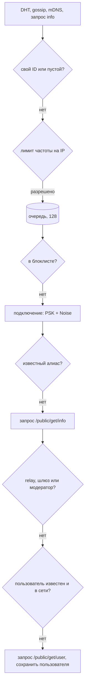

# Обнаружение пиров {#peer-discovery}

В Warpnet нет сервера-каталога, поэтому каждый узел должен находить пиров сам. Эта страница объясняет, откуда узел узнает о других узлах, что он делает с каждым найденным и как решает, какие соединения сохранить. Она в основном для разработчиков и операторов узлов. Нижележащий транспорт описан на странице [Сеть](network.md).

## Источники коротко {#sources-at-a-glance}

| Источник | Что дает | Где работает | Код |
|---|---|---|---|
| Список bootstrap-узлов | Первые пиры для подключения и начальная точка DHT | все роли | [`config/config.go`](https://github.com/Warp-net/warpnet/blob/main/config/config.go) |
| DHT | Пиры, добавленные в таблицу маршрутизации Kademlia, и провайдеры ключа rendezvous сети | все роли; в обнаружение их передают только member- и relay-узлы | [`core/dht/dht.go`](https://github.com/Warp-net/warpnet/blob/main/core/dht/dht.go) |
| PubSub gossip | Анонсы пиров в `/warpnet/discovery/1.0.0` | публикуют все роли; используют полученное member- и relay-узлы | [`core/pubsub/gossip.go`](https://github.com/Warp-net/warpnet/blob/main/core/pubsub/gossip.go) |
| mDNS | Узлы в той же локальной сети | member-узлы | [`core/mdns/mdns.go`](https://github.com/Warp-net/warpnet/blob/main/core/mdns/mdns.go) |
| Входящие запросы info | Любой пир, который запрашивает у этого узла `/public/get/info/0.0.0` | member- и relay-узлы | [`core/handler/info.go`](https://github.com/Warp-net/warpnet/blob/main/core/handler/info.go) |

Все источники, кроме списка bootstrap-узлов, наполняют одну очередь в сервисе обнаружения ([`core/discovery/discovery.go`](https://github.com/Warp-net/warpnet/blob/main/core/discovery/discovery.go)), которую разбирает единственный worker. Узлы-модераторы не запускают сервис обнаружения: они поддерживают таблицу маршрутизации DHT, участвуют в rendezvous, публикуют собственные gossip-анонсы и пересылают топик, но ни на что услышанное не реагируют. Мобильные приложения пиров не обнаруживают; см. [Сеть](network.md#what-the-mobile-apps-do).

Соединиться вообще могут только узлы одной сети и одной мажорной версии, потому что ключ приватной сети выводится из обоих значений (см. [Сеть](network.md#the-pre-shared-key-is-public)). Обнаруженный пир с другим ключом отсеивается на шаге подключения.

## Bootstrap-узлы {#bootstrap-nodes}

Bootstrap-узел — это любой адрес из списка bootstrap-узлов узла, а не тип узла. Встроенный список — это три relay-узла, которые проект запускает на одном хосте, `207.154.221.44`. Каждый из них доступен по IPv4 и IPv6:

| Сеть | Порты |
|---|---|
| `warpnet` | TCP 4001, 4002, 4003 |
| `testnet` | TCP 4011, 4022, 4033 |

Member-узел выбирает список bootstrap-узлов в таком порядке:

1. список, сохраненный в собственных сетевых настройках узла (`/private/post/settings/network/0.0.0`, экран **Settings**);
2. `--node.bootstrap <multiaddr>,<multiaddr>` или `NODE_BOOTSTRAP` — заменяет встроенный список;
3. встроенный список для `warpnet` или `testnet`.

Список читается при запуске узла. Relay-узлы и узлы-модераторы используют только пункты 2 и 3. Любой может запустить свой relay-узел (`cmd/node/relay`) и направить на него свои узлы; см. [Сеть](network.md#keeping-the-projects-hosts-out-of-the-path).

Что узел делает со списком bootstrap-узлов:

- Навсегда добавляет их адреса в свой peerstore и заполняет ими DHT, затем выполняет bootstrap и обновляет таблицу маршрутизации.
- Проверяет каждый bootstrap-пир DHT-пингом. Если по адресу отвечает пир с другим peer ID, чем указано в конфигурации, узел удаляет указанный ID из таблицы маршрутизации и peerstore и записывает адрес под фактическим ID.
- Использует список как статические relay для AutoRelay: узел за NAT резервирует слоты relay только на своих bootstrap-узлах. Собственный ID в списке узел пропускает.
- На member-узле: дает им наивысший приоритет соединения при запуске (см. [Приоритизация пиров](#peer-prioritisation)) и передает тот же список телефону при сопряжении.

Bootstrap-узлы проекта работают на бинарнике relay. Relay-узел отвечает на `/public/get/info/0.0.0` с типом `relay` и не несет профиля пользователя, поэтому обнаружение никогда не синхронизирует с него пользователя.

## DHT и rendezvous {#dht-and-rendezvous}

Каждая роль запускает Kademlia DHT (go-libp2p-kad-dht) в автоматическом режиме клиента/сервера под префиксом протокола, который зависит от сети, — `/warpnet` или `/testnet`. Узлы другой сети не могут делить с ней таблицу маршрутизации.

| Параметр | Значение |
|---|---|
| Размер бакета | 50 |
| Обновление таблицы маршрутизации | каждый час |
| Максимальный возраст записи | 1 час |
| Кэш записей провайдеров | 256 записей, 8 часов |

На member- и relay-узлах обнаружение получает данные из DHT двумя путями:

- **Добавления в таблицу маршрутизации.** Когда пир попадает в таблицу маршрутизации, его ID передается в обнаружение. Затем шаг подключения использует те адреса пира, которые есть в peerstore.
- **Rendezvous.** После bootstrap DHT узел объявляет себя провайдером пространства имен `warpnet/rendezvous/<network>` (например, `warpnet/rendezvous/warpnet`) и ищет других провайдеров того же пространства имен: сразу, а затем каждые 10 минут, до 50 пиров за один поиск. Он пропускает себя, пиров без адресов, уже подключенных пиров и пиров, исключенных по рейтингу, сохраняет найденные адреса на 8 часов и передает каждого пира в обнаружение. Для объявления нужен хотя бы один пир в таблице маршрутизации. Неудачная попытка повторяется через 30 секунд, успешное объявление обновляется каждые 3 часа.

Member-узлы хранят записи DHT и свой peerstore в локальной базе данных, поэтому известные пиры сохраняются после перезапуска. Relay-узлы и узлы-модераторы хранят их в памяти.

## PubSub gossip {#pubsub-gossip}

Gossip-топик `/warpnet/discovery/1.0.0` — главный источник обнаружения. Публикует в него каждая роль:

- Сообщение содержит собственный peer ID и адреса публикатора, а также до 10 пиров, к которым он сейчас подключен, с их адресами.
- Первый анонс уходит при запуске gossip, следующий — через минуту. Каждый следующий интервал на 5 секунд длиннее предыдущего, до 30 минут, плюс случайные 0–59 секунд.

Member- и relay-узлы передают в обнаружение каждого пира из полученного анонса. Модераторы подписываются на топик только для того, чтобы пересылать его.

## mDNS {#mdns}

Member-узлы анонсируют себя в локальной сети через сервис mDNS из libp2p под именем `warpnet` и передают в обнаружение каждого локального пира, которого услышат. Обе сети используют одно и то же имя сервиса; соединиться им не дает ключ приватной сети.

## Входящие запросы info {#inbound-info-requests}

Когда любой пир вызывает `/public/get/info/0.0.0`, обслуживающий узел (member или relay) также считает вызывающего обнаруженным, с тем адресом, откуда пришел вызов. Пиры, чьи адреса уже есть в peerstore, пропускаются, поэтому два узла, которые запрашивают info друг у друга, не зацикливаются.

## Конвейер обнаружения {#the-discovery-pipeline}

Схема показывает member-узел.

### До очереди {#before-the-queue}

Каждый источник проходит одни и те же входные проверки:

1. Пустые peer ID и собственный ID узла отбрасываются.
2. Факт появления пира сообщается движку [рейтинга](rating.md), который фиксирует пира, появляющегося слишком часто.
3. Leaky bucket на каждый IP ограничивает, как часто можно услышать один адрес: по умолчанию burst 64 и 32 за 10 секунд. Bucket выбирается по первому IP в адресах пира (для адреса через relay — по IP relay-узла). Пиры, переданные без адресов, — а это все, что приходит из DHT, — делят один общий bucket. На member-узле владелец может изменить оба числа в настройках ограничения частоты запросов (`discovery_burst`, `discovery_per_ten_sec`); они применяются при следующем запуске узла. Relay-узлы используют значения по умолчанию.
4. Пир попадает в очередь на 128 мест. Если очередь заполнена, новое появление отбрасывается вместе с 1–12 самыми старыми записями очереди.

### Member-узлы {#member-nodes}

Для каждого пира из очереди member-узел:

1. Пропускает его, если его peer ID в блоклисте.
2. Подключается к нему. Именно здесь применяются ключ приватной сети, Noise и фильтр соединений (connection gater). Недоступный пир отбрасывается.
3. Если пир — устройство, сопряженное с узлом, у которого этот узел уже запрашивал info (алиас), повышает его приоритет соединения до максимума и останавливается.
4. Запрашивает у него `/public/get/info/0.0.0`. Узел, который отвечает ошибкой или в информации которого нет владельца, отбрасывается.
5. Запоминает алиасы пира (его сопряженные устройства; до 10 записей, на 24 часа) и задает приоритет соединения по доступности, о которой сообщил пир.
6. Останавливается, если пир — relay-узел, шлюз моста, которым пользуется этот узел, или модератор. Ни у одного из них нет профиля пользователя для синхронизации.
7. Останавливается, если пользователь с этим ID узла уже сохранен и не помечен как не в сети.
8. Запрашивает профиль владельца через `/public/get/user/0.0.0`, измеряет время приема-передачи (RTT) и создает пользователя локально или обновляет существующую запись. Пользователь помечается как находящийся в сети.

Пользователь помечается как не в сети, когда поток к его узлу завершается ошибкой `node is offline`. В следующий раз, когда обнаружение встретит этот узел, шаг 7 позволит загрузить профиль заново.

### Relay-узлы {#relay-nodes}

Relay-узлы делают меньше: подключаются, проверяют кэш алиасов (4096 записей, 72 часа), запрашивают info, задают приоритет соединения и запоминают алиасы. Блоклиста у них нет, пользователей они не хранят.

Если очередь остается пустой 30 минут на member-узле (5 минут на relay-узле), узел пишет в лог `discovery: stalled`.

## Приоритизация пиров {#peer-prioritisation}

Соединениями управляет менеджер соединений libp2p. По умолчанию он начинает сокращать их число при 50 соединениях и оставляет 20. Для новых соединений действует льготный период в один час. На member-узле владелец может изменить `network_low_water` и `network_high_water` в настройках ограничения частоты запросов (нижняя граница должна быть меньше верхней и не превышает половины верхней); значения применяются при следующем запуске узла. При сокращении первыми уходят пиры с наименьшими значениями тегов. Значения двух тегов складываются:

| Тег | Значения | Когда задается |
|---|---|---|
| Доступность | 100 для bootstrap-узлов и алиасов; для остальных — по доступности, о которой сообщает пир: публичные 90, неизвестные 60, приватные 30 | при запуске для bootstrap-узлов (только на member-узлах), для остальных — после запроса info; новое значение игнорируется, если тег менялся за последние 30 секунд |
| Рейтинг | trusted 60, watched 30, degraded 10, floor 1 | при подключении и каждые 30 секунд |

[Рейтинг](rating.md) также фильтрует пиров вне менеджера соединений:

| Эффект | Уровень floor | Уровни watched и degraded |
|---|---|---|
| DHT | не попадает в таблицу маршрутизации, в результаты запросов и в результаты rendezvous; таблица маршрутизации проверяется каждые 30 секунд | остаются |
| Gossip | оценка ниже порога серого списка, сообщения больше не читаются | отрицательная оценка, нет места в gossip mesh |
| Ограничения частоты для потоков | 10% от лимита каждого маршрута | 50% (watched), 25% (degraded) |
| Медиа в постах и ответах, которые они доставляют | отбрасываются | сохраняются |

Пир, о котором у узла нет сведений, считается доверенным (trusted). Низкий рейтинг замедляет пира и понижает его приоритет; соединения с ним не отклоняются.

## Блоклист {#blocklist}

Member-узлы хранят блоклист пиров в своей базе данных ([`database/node-repo.go`](https://github.com/Warp-net/warpnet/blob/main/database/node-repo.go)). Заблокированный пир:

- пропускается обнаружением;
- отклоняется фильтром соединений при исходящих попытках соединения, а также при входящих соединениях, как только Noise раскрыл его peer ID;
- отключается и удаляется из peerstore проверкой, которая выполняется каждые 10 секунд;
- попадает в черный список GossipSub.

Когда заблокированный пир доходит до узла через relay-узел, узел также просит этот relay-узел больше не соединять с ним этого пира (см. [Сеть](network.md#relay-reservation-refusals)).

Блокировка пользователя в приложении (`/private/post/settings/block/0.0.0`) добавляет узел этого пользователя в блоклист; разблокировка удаляет его оттуда. Исключение — пользователи из сетей за мостом: узел шлюза моста, через который они приходят, в блоклист никогда не попадает (см. [Мосты](bridge.md)).

## Переподключения и кэширование {#reconnects-and-caching}

- **Адреса пиров.** Member-узлы сохраняют свой peerstore, поэтому к известным пирам можно подключиться после перезапуска. Адреса, полученные через rendezvous, истекают через 8 часов; адреса bootstrap-узлов не истекают никогда.
- **Переподключение.** Когда пир подключается снова, узел сразу снимает с него отметку «не в сети» (иначе пир, на котором сорвался поток, пропускается 30 секунд). Затем узел отправляет все записи, ожидающие этого пира в очереди исходящих, и заново применяет его тег рейтинга. См. [Протокол](protocol.md#outbox-for-offline-peers).
- **Relay-узлы.** После неудачной резервации AutoRelay ждет 5 минут, прежде чем снова обратиться к тому же relay-узлу, и отбрасывает кандидатов в relay старше 5 минут.
- **Периодическое обновление.** Gossip-анонсы и поиски rendezvous продолжаются все время работы узла. Поэтому узел, потерявший всех пиров, находит их снова без перезапуска.

## См. также {#see-also}

- [Сеть](network.md): транспорт, обход NAT, relay-узлы
- [Протокол](protocol.md): маршруты, конверты, топики gossip
- [Рейтинг](rating.md): как оцениваются пиры
- [Архитектура relay-узла](relay-node-architecture.md): relay-узел
- [Запуск узла](user-guide/running-a-node.md): флаги и конфигурация
