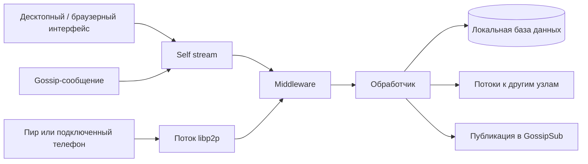

# Архитектура member-узла {#member-node-architecture}

Member-узел — это узел, который запускает пользователь: он хранит аккаунт, обслуживает интерфейс и подключенные телефоны и участвует в сети. Эта страница описывает, как он запускается, как через него проходит запрос и что делает каждый компонент. Она рассчитана на разработчиков и любознательных операторов. Общую картину сначала смотрите на странице [Архитектура](architecture.md).

## Варианты сборки {#build-flavours}

У одного пакета, [`cmd/node/member`](https://github.com/Warp-net/warpnet/tree/main/cmd/node/member), три точки входа, которые выбираются тегами сборки Go. Все три собирают один и тот же узел через `NewMemberNode` и `Start` из [`cmd/node/member/node/member-node.go`](https://github.com/Warp-net/warpnet/blob/main/cmd/node/member/node/member-node.go). Различаются они тем, как к узлу обращается пользователь.

| Вариант | Точка входа | Сборка | Интерфейс пользователя | База данных | Самообновление |
|---|---|---|---|---|---|
| **Desktop** | [`main.go`](https://github.com/Warp-net/warpnet/blob/main/cmd/node/member/main.go) + [`app.go`](https://github.com/Warp-net/warpnet/blob/main/cmd/node/member/app.go) | по умолчанию (без тегов `echo` и `remote`), собирается с Wails; на Linux `-tags webkit2_41` | окно Wails; интерфейс вызывает узел внутри процесса | зашифрованная BadgerDB на диске | Linux и Windows; сначала спрашивает владельца; в macOS только сообщает о релизе; выключено в пакете Snap |
| **Remote** | [`remote-member.go`](https://github.com/Warp-net/warpnet/blob/main/cmd/node/member/remote-member.go) | `go build -tags remote` | тот же интерфейс в браузере: HTTP на `/`, WebSocket на `/ws` | зашифрованная BadgerDB на диске | нет |
| **Echo** | [`echo-member.go`](https://github.com/Warp-net/warpnet/blob/main/cmd/node/member/echo-member.go) | `go build -tags echo`, `CGO_ENABLED=0` | нет: это бот | в памяти, фиксированный аккаунт | нет |

Все три варианта сообщают другим узлам `type: "member"`.

**Desktop.** Интерфейс на Vue встроен в бинарный файл и отрисовывается [Wails](https://wails.io) в нативном окне. Wails держит блокировку единственного экземпляра (`net.warpnet.app`), поэтому одновременно работает только одно десктопное приложение. Повторный запуск передает уже запущенному приложению ссылку `warpnet://`, если она была. При запуске приложение регистрирует схему URL `warpnet://`.

**Remote.** Member-узел без интерфейса (headless) с HTTP-сервером для дашборда в браузере. Он слушает на `--node.server.host` и `--node.server.port` (по умолчанию `0.0.0.0` и `4999`) и отклоняет WebSocket-соединения, открытые страницами с другого источника (origin). Каждое соединение `/ws` начинается с рукопожатия Noise XX ([`security/noise.go`](https://github.com/Warp-net/warpnet/blob/main/security/noise.go)). Статический ключ узла хранится в `ws-noise.key` в каталоге данных сети, а его отпечаток выводится при запуске, чтобы пользователь мог сравнить его с тем, что закрепил браузер. Первый успешный вход запускает узел, и дальше он работает до завершения процесса. Вход регистрирует ключ браузера на все время работы процесса. Выход из браузера удаляет этот ключ, но узел продолжает работать ([`cmd/node/member/remote/bridge.go`](https://github.com/Warp-net/warpnet/blob/main/cmd/node/member/remote/bridge.go)). Запуск на сервере описан на странице [Запуск узла](user-guide/running-a-node.md).

**Echo.** Тестовый бот, который работает в testnet. Он использует базу данных в памяти и фиксированный аккаунт `Echo`, сам выполняет вход, а затем заменяет три обработчика поведением бота: подписывается в ответ на всех, кто подписался на него, отвечает на личные сообщения (шуткой из публичного API с шутками или повтором сообщения) и принимает, но игнорирует отправленные ему посты. Каждые 24 часа он сохраняет новый пост, текст которого берет из того же API с шутками; другие видят этот пост в профиле бота.

## Последовательность запуска {#boot-sequence}

Десктопный вариант запускается так. Варианты remote и echo пропускают части, связанные с Wails, но проходят те же вход и запуск узла.

1. **Конфигурация.** Флаги и переменные окружения читаются при инициализации пакета [`config`](https://github.com/Warp-net/warpnet/blob/main/config/config.go): сеть (`mainnet` отображается на `warpnet`), список bootstrap-узлов, порты, путь к данным. Флаг переопределяет одноименную переменную окружения (`--node.port` / `NODE_PORT`), а та — значение по умолчанию. Полный список — на странице [Запуск узла](user-guide/running-a-node.md).
2. **Запуск процесса** (`main.go`). Настраивается логирование. На Linux вне Snap устанавливаются значок приложения и файл fontconfig. Регистрируется схема `warpnet://`, затем запускается Wails со встроенным интерфейсом и привязывается объект `App`, чтобы интерфейс мог его вызывать.
3. **Старт приложения** (`App.startup`). Подготавливается хранилище BadgerDB в `~/.warpdata/<network>/<database.dir>` (открывается оно только при входе). Создаются репозитории аутентификации и пользователей и сервис аутентификации. Из имени сети и мажорной версии выводится сетевой ключ (PSK). Запускается цикл входа и, если включен `--node.self-update` и приложение запущено не из Snap, — модуль самообновления.
4. **Вход.** Интерфейс отправляет `/private/post/login/0.0.0` с логином и паролем; приложение обрабатывает его само. Пароль должен быть длиной 8-32 символа и содержать заглавную букву, строчную букву, цифру и специальный символ. Логин и пароль открывают зашифрованную базу данных и дают ключ идентичности Ed25519 ([`database/auth-repo.go`](https://github.com/Warp-net/warpnet/blob/main/database/auth-repo.go), [`security/kdf.go`](https://github.com/Warp-net/warpnet/blob/main/security/kdf.go)). При самом первом входе создаются запись владельца и профиль пользователя (с именем «Anonymous») с новым ID пользователя в формате ULID.
5. **Запуск узла.** Цикл входа вычисляет ID узла по ключу и читает сетевые настройки, сохраненные в базе данных (список bootstrap-узлов, адреса для прослушивания, порт; пустые значения берутся из конфигурации). Затем он вызывает `NewMemberNode` и `Start` и отвечает на вход ID пользователя, ID узла, адресами, списком bootstrap-узлов, сетью, PSK и токеном сопряжения. Из этого ответа интерфейс строит QR-код для сопряжения.
6. **Выход.** На десктопе выход останавливает узел и закрывает базу данных; следующий вход запускает новый узел.

### NewMemberNode {#newmembernode}

`NewMemberNode` собирает все, для чего не нужен работающий libp2p-хост:

- очищает список подключенных устройств, поэтому после перезапуска узла телефон нужно подключить заново;
- применяет настройку владельца для шлюза моста и создает входной аккаунт моста ([`core/bridge`](https://github.com/Warp-net/warpnet/tree/main/core/bridge));
- загружает из базы данных настройки ограничения частоты запросов, сети и кошелька;
- создает модуль уведомлений (хранилище в приложении и email), репозиторий пользователей, сервис обнаружения и mDNS;
- собирает пользователей, на которых подписан владелец (кроме пользователей из мостов), чтобы gossip с самого начала подписался на их топики;
- создает сервис GossipSub, DHT и клиент кошелька;
- собирает опции libp2p: идентичность, peerstore с сохранением в базе данных, PSK, TCP-слушатели на IPv4 и IPv6, маршрутизацию через DHT, AutoRelay, ограниченный bootstrap-узлами, фильтр соединений (connection gater) для пиров из блоклиста и опции, общие для всех типов узлов ([`core/warpnet/options.go`](https://github.com/Warp-net/warpnet/blob/main/core/warpnet/options.go)).

### Start {#start}

`Start` поднимает узел в таком порядке:

1. Создает libp2p-хост ([`core/node/node.go`](https://github.com/Warp-net/warpnet/blob/main/core/node/node.go)) с менеджером ресурсов, менеджером соединений, yamux, hole punching и сервисом circuit relay v2.
2. Подключает очередь исходящих (outbox) для недоставленных записей.
3. Запускает обнаружение, затем GossipSub (обнаружение должно работать первым, потому что слушатель gossip передает в него данные), затем mDNS.
4. Запускает CRDT-хранилища для статистики постов и рейтингов узлов, затем движок рейтинга.
5. Устанавливает middleware потоков и подключает движок рейтинга к событиям хоста, middleware, обнаружения и самого узла.
6. Запускает круг доверия.
7. Регистрирует обработчики потоков.
8. Дает bootstrap-узлам наивысший приоритет соединения и выводит `NODE STARTED WITH ID ... AND ADDRESSES ...`.

`Stop` сначала закрывает libp2p-хост, ждет завершения обрабатываемых запросов, а затем закрывает остальные компоненты.

## Путь запроса {#request-path}

Каждый запрос в итоге попадает в обработчик, зарегистрированный для маршрута. Прийти он может двумя путями.

| Вход | Кто использует | Как |
|---|---|---|
| **Self stream** (поток к себе) | десктопный интерфейс, дашборд в браузере, доставка через gossip | `SelfStream` создает loopback-поток в памяти и напрямую запускает обработчик маршрута с дедлайном в одну минуту (десять минут для импорта архива Twitter) |
| **Peer stream** (поток от пира) | другие узлы и подключенные телефоны | настоящий поток libp2p, открытый по protocol ID маршрута |

Оба варианта обернуты одним и тем же кодом в `WarpNode`. Он читает запрос (у каждого класса маршрутов свой лимит размера), запускает middleware и обработчик и записывает обратно ответ или объект ошибки.



### Middleware {#middleware}

Member-узел устанавливает четыре middleware; первый в списке — самый внешний ([`core/middleware`](https://github.com/Warp-net/warpnet/tree/main/core/middleware)).

| Порядок | Middleware | Что делает |
|---|---|---|
| 1 | Логирование | на уровне debug записывает маршрут, пира и длительность каждого запроса |
| 2 | Ограничитель частоты (rate limiter) | leaky bucket для каждой пары маршрута и пира: бюджеты на чтение и запись, которые владелец может менять, фиксированные бюджеты для скачивания медиа, загрузок, доставки в ленту, чатов, жалоб и сопряжения и увеличенный бюджет для шлюза моста; для пиров с плохим рейтингом лимиты снижаются; собственные запросы узла не ограничиваются ([`core/ratelimit/stream.go`](https://github.com/Warp-net/warpnet/blob/main/core/ratelimit/stream.go)) |
| 3 | Аутентификация (auth) | разбирает конверт; требует ID сообщения и подпись; проверяет подпись Ed25519 по ключу из peer ID отправителя; отклоняет удаленные сообщения, время которых расходится больше чем на пять минут; допускает маршруты `private` только от самого узла и его подключенных устройств (маршрут сопряжения открыт, ведь именно через него устройство подключается) |
| 4 | Идемпотентность | для маршрутов `post` кэширует каждый ответ по маршруту, пиру и ID сообщения на десять минут, чтобы повторный запрос не выполнялся дважды; ошибки не кэшируются |

Обработчик получает только тело сообщения, а также ID сообщения и признак того, что вызывающий — подключенное устройство.

### Исходящие потоки и очередь исходящих {#outgoing-streams-and-the-outbox}

Обработчики общаются с другими узлами через `GenericStream`. Запись (любой маршрут, кроме `get`) помещается в очередь исходящих (outbox) до отправки и удаляется, когда пир ее примет; ответ об ограничении частоты оставляет ее в очереди. Записи из очереди отправляются повторно, когда пир снова подключится, и не реже чем раз в пять минут, а через 30 дней удаляются ([`core/stream/outbox.go`](https://github.com/Warp-net/warpnet/blob/main/core/stream/outbox.go)). Пока пир не в сети, его пользователь помечается как не в сети. Узел никогда не открывает поток пира к самому себе.

### Входящие gossip-сообщения {#gossip-input}

У сообщений в топиках пользователей, на которых подписан владелец, нет собственного обработчика: они передаются в узел как self stream, где отправителем указан опубликовавший их узел ([`core/pubsub/gossip.go`](https://github.com/Warp-net/warpnet/blob/main/core/pubsub/gossip.go)). Поэтому сообщение проходит те же проверки подписи и свежести, что и прямой запрос. Сообщения, назначение которых — маршрут `get`, игнорируются.

## Компоненты {#components}

| Компонент | Пакет | Назначение |
|---|---|---|
| Хост и диспетчеризация | [`core/node`](https://github.com/Warp-net/warpnet/tree/main/core/node), [`core/warpnet`](https://github.com/Warp-net/warpnet/tree/main/core/warpnet) | хост libp2p, регистрация обработчиков, self streams, приоритеты пиров, фильтр соединений для блоклиста |
| Потоки | [`core/stream`](https://github.com/Warp-net/warpnet/tree/main/core/stream) | пул потоков к пирам, loopback-потоки, outbox |
| Middleware | [`core/middleware`](https://github.com/Warp-net/warpnet/tree/main/core/middleware) | логирование, ограничения частоты запросов, проверки подписи и доступа, идемпотентность |
| Обработчики | [`core/handler`](https://github.com/Warp-net/warpnet/tree/main/core/handler) | по одному обработчику на маршрут |
| Репозитории | [`database`](https://github.com/Warp-net/warpnet/tree/main/database) | хранение поверх BadgerDB, по одному репозиторию на функцию |
| Gossip | [`core/pubsub`](https://github.com/Warp-net/warpnet/tree/main/core/pubsub), [`cmd/node/member/pubsub`](https://github.com/Warp-net/warpnet/tree/main/cmd/node/member/pubsub) | топики GossipSub, обновления для подписчиков, жалобы |
| Обнаружение | [`core/discovery`](https://github.com/Warp-net/warpnet/tree/main/core/discovery), [`core/dht`](https://github.com/Warp-net/warpnet/tree/main/core/dht), [`core/mdns`](https://github.com/Warp-net/warpnet/tree/main/core/mdns) | поиск пиров и выяснение, кто их запускает |
| CRDT-хранилища | [`core/crdt`](https://github.com/Warp-net/warpnet/tree/main/core/crdt) | реплицируемая статистика постов и рейтинги узлов |
| Рейтинг | [`core/rating`](https://github.com/Warp-net/warpnet/tree/main/core/rating) | оценивает пиров по наблюдаемому поведению |
| Круг доверия | [`core/trust`](https://github.com/Warp-net/warpnet/tree/develop/core/trust) | пользователи, которым доверяет владелец, по графу подписок |
| Уведомления | [`core/notifications`](https://github.com/Warp-net/warpnet/tree/main/core/notifications) | уведомления в приложении и необязательный email |
| Медиа | [`core/media-meta`](https://github.com/Warp-net/warpnet/tree/main/core/media-meta), [`core/video`](https://github.com/Warp-net/warpnet/tree/main/core/video) | проверки изображений и видео, обработка спонсорских медиа |
| Самообновление | [`core/selfupdate`](https://github.com/Warp-net/warpnet/tree/main/core/selfupdate) | подписанные обновления из релизов |
| Кошелек | [`core/wallet`](https://github.com/Warp-net/warpnet/tree/main/core/wallet) | кошелек TRON для платных постов |
| Мост | [`core/bridge`](https://github.com/Warp-net/warpnet/tree/main/core/bridge) | пометка пользователей из мостов и peer ID шлюза |

### Обработчики {#handlers}

Обработчики — это фабричные функции. Они получают зависимости в виде небольших интерфейсов и возвращают функцию от `(body, stream)`. Поэтому каждый обработчик можно тестировать без работающего узла; шаблон хорошо виден на коротком обработчике, например [`core/handler/bookmark.go`](https://github.com/Warp-net/warpnet/blob/main/core/handler/bookmark.go). `setupHandlers` регистрирует их группами:

| Группа | Примеры |
|---|---|
| Узел и устройства | сопряжение, список и удаление устройств, информация об узле, статистика узла, собственный рейтинг, жалобы, результаты модерации |
| Посты и лента | новый пост, ответ, редактирование, удаление, закрепление, репост, доставка в ленту, импорт архива Twitter |
| Взаимодействие | реакции, просмотры, отреагировавшие, сделавшие репост, голоса в опросах |
| Подписки | подписка, отписка, подписчики, на кого подписан, круг доверия |
| Пользователи | профиль, поиск пользователей, рекомендации (who to follow) |
| Чаты | чаты, сообщения |
| Медиа | загрузка и скачивание изображений и видео, для постов и для чатов |
| Уведомления | список, чтение, отметка о прочтении |
| Настройки | уведомления, шлюз, ограничения частоты запросов, сеть, кошелек, спонсорские посты, фильтры по ключевым словам |
| Блокировки, скрытие, закладки | блокировка, разблокировка, скрытие, отмена скрытия, закладки |
| Кошелек и спонсорские посты | баланс, перевод, стейкинг, платные посты, заказы |

Полный список маршрутов — в [справочнике маршрутов](developer-guide/api.md).

### Топики gossip {#gossip-topics}

| Топик | Что передает |
|---|---|
| `user-update-<user ID>` | новые и удаленные посты этого пользователя и вердикты модераторов о нем; узел подписывается на топики пользователей, на которых подписан его владелец |
| `/warpnet/discovery/1.0.0` | анонсы адресов: собственные адреса узла и адреса до десяти подключенных пиров; сначала при запуске, затем с интервалом, который растет от одной минуты до 30 минут |
| `/warpnet/stats/1.0.0` | CRDT-обновления статистики постов |
| `/warpnet/rating/1.0.0` | CRDT-обновления рейтингов узлов |
| `/warpnet/reports/1.0.0` | жалобы, которые узел публикует для узлов-модераторов |

GossipSub оценивает пиров по их рейтингу: сообщения пира с достаточно низким рейтингом перестают читаться вовсе. Пиры из блоклиста игнорируются. См. [Рейтинг](rating.md).

### Обнаружение {#discovery}

Обнаружение берет пиров-кандидатов из DHT, gossip-анонсов, mDNS и от пиров, которые вызывают `/public/get/info/0.0.0`; анонсы ограничиваются по частоте для каждого IP-адреса. К каждому кандидату узел подключается, запрашивает информацию об узле и задает приоритет соединения по доступности пира. Для member-пира он также загружает и сохраняет профиль пользователя — так пользователи появляются в поиске и в рекомендациях (who to follow). К relay-узлам, модераторам и шлюзу моста узел подключается, но не добавляет их как пользователей. Пиры из блоклиста пропускаются. См. [Обнаружение](discovery.md).

### База данных {#database}

Все состояние хранится в одном хранилище BadgerDB. Оно зашифровано ключом, выведенным из логина и пароля, и открывается при входе. Репозитории в [`database`](https://github.com/Warp-net/warpnet/tree/main/database) хранят посты, ленту, подписки, чаты, медиа, уведомления, настройки, очередь исходящих, peerstore и записи DHT. Посты и медиа, загруженные с других узлов, кэшируются с ограниченным сроком хранения. См. [Хранилище](storage.md).

### CRDT-хранилища и рейтинг {#crdt-stores-and-rating}

Статистика постов (просмотры, реакции, ответы, репосты, голоса в опросах) хранится дважды: как локальные счетчики в базе данных и как подписанные Merkle-CRDT-счетчики, которые реплицируются через gossip ([`core/crdt/stats`](https://github.com/Warp-net/warpnet/tree/main/core/crdt/stats)). В реплицируемый счетчик добавляет только узел пользователя, совершившего действие. Рейтинги узлов используют второе CRDT-хранилище из подписанных записей. Движок рейтинга превращает события, о которых узнает (неверные подписи, некорректные фреймы, срабатывания ограничения частоты запросов, неудачные попытки соединения и другие), в рейтинги. Рейтинги, в свою очередь, задают приоритет соединения, допуск в DHT, оценку в gossip, ограничения частоты запросов и то, принимаются ли медиа от пира. См. [Синхронизация](synchronization.md) и [Рейтинг](rating.md).

### Подключенные устройства {#paired-devices}

Телефон подключается (сопряжение) через `/private/post/admin/pair/0.0.0` с токеном из QR-кода. Узел сохраняет peer ID телефона как алиас и отвечает своими адресами ([`core/handler/device.go`](https://github.com/Warp-net/warpnet/blob/main/core/handler/device.go)). Пока подключено хотя бы одно устройство, узел просит операционную систему не уходить в сон («serving paired devices»); удаление последнего устройства снимает этот запрет. Подключенное устройство может отключить только само себя. Список алиасов очищается при каждом запуске узла. См. [Мобильные приложения](user-guide/mobile.md).

### Уведомления {#notifications}

Обработчики и репозиторий пользователей записывают уведомления (подписки, ответы, реакции, репосты, сообщения, итоги модерации, новые обнаруженные пользователи и другие) через один модуль уведомлений. Он доставляет их во все каналы: в хранилище внутри приложения и, если владелец настроил SMTP и включил этот тип, на email. Письма отправляются в фоне и никогда не задерживают уведомление в приложении ([`core/notifications`](https://github.com/Warp-net/warpnet/tree/main/core/notifications)).

### Медиа {#media}

Изображения и видео хранятся на узле автора под ключом содержимого. Другие узлы загружают их по запросу с узла автора. Они проверяют, что байты соответствуют ключу, а встроенные в файл метаданные указывают на узел и пользователя автора, и кэшируют файлы локально с ограниченным сроком хранения ([`core/handler/image.go`](https://github.com/Warp-net/warpnet/blob/main/core/handler/image.go)). Медиа пользователей из мостов поступают от шлюза. Видео для спонсорских постов обрабатывается сборкой ffmpeg, встроенной в бинарный файл, по одному процессу за раз.

### Самообновление {#self-update}

Десктопный узел проверяет последний релиз на GitHub через минуту после запуска, а затем каждый час ([`core/selfupdate`](https://github.com/Warp-net/warpnet/tree/main/core/selfupdate)). Для более новой версии он проверяет, что в релизе есть архив для этой платформы, список его контрольных сумм и подпись этого списка, и спрашивает владельца в интерфейсе; от отклоненной версии он больше не предлагает обновиться, пока приложение работает. После согласия узел сверяет список контрольных сумм с ключом релизов Ed25519, встроенным в бинарный файл, скачивает архив рядом со своим бинарным файлом, проверяет SHA-256 архива, заменяет бинарный файл (предыдущий остается рядом как `<binary>.old`) и перезапускается. Если перезапуск не удался, он возвращает предыдущий бинарный файл и записывает версию в `<binary>.failed`, чтобы в дальнейшем ее пропускать.

Узел устанавливает файлы релизов в Linux (amd64, arm64) и Windows (amd64). Релиз для macOS — это целый бандл `warpnet.app`, который узел не заменяет, поэтому в macOS он только сообщает, что доступно обновление. В пакете Snap самообновление выключено. Если бинарный файл лежит в каталоге, куда процесс не может писать, узел только сообщает, что доступно обновление. Новая мажорная версия меняет сетевой ключ, поэтому обновленный узел присоединяется к пирам этой мажорной версии.

### Кошелек {#wallet}

Кошелек хранит USDT и TRX в сети TRON и используется для платных (спонсорских) постов. Его ключ выводится из ключа идентичности, сети и логина, поэтому кошелек восстанавливается вместе с аккаунтом ([`core/wallet/seed.go`](https://github.com/Warp-net/warpnet/blob/main/core/wallet/seed.go)). Работу с блокчейном выполняет бинарный файл платежного движка, встроенный в узел ([payment-engine-lib](https://github.com/Warp-net/payment-engine-lib)). Он распаковывается в каталог кэша пользователя и запускается только при необходимости. В mainnet и testnet движок по умолчанию обращается к TronGrid; это можно изменить флагами `--wallet.endpoint` и `--wallet.binary-path` или в настройках кошелька в интерфейсе.

## Данные на диске {#data-on-disk}

```text
~/.warpdata/                    (Windows: %LOCALAPPDATA%\warpdata)
  fontconfig.conf               Linux desktop only, outside the Snap
  <network>/                    warpnet, testnet, or your own network name
    <database.dir>/             default "storage"
      v0/                       encrypted BadgerDB; run.lock appears after the first login
    ws-noise.key                remote flavour only: the dashboard's Noise key
```

Для разработки на одной машине можно запустить несколько member-узлов, если у каждого свои `--node.port` и `--database.dir` (а для варианта remote — еще и `--node.server.port`). Десктопный вариант при этом по-прежнему допускает только одно приложение одновременно. См. [Запуск узла](user-guide/running-a-node.md).

## См. также {#see-also}

- [Архитектура](architecture.md)
- [Архитектура relay-узла](relay-node-architecture.md)
- [Протокол](protocol.md)
- [Клиенты](developer-guide/clients.md)
- [Хранилище](storage.md)
