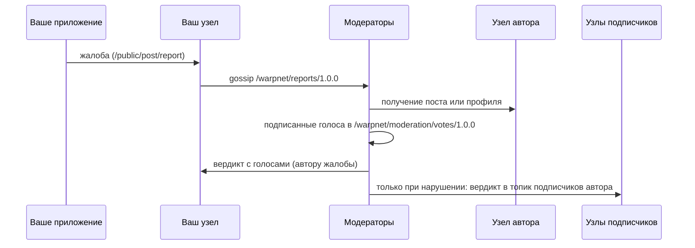

# Модерация {#moderation}

В Warpnet нет компании, администраторов инстансов и команды модерации. Контент, на который пожаловались, оценивают добровольные **узлы-модераторы**: каждый из них локально запускает небольшую языковую модель и голосует. Чтобы принять меры, нужно строгое большинство, и каждый голос подписан. На этой странице объясняется, на что можно пожаловаться, как обрабатывается жалоба, что вы увидите, чем позволяет управлять ваш собственный узел и как запустить модератор. Она написана в первую очередь для пользователей; в последних разделах приведены точные правила для разработчиков.

## Коротко {#in-short}

- Вы жалуетесь на пост или профиль. Жалоба уходит сразу всем модераторам.
- Несколько из них, выбранные в порядке, который никто не контролирует, получают контент и оценивают его с помощью Llama Guard 3.
- Они голосуют. Меры принимаются только при строгом большинстве против контента; ничья или отсутствие большинства — в пользу контента.
- Результат возвращается к вам вместе со всеми голосами, каждый из которых подписан. Ваш узел пересчитывает голоса, прежде чем принять результат.
- Осужденный пост или профиль скрывается от подписчиков автора (теневой бан). Ничего не удаляется, автору ничего не сообщают, обжаловать решение нельзя.

## На что можно пожаловаться {#what-can-be-reported}

| Объект | Что оценивают модераторы |
|---|---|
| Пост | Текст поста в том виде, в каком его отдает узел автора |
| Профиль | Имя профиля, био, сайт и все дополнительные публичные поля профиля, в этом порядке (дополнительные поля отсортированы по имени) |

Что не охватывается:

- **Личные сообщения.** Чаты никогда не читаются, не оцениваются и не могут быть предметом жалобы. Механизма для этого нет.
- **Изображения и видео.** Оценивается только текст. Пост без текста получает результат «unavailable» (недоступно).
- **Другие типы жалоб.** Узел отклоняет все типы жалоб, кроме поста и профиля ([`core/handler/report.go`](https://github.com/Warp-net/warpnet/blob/main/core/handler/report.go)).
- **Аккаунты через мост.** Аккаунты из других сетей модерируют администраторы этих сетей; десктопное приложение сообщает об этом в их профилях. См. [Мосты](bridge.md).

### Сама жалоба {#the-report-itself}

В десктопном приложении вы выбираете одну или несколько категорий (спам или мошенничество, травля, язык вражды, насилие или угрозы, сексуальный контент, безопасность детей, самоповреждение или суицид, нарушение приватности, опасные предметы или оружие) и можете добавить короткий комментарий. Приложение отправляет в качестве причины жалобы соответствующие названия категорий Llama Guard и ваш комментарий. Ваш узел принимает жалобу только от своего владельца, обрезает пробелы по краям причины и отклоняет причину длиннее 256 символов.

Причина передается вместе с жалобой и попадает в логи модераторов, но модель оценивает контент, а не причину.

Жалоба **не анонимна**: ваш узел помечает ее вашим ID пользователя и ID узла, чтобы результат мог вернуться к вам, и она передается через публичный gossip-топик. Warpnet не уведомляет человека, на которого вы пожаловались.

## Как обрабатывается жалоба {#how-a-report-is-handled}



1. Ваш узел проверяет жалобу, добавляет в нее вашу идентичность и публикует ее в глобальном топике жалоб. Relay-узлы пересылают этот топик, поэтому жалоба сразу доходит до всех модераторов.
2. Каждый модератор открывает для жалобы **раунд** и сам вычисляет свое место в очереди этого раунда.
3. Первые модераторы в очереди получают пост или профиль напрямую с узла автора (3 попытки с интервалом 3 секунды) и пропускают его через модель. Если контент получить не удалось, они вместо этого голосуют «unavailable», что засчитывается как отсутствие нарушения.
4. Каждый голос подписывается и рассылается в топике голосов.
5. Когда окно голосования закрывается, каждый проголосовавший модератор вычисляет один и тот же итог по одним и тем же голосам.
6. Один из них, председатель (chair), подписывает вердикт, прикладывает учтенные голоса и отправляет его вашему узлу, а при нарушении также публикует его для подписчиков автора.

### Кто оценивает жалобу {#who-judges-a-report}

Модераторов никто не назначает, и никто не может вызваться оценить конкретную жалобу ([`cmd/node/moderator/round`](https://github.com/Warp-net/warpnet/tree/main/cmd/node/moderator/round)):

- **ID раунда.** Хеш SHA-256 от собственных полей жалобы (тип, целевой пользователь, целевой узел, объект, причина, автор жалобы, узел автора жалобы), каждое с префиксом длины. Одинаковые жалобы сливаются в один раунд, а ID завершенного раунда запоминается на час, чтобы его не оценивали дважды.
- **Очередь.** Ранг каждого модератора задают первые 8 байт `SHA-256(round ID + "|" + moderator ID)`. Порядок определяет сама жалоба, поэтому атакующий не может устроить так, чтобы оценивать пост своего друга.
- **Кто начинает.** Каждый модератор оценивает свой ранг среди модераторов, которых он видел голосующими за последние 24 часа. Первые три начинают сразу. Остальные ждут по 35 секунд за каждое место ниже первой тройки и молчат, если к их очереди уже есть три голоса, — так вычисления модели не тратятся впустую.
- **Идентичность модератора.** ID модератора в голосе берется из подписанного gossip-конверта, а не из содержимого самого голоса.

### Голосование и большинство {#voting-and-majority}

Правила одинаковы на каждом модераторе и на каждом member-узле ([`cmd/node/moderator/round/countdown.go`](https://github.com/Warp-net/warpnet/blob/main/cmd/node/moderator/round/countdown.go), [`event/event.go`](https://github.com/Warp-net/warpnet/blob/main/event/event.go)):

| Правило | Значение |
|---|---|
| Окно голосования | 150 секунд с момента, когда модератор открывает раунд |
| Голосов на модератора | Один; дубликаты игнорируются |
| Порядок голосов | По возрастанию хеша пары, описанного выше; позиция 0 идет первой |
| Четное число голосов | Последний голос в этом порядке откладывается, поэтому число учтенных голосов всегда нечетное |
| Нарушение (FAIL) | Только если так проголосовало больше половины учтенных голосов |
| Ничья, раскол, нет большинства | Всегда в пользу контента (OK) |
| Причина в результате | Берется из первого в порядке голоса на победившей стороне |

**Председатель** — первый голосующий в порядке. Все остальные голосующие — резервные: голосующий на позиции *k* ждет *k* × 10 секунд и сам публикует вердикт, если объявление «final» так и не пришло, поэтому жалоба не теряется, когда председатель уходит офлайн. Объявление «final» принимается только от модератора, чей голос есть в раунде.

### Подписанные вердикты {#signed-verdicts}

Один поддельный вердикт мог бы скрыть чьи угодно посты, поэтому вердикты проверяет каждый узел, который их получает ([`core/handler/moderation.go`](https://github.com/Warp-net/warpnet/blob/main/core/handler/moderation.go)):

1. Каждый голос подписывается его модератором ключом узла Ed25519 этого модератора; подпись покрывает предмет вердикта (тип, пользователь, объект), ID модератора и результат.
2. Вердикт подписывается модератором, который его публикует; подпись покрывает собственные поля вердикта и метку времени. Обе подписи используют явные поля с префиксом длины, а не перекодированный JSON.
3. Ваш узел проверяет подпись публикующего модератора по ключу, встроенному в его ID модератора.
4. Ваш узел пересчитывает приложенные голоса: отбрасывает голоса, подпись которых не совпадает с их ID модератора, учитывает каждого модератора один раз и требует **не меньше трех** действительных голосующих, чье строгое большинство совпадает с вердиктом.
5. Если какая-либо проверка не пройдена, вердикт молча отбрасывается. Ничего не скрывается, и никто не получает уведомлений.

## Что вы увидите {#what-you-will-see}

Как автор жалобы вы получите одно уведомление при любом исходе:

| Исход | Уведомление |
|---|---|
| Нарушение найдено | «The tweet you reported was moderated: *reason*» (пост, на который вы пожаловались, скрыт модерацией: *причина*) |
| Нарушения нет | «The tweet you reported was reviewed: no violation found» (пост проверен, нарушений не найдено) |
| Контент не удалось получить | «The tweet you reported could not be reviewed: the content is unavailable» (пост не удалось проверить: контент недоступен) |

Для профиля в тексте вместо «tweet» стоит «profile». Причина — это список нарушенных категорий Llama Guard, например «Violent Crimes, Hate». «Could not be reviewed» обычно означает, что узел автора был офлайн; никакого решения принято не было.

Обычно обработка жалобы занимает несколько минут: окно голосования длится 150 секунд, и может понадобиться вмешательство резервного модератора.

Если вы подписаны на автора поста, прошедшего модерацию, ваш узел убирает этот пост из вашей ленты Home; там, где пост все еще виден, приложение заменяет его текст на «Moderated: *reason*». В списках пользователей профиль после модерации показывает «Moderated» вместо имени и «Moderated: *reason*» вместо био.

Автор ничего не видит: его собственная копия выглядит как раньше, и уведомления он не получает.

## Что происходит с контентом после модерации {#what-happens-to-moderated-content}

Модерация — это **теневой бан**, а не удаление ([`cmd/node/moderator/isolation/isolation-protocol.go`](https://github.com/Warp-net/warpnet/blob/main/cmd/node/moderator/isolation/isolation-protocol.go)):

- Рассылаются только вердикты о нарушении и только в топик подписчиков автора. Результат «нарушения нет» получает только автор жалобы.
- Каждый узел-получатель, на котором хранится пост, помечает свою копию записью о модерации и убирает пост из ленты Home своего владельца. Вердикт по профилю применяют только узлы, на которых этот профиль уже хранится.
- Ничего не удаляется ни с чьего диска, включая диск автора.
- Узел автора вердикт никогда не получает.
- Модератор, который доставляет решение, также один раз за вердикт записывает его на счет узла автора в системе [рейтинга](rating.md).
- Нет ни обжалования, ни проверки человеком. Защита от ошибочного решения в том, что с ним должны были согласиться несколько независимых машин.

Логика теневого бана такова: автор, который знает точный момент, когда его поймали, обычно публикует то же самое другими словами; автор, который этого не знает, продолжает писать в комнату, которая тихо опустела.

## Модераторы проверяют друг друга {#moderators-check-each-other}

Раунд голосования не пропустит одиночный поддельный вердикт, но не может отличить настоящего модератора от того, кто голосует, не запуская модель. Поэтому модераторы выборочно проверяют друг друга ([`cmd/node/moderator/audit`](https://github.com/Warp-net/warpnet/tree/main/cmd/node/moderator/audit)):

- **Эталонные тексты.** Когда по раунду, в котором голосовал этот модератор, принято решение, он сохраняет оцененный им текст вместе с вердиктом раунда. Он хранит до 128 чистых и 128 отмодерированных текстов и начинает проверять других, только когда у него есть хотя бы по одному тексту каждого вида.
- **Кого спрашивают.** Каждые 5 минут он выбирает случайного пира среди модераторов, которых видел голосующими за последние 24 часа, пропуская тех, кого уже спрашивал в последние 10 минут, и отправляет ему один эталонный текст, случайно выбирая чистый или отмодерированный, через `/public/get/moderate/challenge/0.0.0`. Эталоны берутся из живого трафика, поэтому заранее составить таблицу ответов нельзя.
- **Ответ.** Пир прогоняет текст через собственную модель и возвращает вердикт, подписанный ключом своего узла и привязанный к ID проверки и SHA-256 текста. Ответ с неверной привязкой или подписью считается недействительным; отсутствие ответа или ошибка считаются неотвеченной проверкой.

Каждый модератор ведет статус для каждого пира, которого он проверял:

| Статус | Когда |
|---|---|
| Probation (испытательный срок) | Меньше 20 отвеченных проверок (с этого статуса начинает каждый пир) |
| Trusted (доверенный) | 80% ответов или больше совпадают с принятым решением |
| Suspect (подозрительный) | Совпадение ниже 80% или больше половины из 20 или более проверок остались без ответа |
| Banned (заблокирован) | Совпадение ниже 65% или больше одного недействительного ответа |

Статус никогда не отменяет голос: модератор с пометкой продолжает голосовать. Мнение одной машины о другой — не доказательство, а модераторы вполне могут использовать разные модели, которые иногда расходятся во мнениях. Каждая проверка без ответа и каждый переход в Suspect или Banned передаются в систему [рейтинга](rating.md), которая взвешивает наблюдения многих узлов.

## Ваши собственные инструменты {#your-own-controls}

Помимо жалоб, каждый пользователь может настроить то, что он видит. Эти настройки хранятся на вашем собственном узле и действуют только для вас; никому больше о них не сообщается.

| Инструмент | Где | Эффект |
|---|---|---|
| **Block** (заблокировать) | Меню профиля; Settings → Blocked users | Хранится на вашем узле. Для пользователя Warpnet ваш узел также отказывается от соединений с узлом этого пользователя в обе стороны. Для аккаунта через мост действует только сохраненная блокировка |
| **Mute** (заглушить) | Меню профиля; Settings → Muted users | Хранится на вашем узле. На соединения не влияет |
| **Filters** (фильтры) | Settings → Filters | Именованные списки ключевых слов; сопоставление выполняется в приложении |
| **Report** (пожаловаться) | Меню поста или профиля | Отправляет жалобу модераторам, как описано выше |

**Filters** устроены по модели Mastodon ([`domain/warpnet.go`](https://github.com/Warp-net/warpnet/blob/main/domain/warpnet.go)): у каждого фильтра есть название, одно или несколько ключевых слов (каждое можно отметить как «whole word» — целое слово), контексты, в которых он применяется (home, notifications, thread), действие (warn или hide) и необязательный срок действия. Узел их хранит; сопоставление выполняется в приложении. Десктопное приложение применяет активные фильтры с действием «hide» к ленте Home, сравнивает без учета регистра и никогда не скрывает ваши собственные посты.

Блокировка на сетевом уровне описана в разделе [Безопасность](security.md#blocklist).

## Как запустить узел-модератор {#running-a-moderator-node}

Запустить его может любой. Не нужны ни заявка, ни одобрение, и модератор не получает особых полномочий: его голос весит столько же, сколько любой другой, и он не может выбирать, какие жалобы оценивать. Запуская модератор, вы обязуете свою машину получать контент из жалоб, оценивать его, отвечать на выборочные проверки других модераторов и подписывать свои голоса.

### Требования {#requirements}

- **Платформа.** В релизах есть бинарный файл модератора для Linux amd64 (`moderator_linux_amd64.tar.gz`). На других платформах соберите его из исходников.
- **Файл модели.** `Llama-Guard-3-1B-Q4_K_M.gguf`, который вы получаете сами; его нет ни в репозитории, ни в релизах. Модератор загружает его из своего **рабочего каталога**; имя файла фиксировано, и флага для другого пути нет ([`cmd/node/moderator/moderator/moderator.go`](https://github.com/Warp-net/warpnet/blob/main/cmd/node/moderator/moderator/moderator.go)).
- **CPU.** Инференс выполняется на CPU и использует все ядра; файл модели отображается в память (memory-mapped). В собственном развертывании проекта каждый контейнер модератора ограничен 256 MB RAM ([`deploy/docker-compose-moderator.yml`](https://github.com/Warp-net/warpnet/blob/main/deploy/docker-compose-moderator.yml)).
- **Сеть.** Достаточно стабильное соединение; другие модераторы должны иметь возможность подключиться к нему для выборочных проверок.

Модератор создает новую случайную идентичность при каждом запуске, поэтому после перезапуска статус, который ведут для него другие модераторы, начинается заново.

### Сборка и запуск {#build-and-run}

Для сборки из исходников нужен набор инструментов C/C++ (cgo), а подмодуль `core/moderation` должен быть загружен:

```bash
git submodule update --init --recursive
CGO_ENABLED=1 go build -tags=llama -mod=mod -o moderator cmd/node/moderator/main.go
# файл модели должен лежать в текущем каталоге
./moderator --node.network warpnet --node.port 4001
```

Dockerfile репозитория собирает модератор с тем же тегом `llama`; цель `run-moderator` в `Makefile` запускает модератор в `testnet`.

С Docker, используя [`Dockerfile.moderator`](https://github.com/Warp-net/warpnet/blob/main/Dockerfile.moderator) из репозитория (рабочий каталог контейнера — `/warpnet`):

```bash
docker build -f Dockerfile.moderator -t warpnet-moderator .
docker run -d --network host \
  -e NODE_NETWORK=warpnet -e NODE_PORT=4001 \
  -v /path/to/Llama-Guard-3-1B-Q4_K_M.gguf:/warpnet/Llama-Guard-3-1B-Q4_K_M.gguf:ro \
  warpnet-moderator
```

### Параметры {#options}

Модератор читает общие параметры узла ([`config/config.go`](https://github.com/Warp-net/warpnet/blob/main/config/config.go)). Каждый флаг можно задать и переменной окружения: в верхнем регистре, с `_` вместо `.` и `-`:

| Флаг | Переменная окружения | По умолчанию | Назначение |
|---|---|---|---|
| `--node.network` | `NODE_NETWORK` | `warpnet` | `warpnet` или `testnet` |
| `--node.port` | `NODE_PORT` | `4001` | TCP-порт для прослушивания |
| `--node.host.v4` / `--node.host.v6` | `NODE_HOST_V4` / `NODE_HOST_V6` | `0.0.0.0` / `::` | Адреса для прослушивания |
| `--node.bootstrap` | `NODE_BOOTSTRAP` | встроенный список | Bootstrap-узлы, multiaddr через запятую |
| `--node.self-update` | `NODE_SELF_UPDATE` | `true` | Автоматически устанавливать новые подписанные релизы |
| `--logging.level` | `LOGGING_LEVEL` | `info` | Уровень логирования |
| `--logging.format` | `LOGGING_FORMAT` | `text` | `text` или `json` |

Модератор устанавливает обновления, ни о чем не спрашивая. Параметры, общие для всех типов узлов, описаны на странице [Запуск своего узла](user-guide/running-a-node.md).

### Движок и политика {#engine-and-policy}

Движок — пакет [Warp-net/moderation](https://github.com/Warp-net/moderation), подключенный как подмодуль `core/moderation`. Он запускает Llama Guard 3 (1B, квантизация Q4_K_M) через llama.cpp без сетевых вызовов. Декодирование детерминировано: temperature 0, top-p 0.9, фиксированный seed 42, не больше 64 выходных токенов, контекст 4096 токенов, без слоев на GPU.

Промпт перечисляет категории опасности от S1 до S13, а модель отвечает `safe` или `unsafe`, за которым следует строка с кодами категорий. Часть кодов игнорируется:

| Считаются нарушением | Игнорируются (считаются безопасными) |
|---|---|
| S1 Violent Crimes, S2 Non-Violent Crimes, S3 Sex Crimes, S4 Child Exploitation, S7 Privacy, S9 Indiscriminate Weapons, S10 Hate, S11 Self-Harm | S5 Defamation, S6 Specialized Advice, S8 Intellectual Property, S12 Sexual Content, S13 Elections |

Если модель помечает контент только игнорируемыми кодами, контент считается безопасным. Ответ, который не является ни `safe`, ни `unsafe`, считается ошибкой движка; в этом случае модератор вообще не голосует.

## Ограничения {#limits}

Они реальны, и о них стоит знать:

- **Модель ошибается** в обе стороны. Правило большинства означает, что одну и ту же ошибку должны совершить несколько машин; оно не делает ошибки невозможными.
- **Только текст и только по жалобам.** Изображения и видео не анализируются, и ничто не сканирует сеть само по себе. Контент, на который никто не пожаловался, никогда не проверяется.
- **Нет модераторов — нет модерации.** Если ни одного модератора нет в сети, жалоба принимается и никуда не уходит, без уведомления. Если модераторов меньше трех, раунд все равно принимает решение, но узлы отбрасывают вердикт, в котором меньше трех подписанных голосов, так что и тогда ничего не происходит и никто не получает уведомления.
- **Ключи ничего не стоят.** Списка одобренных модераторов нет: сеть никому не принадлежит. Любой, кто сгенерирует три одноразовых ключа, может подписать три голоса и собрать вердикт, который узлы примут, не запуская модель. Терпеливый атакующий может также запустить несколько настоящих модераторов, чтобы влиять на исход голосования.
- **Контент предоставляет узел автора.** Модераторы оценивают то, что возвращает узел автора. Если возвращенный пост уже несет запись о модерации, модераторы повторно используют ее результат и не запускают модель.
- **Только подписчики.** Вердикт доходит до узлов, которые получают обновления автора. Любой, кто читает посты автора напрямую с его узла, видит их без изменений.
- **Применяется каждым приложением, а не навязывается сетью.** Узел с модифицированной программой может игнорировать вердикты на своем экране.
- **Ничего не удаляется**, и обжалования нет.

## Справочник протокола {#protocol-reference}

| Назначение | Маршрут или топик |
|---|---|
| Отправка жалобы (от вашего приложения вашему узлу) | `/public/post/report/0.0.0` |
| Gossip-топик жалоб | `/warpnet/reports/1.0.0` |
| Gossip-топик голосов модераторов | `/warpnet/moderation/votes/1.0.0` |
| Доставка вердикта (автору жалобы и подписчикам) | `/public/post/moderate/result/0.0.0` |
| Выборочная проверка (от модератора модератору) | `/public/get/moderate/challenge/0.0.0` |
| Получение поста / профиля, на который пожаловались | `/public/get/tweet/0.0.0` / `/public/get/user/0.0.0` |

Маршрут выборочной проверки определен в [`cmd/node/moderator/audit/wire.go`](https://github.com/Warp-net/warpnet/blob/main/cmd/node/moderator/audit/wire.go), остальные — в [`event/paths.go`](https://github.com/Warp-net/warpnet/blob/main/event/paths.go); полный список — в [справочнике API](developer-guide/api.md).

## См. также {#see-also}

- [Безопасность](security.md): подписи, список блокировки и ограничение частоты запросов
- [Рейтинг узлов](rating.md): как результаты модерации и выборочных проверок влияют на рейтинг узла
- [Мосты](bridge.md): модерация аккаунтов через мост
- [Начало работы](user-guide/index.md): как пожаловаться из приложения
