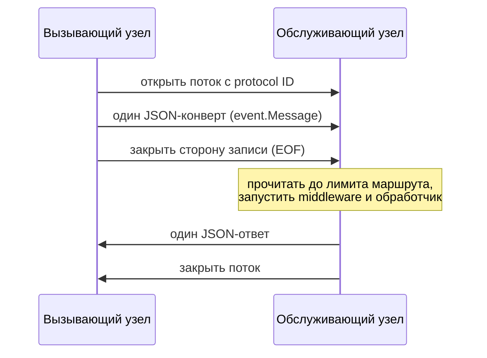

# Сетевой протокол {#wire-protocol}

Эта страница описывает прикладной протокол, на котором узлы Warpnet общаются поверх libp2p: как называются маршруты, как запрос выглядит в сети, как он подписывается и проверяется, какие сообщения рассылаются через gossip и как несовместимые узлы отделяются друг от друга. Она написана для разработчиков и ревьюеров. Нижележащий транспорт (маскировка под TLS, PSK, Noise, обход NAT) описан на странице [Сеть](network.md), а полный список маршрутов — в [справочнике API](developer-guide/api.md).

## Коротко {#at-a-glance}

| Уровень | Что это | Код |
|---|---|---|
| Маршрут | protocol ID libp2p, например `/public/post/react/0.0.0` | [`event/paths.go`](https://github.com/Warp-net/warpnet/blob/main/event/paths.go) |
| Обмен | Один поток на запрос: записать один JSON-конверт, закрыть запись (half-close), прочитать один JSON-ответ | [`core/stream/stream.go`](https://github.com/Warp-net/warpnet/blob/main/core/stream/stream.go) |
| Конверт | `event.Message`: тело, идентификаторы, маршрут, метка времени, подпись Ed25519 | [`event/event.go`](https://github.com/Warp-net/warpnet/blob/main/event/event.go) |
| Проверки | Ограничение частоты запросов, подпись, свежесть, доступ к приватным маршрутам, идемпотентность | [`core/middleware`](https://github.com/Warp-net/warpnet/tree/main/core/middleware) |
| Рассылка | Топики GossipSub для лент, обнаружения пиров, CRDT-дельт, жалоб | [`core/pubsub/gossip.go`](https://github.com/Warp-net/warpnet/blob/main/core/pubsub/gossip.go) |
| Совместимость | Имя сети и мажорная версия, зашитые в ключ приватной сети | [`security/psk.go`](https://github.com/Warp-net/warpnet/blob/main/security/psk.go) |

## Protocol ID {#protocol-ids}

Каждый прикладной маршрут — это protocol ID libp2p такого вида:

```text
/{visibility}/{verb}/{entity}[/{sub}...]/{version}
```

| Сегмент | Значения | Пример |
|---|---|---|
| `visibility` | `private` или `public` | `/private/...` |
| `verb` | `get`, `post` или `delete` | `/private/get/...` |
| `entity` | объект действия, за которым могут следовать подсегменты | `tweet`, `settings/filter/keyword` |
| `version` | сегодня `0.0.0` на всех маршрутах | `/0.0.0` |

Примеры: `/private/post/tweet/0.0.0`, `/public/get/tweet/reactors/0.0.0`, `/private/delete/settings/filter/keyword/0.0.0`.

Несколько правил следуют из кода, а не из соглашения об именовании:

- Маршрут считается чтением, если его ID содержит подстроку `get` (`WarpRoute.IsGet` в [`core/stream/routes.go`](https://github.com/Warp-net/warpnet/blob/main/core/stream/routes.go)). Для чтения действуют более высокие лимиты на размер ответа. Такие маршруты никогда не ставятся в очередь исходящих (outbox) и никогда не воспроизводятся из gossip.
- Маршрут считается приватным, если его ID содержит `private`.
- Кэш идемпотентности применяется к маршрутам, ID которых содержит `/post/`.
- `event.InternalRoutePrefix` (`/internal`) определен и принимается при регистрации обработчиков, но ни один маршрут его не использует.

### Кто обслуживает какие маршруты {#who-serves-which-routes}

`event/paths.go` определяет 126 констант маршрутов. Не все они — обработчики потоков:

| Роль узла | Зарегистрированные маршруты |
|---|---|
| Member (варианты desktop и remote) | 120: все константы, кроме шести, перечисленных ниже |
| Relay | `/public/get/info/0.0.0`, `/public/post/relay/refuse/reservation/0.0.0` |
| Moderator | `/public/get/info/0.0.0`, `/public/get/moderate/challenge/0.0.0` (определен в `cmd/node/moderator/audit`) |

Шесть констант, которые member-узел не обслуживает:

| Маршрут | Кто обрабатывает |
|---|---|
| `/private/post/login/0.0.0`, `/private/post/logout/0.0.0` | Десктопное приложение (`cmd/node/member/app.go`) или мост `/ws` удаленного узла, до запуска узла или после его остановки |
| `/private/get/update/0.0.0`, `/private/post/update/0.0.0` | Только модуль самообновления десктопного приложения |
| `/public/post/admin/challenge/0.0.0` | Никто: маршрут определен и для него задан лимит частоты, но обработчик не зарегистрирован |
| `/public/post/relay/refuse/reservation/0.0.0` | Только relay-узлы (его отправляет member-узел, см. [Сеть](network.md#relay-reservation-refusals)) |

Помимо этих маршрутов, узлы используют стандартные протоколы libp2p (identify, ping, GossipSub, circuit relay v2, DCUtR, AutoNAT v2) и Kademlia DHT под префиксом, который зависит от сети: `/warpnet/kad/1.0.0` в mainnet и `/testnet/kad/1.0.0` в testnet.

## Приватные и публичные маршруты {#private-and-public-routes}

Сегмент видимости проверяет middleware аутентификации ([`core/middleware/auth.go`](https://github.com/Warp-net/warpnet/blob/main/core/middleware/auth.go)); это не просто соглашение.

**Приватный** маршрут обслуживается, только если вызывающий:

1. сам узел (loopback self-stream от собственного интерфейса), или
2. устройство, подключенное к этому узлу (peer ID, сохраненный через `/private/post/admin/pair/0.0.0`), или
3. кто угодно, кто вызывает сам `/private/post/admin/pair/0.0.0`; в этом случае обработчик сопряжения проверяет токен сессии.

Любой другой пир получает `middleware: auth: unknown client peer`. Member-узел очищает список подключенных устройств при запуске.

**Публичный** маршрут может вызвать любой пир, который прошел ключ приватной сети, Noise и проверку подписи. Обработчики, действующие от имени пользователя, дополнительно проверяют *авторство*: участник, указанный в событии, должен принадлежать узлу на другом конце потока (или этому узлу, если подключенное устройство вызывает маршрут от имени владельца). См. `warpnet.VerifyAuthorship` в [`core/warpnet/warpnet.go`](https://github.com/Warp-net/warpnet/blob/main/core/warpnet/warpnet.go) и [`core/authorship`](https://github.com/Warp-net/warpnet/tree/main/core/authorship). Пир, который выдает чужие действия за свои, получает `event did not come from its author's node`, а само событие понижает его рейтинг.

## Запрос и ответ {#request-and-response}

Каждый запрос использует собственный поток libp2p. Здесь нет сессии, нет мультиплексирования нескольких запросов в одном потоке и нет префикса длины: границей кадра служит конец потока.



Что делает отправитель ([`core/stream/stream.go`](https://github.com/Warp-net/warpnet/blob/main/core/stream/stream.go)):

1. Открывает поток и отводит 10 секунд на установку соединения и согласование протокола. Поток может идти через ретранслируемое (ограниченное) соединение.
2. Собирает конверт — новый ULID в `message_id`, свой peer ID в `node_id`, маршрут в `path`, текущее время UTC и `version` `0.0.0` — и подписывает его.
3. Записывает JSON и закрывает свою сторону записи.
4. Читает ответ до EOF с дедлайном чтения 2 минуты и с учетом лимита размера для маршрута.

Что делает получатель ([`core/node/node.go`](https://github.com/Warp-net/warpnet/blob/main/core/node/node.go), `unwrap`):

1. Читает запрос до EOF в пределах 15 секунд (5 минут на маршрутах загрузки медиа) и в пределах лимита размера запроса. Слишком большой запрос сбрасывает поток без ответа.
2. Запускает цепочку middleware и обработчик маршрута.
3. Кодирует результат обработчика в JSON (результат-строка или массив байтов записывается как есть), записывает его и закрывает поток.

### Повторы и пиры не в сети {#retries-and-offline-peers}

- Вызов завершается ошибкой `node is offline`, если соединение установить не удалось: у пира нет известного адреса, все попытки соединения провалились, поиск в DHT не удался или истекли 10 секунд. Затем на 30 секунд или до переподключения пир сразу считается не в сети, без новых попыток соединения.
- Если запрос был записан, но ответ потерян, отправитель сразу повторяет его один раз с **тем же** `message_id`. Поэтому кэш идемпотентности получателя отвечает на повтор, не запуская обработчик второй раз.
- Остальные сбои повторяются с паузой в 1 секунду, до 5 попыток в пределах 10 секунд.
- Одинаковые одновременные отправки (тот же маршрут, пир и тело) схлопываются в одну.

### Очередь исходящих для пиров не в сети {#outbox-for-offline-peers}

Записи на другие узлы (любой маршрут, кроме `get`) проходят через постоянную очередь исходящих (outbox) ([`core/stream/outbox.go`](https://github.com/Warp-net/warpnet/blob/main/core/stream/outbox.go)). Запись сохраняется до отправки и удаляется, как только пир ответит чем угодно, кроме ошибки ограничения частоты запросов. Записи из очереди отправляются, когда пир снова подключается, и каждые 5 минут. Запись, идентичная последней поставленной в очередь для того же пира, сохраняется один раз. Чтения никогда не ставятся в очередь.

### Локальные вызовы идут тем же путем {#local-calls-use-the-same-path}

У десктопного интерфейса, браузерного дашборда удаленного узла и подключенных телефонов нет отдельного API. Узел направляет их запросы через те же обработчики и middleware:

- **Self-stream.** Десктопное приложение и мост `/ws` удаленного узла подписывают конверт ключом владельца и проталкивают его через loopback-поток в памяти (`SelfStream`, [`core/stream/loopback-stream.go`](https://github.com/Warp-net/warpnet/blob/main/core/stream/loopback-stream.go)). Дедлайн ввода-вывода — 1 минута (10 минут для маршрута импорта архива X). Для loopback проверка свежести пропускается.
- **Подключенное устройство.** Приложение для Android открывает к своему узлу настоящие потоки libp2p, подписанные собственным ключом телефона. Приватные маршруты разрешены, потому что peer ID телефона был зарегистрирован при сопряжении.
- **Peer stream.** Когда обработчику нужен другой узел, он вызывает тот же маршрут на этом узле через настоящий поток (`GenericStream`). Вызов собственного узла таким способом отклоняется с ошибкой `self request is not allowed`.

Типичный публичный маршрут обрабатывается дважды. Например, реакция на чужой пост:

1. Ваш интерфейс вызывает `/public/post/react/0.0.0` на вашем узле через self-stream.
2. Ваш узел записывает реакцию и пересылает то же событие через peer stream на узел автора поста.
3. Узел автора запускает тот же обработчик, видит, что отреагировавший — не его владелец, записывает реакцию и добавляет уведомление.

Если узел автора не в сети, шаг 2 заканчивается в очереди исходящих, и событие доставляется позже.

## Конверт сообщения {#the-message-envelope}

Запросы и gossip-сообщения используют один конверт, `event.Message`:

```json
{
  "body": {"tweet_id": "01J...", "user_id": "a1b2...", "owner_id": "c3d4..."},
  "message_id": "01JD7Q3K8V6N2M4P5R7S9T0W1X",
  "node_id": "12D3KooW...",
  "path": "/public/post/react/0.0.0",
  "timestamp": "2026-11-24T10:15:30.123456789Z",
  "version": "0.0.0",
  "signature": "base64..."
}
```

| Поле | Тип | Значение |
|---|---|---|
| `body` | значение JSON | DTO запроса маршрута; хранится как сырые байты и подписывается байт в байт |
| `message_id` | строка | Уникален для каждого запроса. ULID в потоках между узлами; UUID в gossip и от интерфейса. Обязателен: конверт без него отклоняется |
| `node_id` | строка | Peer ID отправителя в libp2p. В потоках носит информационный характер; в gossip указывает публикатора |
| `path` | строка | Маршрут (поле Go `Destination`) |
| `timestamp` | время RFC 3339 | Часы отправителя, UTC |
| `version` | строка | Сегодня всегда `0.0.0` |
| `signature` | строка | Подпись Ed25519 в Base64, см. ниже |
| `bridge_key` | строка, необязательное | Задается только в сообщениях шлюзу Fediverse: ключ, которым шлюз действует от имени отправителя в сетях за мостом |

Ответ **не** оборачивается в конверт: получатель записывает голый DTO ответа (см. [Ошибки](#errors-and-responses)).

Тела запросов и ответов — обычный JSON (кодируется json-iterator в режиме совместимости со стандартной библиотекой). Имена полей записываются в snake_case. Бинарные медиа передаются как строки base64 внутри JSON.

## Подпись {#signing}

Подпись покрывает ровно эти байты (`Message.SigningBytes`):

```text
raw body bytes  ||  timestamp as decimal Unix nanoseconds  ||  path
```

Это подпись Ed25519 ключом идентичности узла, закодированная в base64 со стандартным алфавитом ([`security/signature.go`](https://github.com/Warp-net/warpnet/blob/main/security/signature.go)).

Получатель проверяет ее по открытому ключу, встроенному в **peer ID соединения**, а не по полю `node_id`. Peer ID libp2p для ключа Ed25519 содержит сам ключ, поэтому обмен ключами или их поиск не нужны. Затем:

- **Свежесть.** Для удаленных пиров метка времени должна отличаться от часов получателя не больше чем на 5 минут в любую сторону; иначе получатель отвечает `middleware: auth: stale or replayed message`. Loopback-вызовы от собственного интерфейса узла освобождены от этой проверки. Поэтому часы на узлах должны идти примерно правильно.
- **Повторы.** Вместе с 10-минутным кэшем идемпотентности на маршрутах `post` это окно ограничивает, как долго перехваченный запрос можно воспроизвести повторно.

Поскольку путь входит в подписанные байты, подписанное тело нельзя воспроизвести на другом маршруте.

## Цепочка middleware {#middleware-chain}

Каждая роль узла оборачивает каждый маршрут в одну и ту же цепочку; первым указано самое внешнее звено ([`cmd/node/member/node/member-node.go`](https://github.com/Warp-net/warpnet/blob/main/cmd/node/member/node/member-node.go)):

| Шаг | Что делает |
|---|---|
| unwrap | Читает запрос в пределах лимитов, записывает ответ, превращает ошибки обработчика в `{code, message}` |
| Логирование | Логирует открытие и закрытие потока и длительность на уровне debug |
| Ограничитель частоты | Leaky bucket для каждой пары пира и маршрута; при превышении лимита отвечает кодом `5001`, не запуская обработчик |
| Аутентификация | Разбирает конверт, проверяет подпись и свежесть, контролирует доступ к приватным маршрутам, передает дальше внутреннее `body` |
| Идемпотентность | На маршрутах `/post/` кэширует ответ по маршруту, пиру и `message_id` на 10 минут; дубликаты, пришедшие во время обработки, ждут результата первого запроса |

Ограничения частоты запросов ([`core/ratelimit/stream.go`](https://github.com/Warp-net/warpnet/blob/main/core/ratelimit/stream.go), [`core/ratelimit/settings.go`](https://github.com/Warp-net/warpnet/blob/main/core/ratelimit/settings.go)) не действуют на собственные loopback-вызовы узла. Значения по умолчанию:

| Маршруты | Burst | В минуту |
|---|---|---|
| Чтение (по умолчанию, настраивается владельцем) | 60 | 300 |
| Запись (по умолчанию, настраивается владельцем) | 30 | 120 |
| Скачивание медиа (`/public/get/image`, `video`, медиа чатов и спонсорские медиа) | 150 | 600 |
| Загрузки (`/private/post/image`, `video`, медиа чатов) | 10 | 30 |
| Доставка в ленту и вердикты модерации | 200 | 1200 |
| Создание чатов и сообщения | 60 | 300 |
| Жалобы | 10 | 30 |
| Сопряжение и `admin/challenge` | 5 | 15 |
| Любой маршрут, вызванный шлюзом Fediverse | 600 | 6000 |

Пир с более низким [рейтингом](rating.md) получает долю этих значений (0.5, 0.25 или 0.1 от burst и частоты), но никогда не ноль. Владелец может изменить значения по умолчанию для чтения и записи через `/private/post/settings/ratelimit/0.0.0`.

Кэш идемпотентности вмещает до 1024 записей и хранит только успешные ответы размером не более 64 KiB.

## Лимиты размера и тайм-ауты {#size-limits-and-timeouts}

| Лимит | Значение | К чему относится |
|---|---|---|
| Размер запроса | 50 MiB | `/private/post/image`, `/private/post/video`, `/private/post/import/twitter/tweet`, `/private/get/sponsored/buyer` |
| Размер запроса | 1 MiB | все остальные маршруты |
| Размер ответа | 50 MiB | `/public/get/image`, `/public/get/video`, `/public/get/sponsored/image`, `/public/get/sponsored/video` |
| Размер ответа | 8 MiB | остальные маршруты `get` |
| Размер ответа | 1 MiB | все остальные маршруты |
| Открытие потока (соединение + согласование) | 10 с | отправитель |
| Чтение запроса | 15 с, или 5 мин на маршрутах с запросами до 50 MiB | получатель |
| Чтение ответа | 2 мин | отправитель |
| Loopback-вызов | 1 мин, 10 мин для маршрута импорта | self-stream |
| Одновременные входящие видеопотоки | 2 на пир | `/public/get/video`, видео в чатах и спонсорское видео |

Лимиты определены в [`core/stream/stream.go`](https://github.com/Warp-net/warpnet/blob/main/core/stream/stream.go) и [`core/ratelimit/stream.go`](https://github.com/Warp-net/warpnet/blob/main/core/ratelimit/stream.go).

## Ошибки и ответы {#errors-and-responses}

Успешный обработчик возвращает DTO ответа в формате JSON. Обработчик, которому нечего вернуть, отвечает буквальной строкой:

```json
{"code":0,"message":"Accepted"}
```

Ошибки имеют ту же форму, `event.ResponseError`:

```json
{"code":5000,"message":"middleware: auth: stale or replayed message"}
```

| Ситуация | Ответ |
|---|---|
| Обработчик вернул ошибку или аутентификация не прошла (некорректный конверт, отсутствующая или неверная подпись, устаревшее сообщение, отказ в доступе к приватному маршруту) | код `5000`, сообщение — текст ошибки |
| Превышен лимит частоты запросов | код `5001`, `middleware: too many requests for this route` |
| Не удалось прочитать запрос | код `0`, `middleware: stream: reading failed` |
| Узел завершает работу | код `0`, `node is offline` |
| Обработчик ничего не вернул | код `0`, `empty response` |
| Запрос больше лимита маршрута | поток сбрасывается, ответа нет |

Код узла считает ошибкой ответ, который декодируется в `{code, message}` с непустым сообщением; исключение — успешный `Accepted`. Если пересылка на другой узел завершилась ошибкой `node is offline`, большинство обработчиков все равно отвечают локальному вызывающему результатом, сохраненным локально.

## Топики gossip {#gossip-topics}

Рассылки используют GossipSub ([`core/pubsub/gossip.go`](https://github.com/Warp-net/warpnet/blob/main/core/pubsub/gossip.go)). Топики обнаружения, ленты, жалоб и голосования передают тот же конверт `event.Message`, подписанный по `SigningBytes` ключом узла публикатора. Два CRDT-топика вместо этого передают собственные сообщения-дельты CRDT-библиотеки.

| Топик | Кто публикует | Что передает |
|---|---|---|
| `/warpnet/discovery/1.0.0` | все роли | Peer ID и адреса публикатора плюс до 10 подключенных пиров; см. [Обнаружение](discovery.md#pubsub-gossip) |
| `user-update-<userId>` | member-узел автора; модераторы | Рассылка в ленты: конверты с `path` `/public/post/timeline/0.0.0` (новый пост) или `/public/delete/timeline/0.0.0`; вердикты модерации с `/public/post/moderate/result/0.0.0` |
| `/warpnet/stats/1.0.0` | member-узлы | CRDT-дельты для счетчиков постов (реакции, ретвиты, ответы, просмотры, голоса в опросах); см. [Синхронизация](synchronization.md) |
| `/warpnet/rating/1.0.0` | все роли | Подписанные записи рейтинга узлов; см. [Рейтинг](rating.md) |
| `/warpnet/reports/1.0.0` | member-узлы | Жалобы пользователей для модераторов; см. [Модерация](moderation.md) |
| `/warpnet/moderation/votes/1.0.0` | модераторы | Бюллетени модераторов |

Как подписчик получает обновление ленты:

1. Подписка на пользователя подписывает узел на `user-update-<userId>`; отписка отменяет эту подписку. При запуске member-узел подписывается на топики всех, на кого подписан его владелец (кроме аккаунтов из мостов).
2. Полученное сообщение декодируется. Если его `path` — не маршрут `get`, сообщение воспроизводится в собственном обработчике узла для этого пути через self-stream, а вызывающим указывается peer ID публикатора.
3. Поэтому middleware аутентификации проверяет подпись публикатора и 5-минутное окно свежести точно так же, как для прямого потока.

Оценка пиров в gossip следует [рейтингу](rating.md). Пиры на самом низком уровне опускаются ниже порога серого списка (-100), и их сообщения больше не читаются; пиры на других низких уровнях теряют место в mesh. На member-узлах блоклист пиров также передается в черный список GossipSub.

## Версионирование и совместимость {#versioning-and-compatibility}

Согласования версий для отдельных маршрутов нет. Суффикс `0.0.0` в маршрутах и поле `version` в конверте — фиксированные заглушки.

Совместимость обеспечивается уровнем ниже — ключом приватной сети (PSK):

```text
PSK = SHA-256(network name || major version)
```

Сеть — это `warpnet` (mainnet; `mainnet` принимается как псевдоним) или `testnet`, а мажорная версия берется из версии релиза (`0.8.124` дает `0`). Например, каждый узел mainnet версии 0.x использует `SHA-256("warpnet0")`. Слой приватной сети libp2p шифрует этим ключом все соединение. Поэтому узел из другой сети или другой мажорной версии отваливается еще при установке соединения, до того как появится какой-либо поток или сообщение Warpnet. Когда самообновление переходит на новую мажорную версию, узел пишет в лог, что его сетевой ключ меняется и что теперь он будет встречать только пиров новой мажорной версии.

PSK публичен: он разделяет сети и несовместимые версии и не является секретом. См. [Сеть](network.md#the-pre-shared-key-is-public).

В пределах одной мажорной версии узлы остаются совместимыми благодаря терпимому разбору JSON:

- Неизвестные поля игнорируются, поэтому можно добавлять новые необязательные поля. Примеры: если старый клиент не передает `emoji` в реакции, по умолчанию используется стандартная реакция; `my_reaction` в статистике поста присутствует всегда, чтобы клиент мог отличить новый узел от старого.
- Там, где формы ответов изменились, старые формы по-прежнему принимаются. Например, устаревший формат ошибок (голый JSON-массив строк) и прежние способы, которыми relay-узлы представлялись в `/public/get/info/0.0.0`.
- `/public/get/info/0.0.0` возвращает `NodeInfo`, где есть версия пира и список протоколов, которые он обслуживает. Так вызывающий видит, что поддерживает другая сторона.

## См. также {#see-also}

- [Сеть](network.md): транспорт, PSK, Noise, обход NAT
- [Обнаружение](discovery.md): как находятся пиры
- [Справочник API](developer-guide/api.md): все маршруты с их DTO
- [Stream API](developer-guide/stream-API.md): как написать клиент, который общается с узлом
- [Безопасность](security.md): идентичность, ключи и подписи
