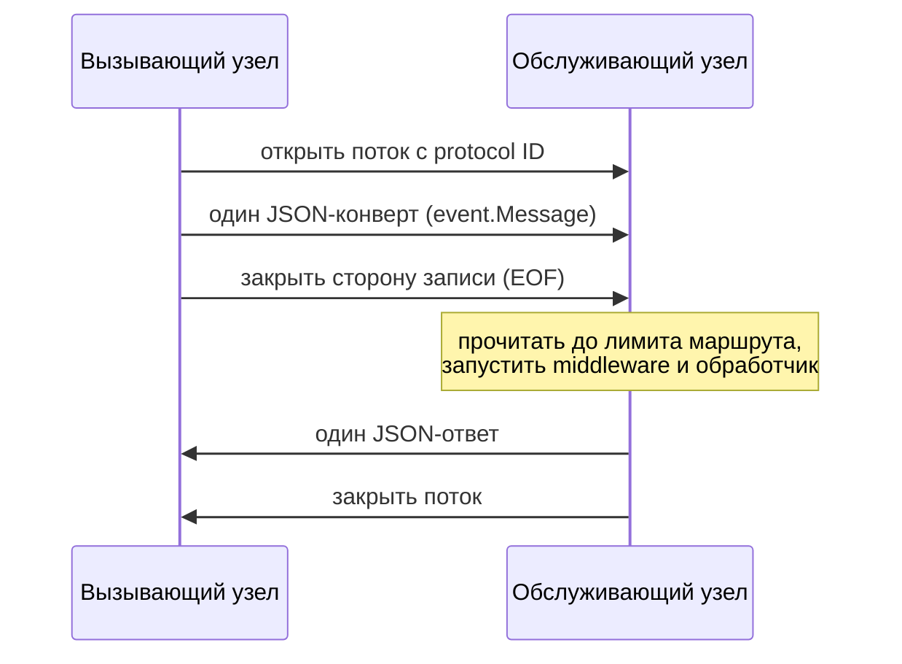

# Сетевой протокол {#wire-protocol}

Эта страница описывает прикладной протокол, на котором узлы Warpnet общаются поверх libp2p: как называются маршруты, как запрос выглядит в сети, как он подписывается и проверяется, какие сообщения рассылаются через gossip и как несовместимые узлы отделяются друг от друга. Она написана для разработчиков и ревьюеров. Нижележащий транспорт (маскировка под TLS, PSK, Noise, обход NAT) описан на странице [Сеть](network.md), а список маршрутов — в [справочнике API](developer-guide/api.md).

## Коротко {#at-a-glance}

| Уровень | Что это | Код |
|---|---|---|
| Маршрут | protocol ID libp2p, например `/public/post/react/0.0.0` | [`event/paths.go`](https://github.com/Warp-net/warpnet/blob/main/event/paths.go) |
| Обмен | Один поток на запрос: записать один JSON-конверт, закрыть запись (half-close), прочитать один JSON-ответ | [`core/stream/stream.go`](https://github.com/Warp-net/warpnet/blob/main/core/stream/stream.go) |
| Конверт | `event.Message`: тело, идентификаторы, маршрут, метка времени, подпись Ed25519 | [`event/event.go`](https://github.com/Warp-net/warpnet/blob/main/event/event.go) |
| Проверки | Ограничение частоты запросов, подпись, свежесть, доступ к приватным маршрутам, идемпотентность | [`core/middleware`](https://github.com/Warp-net/warpnet/tree/main/core/middleware) |
| Рассылка | Топики GossipSub для лент, обнаружения пиров, CRDT-дельт, жалоб, голосов модераторов | [`core/pubsub/gossip.go`](https://github.com/Warp-net/warpnet/blob/main/core/pubsub/gossip.go) |
| Совместимость | Имя сети и мажорная версия, заложенные в ключ приватной сети | [`security/psk.go`](https://github.com/Warp-net/warpnet/blob/main/security/psk.go) |

## Protocol ID {#protocol-ids}

Каждый прикладной маршрут — это protocol ID libp2p такого вида:

```text
/{visibility}/{verb}/{entity}[/{sub}...]/{version}
```

| Сегмент | Значения | Пример |
|---|---|---|
| `visibility` | `private` или `public` | `/private/...` |
| `verb` | `get`, `post` или `delete` | `/private/get/...` |
| `entity` | объект действия, за которым могут следовать подсегменты | `tweet`, `settings/filter/keyword` |
| `version` | `0.0.0` на всех маршрутах | `/0.0.0` |

Примеры: `/private/post/tweet/0.0.0`, `/public/get/tweet/reactors/0.0.0`, `/private/delete/settings/filter/keyword/0.0.0`.

Код классифицирует маршруты по подстроке ([`core/stream/routes.go`](https://github.com/Warp-net/warpnet/blob/main/core/stream/routes.go)):

- Маршрут — **чтение**, если его ID содержит `get` (`WarpRoute.IsGet`). Для чтения действуют больший лимит размера ответа и лимит частоты для чтения; чтения никогда не ставятся в очередь исходящих, а gossip-сообщение, чей путь — чтение, отбрасывается.
- Маршрут — **приватный**, если его ID содержит `private` (`WarpRoute.IsPrivate`).
- Кэш идемпотентности охватывает маршруты, ID которых содержит `/post/`.

### Кто обслуживает какие маршруты {#who-serves-which-routes}

| Роль узла | Зарегистрированные обработчики потоков |
|---|---|
| Member (варианты desktop, remote и echo) | 120 маршрутов из `event/paths.go`, зарегистрированных в `setupHandlers` ([`cmd/node/member/node/member-node.go`](https://github.com/Warp-net/warpnet/blob/main/cmd/node/member/node/member-node.go)). Echo-узел заменяет обработчики `/private/post/tweet/0.0.0`, `/public/post/follow/0.0.0` и `/public/post/message/0.0.0` своей логикой бота |
| Relay | `/public/get/info/0.0.0`, `/public/post/relay/refuse/reservation/0.0.0` |
| Moderator | `/public/get/info/0.0.0`, `/public/get/moderate/challenge/0.0.0` (определен в `cmd/node/moderator/audit/wire.go`; его вызывают другие модераторы, чтобы проверить этого) |

Четыре маршрута из `event/paths.go` обслуживает приложение вокруг узла, а не обработчик потока:

| Маршрут | Кто отвечает |
|---|---|
| `/private/post/login/0.0.0`, `/private/post/logout/0.0.0` | Десктопное приложение (`App.Call` в `cmd/node/member/app.go`) и мост `/ws` удаленного узла (`cmd/node/member/remote/bridge.go`). Вход открывает базу данных и запускает узел; выход останавливает его |
| `/private/get/update/0.0.0`, `/private/post/update/0.0.0` | Только десктопное приложение: ожидающее самообновление и ответ владельца на него |

Member-узел отправляет `/public/post/relay/refuse/reservation/0.0.0` relay-узлу, когда пир из его блоклиста приходит к нему через этот relay (см. [Сеть](network.md#relay-reservation-refusals)).

Помимо этих маршрутов, узлы используют стандартные протоколы libp2p (identify, ping, GossipSub, circuit relay v2, DCUtR, AutoNAT v2) и Kademlia DHT под префиксом, который зависит от сети: `/warpnet/kad/1.0.0` в mainnet, `/testnet/kad/1.0.0` в testnet.

## Приватные и публичные маршруты {#private-and-public-routes}

Сегмент видимости проверяет middleware аутентификации ([`core/middleware/auth.go`](https://github.com/Warp-net/warpnet/blob/main/core/middleware/auth.go)).

**Приватный** маршрут обслуживается, только если вызывающий:

1. сам узел (loopback self-stream от собственного интерфейса), или
2. устройство, сопряженное с этим узлом: peer ID, сохраненный маршрутом `/private/post/admin/pair/0.0.0`. Запись истекает через 72 часа после последнего сопряжения устройства, узел хранит не больше 10 устройств, владелец удаляет устройство через `/private/delete/admin/device/0.0.0` (`database/aliases-repo.go`), а каждый запуск member-узла отзывает их все (`NewMemberNode`), или
3. кто угодно, кто вызывает сам `/private/post/admin/pair/0.0.0`; в этом случае обработчик сопряжения проверяет токен сессии.

Любой другой пир получает `middleware: auth: unknown client peer`.

**Публичный** маршрут может вызвать любой пир, который прошел ключ приватной сети, Noise и проверку подписи. Обработчики, действующие от имени пользователя, дополнительно проверяют *авторство*: участник, указанный в событии, должен принадлежать узлу на другом конце потока, а если вызывает сопряженное устройство — этому узлу (`warpnet.VerifyAuthorship` в [`core/warpnet/warpnet.go`](https://github.com/Warp-net/warpnet/blob/main/core/warpnet/warpnet.go), [`core/authorship`](https://github.com/Warp-net/warpnet/tree/main/core/authorship)). Пир, который выдает чужое действие за свое, получает `event did not come from its author's node`, и ему засчитывается нарушение foreign authorship в [рейтинге](rating.md).

## Запрос и ответ {#request-and-response}

Каждый запрос использует собственный поток libp2p. Здесь нет сессии, нет мультиплексирования нескольких запросов в одном потоке и нет префикса длины: границей кадра служит конец потока.



Что делает отправитель ([`core/stream/stream.go`](https://github.com/Warp-net/warpnet/blob/main/core/stream/stream.go)):

1. Открывает поток и отводит 10 секунд на установку соединения и согласование протокола. Поток может идти через ретранслируемое (ограниченное) соединение.
2. Собирает конверт — ULID в `message_id`, свой peer ID в `node_id`, маршрут в `path`, текущее время UTC и `version` `0.0.0` — и подписывает его.
3. Записывает JSON и закрывает свою сторону записи.
4. Читает ответ до EOF с дедлайном чтения 2 минуты и с учетом лимита размера ответа для маршрута.

Что делает получатель (`unwrap` в [`core/node/node.go`](https://github.com/Warp-net/warpnet/blob/main/core/node/node.go)):

1. Читает запрос до EOF в пределах 15 секунд (5 минут на маршрутах с запросами до 50 MiB) и в пределах лимита размера запроса. Слишком большой запрос сбрасывает поток без ответа.
2. Отвечает `node is offline`, если узел завершает работу.
3. Запускает цепочку middleware и обработчик маршрута.
4. Кодирует результат обработчика в JSON (результат-строка или массив байтов записывается как есть), записывает его и закрывает поток.

### Повторы и пиры не в сети {#retries-and-offline-peers}

- Вызов завершается ошибкой `node is offline`, если соединение установить не удалось: у пира нет известного адреса, поиск в DHT не удался, все попытки соединения провалились или истекли 10 секунд. Затем на 30 секунд или до нового подключения пир сразу считается не в сети, без попыток соединения.
- Если запрос был записан, но ответ потерян, отправитель сразу повторяет его один раз с **тем же** `message_id`, поэтому на маршруте `post` кэш идемпотентности получателя отвечает, не запуская обработчик второй раз.
- Остальные сбои повторяются сразу, а затем после пауз 2, 3, 4… секунды (плюс до 0,5 с случайной задержки), не больше 5 раз в пределах 10 секунд. Все повторы сохраняют тот же `message_id`.
- Одинаковые одновременные отправки (тот же маршрут, пир и тело) используют один обмен.

### Очередь исходящих для пиров не в сети {#outbox-for-offline-peers}

На member-узлах записи на другие узлы (любой маршрут, кроме `get`) проходят через постоянную очередь исходящих (outbox) ([`core/stream/outbox.go`](https://github.com/Warp-net/warpnet/blob/main/core/stream/outbox.go)). Запись сохраняется до отправки и удаляется, как только пир ответит чем угодно, кроме ошибки ограничения частоты запросов. Записи из очереди отправляются снова при запуске узла, при новом подключении пира и каждые 5 минут; запись в очереди истекает через 30 дней. Запись, идентичная последней поставленной в очередь для того же пира, сохраняется один раз. Повторно доставляемая запись уходит с новым `message_id`, поэтому кэш идемпотентности получателя не распознает в ней повтор. Чтения никогда не ставятся в очередь.

### Локальные вызовы идут тем же путем {#local-calls-use-the-same-path}

У десктопного интерфейса, браузерного дашборда удаленного узла и сопряженных телефонов нет отдельного API. Узел пропускает их запросы через те же обработчики и middleware:

- **Self-stream.** Десктопное приложение и мост `/ws` удаленного узла подписывают конверт ключом идентичности узла и проталкивают его через loopback-поток в памяти (`SelfStream`, [`core/stream/loopback-stream.go`](https://github.com/Warp-net/warpnet/blob/main/core/stream/loopback-stream.go)). `message_id` задает интерфейс. Дедлайн ввода-вывода — 1 минута (10 минут для `/private/post/import/twitter/tweet/0.0.0`). Loopback-вызовы не проходят через ограничитель частоты и проверку свежести.
- **Сопряженное устройство.** Приложения для Android и iOS открывают к своему узлу настоящие потоки libp2p, подписанные собственным ключом телефона. Приватные маршруты разрешены, потому что peer ID телефона был сохранен при сопряжении.
- **Peer stream.** Когда обработчику нужен другой узел, он вызывает тот же маршрут на этом узле через настоящий поток (`GenericStream`). Вызов собственного узла таким способом отклоняется с ошибкой `self request is not allowed`.

Типичный публичный маршрут обрабатывается дважды. Например, реакция на чужой пост:

1. Ваш интерфейс вызывает `/public/post/react/0.0.0` на вашем узле через self-stream.
2. Ваш узел записывает реакцию и пересылает то же событие через peer stream на узел автора поста.
3. Узел автора запускает тот же обработчик, видит, что отреагировавший — не его владелец, записывает реакцию и добавляет уведомление.

Если узел автора не в сети, шаг 2 попадает в очередь исходящих, а ваш узел все равно отвечает вашему интерфейсу своим локальным результатом.

## Конверт сообщения {#the-message-envelope}

Запросы и большинство gossip-сообщений используют один конверт, `event.Message`:

```json
{
  "body": {"tweet_id": "01J...", "user_id": "a1b2...", "owner_id": "c3d4..."},
  "message_id": "01JD7Q3K8V6N2M4P5R7S9T0W1X",
  "node_id": "12D3KooW...",
  "path": "/public/post/react/0.0.0",
  "timestamp": "2026-11-24T10:15:30.123456789Z",
  "version": "0.0.0",
  "signature": "base64..."
}
```

| Поле | Тип | Значение |
|---|---|---|
| `body` | значение JSON | DTO запроса маршрута; хранится как сырые байты и подписывается байт в байт |
| `message_id` | строка | Уникален для каждого запроса: ULID в потоках между узлами, UUID от интерфейсов, мобильных приложений и публикаторов gossip. Запрос в потоке без него отклоняется |
| `node_id` | строка | Peer ID отправителя в libp2p. В потоках получатель вместо него берет peer ID соединения; в gossip поле указывает публикатора |
| `path` | строка | Маршрут (поле Go `Destination`) |
| `timestamp` | время RFC 3339 | Часы отправителя, UTC |
| `version` | строка | Всегда `0.0.0` |
| `signature` | строка | Подпись Ed25519 в Base64, см. [Подпись](#signing) |
| `bridge_key` | строка, необязательное | Задается только в сообщениях шлюзу [мостов](bridge.md): ключ, выведенный из ключа идентичности отправителя, которым шлюз действует от его имени в сетях за мостом |

Ответ **не** оборачивается в конверт: получатель записывает голый DTO ответа (см. [Ошибки и ответы](#errors-and-responses)).

Тела запросов и ответов — обычный JSON, который кодирует json-iterator в режиме совместимости со стандартной библиотекой. Имена полей записываются в snake_case. Бинарные медиа передаются как строки base64 внутри JSON.

## Подпись {#signing}

Подпись покрывает ровно эти байты (`Message.SigningBytes`):

```text
raw body bytes  ||  timestamp as decimal Unix nanoseconds  ||  path
```

Это подпись Ed25519 ключом идентичности узла, закодированная в base64 со стандартным алфавитом ([`security/signature.go`](https://github.com/Warp-net/warpnet/blob/main/security/signature.go)).

В потоке получатель проверяет ее по открытому ключу, встроенному в **peer ID соединения**, а не по `node_id`. Peer ID libp2p для ключа Ed25519 содержит сам ключ, поэтому обмен ключами или их поиск не нужны, а перехваченный запрос другой пир за свой не выдаст. Затем:

- **Свежесть.** Метка времени должна отличаться от часов получателя не больше чем на 5 минут в любую сторону; иначе получатель отвечает `middleware: auth: stale or replayed message`. Loopback-вызовы от собственного интерфейса узла освобождены от этой проверки. Поэтому часы на узлах должны идти примерно правильно.
- **Gossip.** Воспроизводимое сообщение ленты проверяется по ключу из его `node_id` (оно приходит через других пиров), поэтому для gossip повтор ограничивает именно 5-минутное окно.

Поскольку путь входит в подписанные байты, подписанное тело нельзя воспроизвести на другом маршруте.

## Цепочка middleware {#middleware-chain}

Member-, relay- и moderator-узлы оборачивают каждый маршрут в одну и ту же цепочку; первым указано самое внешнее звено:

| Шаг | Что делает |
|---|---|
| unwrap | Читает запрос в пределах лимитов, записывает ответ, превращает ошибки обработчика в `{code, message}` |
| Логирование | Логирует открытие и закрытие потока и длительность на уровне debug |
| Ограничитель частоты | Leaky bucket для каждой пары пира и маршрута; при превышении лимита отвечает кодом `5001`, не запуская обработчик. Loopback-вызовы не ограничиваются |
| Аутентификация | Разбирает конверт, требует `message_id` и `signature`, проверяет подпись и свежесть, контролирует доступ к приватным маршрутам, передает дальше внутреннее `body` |
| Идемпотентность | На маршрутах `/post/` кэширует успешные ответы по маршруту, пиру и `message_id` на 10 минут; дубликаты, пришедшие во время обработки, ждут результата первого запроса |

Ограничения частоты запросов ([`core/ratelimit/stream.go`](https://github.com/Warp-net/warpnet/blob/main/core/ratelimit/stream.go), [`core/ratelimit/settings.go`](https://github.com/Warp-net/warpnet/blob/main/core/ratelimit/settings.go)). Burst — размер корзины; корзина опустошается с частотой «в минуту».

| Маршруты | Burst | В минуту |
|---|---|---|
| Чтение (маршрут содержит `get`), а также `/public/post/isfollowing`, `/public/post/isfollower`, `/public/post/view`, `/private/post/notification/read` | 60 | 300 |
| Прочие записи | 30 | 120 |
| Скачивание медиа: `/public/get/image`, `/public/get/video`, `/public/get/chat/image`, `/public/get/chat/video`, `/public/get/sponsored/image`, `/public/get/sponsored/video` | 150 | 600 |
| Загрузки: `/private/post/image`, `/private/post/video`, `/private/post/chat/image`, `/private/post/chat/video` | 10 | 30 |
| Доставка в ленту и вердикты модерации: `/public/post/timeline`, `/public/post/moderate/result` | 200 | 1200 |
| Чаты и сообщения: `/public/post/chat`, `/public/post/message` | 60 | 300 |
| Жалобы: `/public/post/report` | 10 | 30 |
| Сопряжение: `/private/post/admin/pair` | 5 | 15 |
| Любой маршрут, вызванный шлюзом мостов | 600 | 6000 |

Пир на более низком уровне [рейтинга](rating.md) получает 0,5, 0,25 или 0,1 от burst и частоты, но не меньше одного вызова. На member-узле владелец может изменить лимиты чтения и записи через `/private/post/settings/ratelimit/0.0.0`; узел читает их при запуске. Relay-узлы и модераторы используют значения по умолчанию.

Кэш идемпотентности вмещает до 1024 записей. Ответы-ошибки никогда не кэшируются, как и сырой ответ-строка или массив байтов больше 64 KiB.

## Лимиты размера и тайм-ауты {#size-limits-and-timeouts}

| Лимит | Значение | К чему относится |
|---|---|---|
| Размер запроса | 50 MiB | `/private/post/image`, `/private/post/video`, `/private/post/import/twitter/tweet`, `/private/get/sponsored/buyer` |
| Размер запроса | 1 MiB | все остальные маршруты |
| Размер ответа | 50 MiB | `/public/get/image`, `/public/get/video`, `/public/get/sponsored/image`, `/public/get/sponsored/video` |
| Размер ответа | 8 MiB | остальные маршруты `get` |
| Размер ответа | 1 MiB | все остальные маршруты |
| Открытие потока (соединение + согласование) | 10 с | отправитель |
| Чтение запроса | 15 с, или 5 мин на маршрутах с запросами до 50 MiB | получатель |
| Чтение ответа | 2 мин | отправитель |
| Loopback-вызов | 1 мин, 10 мин для маршрута импорта | self-stream |
| Одновременные входящие потоки | 2 на пир | `/public/get/video`, `/public/get/chat/video`, `/public/get/sponsored/video` |

Лимиты определены в [`core/stream/stream.go`](https://github.com/Warp-net/warpnet/blob/main/core/stream/stream.go) и [`core/ratelimit/stream.go`](https://github.com/Warp-net/warpnet/blob/main/core/ratelimit/stream.go).

## Ошибки и ответы {#errors-and-responses}

Успешный обработчик возвращает DTO ответа в формате JSON. Обработчик, которому больше нечего вернуть, отвечает буквальной строкой:

```json
{"code":0,"message":"Accepted"}
```

Ошибки имеют ту же форму, `event.ResponseError`:

```json
{"code":5000,"message":"middleware: auth: stale or replayed message"}
```

| Ситуация | Ответ |
|---|---|
| Обработчик вернул ошибку | код `5000`, сообщение — текст ошибки |
| Конверт не разбирается, нет `message_id`, подпись отсутствует или неверна | код `5000`, `middleware: internal node error` |
| Метка времени вне 5-минутного окна | код `5000`, `middleware: auth: stale or replayed message` |
| Приватный маршрут вызван неизвестным пиром | код `5000`, `middleware: auth: unknown client peer` |
| Превышен лимит частоты запросов | код `5001`, `middleware: too many requests for this route` |
| Не удалось прочитать запрос | код `0`, `middleware: stream: reading failed` |
| Узел завершает работу | код `0`, `node is offline` |
| Обработчик ничего не вернул | код `0`, `empty response` |
| Запрос больше лимита маршрута | поток сбрасывается, ответа нет |

Ошибка обработчика `node is offline` не превращается в код `5000`: вместо этого записывается собственный результат обработчика. Вызывающая сторона отличает ошибку от успеха, декодируя ответ как `{code, message}`: непустое `message`, отличное от `Accepted`, — это ошибка. Ошибки, которые десктопное приложение или мост `/ws` выдают до того, как запрос дошел до узла (например, неудачный вход), имеют код `500`.

## Топики gossip {#gossip-topics}

Рассылки используют GossipSub ([`core/pubsub/gossip.go`](https://github.com/Warp-net/warpnet/blob/main/core/pubsub/gossip.go)). Топики обнаружения, ленты, жалоб и голосования передают конверт `event.Message`, подписанный по `SigningBytes` ключом узла публикатора. Сообщения ленты проверяет middleware аутентификации (см. ниже), а жалобы и голоса — модераторы. Два CRDT-топика передают собственные сообщения-дельты хранилища CRDT.

| Топик | Кто публикует | Что передает |
|---|---|---|
| `/warpnet/discovery/1.0.0` | все роли | Peer ID и адреса публикатора плюс до 10 подключенных пиров; см. [Обнаружение](discovery.md#pubsub-gossip) |
| `user-update-<userId>` | member-узел автора; модераторы | Рассылка в ленты: конверты с `path` `/public/post/timeline/0.0.0` (новый пост) или `/public/delete/timeline/0.0.0` (удаленный пост); вердикты модерации с `/public/post/moderate/result/0.0.0` |
| `/warpnet/stats/1.0.0` | member-узлы | CRDT-дельты счетчиков постов; см. [Синхронизация](synchronization.md) |
| `/warpnet/rating/1.0.0` | все роли | CRDT-дельты подписанных записей рейтинга; см. [Рейтинг](rating.md) |
| `/warpnet/reports/1.0.0` | member-узлы; relay-узлы пересылают | Жалобы пользователей для модераторов; см. [Модерация](moderation.md) |
| `/warpnet/moderation/votes/1.0.0` | модераторы; relay-узлы пересылают | Бюллетени модераторов |

Как подписчик получает обновление ленты:

1. Подписка на пользователя подписывает узел на `user-update-<userId>`; отписка отменяет эту подписку. При запуске member-узел подписывается на топики всех, на кого он подписан, кроме аккаунтов из мостов.
2. Полученное сообщение декодируется. Если его `path` — не маршрут `get`, сообщение воспроизводится в собственном обработчике узла для этого пути через self-stream, а вызывающим указывается peer ID из `node_id`.
3. Поэтому middleware аутентификации проверяет подпись публикатора и 5-минутное окно свежести, а ограничитель частоты засчитывает вызов публикатору — точно так же, как для прямого потока.

Оценка пиров в gossip следует [рейтингу](rating.md): пиры на самом низком уровне получают -200, что ниже порога серого списка -100, и их сообщения больше не читаются; остальные низкие уровни получают оценку ниже нуля и теряют место в mesh. На member-узлах блоклист пиров также передается в черный список GossipSub.

## Версионирование и совместимость {#versioning-and-compatibility}

Согласования версий для отдельных маршрутов нет. Суффикс `0.0.0` в маршрутах и поле `version` в конверте никогда не меняются, и ни один узел их не проверяет.

Совместимость обеспечивается уровнем ниже — ключом приватной сети (PSK):

```text
PSK = SHA-256(network name || major version)
```

Сеть — это `warpnet` (mainnet; `mainnet` принимается как псевдоним) или `testnet`, а мажорная версия берется из версии релиза (`0.8.125` дает `0`). Поэтому каждый узел mainnet версии 0.x использует `SHA-256("warpnet0")`. Слой приватной сети libp2p шифрует этим ключом все соединение, так что узел из другой сети или другой мажорной версии отваливается еще при установке соединения, до того как появится какой-либо поток или сообщение Warpnet. Когда самообновление переходит на новую мажорную версию, узел пишет в лог, что его ключ приватной сети меняется; после перезапуска он встречает только пиров новой мажорной версии.

PSK публичен: он разделяет сети и несовместимые версии и не является секретом. См. [Сеть](network.md#the-pre-shared-key-is-public).

В пределах одной мажорной версии разбор JSON игнорирует неизвестные поля, поэтому новые необязательные поля можно добавлять, не ломая узлы, которые о них не знают. `/public/get/info/0.0.0` возвращает `NodeInfo`, где есть версия узла и protocol ID, которые он обслуживает.

## См. также {#see-also}

- [Сеть](network.md): транспорт, PSK, Noise, обход NAT
- [Обнаружение](discovery.md): как находятся пиры
- [Справочник API](developer-guide/api.md): все маршруты с их DTO
- [Stream API](developer-guide/stream-API.md): как написать клиент, который общается с узлом
- [Безопасность](security.md): идентичность, ключи и подписи
