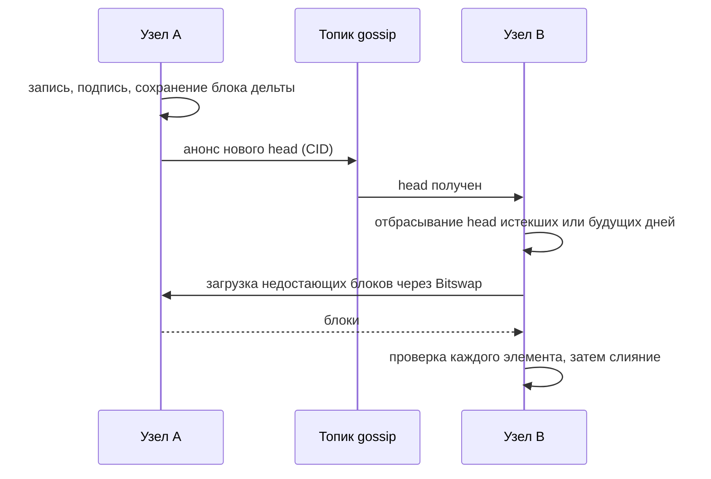

# Синхронизация {#synchronization}

В Warpnet нет сервера, который хранит «настоящую» копию чего бы то ни было. Каждый member-узел хранит данные своего владельца, а другие узлы узнают о них двумя путями:

- **Прямая доставка.** Посты, ответы, подписки, реакции и сообщения в чатах отправляются на узлы затронутых людей — через прямые потоки libp2p или через gossip-топик автора.
- **Реплицируемые хранилища.** Два вида общего состояния — счетчики вовлеченности и записи рейтинга узлов — реплицируются между узлами в виде бесконфликтных реплицируемых типов данных (CRDT), поэтому все узлы приходят к одним и тем же значениям без координации.

Первые разделы — для всех, кому интересно, как сеть остается согласованной; последующие — для разработчиков.

## Вкратце {#in-short}

- Посты, подписки, ответы, реакции и чаты хранятся на узлах затронутых людей. Запись для узла не в сети ждет в очереди исходящих (outbox) отправителя.
- Во всей сети реплицируются только две вещи: **счетчики вовлеченности** (реакции, ретвиты, ответы, просмотры, голоса в опросах) и **записи рейтинга узлов**.
- Обе используют один движок: Merkle-CRDT из [go-ds-crdt](https://github.com/ipfs/go-ds-crdt), обернутый Warpnet в [`core/crdt/store`](https://github.com/Warp-net/warpnet/tree/main/core/crdt/store).
- Каждое реплицируемое значение **подписано узлом, который его записал**, и проверяется перед слиянием. Узел может записывать только собственные элементы.
- Об изменениях сообщается через gossip, а блоки данных загружаются у пиров через Bitswap. Нет ни лидера, ни глобального порядка изменений.
- Реплицируемая история разбита на **один DAG на день по UTC**. Дни за пределами окна хранения удаляются и отвергаются.
- Ничто из присланного пиром не может удалить реплицируемые данные на вашем узле.

## Как передаются посты, подписки и сообщения {#how-posts-follows-and-messages-travel}

| Действие | Где хранится | Как доходит до других |
|---|---|---|
| Новый или удаленный пост | На узле автора | Публикуется в gossip-топике `user-update-<user ID автора>`. Каждый узел, владелец которого подписан на автора, добавляет пост в домашнюю ленту владельца (или удаляет из нее). |
| Ответ | На узле ответившего | Прямой поток на узел автора родительского поста |
| Реакция, ретвит, просмотр, голос в опросе | На узле того, кто совершил действие | Прямой поток на узел автора |
| Подписка, отписка | На узле подписчика | Прямой поток на узел пользователя, на которого подписываются. Узел подписчика подписывается на `user-update`-топик этого пользователя (или покидает его). |
| Сообщение в чате | На узле отправителя | Прямой поток на узел получателя |
| Чужой профиль | На узле автора | Загружается с узла автора при просмотре; загруженные посты кэшируются на 30 дней |

- При запуске member-узел подписывается на `user-update`-топики всех аккаунтов, на которые подписан его владелец, кроме аккаунтов, пришедших через мосты из других сетей.
- Пост, пришедший через gossip, принимается, только если его подпись соответствует указанному в нем узлу, его метка времени отличается от локальных часов не более чем на 5 минут, он пришел с узла, к которому привязан автор, и владелец подписан на автора.
- Gossip не хранит истории. Пост, опубликованный, пока узел подписчика не в сети, позже в ленту этого подписчика не попадет; его по-прежнему можно прочитать в профиле автора.
- Прямая запись, которую не удалось доставить, остается в outbox отправителя и отправляется повторно, когда пир подключается, каждые 5 минут и при запуске — в течение 30 дней. См. [Хранилище](storage.md#outbox) и [Протокол](protocol.md#outbox-for-offline-peers).

Список gossip-топиков приведен на странице [Протокол](protocol.md#gossip-topics).

## Что реплицируется {#what-is-replicated}

| Хранилище | Что в нем | Кто его ведет | Топик gossip | Срок хранения |
|---|---|---|---|---|
| Статистика | Подсчетчики каждого узла для реакций, ретвитов, ответов, просмотров и голосов в опросах | Member-узлы (десктоп, remote, echo) | `/warpnet/stats/1.0.0` | Посты, созданные за последние 30 дней |
| Рейтинг | Подписанные наблюдения одного узла о другом | Member-, relay-узлы и узлы-модераторы | `/warpnet/rating/1.0.0` | 4 дня (сетевое измерение), 56 дней (прикладное, модерация) |

Два хранилища полностью разделены: у каждого свое пространство имен в хранилище данных, свой топик gossip и свой префикс протокола Bitswap (`/warpnet/stats` и `/warpnet/rating`). Экземпляр go-ds-crdt владеет всем своим пространством имен и набором head, поэтому два хранилища с общим топиком или общим хранилищем данных сливали бы данные друг друга.

Кто поставил реакцию, проголосовал или просмотрел, а также счетчики реакций по каждому эмодзи не реплицируются: они остаются в локальных базах данных затронутых узлов.

## Как распространяется изменение {#how-a-change-travels}

Каждое хранилище — это множество ключей и значений с удалением по наблюдению (observed-remove set). Каждая локальная запись становится **блоком дельты** в Merkle-DAG. Самые новые блоки — это **head** DAG; их идентификаторы содержимого (CID) анонсируются в топике gossip хранилища сразу после записи. Узел, узнавший о head, которого у него нет, запрашивает недостающие блоки у подключенных пиров через Bitswap, а затем выполняет слияние.



Настройки движка из [`core/crdt/store/store.go`](https://github.com/Warp-net/warpnet/blob/main/core/crdt/store/store.go):

| Настройка | Значение | Смысл |
|---|---|---|
| Интервал повторной рассылки | 5 минут со случайным отклонением до 30% | Head анонсируются повторно, поэтому узел, пропустивший сообщение, догоняет остальных |
| Тайм-аут DAG syncer | 1 минута | Сколько может ждать загрузка одного блока |
| Воркеры | 16 | Блоки загружаются и применяются параллельно |
| Обработка нескольких head | включена | Несколько head обрабатываются одновременно |
| Предельный размер блока | 256 KiB | Записи упаковываются в минимальное число блоков, которое допускает этот предел |
| Интервал автоматического восстановления | выключен | Заменен одним полным восстановлением при каждом запуске (см. ниже) |

Адаптер gossip ([`core/crdt/broadcast/gossip.go`](https://github.com/Warp-net/warpnet/blob/main/core/crdt/broadcast/gossip.go)) буферизует 100 входящих сообщений; когда буфер полон, он отбрасывает самое старое, а не блокируется. Отброшенный анонс восстанавливается при следующей повторной рассылке. Пиры, которые уже подключены на момент запуска хранилища, сразу передаются в Bitswap, поэтому хранилище может загружать у них блоки, не дожидаясь нового подключения.

Сообщения gossip подписываются libp2p pubsub ключом отправителя (строгая подпись по умолчанию), так что анонс head привязан к пиру, который его опубликовал.

## DAG по дням {#day-dags}

Каждая запись помещается в **именованный DAG** одного дня по UTC: `<prefix>-<day>`, где `<day>` — число дней с начала эпохи Unix. Например, счетчики поста, созданного 24 ноября 2026 года, лежат в `stats-20781`.

| Хранилище | Префикс | Какой день |
|---|---|---|
| Статистика | `stats` | День создания поста, прочитанный из ULID поста |
| Рейтинг | `net`, `app` или `mod` (измерение рейтинга) | День часового интервала (bucket) записи |

DAG дня считается **актуальным** (live), если его имя корректно, префикс принадлежит хранилищу, он не старше первого актуального дня хранилища и опережает локальные часы не более чем на один день. Правила из [`core/crdt/store/epochs.go`](https://github.com/Warp-net/warpnet/blob/main/core/crdt/store/epochs.go):

- Head неактуальных DAG удаляются из исходящих и входящих анонсов, так что истекшие дни не передаются ни в одну сторону.
- Раз в час каждое хранилище удаляет из своего хранилища данных все блоки дней, вышедших за пределы срока хранения.
- Блок, достигнутый из head одного дня, но заявляющий о принадлежности к другому дню, отвергается ([`lineage.go`](https://github.com/Warp-net/warpnet/blob/main/core/crdt/store/lineage.go)).

История ограничена только этим скользящим окном; снимков и уплотнения внутри актуального дня нет.

## Что принимает узел {#what-a-node-accepts}

Каждый полученный блок декодируется через проверяемую дельту ([`delta.go`](https://github.com/Warp-net/warpnet/blob/main/core/crdt/store/delta.go)) до какого-либо слияния:

1. **Метки удаления (tombstones) отбрасываются.** Пир не может ничего удалить на вашем узле. Удаление происходит только локально, когда отбрасываются целые истекшие дни.
2. **Каждый элемент проверяется** своим хранилищем. Элемент, не прошедший проверку, удаляется из блока; остальная часть блока все равно сливается.
   - Статистика: счетчик должен нести действительную подпись Ed25519 от узла, указанного в его ключе, и находиться в DAG дня своего поста.
   - Рейтинг: запись должна быть подписана своим наблюдателем и находиться в DAG своего измерения и дня.
3. **Повторы проигрывают.** Обычно go-ds-crdt выбирает между двумя значениями ключа по приоритету блока, но приоритет не подписывается. Поэтому Warpnet считывает любой сохраненный приоритет как наименьший и оставляет решение за хранилищем: счетчик статистики сохраняет большую нарастающую сумму, запись рейтинга — версию с более поздним `updated_at`. Старое значение, повторно отправленное атакующим, никогда не заменит более новое.

## Счетчики вовлеченности {#engagement-counters}

Хранилище статистики ([`core/crdt/stats/store.go`](https://github.com/Warp-net/warpnet/blob/main/core/crdt/stats/store.go)) — это PN-счетчик: инкременты и декременты хранятся в отдельных подсчетчиках, и каждый узел пишет только свои.

### Ключи и значения {#keys-and-values}

```text
/STATS/{incr|decr}/{dataKey}/{nodeID}/{generation}
```

- `{dataKey}` — ключ счетчика в локальной базе данных (таблица ниже).
- `{nodeID}` — libp2p peer ID записывающего узла.
- `{generation}` — 128-битный случайный nonce в hex, создаваемый один раз при каждом запуске процесса.
- Значение — **нарастающая сумма** подсчетчика (8 байт, big-endian), за которой следует 64-байтная подпись Ed25519 над ключом, нулевым байтом и суммой.

| Счетчик | `dataKey` | Максимум от одного узла |
|---|---|---|
| Реакции (все эмодзи вместе) | `/REACTIONS/INCR/{tweetId}` | 1 |
| Ретвиты | `/TWEETS/RETWEETSCOUNT/{tweetId}` | 1 |
| Ответы | `/TWEETS/TWEETSCOUNT/{parentId}` | без ограничений |
| Просмотры | `/TWEETS/VIEWS/{tweetId}` | 1 |
| Голоса в опросах | `/POLLS/VOTES/INCR/{tweetId}/{option}` | 1 |

Владелец узла ставит реакцию, ретвитит, просматривает и голосует один раз, но отвечать может много раз.

### Запись {#writing}

- Действие пользователя увеличивает счетчик в памяти. Каждые 30 секунд (и при остановке) все измененные счетчики подписываются и публикуются вместе.
- Поскольку у каждой пары `(node, generation)` ровно один писатель, узел никогда не читает CRDT перед записью. Ни один инкремент не может потеряться из-за задержки репликации.
- Реплицируемый счетчик увеличивает только узел пользователя, совершившего действие. Действие часто сохраняется и на узле того, кто его совершил, и на узле автора; копия на узле автора обновляет только локальный счетчик, так что действие учитывается один раз.
- Дубликаты отфильтровываются локально до записи в CRDT: одна реакция от пользователя на пост (смена эмодзи не меняет итог), один ретвит от пользователя, один итоговый голос от каждого голосующего, один просмотр от каждого зрителя.
- Счетчики постов старше 30 дней, а также постов, чей ID не является ULID, не реплицируются. Такие посты учитываются только по локальным данным.

### Чтение {#reading}

Для каждого записывающего узла читатель суммирует его инкременты по всем поколениям, вычитает его декременты, отбрасывает узел, если результат равен нулю или меньше, и применяет лимит на узел. Затем итоги всех узлов складываются. Собственные, еще не сброшенные изменения узла тоже учитываются.

Узел сообщает **большее** из двух значений: реплицированный итог или собственный локальный счетчик. Если CRDT не удается прочитать, используется только локальный счетчик.

Для чужого поста приложение сначала запрашивает счетчики у узла автора. Только если узел автора не в сети или не может ответить, узел отвечает по своим данным, как описано выше.

### Где это работает {#where-it-runs}

Хранилище статистики работает только на member-узлах: в десктопном приложении, на удаленном узле и на echo-узле. Relay-узлы и модераторы его не запускают.

## Записи рейтинга {#rating-records}

Хранилище рейтинга ([`core/crdt/rating/store.go`](https://github.com/Warp-net/warpnet/blob/main/core/crdt/rating/store.go)) реплицирует подписанные наблюдения, а не счетчики:

```text
/record/{peerID}/{observerID}/{dimension}/{bucket}/{generation}
```

Значение — JSON-запись, подписанная наблюдателем. Узел пишет только записи, в которых наблюдатель — он сам, раз в 30 секунд. Member-узлы держат свою реплику в зашифрованной локальной базе данных; relay-узлы и модераторы держат ее в памяти и восстанавливают от пиров после каждого перезапуска. Подсчет оценок, подписи и применение рейтинга описаны на странице [Рейтинг узла](rating.md).

## Запуск и восстановление {#startup-and-recovery}

### При каждом запуске {#every-start}

При запуске хранилище запускает в фоне полное **восстановление** DAG (repair). Восстановление проходит DAG от head вниз и обрабатывает каждую еще не обработанную ветку, загружая недостающие блоки. Оно выполняется безусловно: штатная остановка посреди синхронизации может оставить пробел, не пометив хранилище как «грязное», и собственное восстановление библиотеки его бы не заметило.

### Новый или пустой узел {#a-new-or-empty-node}

Узел с пустой репликой узнает head пиров из их анонсов и скачивает каждый **актуальный** DAG дня: до 30 дней счетчиков и до 56 дней записей рейтинга. Head истекших дней отфильтровываются, поэтому такие дни никогда не запрашиваются.

> **Примечание:** хранилище статистики устанавливает границу отсечения сразу при запуске. Хранилище рейтинга устанавливает ее при первом проходе очистки, примерно через час после запуска; до этого оно принимает дни рейтинга любого возраста (записи за пределами срока хранения все равно игнорируются при подсчете оценок) и удаляет их на этом первом проходе.
{: .note }

### Узел, потерявший данные {#a-node-that-lost-its-data}

Ключ узла выводится из логина, пароля и сети, поэтому повторный вход на новой базе данных дает тот же ID узла. Узел создает новое поколение и заводит новые подсчетчики рядом со старыми. Его прежние поколения по-прежнему хранятся у пиров, по-прежнему несут действительные подписи того же ключа и снова сливаются при синхронизации. Счетчики сходятся к прежним значениям без двойного учета.

Relay-узлы и модераторы хранят свою реплику рейтинга только в памяти, поэтому после каждого перезапуска заново наполняют ее от пиров именно так.

### Ограничения {#limits}

- Узел может восстановить только то, что еще хранит какой-либо доступный пир. После перезапуска в пустой или разделенной сети ничего не вернется, пока не появятся пиры.
- Данные старше окна хранения потеряны для всех.
- Каждый перезапуск добавляет новое поколение для каждого счетчика, который узел затрагивает; эти подсчетчики живут, пока не истечет их день.

## Замечания о безопасности {#security-notes}

| Свойство | Как оно обеспечивается |
|---|---|
| Никто не может записать счетчик другого узла | Каждый счетчик подписан узлом, указанным в его ключе; неподписанные или чужие элементы отбрасываются до слияния |
| Никто не может уменьшить чужой счетчик | Декремент — это собственный подсчетчик узла, и он компенсирует только инкременты этого же узла |
| Один узел не может накрутить счетчик | Лимит на узел — 1 для реакций, ретвитов, просмотров и голосов |
| Нет удаленных удалений | Полученные метки удаления отбрасываются |
| Нет повторов | Нарастающие суммы только растут; записи рейтинга движутся только вперед во времени |
| Нет данных из далекого будущего | DAG, опережающие локальные часы более чем на один день, отвергаются |

Чего это **не** предотвращает: множества идентичностей. ID узлов создаются бесплатно, поэтому большое число узлов может добавить по одной реакции или просмотру каждый.

## См. также {#see-also}

- [Рейтинг узла](rating.md)
- [Хранилище](storage.md)
- [Протокол](protocol.md)
- [Модерация](moderation.md)
- [Архитектура](architecture.md)
