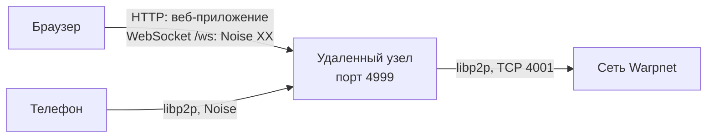

# Запуск узла {#running-a-node}

Десктопное приложение — полноценный узел, но оно обслуживает ваш аккаунт и телефоны, только пока запущено. Эта страница для тех, кому нужен постоянно работающий Warpnet: **удаленный узел** на сервере, которым вы пользуетесь из браузера, **relay-узел**, который помогает сети, и Docker-файлы для обоих. В конце — полный справочник настроек и структура каталога данных.

## Выбор конфигурации {#choose-a-setup}

| Вариант | Что это | Для кого |
|---|---|---|
| Десктопное приложение, оставленное включенным | Обычное приложение ([Начало работы](index.md)) на компьютере, который не выключается | Для большинства пользователей с подключенными телефонами |
| [Удаленный узел](#remote-node) | Узел без графического интерфейса (headless), который отдает в браузер тот же веб-интерфейс | Для VPS или домашнего сервера |
| [Relay-узел](#relay-node) | Точка входа без состояния и ретранслятор трафика для других узлов | Для всех, у кого есть публичный IP и желание помочь |
| [Echo-узел](#echo-node) | Бот с хранилищем в памяти | Для разработчиков, которые тестируют локально |
| Узел-модератор | Рассматривает жалобы с помощью модели, работающей на устройстве | См. [Модерация](../moderation.md) |

Десктопное приложение нельзя запустить в Docker: для окна ему нужен графический сеанс. `Dockerfile.member` в репозитории только проверяет, что десктопная сборка компилируется.

## Удаленный узел {#remote-node}

Удаленный узел — это member-узел без окна. Он отдает веб-приложение на Vue по HTTP и соединяет браузер с узлом через WebSocket на `/ws` ([`cmd/node/member/remote-member.go`](https://github.com/Warp-net/warpnet/blob/main/cmd/node/member/remote-member.go)). Хранилище, сопряжение телефонов и настройки работают так же, как в десктопном приложении. Переключатель сети, блокировка экрана и предложения обновиться есть только в десктопном приложении.



### Без серверного пароля {#no-server-password}

В старой документации говорилось, что удаленному узлу нужен `--node.server.password`. Этого флага больше нет. Канал браузера защищен без общего секрета:

- Каждое соединение с `/ws` начинается с рукопожатия Noise XX. Долговременный ключ узла хранится в `ws-noise.key` рядом с базой данных; браузер создает свой ключ при первом использовании.
- При первом контакте браузер запоминает ключ узла и отказывается подключаться, если тот когда-нибудь изменится. При запуске узел выводит `NODE KEY FINGERPRINT: …`, чтобы вы могли сверить отпечаток.
- Регистрация, вход и все остальные вызовы идут внутри зашифрованного канала. Успешный вход авторизует ключ этого браузера до остановки узла. Любой другой браузер получает `401`, пока не войдет.
- WebSocket принимается, только если origin страницы совпадает с хостом, к которому она подключается, поэтому другие сайты не могут его открыть. Если узел стоит за обратным прокси, сохраняйте заголовок `Host`, который отправил браузер.

> **Внимание:** На свежем узле первая регистрация создает аккаунт, и сделать это может любой, у кого есть доступ к порту панели управления. Либо создайте аккаунт сразу после первого запуска, либо привяжите панель к localhost с помощью `--node.server.host 127.0.0.1` и заходите через SSH-туннель: `ssh -L 4999:127.0.0.1:4999 you@your-server`, затем откройте `http://localhost:4999`.
{: .warning }

### Запуск в Docker {#run-it-with-docker}

[`docker-compose.yaml`](https://github.com/Warp-net/warpnet/blob/main/docker-compose.yaml) в репозитории собирает `Dockerfile.remote` и запускает удаленный узел testnet с сетью хоста (host networking). Тома в нем нет, поэтому добавьте его, иначе аккаунт пропадет при пересоздании контейнера:

```yaml
services:
  remote-node:
    build:
      context: .
      dockerfile: Dockerfile.remote
    network_mode: host
    restart: unless-stopped
    environment:
      - NODE_NETWORK=testnet        # or warpnet
      - NODE_PORT=4001
      - NODE_SERVER_PORT=4999
      - NODE_SERVER_HOST=127.0.0.1  # dashboard via SSH tunnel only
      - LOGGING_FORMAT=json
    volumes:
      - warpnet-data:/root/.warpdata
volumes:
  warpnet-data:
```

Проект также публикует образ, который сам запускает в testnet, — `ghcr.io/warp-net/warpnet-demo:latest` (собирается из `Dockerfile.remote`). Его собирают вручную через deploy-workflow проекта, поэтому `latest` не привязан к релизу. Предсказуемее собрать образ из нужного вам тега релиза.

Без сети хоста опубликуйте порт libp2p и порт панели управления: `-p 4001:4001 -p 4999:4999`.

### Запуск без Docker {#run-it-without-docker}

```bash
git clone https://github.com/Warp-net/warpnet && cd warpnet
go build -tags remote -mod=vendor -o warpnet-remote ./cmd/node/member/remote-member.go
./warpnet-remote --node.network testnet --node.server.host 127.0.0.1
```

Для этого нужна версия Go, указанная в `go.mod`. Веб-приложение встраивается из закоммиченного `frontend/dist`, поэтому инструменты Node.js не нужны.

### Эксплуатация {#operating-it}

- **Входите после каждого перезапуска.** Удаленный узел сразу запускает HTTP-сервер, но подключается к сети, только когда вы войдете из браузера, потому что ваши ключи существуют только после входа. До этого подключенные телефоны не могут до него достучаться.
- **Подключайте телефоны** через меню аккаунта в панели управления: **Sign in by QR-code**. Перезапуск выдает новый токен сопряжения, поэтому после него телефонам нужно заново отсканировать код (см. [Мобильные приложения](mobile.md#manage-paired-devices)).
- **Обновления.** Удаленный узел не обновляется сам. Скачайте или пересоберите образ и перезапустите узел.
- **Ошибка смены ключа.** Если браузер сообщает, что ключ идентичности узла изменился, значит, либо потерян `ws-noise.key` (восстановите его из резервной копии или очистите данные сайта в браузере и подключитесь снова), либо кто-то выдает себя за ваш узел.

## Relay-узел {#relay-node}

Relay-узлы — дорожные указатели сети. Relay-узел помогает новым узлам находить пиров через DHT и пересылает зашифрованный трафик (libp2p circuit relay v2) для узлов за NAT. Он не хранит пользовательских данных и не может прочитать то, что пересылает. Если у вас есть машина с публичным IP и открытым TCP-портом, запуск relay-узла — полезный вклад. Его внутреннее устройство описано на странице [Relay-узел](../relay-node-architecture.md).

Получить его можно тремя способами:

| Источник | Примечания |
|---|---|
| `relay_linux_amd64.tar.gz` из [последнего релиза](https://github.com/Warp-net/warpnet/releases/latest) | Статический бинарный файл для Linux x86-64 с именем `relay` |
| `ghcr.io/warp-net/warpnet-relay:latest` | Собран из `Dockerfile.relay` (distroless) |
| `Dockerfile.relay` | Соберите сами; под Windows relay-узел не собирается |

Запуск:

```bash
./relay --node.network warpnet --node.port 4001 --node.seed "<long random secret>"
```

```bash
docker run -d --name warpnet-relay --network host --restart unless-stopped \
  -e NODE_NETWORK=warpnet -e NODE_PORT=4001 -e NODE_SEED="<long random secret>" \
  ghcr.io/warp-net/warpnet-relay:latest
```

При запуске relay-узел выводит `RELAY NODE STARTED WITH ID <peer-id> AND ADDRESSES [...]`.

> **Внимание:** Ключ идентичности relay-узла генерируется из `--node.seed`. Если его не задать, seed строится из имени сети, `--database.dir`, `--node.host.v4` и `--node.port`. Эти значения может угадать кто угодно, а значит, кто угодно сможет вычислить ключ вашего relay-узла. Всегда задавайте длинный случайный seed и сохраняйте его: с тем же seed после перезапуска у узла будет тот же peer ID.
{: .warning }

Чтобы использовать ваш relay-узел, передайте его адрес member-узлам в виде полного multiaddr, `/ip4/<public-ip>/tcp/<port>/p2p/<peer-id>`:

- в командной строке: `--node.bootstrap /ip4/…/p2p/…` (несколько адресов — через запятую), или
- в приложении: **Settings → Network → Bootstrap peers** (применяется после перезапуска).

В обоих случаях список **заменяет** встроенные bootstrap-узлы, а не дополняет их, поэтому включите в него все relay-узлы, которые хотите использовать. Подключенные телефоны получают от узла тот же список.

С флагом `--node.print-psk` relay-узел выводит сетевой ключ при запуске. На Linux x86-64 relay-узел каждый час проверяет GitHub и Codeberg и без вопросов заменяет себя новым подписанным релизом. Чтобы управлять обновлениями самостоятельно, задайте `--node.self-update=false`.

## Echo-узел {#echo-node}

Echo-узел — это тестовый бот: member-узел с хранилищем в памяти, который отвечает на сообщения в чатах и на ответы заготовленным текстом. Он нужен, чтобы наполнить локальную или тестовую сеть, и не предназначен для настоящих аккаунтов. Соберите его командой `go build -tags echo ./cmd/node/member/echo-member.go` или выполните `make echo-main`. См. [Руководство разработчика](../developer-guide/index.md).

## Docker-файлы {#docker-files}

| Файл | Роль | Базовый образ | Примечания |
|---|---|---|---|
| `Dockerfile.remote` | Удаленный узел | `ubuntu:24.04` | Открывает порт 4999; данные в `/root/.warpdata` |
| `Dockerfile.relay` | Relay-узел | `distroless/static-debian12` | Статический бинарный файл, без данных |
| `Dockerfile.echo` | Echo-бот | `distroless/static-debian12` | Хранилище в памяти |
| `Dockerfile.moderator` | Модератор | `ubuntu:24.04` | Нужны сабмодуль `core/moderation` и файл модели |
| `Dockerfile.member` | Проверка десктопной сборки | `ubuntu:24.04` | Не для запуска |

Собственное развертывание testnet проекта описано в [`deploy/docker-compose-testnet.yml`](https://github.com/Warp-net/warpnet/blob/main/deploy/docker-compose-testnet.yml); это полезный пример настроек relay-узлов.

## Порты {#ports}

| Порт | Протокол | Роль | Назначение |
|---|---|---|---|
| `--node.port` (4001) | TCP, IPv4 и IPv6 | все | libp2p: другие узлы, телефоны, relay-узлы |
| `--node.server.port` (4999) | TCP (HTTP, WebSocket) | удаленный узел | Панель управления и `/ws` |

Member-узлы и удаленные узлы пытаются открыть свой порт libp2p на роутере через UPnP или NAT-PMP. Узлы в одной локальной сети также находят друг друга через mDNS.

## Справочник настроек {#configuration-reference}

Все настройки читаются в [`config/config.go`](https://github.com/Warp-net/warpnet/blob/main/config/config.go). Каждую можно задать флагом командной строки или переменной окружения. Флаг важнее переменной окружения, а переменная важнее значения по умолчанию. Имя переменной — это флаг в верхнем регистре, в котором `.` и `-` заменены на `_`: `--node.self-update` превращается в `NODE_SELF_UPDATE`.

| Флаг | Переменная окружения | По умолчанию | Кто использует | Значение |
|---|---|---|---|---|
| `--node.network` | `NODE_NETWORK` | `warpnet` | все | Имя сети. `testnet` — тестовая сеть; `mainnet` читается как `warpnet`. Любое другое имя создает отдельную частную сеть. |
| `--node.port` | `NODE_PORT` | `4001` | все | TCP-порт libp2p, IPv4 и IPv6 |
| `--node.host.v4` | `NODE_HOST_V4` | `0.0.0.0` | все | Адрес привязки IPv4 |
| `--node.host.v6` | `NODE_HOST_V6` | `::` | все | Адрес привязки IPv6 |
| `--node.bootstrap` | `NODE_BOOTSTRAP` | встроенный список для `warpnet` и `testnet` | все | Bootstrap-адреса multiaddr через запятую. Если задан, заменяет встроенный список. |
| `--node.seed` | `NODE_SEED` | выводится из сети, каталога базы данных, IPv4-хоста и порта | relay | Seed ключа идентичности relay-узла. Member-узлы вместо этого выводят ключ из логина и пароля. |
| `--node.print-psk` | `NODE_PRINT_PSK` | `false` | relay | Выводить сетевой ключ при запуске |
| `--node.self-update` | `NODE_SELF_UPDATE` | `true` | десктоп, relay, модератор | Заменять бинарный файл новейшим подписанным релизом. Десктопное приложение сначала спрашивает; relay и модератор устанавливают обновление сами. Под Snap отключено. |
| `--node.server.host` | `NODE_SERVER_HOST` | `0.0.0.0` | удаленный | Адрес привязки панели управления. `127.0.0.1` — доступ только с этого хоста. |
| `--node.server.port` | `NODE_SERVER_PORT` | `4999` | удаленный | Порт HTTP и WebSocket панели управления |
| `--logging.level` | `LOGGING_LEVEL` | `info` | все | `debug`, `info`, `warn` или `error`; при неизвестном значении используется `info` |
| `--logging.format` | `LOGGING_FORMAT` | `text` | все | `text`; любое другое значение включает JSON |
| `--database.dir` | `DATABASE_DIR` | `storage` | десктоп, удаленный | Имя папки внутри `<data>/<network>/` |
| `--wallet.binary-path` | `WALLET_BINARY_PATH` | пусто | десктоп, удаленный | Путь к бинарному файлу платежного движка, который использует кошелек |
| `--wallet.endpoint` | `WALLET_ENDPOINT` | `https://nile.trongrid.io` в testnet, `https://api.trongrid.io` в `warpnet` | десктоп, удаленный | Эндпоинт TRON API для кошелька |

Встроенные bootstrap-узлы — это три relay-узла проекта на `207.154.221.44`: TCP-порты 4001, 4002 и 4003 в `warpnet` и 4011, 4022 и 4033 в `testnet`, каждый также доступен по IPv6.

> **Примечание:** Некоторые настройки можно изменить и в приложении, и тогда сохраненное значение хранится в вашей зашифрованной базе данных. В этом случае **Settings → Network** (адреса прослушивания, порт, bootstrap-пиры) и **Settings → Wallet backend** для этого аккаунта имеют приоритет над флагами и переменными окружения. Оставьте поле в приложении пустым, чтобы вернуться к флагу, переменной или значению по умолчанию. Изменения применяются после перезапуска узла.
{: .note }

Примеры:

```bash
LOGGING_LEVEL=debug warpnet --node.network testnet
warpnet --node.port 4100 --database.dir second    # второй аккаунт на одной машине
```

Два экземпляра десктопного приложения не могут работать на одной машине одновременно: приложение держит блокировку единственного экземпляра. Второму аккаунту нужен собственный `--database.dir`, и пользоваться аккаунтами можно только по очереди.

## Каталог данных {#data-directory}

Каждый узел хранит данные в одной базовой папке, разделенной по сетям и по `--database.dir`:

| Система | Базовая папка |
|---|---|
| Linux, macOS | `~/.warpdata/` |
| Linux, Snap | `~/snap/warpnet/current/.warpdata/` (Snap направляет `$HOME` в собственную папку snap-пакета) |
| Windows | `%LOCALAPPDATA%\warpdata\` |
| Docker (образ удаленного узла) | `/root/.warpdata/` внутри контейнера |

```text
~/.warpdata/
├── warpnet/                  main network
│   ├── storage/              --database.dir (default "storage")
│   │   └── v0/               encrypted database files
│   │       └── run.lock      marks that an account exists
│   └── ws-noise.key          remote node only: browser channel key
├── testnet/
│   └── storage/
│       └── v0/
└── fontconfig.conf           Linux desktop app outside Snap, rewritten at every start
```

База данных — BadgerDB, зашифрованная ключом, который выводится из вашего логина и пароля. Не удаляйте файлы, пока узел работает: узел, который обнаружил пропажу `run.lock`, намеренно останавливается. Как скопировать или перенести папку, описано на странице [Резервное копирование и восстановление](backup-and-restore.md).

## Логи и состояние {#logs-and-status}

Все роли пишут логи в стандартный вывод. Используйте `--logging.format json` для сборщиков логов и `--logging.level debug`, когда сообщаете об ошибке.

Экспортера метрик нет: настройка Prometheus push-gateway, описанная в старой документации, удалена. Вместо этого состояние можно посмотреть в приложении. Панель информации об узле на главном экране (Home) показывает ID узла, версию, адреса, состояние relay-соединения и сети, пиров, трафик, а также статистику базы данных, памяти и CPU. **Settings → Node rating** показывает, как сеть оценивает ваш узел (см. [Рейтинг узлов](../rating.md)).

## См. также {#see-also}

- [Начало работы](index.md)
- [Резервное копирование и восстановление](backup-and-restore.md)
- [Relay-узел](../relay-node-architecture.md)
- [Member-узел](../member-node-architecture.md)
- [Сеть и транспорт](../network.md)
