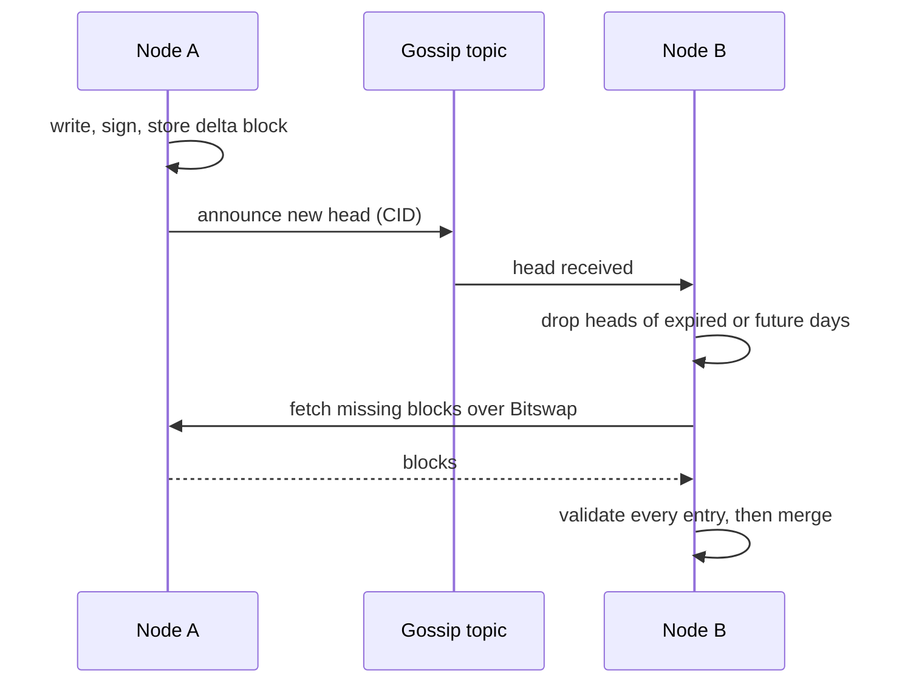

# Synchronization

Warpnet has no server that holds the "real" copy of anything. Each member node keeps its owner's data, and other nodes learn about it in two ways:

- **Direct delivery.** Posts, replies, follows, reactions and chat messages are sent to the nodes of the people involved, over direct libp2p streams or the author's gossip topic.
- **Replicated stores.** Two kinds of shared state, engagement counters and node rating records, are replicated between nodes as conflict-free replicated data types (CRDTs), so every node converges on the same values without coordination.

The first sections are for anyone curious about how the network stays consistent; the later ones are for developers.

## In short

- Posts, follows, replies, reactions and chats live on the nodes of the people involved. A write to an offline node waits in the sender's outbox.
- Only two things are replicated network-wide: **engagement counters** (reactions, retweets, replies, views, poll votes) and **node rating records**.
- Both use the same engine: a Merkle-CRDT from [go-ds-crdt](https://github.com/ipfs/go-ds-crdt), wrapped by Warpnet in [`core/crdt/store`](https://github.com/Warp-net/warpnet/tree/main/core/crdt/store).
- Every replicated value is **signed by the node that wrote it** and checked before it is merged. A node can only write its own entries.
- Changes are announced over gossip and the data blocks are fetched from peers over Bitswap. There is no leader and no global order of changes.
- Replicated history is cut into **one DAG per UTC day**. Days past the retention window are dropped and refused.
- Nothing a peer sends can delete replicated data on your node.

## How posts, follows and messages travel

| Action | Stored on | How it reaches others |
|---|---|---|
| New or deleted post | The author's node | Published on the gossip topic `user-update-<author's user ID>`. Each node whose owner follows the author adds the post to (or removes it from) its owner's home timeline. |
| Reply | The replier's node | Direct stream to the node of the parent post's author |
| Reaction, retweet, view, poll vote | The actor's node | Direct stream to the author's node |
| Follow, unfollow | The follower's node | Direct stream to the followed user's node. The follower's node subscribes to (or leaves) that user's `user-update` topic. |
| Chat message | The sender's node | Direct stream to the recipient's node |
| Someone else's profile | The author's node | Fetched from the author's node when viewed; the fetched posts are cached for 30 days |

- On start, a member node subscribes to the `user-update` topics of every account its owner follows, except accounts bridged in from other networks.
- A post that arrives over gossip is accepted only if its signature matches the node it names, its timestamp is within 5 minutes of the local clock, it comes from the node the author is bound to, and the owner follows the author.
- Gossip keeps no backlog. A post published while a follower's node is offline does not reach that follower's timeline later; it can still be read on the author's profile.
- A direct write that cannot be delivered stays in the sender's outbox and is retried when the peer connects, every 5 minutes, and at start, for up to 30 days. See [Storage](storage.md#outbox) and [Protocol](protocol.md#outbox-for-offline-peers).

The list of gossip topics is in [Protocol](protocol.md#gossip-topics).

## What is replicated

| Store | What it holds | Who runs it | Gossip topic | Kept for |
|---|---|---|---|---|
| Stats | Per-node sub-counters for reactions, retweets, replies, views and poll votes | Member nodes (desktop, remote, echo) | `/warpnet/stats/1.0.0` | Tweets created in the last 30 days |
| Rating | Signed observations one node made about another | Member, relay and moderator nodes | `/warpnet/rating/1.0.0` | 4 days (network dimension), 56 days (application, moderation) |

The two stores are fully separate: each has its own datastore namespace, its own gossip topic and its own Bitswap protocol prefix (`/warpnet/stats` and `/warpnet/rating`). A go-ds-crdt instance owns its whole namespace and set of heads, so two stores sharing a topic or a datastore would merge each other's data.

Who reacted, voted or viewed, and the per-emoji reaction counts, are not replicated: they stay in the local databases of the nodes involved.

## How a change travels

Each store is an observed-remove set of keys and values. Every local write becomes a **delta block** in a Merkle-DAG. The newest blocks are the DAG's **heads**; their content identifiers (CIDs) are announced on the store's gossip topic as soon as they are written. A node that hears about a head it does not have asks its connected peers for the missing blocks over Bitswap, then merges them.



Engine settings, from [`core/crdt/store/store.go`](https://github.com/Warp-net/warpnet/blob/main/core/crdt/store/store.go):

| Setting | Value | Meaning |
|---|---|---|
| Rebroadcast interval | 5 minutes, randomised by up to 30% | Heads are re-announced, so a node that missed a message catches up |
| DAG syncer timeout | 1 minute | How long fetching one block may wait |
| Workers | 16 | Blocks fetched and applied in parallel |
| Multi-head processing | on | Several heads are processed concurrently |
| Block size cap | 256 KiB | Writes are packed into as few blocks as this allows |
| Automatic repair interval | off | Replaced by one full repair at every start (see below) |

The gossip adapter ([`core/crdt/broadcast/gossip.go`](https://github.com/Warp-net/warpnet/blob/main/core/crdt/broadcast/gossip.go)) buffers 100 incoming messages; when the buffer is full it drops the oldest one rather than block. A dropped announcement is recovered at the next rebroadcast. Peers that are already connected when the store starts are handed to Bitswap at once, so a store can fetch blocks from them without waiting for a new connection.

Gossip messages are signed by libp2p pubsub with the sender's key (default strict signing), so a head announcement is bound to the peer that published it.

## Day DAGs

Every write is filed under a **named DAG** for one UTC day: `<prefix>-<day>`, where `<day>` is the number of days since the Unix epoch. For example, counters of a tweet created on 24 November 2026 live in `stats-20781`.

| Store | Prefix | Which day |
|---|---|---|
| Stats | `stats` | The day the tweet was created, read from the tweet's ULID |
| Rating | `net`, `app` or `mod` (the rating dimension) | The day of the record's hour bucket |

A day DAG is **live** when its name is well-formed, its prefix belongs to the store, it is not older than the store's first live day, and it is not more than one day ahead of the local clock. The rules, from [`core/crdt/store/epochs.go`](https://github.com/Warp-net/warpnet/blob/main/core/crdt/store/epochs.go):

- Heads of non-live DAGs are removed from outgoing and incoming announcements, so expired days travel in neither direction.
- Once an hour, each store drops every block of the days that fell out of retention from its own datastore.
- A block reached from one day's head that claims to belong to another day is refused ([`lineage.go`](https://github.com/Warp-net/warpnet/blob/main/core/crdt/store/lineage.go)).

History is bounded only by this sliding window; there are no snapshots or compaction inside a live day.

## What a node accepts

Every received block is decoded through a checked delta ([`delta.go`](https://github.com/Warp-net/warpnet/blob/main/core/crdt/store/delta.go)) before anything is merged:

1. **Tombstones are discarded.** A peer cannot delete anything on your node. Deletion happens only by dropping whole expired days locally.
2. **Every entry is validated** by its store. An entry that fails is removed from the block; the rest of the block is still merged.
   - Stats: the counter must carry a valid Ed25519 signature from the node named in its key, and sit in the DAG of its tweet's day.
   - Rating: the record must be signed by its observer and sit in the DAG of its own dimension and day.
3. **Replays lose.** go-ds-crdt normally picks between two values of a key by block priority, but priority is not signed. Warpnet therefore reads every stored priority as the lowest and lets the store decide: a stats counter keeps the larger running total, a rating record keeps the version with the later `updated_at`. An old value re-sent by an attacker never replaces a newer one.

## Engagement counters

The stats store ([`core/crdt/stats/store.go`](https://github.com/Warp-net/warpnet/blob/main/core/crdt/stats/store.go)) is a PN-counter: increments and decrements are kept in separate sub-counters, and each node only ever writes its own.

### Keys and values

```text
/STATS/{incr|decr}/{dataKey}/{nodeID}/{generation}
```

- `{dataKey}` is the counter's key in the local database (table below).
- `{nodeID}` is the writing node's libp2p peer ID.
- `{generation}` is a 128-bit random nonce, hex-encoded, minted once per process start.
- The value is the sub-counter's **running total** (8 bytes, big-endian) followed by a 64-byte Ed25519 signature over the key, a zero byte and the total.

| Counter | `dataKey` | Most one node can add |
|---|---|---|
| Reactions (all emoji together) | `/REACTIONS/INCR/{tweetId}` | 1 |
| Retweets | `/TWEETS/RETWEETSCOUNT/{tweetId}` | 1 |
| Replies | `/TWEETS/TWEETSCOUNT/{parentId}` | no limit |
| Views | `/TWEETS/VIEWS/{tweetId}` | 1 |
| Poll votes | `/POLLS/VOTES/INCR/{tweetId}/{option}` | 1 |

A node's owner reacts, retweets, views and votes once, but may reply many times.

### Writing

- A user action bumps an in-memory counter. Every 30 seconds (and on shutdown) all changed counters are signed and published together.
- Because each `(node, generation)` pair has exactly one writer, a node never reads the CRDT before writing. No increment can be lost to replication lag.
- Only the node of the user who acted bumps the replicated counter. An action is often stored on both the actor's node and the author's node; the author's copy updates the local counter only, so the action is counted once.
- Duplicates are filtered locally before any CRDT write: one reaction per user per tweet (changing the emoji does not change the total), one retweet per user, one final vote per voter, one view per viewer.
- Counters of a tweet older than 30 days, or of a tweet whose ID is not a ULID, are not replicated. Such tweets are counted from local data only.

### Reading

For each writing node, the reader sums its increments across all its generations, subtracts its decrements, drops the node if the result is zero or less, and applies the per-node limit. The totals of all nodes are then added up. The node's own not-yet-flushed changes are included.

A node reports the **larger** of this replicated total and its own local counter. If the CRDT cannot be read, the local counter is used alone.

For someone else's post, the app first asks the author's node for the counts. Only when the author's node is offline or cannot answer does the node answer from its own data as above.

### Where it runs

Only member nodes run the stats store: the desktop app, the remote node and the echo node. Relays and moderators do not.

## Rating records

The rating store ([`core/crdt/rating/store.go`](https://github.com/Warp-net/warpnet/blob/main/core/crdt/rating/store.go)) replicates signed observations, not counters:

```text
/record/{peerID}/{observerID}/{dimension}/{bucket}/{generation}
```

The value is the JSON record, signed by the observer. A node writes only records whose observer is itself, every 30 seconds. Member nodes keep their replica in the encrypted local database; relays and moderators keep it in memory and rebuild it from peers after every restart. Scoring, signatures and enforcement are described in [Node rating](rating.md).

## Startup and recovery

### Every start

When a store starts, it launches a full DAG **repair** in the background. Repair walks the DAG from the heads down and processes every branch that was not processed yet, fetching missing blocks. It runs unconditionally: a clean shutdown in the middle of a sync can leave a gap without marking the store dirty, and the library's own repair would not notice it.

### A new or empty node

A node with an empty replica learns its peers' heads from their announcements and downloads every **live** day DAG: up to 30 days of counters and up to 56 days of rating records. Heads of expired days are filtered out, so those days are never requested.

> **Note:** the stats store sets its cut-off as soon as it starts. The rating store sets its cut-off on its first clean-up pass, about an hour after start; until then it accepts rating days of any age (records past retention are still ignored when scores are computed) and drops them at that first pass.
{: .note }

### A node that lost its data

The node's key is derived from login, password and network, so logging in again on a fresh database gives the same node ID. The node mints a new generation and starts new sub-counters next to the old ones. Its previous generations are still held by peers, still carry valid signatures from the same key, and are merged back during sync. Counts converge to what they were, without double counting.

Relays and moderators keep their rating replica in memory only, so they refill it from peers this way after every restart.

### Limits

- A node can only recover what some reachable peer still holds. After a restart into an empty or partitioned network, nothing comes back until peers appear.
- Data older than the retention window is gone for everyone.
- Each restart adds a generation per counter it touches; these sub-counters live until their day expires.

## Security notes

| Property | How it holds |
|---|---|
| Nobody can write another node's counter | Each counter is signed by the node named in its key; unsigned or foreign entries are dropped before merge |
| Nobody can lower someone else's count | A decrement is a node's own sub-counter and only offsets that node's increments |
| One node cannot inflate a count | Per-node limits of 1 for reactions, retweets, views and votes |
| No remote deletes | Received tombstones are discarded |
| No replays | Running totals only grow; rating records only move forward in time |
| No far-future data | DAGs more than one day ahead of the local clock are refused |

What this does **not** stop: many identities. Node IDs are free to create, so a large number of nodes can each add one reaction or view.

## See also

- [Node rating](rating.md)
- [Storage](storage.md)
- [Protocol](protocol.md)
- [Moderation](moderation.md)
- [Architecture](architecture.md)
