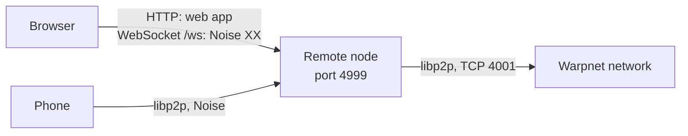

# Running a Node

The desktop app is a complete node, but it only serves your account and your phones while it runs. This page is for people who want Warpnet always on: a **remote node** on a server that you use from a browser, a **relay node** that helps the network, and the Docker files for both. It ends with the full configuration reference and the data directory layout.

## Choose a setup

| Setup | What it is | Who it is for |
|---|---|---|
| Desktop app, left running | The normal app ([Getting started](index.md)) on a computer that stays on | Most people with phones paired |
| [Remote node](#remote-node) | A headless node that serves the same web UI to a browser | A VPS or home server |
| [Relay node](#relay-node) | A stateless entry point and traffic relay for other nodes | Anyone with a public IP who wants to help |
| [Echo node](#echo-node) | A bot with an in-memory store | Developers testing locally |
| Moderator node | Judges reports with an on-device model | See [Moderation](../moderation.md) |

The desktop app cannot run in Docker: it needs a desktop session for its window. `Dockerfile.member` in the repository only checks that the desktop build compiles.

## Remote node

The remote node is the member node without a window. It serves the Vue web app over HTTP and connects the browser to the node over a WebSocket at `/ws` ([`cmd/node/member/remote-member.go`](https://github.com/Warp-net/warpnet/blob/main/cmd/node/member/remote-member.go)). Storage, pairing phones and the settings work as in the desktop app; the network selector, the screen lock and update prompts exist only in the desktop app.



### No server password

Older documentation said the remote node needs `--node.server.password`. That flag no longer exists. The browser channel is protected without a shared secret:

- Every `/ws` connection starts with a Noise XX handshake. The node's long-term key is stored in `ws-noise.key` next to the database; the browser creates its own key on first use.
- The browser pins the node's key on first contact and refuses to connect if it ever changes. At start the node prints `NODE KEY FINGERPRINT: …` so you can compare.
- Sign-up, login and every other call travel inside the encrypted channel. A successful login authorizes that browser's key until the node stops; any other browser gets `401` until it logs in.
- The WebSocket is accepted only when the page's origin matches the host it connects to, so other websites cannot open it. Behind a reverse proxy, keep the `Host` header the browser used.

> **Warning:** On a fresh node the first sign-up creates the account, and anyone who can reach the dashboard port can do it. Either create your account right after the first start, or bind the dashboard to localhost with `--node.server.host 127.0.0.1` and reach it through an SSH tunnel: `ssh -L 4999:127.0.0.1:4999 you@your-server`, then open `http://localhost:4999`.
{: .warning }

### Run it with Docker

The repository's [`docker-compose.yaml`](https://github.com/Warp-net/warpnet/blob/main/docker-compose.yaml) builds `Dockerfile.remote` and starts a testnet remote node with host networking. It has no volume, so add one, or the account is lost when the container is recreated:

```yaml
services:
  remote-node:
    build:
      context: .
      dockerfile: Dockerfile.remote
    network_mode: host
    restart: unless-stopped
    environment:
      - NODE_NETWORK=testnet        # or warpnet
      - NODE_PORT=4001
      - NODE_SERVER_PORT=4999
      - NODE_SERVER_HOST=127.0.0.1  # dashboard via SSH tunnel only
      - LOGGING_FORMAT=json
    volumes:
      - warpnet-data:/root/.warpdata
volumes:
  warpnet-data:
```

The project also publishes the image it runs on testnet as `ghcr.io/warp-net/warpnet-demo:latest` (built from `Dockerfile.remote`). It is built by hand from the project's deploy workflow, so `latest` is not tied to a release. Building from the release tag you want is the predictable option.

Without host networking, publish the libp2p port and the dashboard port: `-p 4001:4001 -p 4999:4999`.

### Run it without Docker

```bash
git clone https://github.com/Warp-net/warpnet && cd warpnet
go build -tags remote -mod=vendor -o warpnet-remote ./cmd/node/member/remote-member.go
./warpnet-remote --node.network testnet --node.server.host 127.0.0.1
```

This needs the Go version named in `go.mod`. The web app is embedded from the committed `frontend/dist`, so no Node.js toolchain is needed.

### Operating it

- **Log in after every restart.** The remote node starts its HTTP server at once, but joins the network only after you sign in from the browser, because your keys exist only after login. Until then paired phones cannot reach it.
- **Pair phones** from the dashboard's account menu: **Sign in by QR-code**. A restart issues a new pairing token, so phones need a new scan afterwards (see [Mobile apps](mobile.md#manage-paired-devices)).
- **Updates.** The remote node does not update itself. Pull or rebuild the image and restart.
- **Key changed error.** If the browser reports that the node's identity key changed, either `ws-noise.key` was lost (restore it from backup, or clear the site data in the browser and connect again) or something is impersonating your node.

## Relay node

Relays are the network's signposts. A relay helps new nodes find peers through the DHT and forwards encrypted traffic (libp2p circuit relay v2) for nodes behind NAT. It stores no user data and cannot read what it forwards. If you have a machine with a public IP and an open TCP port, running a relay is a useful contribution. Its internals are described in [Relay node](../relay-node-architecture.md).

Get it in one of three ways:

| Source | Notes |
|---|---|
| `relay_linux_amd64.tar.gz` from the [latest release](https://github.com/Warp-net/warpnet/releases/latest) | Static Linux x86-64 binary named `relay` |
| `ghcr.io/warp-net/warpnet-relay:latest` | Built from `Dockerfile.relay` (distroless) |
| `Dockerfile.relay` | Build it yourself; the relay does not build for Windows |

Run it:

```bash
./relay --node.network warpnet --node.port 4001 --node.seed "<long random secret>"
```

```bash
docker run -d --name warpnet-relay --network host --restart unless-stopped \
  -e NODE_NETWORK=warpnet -e NODE_PORT=4001 -e NODE_SEED="<long random secret>" \
  ghcr.io/warp-net/warpnet-relay:latest
```

At start the relay prints `RELAY NODE STARTED WITH ID <peer-id> AND ADDRESSES [...]`.

> **Warning:** A relay's identity key is generated from `--node.seed`. When you do not set it, the seed is built from the network name, `--database.dir`, `--node.host.v4` and `--node.port`, which anyone can guess, so anyone could derive your relay's key. Always set a long random seed and keep it: the same seed gives the same peer ID after a restart.
{: .warning }

To use your relay, give its address to member nodes as a full multiaddr, `/ip4/<public-ip>/tcp/<port>/p2p/<peer-id>`:

- on the command line: `--node.bootstrap /ip4/…/p2p/…` (several are comma-separated), or
- in the app: **Settings → Network → Bootstrap peers** (applies after a restart).

Either way the list **replaces** the built-in bootstrap nodes instead of adding to them, so include every relay you want. Paired phones receive the same list from the node.

`--node.print-psk` makes a relay print the network key at start. On Linux x86-64 a relay checks GitHub and Codeberg every hour and replaces itself with a newer signed release without asking; set `--node.self-update=false` to manage updates yourself.

## Echo node

The echo node is a test bot: a member node with an in-memory store that answers chats and replies with canned text. It exists to populate a local or test network and is not meant for real accounts. Build it with `go build -tags echo ./cmd/node/member/echo-member.go`, or run `make echo-main`. See the [Developer guide](../developer-guide/index.md).

## Docker files

| File | Role | Base image | Notes |
|---|---|---|---|
| `Dockerfile.remote` | Remote node | `ubuntu:24.04` | Exposes 4999; data under `/root/.warpdata` |
| `Dockerfile.relay` | Relay | `distroless/static-debian12` | Static binary, no data |
| `Dockerfile.echo` | Echo bot | `distroless/static-debian12` | In-memory store |
| `Dockerfile.moderator` | Moderator | `ubuntu:24.04` | Needs the `core/moderation` submodule and a model file |
| `Dockerfile.member` | Desktop build check | `ubuntu:24.04` | Not for running |

The project's own testnet deployment is in [`deploy/docker-compose-testnet.yml`](https://github.com/Warp-net/warpnet/blob/main/deploy/docker-compose-testnet.yml) and is a useful example of relay settings.

## Ports

| Port | Protocol | Role | Purpose |
|---|---|---|---|
| `--node.port` (4001) | TCP, IPv4 and IPv6 | all | libp2p: other nodes, phones, relays |
| `--node.server.port` (4999) | TCP (HTTP, WebSocket) | remote node | Dashboard and `/ws` |

Member and remote nodes try to open their libp2p port on your router through UPnP or NAT-PMP. Nodes on the same local network also find each other through mDNS.

## Configuration reference

All settings are read in [`config/config.go`](https://github.com/Warp-net/warpnet/blob/main/config/config.go). Each can be given as a command-line flag or as an environment variable. A flag wins over an environment variable, which wins over the default. The variable name is the flag in upper case with `.` and `-` replaced by `_`: `--node.self-update` becomes `NODE_SELF_UPDATE`.

| Flag | Environment variable | Default | Used by | Meaning |
|---|---|---|---|---|
| `--node.network` | `NODE_NETWORK` | `warpnet` | all | Network name. `testnet` for the test network; `mainnet` is read as `warpnet`. Any other name makes a private network of its own. |
| `--node.port` | `NODE_PORT` | `4001` | all | libp2p TCP port, IPv4 and IPv6 |
| `--node.host.v4` | `NODE_HOST_V4` | `0.0.0.0` | all | IPv4 bind address |
| `--node.host.v6` | `NODE_HOST_V6` | `::` | all | IPv6 bind address |
| `--node.bootstrap` | `NODE_BOOTSTRAP` | built-in list for `warpnet` and `testnet` | all | Comma-separated bootstrap multiaddrs. When set, replaces the built-in list. |
| `--node.seed` | `NODE_SEED` | derived from network, database dir, IPv4 host and port | relay | Seed of the relay's identity key. Member nodes derive their key from login and password instead. |
| `--node.print-psk` | `NODE_PRINT_PSK` | `false` | relay | Print the network key at start |
| `--node.self-update` | `NODE_SELF_UPDATE` | `true` | desktop, relay, moderator | Replace the binary with the newest signed release. The desktop app asks first; relay and moderator install on their own. Off under Snap. |
| `--node.server.host` | `NODE_SERVER_HOST` | `0.0.0.0` | remote | Dashboard bind address. `127.0.0.1` serves this host only. |
| `--node.server.port` | `NODE_SERVER_PORT` | `4999` | remote | Dashboard HTTP and WebSocket port |
| `--logging.level` | `LOGGING_LEVEL` | `info` | all | `debug`, `info`, `warn` or `error`; an unknown value falls back to `info` |
| `--logging.format` | `LOGGING_FORMAT` | `text` | all | `text`; any other value gives JSON |
| `--database.dir` | `DATABASE_DIR` | `storage` | desktop, remote | Folder name under `<data>/<network>/` |
| `--wallet.binary-path` | `WALLET_BINARY_PATH` | empty | desktop, remote | Path of the payment engine binary used by the wallet |
| `--wallet.endpoint` | `WALLET_ENDPOINT` | `https://nile.trongrid.io` on testnet, `https://api.trongrid.io` on `warpnet` | desktop, remote | TRON API endpoint used by the wallet |

Built-in bootstrap nodes are three relays run by the project on `207.154.221.44`: TCP ports 4001, 4002 and 4003 on `warpnet`, and 4011, 4022 and 4033 on `testnet`, each also on IPv6.

> **Note:** Some settings can also be changed in the app, and the saved value is stored in your encrypted database. **Settings → Network** (listen addresses, port, bootstrap peers) and **Settings → Wallet backend** then take precedence over flags and environment variables for that account. Leave a field empty in the app to fall back to the flag, variable or default. Changes apply after the node restarts.
{: .note }

Examples:

```bash
LOGGING_LEVEL=debug warpnet --node.network testnet
warpnet --node.port 4100 --database.dir second    # a second account on one machine
```

Two desktop instances cannot run on one machine at the same time: the app holds a single-instance lock. A second account needs its own `--database.dir` and is used one at a time.

## Data directory

Every node keeps its data under one base folder, split by network and by `--database.dir`:

| System | Base folder |
|---|---|
| Linux, macOS | `~/.warpdata/` |
| Linux, Snap | `~/snap/warpnet/current/.warpdata/` (Snap points `$HOME` at the snap's own folder) |
| Windows | `%LOCALAPPDATA%\warpdata\` |
| Docker (remote image) | `/root/.warpdata/` inside the container |

```text
~/.warpdata/
├── warpnet/                  main network
│   ├── storage/              --database.dir (default "storage")
│   │   └── v0/               encrypted database files
│   │       └── run.lock      marks that an account exists
│   └── ws-noise.key          remote node only: browser channel key
├── testnet/
│   └── storage/
│       └── v0/
└── fontconfig.conf           Linux desktop app outside Snap, rewritten at every start
```

The database is BadgerDB, encrypted with the key derived from your login and password. Do not delete files while a node runs: a node that finds its `run.lock` gone stops on purpose. To copy or move the folder, see [Backup and restore](backup-and-restore.md).

## Logs and status

All roles log to standard output. Use `--logging.format json` for log collectors and `--logging.level debug` when reporting a bug.

There is no metrics exporter: the Prometheus push-gateway setting described in older documentation has been removed. Status is available in the app instead: the node info panel on the Home screen shows the node ID, version, addresses, relay and network state, peers, traffic, and database, memory and CPU statistics, and **Settings → Node rating** shows how the network rates your node (see [Node rating](../rating.md)).

## See also

- [Getting started](index.md)
- [Backup and restore](backup-and-restore.md)
- [Relay node](../relay-node-architecture.md)
- [Member node](../member-node-architecture.md)
- [Network and transport](../network.md)
