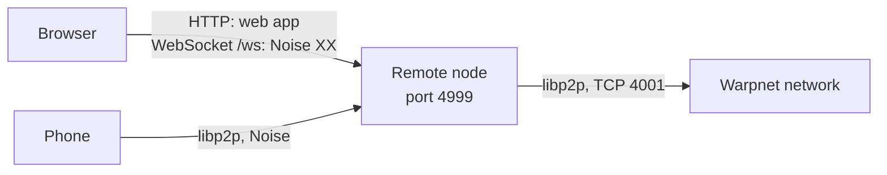

# Running a Node

The desktop app is a complete node, but it serves your account and your phones only while it runs. This page covers the other kinds of node you can run, where each one comes from, the full configuration reference and the data directory layout.

## Choose a setup

| Node | What it is | Where to get it |
|---|---|---|
| Desktop app | Your account in a window. Left running on a computer that stays on, it serves your paired phones too | [warpnet.site/download](https://warpnet.site/download) or `sudo snap install warpnet --beta` ([Getting started](index.md)) |
| [Remote node](#remote-node) | The same node without a window; you use it from a browser | Built from source (`Dockerfile.remote`) |
| [Relay node](#relay-node) | A headless node with no account that helps other nodes connect | `relay_linux_amd64.tar.gz` from the [latest GitHub release](https://github.com/Warp-net/warpnet/releases/latest), or a Docker image |
| [Moderator node](#moderator-node) | A headless node with no account that judges reported content with a local model | `moderator_linux_amd64.tar.gz` from the latest GitHub release, or `Dockerfile.moderator` |
| [Echo node](#echo-node) | A test bot with an in-memory account | Built from source |

The desktop app cannot run in Docker: it needs a desktop session for its window. `Dockerfile.member` in the repository only checks that the desktop build compiles.

## Remote node

The remote node is the desktop node without a window. It serves the same web app over HTTP and connects the browser to the node over a WebSocket at `/ws` ([`cmd/node/member/remote-member.go`](https://github.com/Warp-net/warpnet/blob/main/cmd/node/member/remote-member.go)). Your account, paired phones and settings work as in the desktop app. The network selector, the screen lock and update prompts exist only in the desktop app.



### How the browser connects

The browser channel needs no shared secret:

- Every `/ws` connection starts with a Noise XX handshake. The node's long-term key is stored in `ws-noise.key` in the network's data folder; the browser creates its own key on first use.
- The browser pins the node's key on first contact and refuses to connect if it changes. At start the node prints `NODE KEY FINGERPRINT: …` so you can compare.
- Sign-up, login and every other call travel inside the encrypted channel. A successful login authorizes that browser's key until the node stops or the browser signs out; any other browser gets `401` until it logs in.
- The WebSocket is accepted only when the page's origin matches the host it connects to, so other websites cannot open it. Behind a reverse proxy, keep the `Host` header the browser used.

> **Warning:** On a fresh node the first sign-up creates the account, and anyone who can reach the dashboard port can do it. Either create your account right after the first start, or bind the dashboard to localhost with `--node.server.host 127.0.0.1` and reach it through an SSH tunnel: `ssh -L 4999:127.0.0.1:4999 you@your-server`, then open `http://localhost:4999`.
{: .warning }

### Run it with Docker

The repository's [`docker-compose.yaml`](https://github.com/Warp-net/warpnet/blob/main/docker-compose.yaml) builds `Dockerfile.remote` and starts a testnet remote node with host networking. It has no volume, so add one, or the account is lost when the container is recreated:

```yaml
services:
  remote-node:
    build:
      context: .
      dockerfile: Dockerfile.remote
    network_mode: host
    restart: unless-stopped
    environment:
      - NODE_NETWORK=testnet        # or warpnet
      - NODE_PORT=4001
      - NODE_SERVER_PORT=4999
      - NODE_SERVER_HOST=127.0.0.1  # dashboard via SSH tunnel only
      - LOGGING_FORMAT=json
    volumes:
      - warpnet-data:/root/.warpdata
volumes:
  warpnet-data:
```

The image the project runs on testnet is published as `ghcr.io/warp-net/warpnet-demo:latest` (built from `Dockerfile.remote`). It is built by a manually started workflow, so `latest` is not tied to a release. Building from the release tag you want is the predictable option.

Without host networking, publish the libp2p port and the dashboard port: `-p 4001:4001 -p 4999:4999`.

### Run it without Docker

```bash
git clone https://github.com/Warp-net/warpnet && cd warpnet
go build -tags remote -mod=vendor -o warpnet-remote ./cmd/node/member/remote-member.go
./warpnet-remote --node.network testnet --node.server.host 127.0.0.1
```

This needs the Go version named in `go.mod`. The web app is embedded from the committed `frontend/dist`, so no Node.js toolchain is needed.

### Operating it

- **Log in after every restart.** The remote node starts its HTTP server at once, but joins the network only after you sign in from the browser, because your keys are derived from your login and password at sign-in. Until then paired phones cannot reach it.
- **Pair phones** from the dashboard's account menu: **Sign in by QR-code**. Every node start unpairs all devices and issues a new pairing token, so after a restart phones need a new scan (see [Mobile apps](mobile.md#manage-paired-devices)).
- **Updates.** The remote node does not update itself. Rebuild the image (or pull a new one) and restart.
- **Key changed error.** If the browser reports that the node's identity key changed, either `ws-noise.key` was lost (restore it from backup, or clear the site data in the browser and connect again) or something is impersonating your node.

## Relay node

A relay node is a headless node with no account. It keeps everything in memory and stores no user data. It:

- takes part in the DHT that nodes use to find each other;
- passes on discovery announcements, reports and moderation votes over gossip;
- forwards encrypted traffic (libp2p circuit relay v2) for nodes behind NAT. It cannot read what it forwards.

Its internals are described in [Relay node](../relay-node-architecture.md).

### Relay and bootstrap nodes

A bootstrap node is not a kind of node: it is any address in a node's bootstrap list. A node dials these peers first, seeds its DHT from them, and, when it is behind NAT, reserves relay slots only on them. A member node also hands its list to paired phones. A member node takes its list from **Settings → Network → Bootstrap peers**, else from `--node.bootstrap`, else from the built-in list; relay and moderator nodes take it from `--node.bootstrap` or the built-in list.

The built-in list for `warpnet` and `testnet` points to three relay nodes run by the project on `207.154.221.44`. That is why the project's bootstrap nodes are relays. A relay you start yourself joins the network through that list and takes part in the DHT and gossip at once, but it becomes a bootstrap node, and forwards traffic, only for the nodes whose bootstrap list contains its address.

### Get a relay

| Source | Notes |
|---|---|
| `relay_linux_amd64.tar.gz` from the [latest release](https://github.com/Warp-net/warpnet/releases/latest) | Static Linux x86-64 binary named `relay`. Check it against `relay_linux_amd64_checksums.txt` and its `.sig` (see [Verify the download](index.md#verify-the-download)) |
| `ghcr.io/warp-net/warpnet-relay:latest` | Built by CI from `Dockerfile.relay` (distroless) |
| `Dockerfile.relay` or `go build ./cmd/node/relay` | Build it yourself; the relay does not build for Windows |

### Run a relay

Open the libp2p TCP port (`--node.port`, default 4001) for IPv4 and, if you have it, IPv6.

```bash
./relay --node.network warpnet --node.port 4001 --node.seed "<long random secret>"
```

```bash
docker run -d --name warpnet-relay --network host --restart unless-stopped \
  -e NODE_NETWORK=warpnet -e NODE_PORT=4001 -e NODE_SEED="<long random secret>" \
  ghcr.io/warp-net/warpnet-relay:latest
```

At start the relay prints `RELAY NODE STARTED WITH ID <peer-id> AND ADDRESSES [...]`.

> **Warning:** A relay's identity key is generated from `--node.seed`. When you do not set it, the seed is built from the network name, `--database.dir`, `--node.host.v4` and `--node.port`, which anyone can guess, so anyone could derive your relay's key. Always set a long random seed and keep it: the same seed gives the same peer ID after a restart.
{: .warning }

### Use your relay as a bootstrap node

Give its address to member nodes as a full multiaddr, `/ip4/<public-ip>/tcp/<port>/p2p/<peer-id>`:

- in the app: **Settings → Network → Bootstrap peers** (host, port and peer ID; applies after a restart), or
- on the command line: `--node.bootstrap /ip4/…/p2p/…` (several are comma-separated).

Either way the list **replaces** the built-in bootstrap nodes instead of adding to them, so include every node you want. Paired phones receive the same list when they pair.

`--node.print-psk` makes a relay print the network key at start. On Linux x86-64 a relay checks the latest GitHub release every hour and replaces itself with a newer signed release without asking; set `--node.self-update=false` to manage updates yourself.

## Moderator node

A moderator node has no account. It receives reports, judges the reported post or profile with the Llama Guard 3 model on its own machine, votes together with other moderators and answers their spot checks. How the votes work is described in [Moderation](../moderation.md).

- **Binary:** `moderator_linux_amd64.tar.gz` from the latest release (Linux x86-64 only). It is built on Ubuntu 24.04 and linked dynamically against glibc, libstdc++ and libgomp. Or build the image from `Dockerfile.moderator`, which fetches the `core/moderation` submodule.
- **Model:** the file `Llama-Guard-3-1B-Q4_K_M.gguf` is not shipped with Warpnet. Put it in the directory the moderator runs from (`/warpnet` in the container; [`deploy/docker-compose-moderator.yml`](https://github.com/Warp-net/warpnet/blob/main/deploy/docker-compose-moderator.yml) shows the mount).
- **Identity:** the moderator creates a new random node key at every start; `--node.seed` does not apply.
- **Updates:** like a relay, on Linux x86-64 it installs newer signed releases without asking unless `--node.self-update=false`.

## Echo node

The echo node is a test bot: an account named `Echo` kept in memory and lost when the process exits. It follows back whoever follows it, answers chat messages and once a day posts a tweet, using a joke fetched from `api.chucknorris.io` (a fixed text when that fails). It is meant for populating a local or test network, not for real accounts. Build it with `go build -tags echo -mod=vendor ./cmd/node/member/echo-member.go`, run `make echo-main` (testnet, port 4002), or use `Dockerfile.echo`. See the [Developer guide](../developer-guide/index.md).

## Docker files

| File | Role | Base image | Notes |
|---|---|---|---|
| `Dockerfile.remote` | Remote node | `ubuntu:24.04` | Exposes 4999; data under `/root/.warpdata` |
| `Dockerfile.relay` | Relay | `distroless/static-debian12` | Static binary, no data |
| `Dockerfile.echo` | Echo bot | `distroless/static-debian12` | In-memory account |
| `Dockerfile.moderator` | Moderator | `ubuntu:24.04` | Needs the `core/moderation` submodule and the model file |
| `Dockerfile.member` | Desktop build check | `ubuntu:24.04` | Not for running |

The project's own testnet deployment is in [`deploy/docker-compose-testnet.yml`](https://github.com/Warp-net/warpnet/blob/main/deploy/docker-compose-testnet.yml) and is a useful example of relay settings.

## Ports

| Port | Protocol | Role | Purpose |
|---|---|---|---|
| `--node.port` (4001) | TCP, IPv4 and IPv6 | all | libp2p: other nodes, phones, relays |
| `--node.server.port` (4999) | TCP (HTTP, WebSocket) | remote node | Dashboard and `/ws` |

Every node tries to open its libp2p port on your router through UPnP or NAT-PMP. Desktop and remote nodes on the same local network also find each other through mDNS.

## Configuration reference

All settings are read in [`config/config.go`](https://github.com/Warp-net/warpnet/blob/main/config/config.go). Each can be given as a command-line flag or as an environment variable. A flag wins over an environment variable, which wins over the default. The variable name is the flag in upper case with `.` and `-` replaced by `_`: `--node.self-update` becomes `NODE_SELF_UPDATE`.

| Flag | Environment variable | Default | Used by | Meaning |
|---|---|---|---|---|
| `--node.network` | `NODE_NETWORK` | `warpnet` | all | Network name. `testnet` for the test network; `mainnet` is read as `warpnet`. Any other name makes a separate network with no built-in bootstrap nodes. |
| `--node.port` | `NODE_PORT` | `4001` | all | libp2p TCP port, IPv4 and IPv6 |
| `--node.host.v4` | `NODE_HOST_V4` | `0.0.0.0` | all | IPv4 bind address |
| `--node.host.v6` | `NODE_HOST_V6` | `::` | all | IPv6 bind address |
| `--node.bootstrap` | `NODE_BOOTSTRAP` | built-in list for `warpnet` and `testnet` | all | Comma-separated bootstrap multiaddrs. When set, replaces the built-in list. |
| `--node.seed` | `NODE_SEED` | built from network, `--database.dir`, `--node.host.v4` and `--node.port` | relay | Seed of the relay's identity key. Desktop and remote nodes derive their key from login and password; the moderator uses a random key. |
| `--node.print-psk` | `NODE_PRINT_PSK` | `false` | relay | Print the network key at start |
| `--node.self-update` | `NODE_SELF_UPDATE` | `true` | desktop, relay, moderator | Replace the binary with the newest signed GitHub release. The desktop app (Linux x86-64 and ARM64, Windows x86-64) asks first and is not updated under Snap; relay and moderator (Linux x86-64) install on their own. |
| `--node.server.host` | `NODE_SERVER_HOST` | `0.0.0.0` | remote | Dashboard bind address. `127.0.0.1` serves this host only. |
| `--node.server.port` | `NODE_SERVER_PORT` | `4999` | remote | Dashboard HTTP and WebSocket port |
| `--logging.level` | `LOGGING_LEVEL` | `info` | all but echo | `debug`, `info`, `warn` or `error`. An unknown value falls back to `info` (`error` on the moderator). |
| `--logging.format` | `LOGGING_FORMAT` | `text` | all | `text`; any other value gives JSON |
| `--database.dir` | `DATABASE_DIR` | `storage` | desktop, remote | Folder name under `<data>/<network>/` |
| `--wallet.binary-path` | `WALLET_BINARY_PATH` | empty | desktop, remote, echo | Payment engine binary for the wallet; empty uses the one built into the node |
| `--wallet.endpoint` | `WALLET_ENDPOINT` | `https://nile.trongrid.io` on `testnet`, `https://api.trongrid.io` on `warpnet` | desktop, remote, echo | TRON API endpoint used by the wallet |

Built-in bootstrap nodes are three relays run by the project on `207.154.221.44`: TCP ports 4001, 4002 and 4003 on `warpnet`, and 4011, 4022 and 4033 on `testnet`, each also on IPv6 `2a03:b0c0:3:f0:0:3:2477:f000`.

> **Note:** On desktop and remote nodes some settings can also be changed in the app, and the saved value is stored in your encrypted database. **Settings → Network** (IPv4 host, IPv6 host, port, bootstrap peers) and **Settings → Wallet backend** then take precedence over flags and environment variables for that account. Leave a field empty in the app to fall back to the flag, variable or default. Changes apply after the node restarts.
{: .note }

Examples:

```bash
LOGGING_LEVEL=debug warpnet --node.network testnet
warpnet --node.port 4100 --database.dir second    # a second account on one machine
```

Two desktop instances cannot run on one machine at the same time: the app holds a single-instance lock. A second account needs its own `--database.dir` and is used one at a time.

## Data directory

Desktop and remote nodes keep their data under one base folder, split by network and by `--database.dir`:

| System | Base folder |
|---|---|
| Linux, macOS | `~/.warpdata/` |
| Linux, Snap | `~/snap/warpnet/current/.warpdata/` (Snap points `$HOME` at the snap's own folder) |
| Windows | `%LOCALAPPDATA%\warpdata\` |
| Docker (remote image) | `/root/.warpdata/` inside the container |

```text
~/.warpdata/
├── warpnet/                  main network
│   ├── storage/              --database.dir (default "storage")
│   │   └── v0/               encrypted database files
│   │       └── run.lock      marks that an account exists
│   └── ws-noise.key          remote node only: browser channel key
├── testnet/
│   └── storage/
│       └── v0/
└── fontconfig.conf           Linux desktop app outside Snap, rewritten at every start
```

The database is BadgerDB, encrypted with a key derived from your login and password. Do not delete files while a node runs: a node that finds its `run.lock` gone stops on purpose. To copy or move the folder, see [Backup and restore](backup-and-restore.md).

## Logs and status

All roles log to standard output. Use `--logging.format json` for log collectors and `--logging.level debug` when reporting a bug.

The app shows the node's status. The node info panel on the Home screen shows the node ID, version, addresses, relay and network state, peers, traffic, database, memory and CPU statistics, and the node's rating. **Settings → Node rating** shows how the network rates your node (see [Node rating](../rating.md)).

## See also

- [Getting started](index.md)
- [Backup and restore](backup-and-restore.md)
- [Relay node](../relay-node-architecture.md)
- [Member node](../member-node-architecture.md)
- [Network and transport](../network.md)
